板子是 YuzukiNeko，平头哥 C907（rv32imafdcv），16 MB PSRAM，没有 SBI，内核直接跑在 M 态。

想做的事情是让 mGBA 把一个 16 MiB 的 GBA 游戏 ROM 当成"一块 16 MiB 的内存"来读，而这块板子一共才 16 MB 内存。

做法是在 Zephyr 里给 RISC-V 补上 Sv32 MMU 和请求调页（demand paging），拿 SD 卡上的文件当后备存储。mGBA 本身一行没改。

# MMU 是干什么的

熟悉 MMU 的可以直接跳过这一节，后面只会用到这里讲的东西。

## 虚拟地址和物理地址

CPU 执行 `lw a0, 0(a1)` 的时候，`a1` 里放的是虚拟地址。开了 MMU 之后，硬件在真正访问内存之前，先把虚拟地址翻译成物理地址，也就是内存条上真实的位置。翻译规则放在内存里的一张表里，叫页表，由操作系统来填。

多这一步的好处是翻译表可以不是一一对应的：

- 两个不同的虚拟地址可以指向同一块物理内存
- 一个虚拟地址可以暂时没有对应的物理内存，这一页还在 SD 卡上
- 虚拟地址空间可以比物理内存大得多

ROM 窗口用的就是后两条：虚拟地址空间里有连续 16 MiB，物理内存里只有其中一小部分。

## 页

内存不是一个字节一个字节翻译的，而是按页。Sv32 里一页是 4 KiB。一个 32 位虚拟地址分成两段，高 20 位是虚拟页号，低 12 位是页内偏移，翻译前后偏移不变。

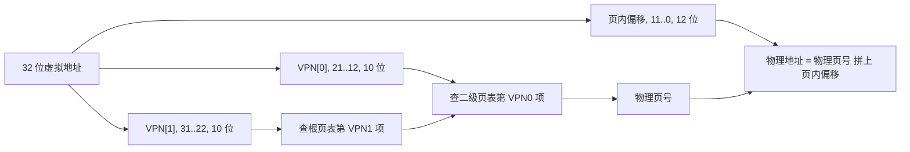

## Sv32：两级页表

Sv32 是 RISC-V 32 位的分页方案，用两级页表：

- 根页表：1024 项，每项 4 字节，刚好一页。用虚拟地址的 `VPN[1]`（31 到 22 位）做下标
- 二级页表：同样是 1024 项、4 KiB。根页表项如果指向一张二级页表，就用 `VPN[0]`（21 到 12 位）做下标

一张二级页表覆盖 1024 页，也就是 4 MiB 虚拟地址。根页表项也可以直接是叶子，这时它直接映射一整块 4 MiB 的"超页"，不再查第二级。后面外设和程序镜像都会用到超页。

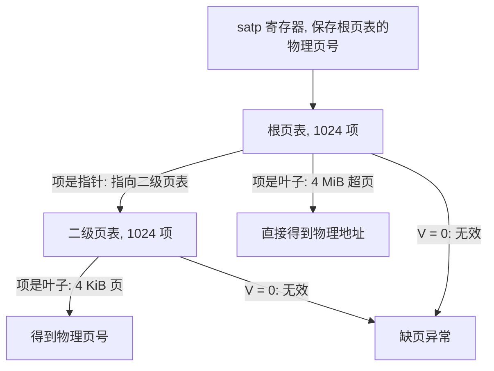

页表项（PTE）是 32 位的：

- 31..10 PPN，物理页号，物理地址 = PPN × 4096
- 9..8 RSW，留给软件用的两位，硬件不看。我用第 8 位标记"已换出"
- 7 D，脏位，这页被写过
- 6 A，访问位，这页被访问过
- 5 G，Global
- 4 U，用户态可访问
- 3 X，可执行
- 2 W，可写
- 1 R，可读
- 0 V，有效。V=0 的时候访问一定缺页

R、W、X 全为 0 表示这一项指向下一级页表，任意一位为 1 表示这一项是叶子。

`satp` 寄存器告诉硬件页表在哪、开不开：最高位 MODE=1 是 Sv32，低 22 位是根页表所在物理页的页号。板子上跑起来之后 `satp = 0x80040126`，MODE=1，根页表在 `0x40126000`。

## TLB

每次访问都去内存里查两次页表太慢了，硬件有一小块缓存叫 TLB，存最近翻译过的"虚拟页号 → 物理页号"。这对后面有两点影响：

- 改了页表之后要让 TLB 作废，用 `sfence.vma`。我的实现是每改一项就全部刷新，简单，不是最快的做法
- TLB 容量有限，这颗 CPU 大约 256 项。访问的页越分散越容易不命中。用 4 MiB 超页一项顶 1024 项，后面讲镜像映射的时候会量出差别

## 缺页异常

页表项 V=0（或者权限不够，或者 A/D 位没满足）的时候，访问不会进行，CPU 转去执行异常处理程序，并告诉它：

- `mcause`：原因，13 是读缺页，15 是写缺页
- `mtval`：出错的虚拟地址
- `mepc`：出错那条指令的地址。处理完用 `mret` 返回，CPU 会重新执行那条指令

请求调页就是靠这个成立的：缺页处理程序可以做任何事，比如从 SD 卡读 4 KiB，只要返回之前把页表项改成有效的，出错的指令重新执行就成功了，程序完全不知道发生过什么。

## 请求调页

把上面几件事组合起来：

1. 一块虚拟内存先登记好，但页表项全是无效的，表示还没读进来
2. 程序访问其中一页，缺页
3. 内核找一个空闲的页帧（一页物理内存），把数据读进去，把页表项改成指向它，返回重试
4. 没有空闲页帧的话，先淘汰一个正在用的页（置换）把页帧腾出来。被淘汰的页如果被改过（脏页），要先写回
5. 后备存储是页的老家，换入从这里读，脏页换出写到这里

Zephyr 内核本来就有请求调页的通用实现（`kernel/mmu.c`，置换算法在 `subsys/demand_paging/eviction/`）。它缺的是每种架构自己的那一半：怎么改页表项，怎么在缺页异常里调用通用代码。RISC-V 这一半 Zephyr 4.2 里没有，所以要自己写。

# 问题和限制

## 为什么要这个

mGBA 加载 ROM 的方式是：拿到一个 `VFile`，调用它的 `map()` 要一个指向整个 ROM 的指针，之后模拟器用这个指针随便读。GBA 的卡带 ROM 最大 32 MiB，常见的大游戏是 16 MiB。

但是内存就这么多：

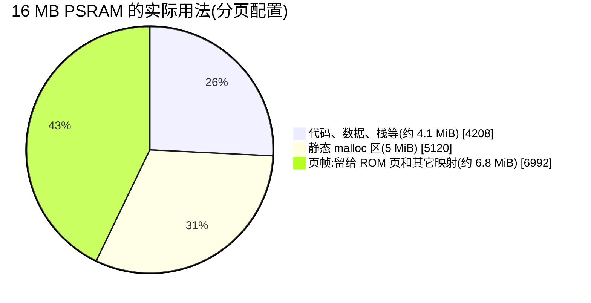

单位是 KiB，三项加起来 16320 KiB，等于 Zephyr 看到的 SRAM 大小。板子上 `0x40000000` 开始的前 64 KiB 不在 Zephyr 的 SRAM 里。

16 MiB 的 ROM 比页帧那一块还大。传统做法有三种：

1. 整个读进内存，放不下
2. 改模拟器，让它自己管缓存，每次读 ROM 先查缓存再读文件。要改 mGBA 里几百处访问 ROM 的地方，而且每次取指都会变慢
3. 让操作系统来做，也就是这篇的做法。ROM 变成一块虚拟内存，访问到不在内存里的页就触发缺页，内核在异常里把这一页从 SD 卡读进来，然后让指令重新执行。对 mGBA 来说什么都没发生过

## 板子的硬限制

这几条决定了后面所有的设计：

- 没有 SBI。xfel 把程序送进 RAM 然后 `exec`，CPU 这时候在 M 态，内核只能跑在 M 态，不能用常见的"S 态内核 + SBI"方案。下一节专门讲这个
- M 态下取指永远不经过页表翻译，所以代码不能换页，整个程序镜像要常驻内存
- CLINT、PLIC 只接受 M 态访问，经过页表翻译的访问会被它们拒绝，要给它们写专门的不翻译读写函数
- 驱动里大量把缓冲区指针直接当总线地址用（SD 卡、DMA、显示），所以凡是给硬件用的内存都必须虚拟地址等于物理地址（1:1）
- 单核。互斥可以简化，但缺页处理程序必须允许睡眠（等 SD 卡），这要改一处内核代码

## 目标

1. 内核和驱动零修改地继续工作，它们看到的地址不变
2. 只有用 `k_mem_map` 映射出来的页才是非 1:1 的
3. ROM 以只读文件映射的形式出现，页从文件读入，不会写回
4. 不依赖模拟器的任何改动

# 全景

先看一下整件事的形状，后面每一节讲其中一块。

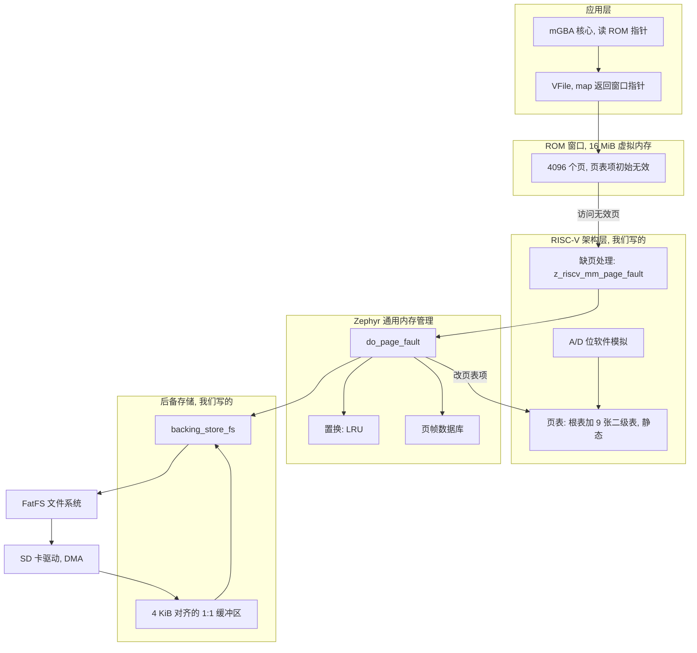

新增和改动的文件：

- 页表、`arch_mem_map` 等架构接口、缺页入口、A/D 位：`arch/riscv/core/mmu.c`、`include/zephyr/arch/riscv/mm.h`
- 缺页时的 CPU 状态切换：`arch/riscv/core/switch.S`、`thread.c`、`fatal.c`
- CLINT/PLIC 的不翻译读写：`mm.h` 里的 `z_riscv_mmode_read32/write32`，以及 `drivers/timer/riscv_machine_timer.c`、`drivers/interrupt_controller/intc_plic.c`
- 外设的 1:1 映射表：`soc/allwinner/sun252i_f101/mmu_regions.c`
- 允许缺页时睡眠的小改动：`kernel/mmu.c`、`kernel/Kconfig.vm`
- 文件后备存储：`subsys/demand_paging/backing_store/backing_store_fs.c`
- mGBA 的接入：`zephyr-components/mgba/src/gba_player.c`、`src/gba_memory.c`

通用调页逻辑和 LRU 置换（`kernel/mmu.c`、`subsys/demand_paging/eviction/lru.c`）是 Zephyr 原有的。

# 最难的一关：没有 SBI，M 态内核怎么用 MMU

## 问题

RISC-V 有三种特权级：M 机器态，最高权限，固件（SBI）跑在这里；S 监督态，操作系统内核跑在这里；U 用户态，应用程序。

Linux 等系统的标准布局是 SBI 在 M 态，内核在 S 态，应用在 U 态，MMU（`satp`、页表）是给 S 态和 U 态用的。

但这块板子没有 SBI，xfel 把代码送进 RAM 跳过去，CPU 就停在 M 态。而 RISC-V 规范里有一条很关键的规定：M 态的取指和普通访存不经过页表翻译。也就是说内核如果一直在 M 态，`satp` 开了也没用。

有两条路：

1. 自己降到 S 态。用 `mret` 把自己返回到 S 态，自己写 SBI 垫片（时钟、核间中断、外设访问），自己处理中断和异常委托。Zephyr 主线没有 S 态内核，所有 CSR 访问（`mstatus`、`mepc`、`mtvec`……）和异常入口都要改成 S 态版本，CLINT/PLIC 还只认 M 态，要在 M 态写垫片。工作量很大
2. 留在 M 态，借用"访存特权级"这个机制。下面讲的是这条路

## MPRV 和 MPP

`mstatus` 里有两个位域：

- MPP（11..12 位）：进入 M 态异常之前的特权级。`mret` 返回时 CPU 切换到 MPP 指定的特权级
- MPRV（17 位）：修改特权级。`MPRV = 1` 的时候，load 和 store（只有数据访问，不包括取指）会按 MPP 指定的特权级做地址翻译和权限检查，尽管 CPU 本身仍在 M 态

所以只要设 `MPRV = 1`、`MPP = U(0)`，M 态里每一次 load/store 都会被当成用户态访问去走页表。页表项里要把 U 位置 1，这就是为什么我们的叶子都是用户页。取指不受影响，一直是物理地址。

结论是数据可以非 1:1，用页表随便映射；代码必须 1:1，整个程序镜像常驻内存，不能换页。程序本身只有 4 MB 左右，这不是问题。ROM 窗口是数据，所以可以用这个办法。

## 陷入的时候发生了什么

这个设计里最容易糊涂的是什么时候翻译开着，什么时候关着。答案是翻译是否生效由 MPP 的值决定，而 MPP 会被硬件在陷入（异常、中断）和 `mret` 的时候自动改写。

规范规定：

- 陷入 M 态时，硬件把 MPP 设成陷入前的特权级，我们本来就在 M 态，所以 `MPP = M(3)`。此时 `MPRV = 1` 且 `MPP = M`，等价于用 M 的特权访存，不翻译
- `mret` 时，CPU 回到 MPP 指定的特权级（M），然后硬件把 MPP 设成支持的最低特权级（U）。因为返回的是 M 态，MPRV 不会被清掉，于是 `MPRV = 1, MPP = U`，翻译重新生效

也就是说线程代码在翻译开启下运行，中断和异常的入口代码、中断处理函数在翻译关闭下运行，全部由硬件自动切换，不用写一行代码。

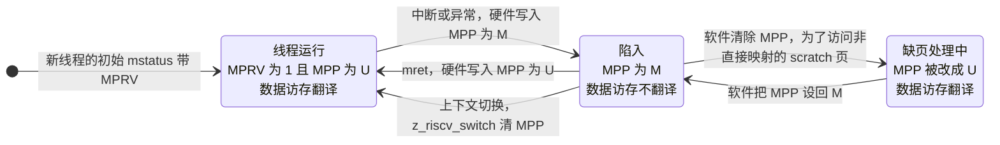

这有三个后果，后面几乎所有的坑都来自这里：

1. 中断处理函数运行时翻译是关的，所以它们碰到的所有地址必须是物理地址。凡是中断里会访问的东西（驱动的寄存器基地址、全局数据、栈）都必须 1:1。这就是为什么外设用 1:1 映射，也是为什么 `device_map()` 要直接返回物理地址，后面会讲
2. 缺页处理要自己把翻译打开。缺页处理程序是在陷入状态下跑的，翻译是关的，但它要通过一个非 1:1 的特殊页（scratch 页）往新页帧里写数据，所以要手动清 MPP，处理完再设回 M。设回去不是返回正确性必须的，Zephyr 的异常出口汇编会从栈上的异常帧恢复 `mstatus`（那里的 MPP 是陷入时硬件写的 M），然后才 `mret`。设回去是为了让没解决的缺页继续走致命错误路径时，仍处在和普通陷入一样的不翻译状态。另外有一条规矩：`mret` 是按 MPP 决定返回哪个特权级的，绝不能在 `MPP = U` 的时候执行 `mret`，否则 CPU 会降到用户态，内核立刻崩
3. 线程切换时也要保证翻译开着。假设线程 A 在线程态被打断，线程 B 在陷入态（翻译关着）里被调度走，现在要切回 A：A 本来是翻译开着的，但此刻 MPP 还是陷入留下的 M，A 会在翻译关闭下继续跑到下一次 `mret`。解决办法是在 `z_riscv_switch` 末尾清一次 MPP

## 对应的代码

打开翻译，在 `z_riscv_mm_init` 的末尾：

```c
csr_write(satp, SATP_SV32 | ((uintptr_t)root_table >> 12));
tlb_flush();

/* 从这里开始本代码的 load/store 都会被翻译 */
csr_clear(mstatus, MSTATUS_MPP);   /* MPP = U */
csr_set(mstatus, MSTATUS_MPRV);    /* MPRV = 1 */
```

新线程从第一条指令起就带翻译（`arch_new_thread`）。线程第一次运行走的是异常返回路径，初始 `mstatus` 里 `MPP = M`，`mret` 之后 MPP 变 U，MPRV 保持 1：

```c
#if defined(CONFIG_RISCV_MMU)
	stack_init->mstatus |= MSTATUS_MPRV;
#endif
```

线程切换后恢复翻译（`switch.S` 里 `z_riscv_switch` 的末尾，`ret` 之前）：

```asm
#if defined(CONFIG_RISCV_MMU)
	li t0, 0x1800 /* MSTATUS_MPP */
	csrc mstatus, t0
#endif
	ret
```

还有一个容易漏的点，就是放行所有访问的 PMP。PMP（物理内存保护）平时不检查 M 态的访问，但开了 MPRV 之后，load/store 的有效特权级是 U，PMP 就要检查，而且没有任何 PMP 项匹配的时候，U 态访问默认被拒绝，结果是 load/store 访问异常（`mcause` 5 或 7）。解决办法是设一条覆盖全部地址空间、可读写执行的 NAPOT 项：

```c
#define PMP_ALL_ADDR	0x3fffffffUL	/* NAPOT, 整个 34 位地址空间 */
#define PMP_ALL_CFG	0x1fUL		/* NAPOT, R, W, X */
csr_write(pmpaddr0, PMP_ALL_ADDR);
csr_write(pmpcfg0, PMP_ALL_CFG);
```

所以 Zephyr 自己的 PMP（`CONFIG_RISCV_PMP`）不能同时开，`RISCV_MMU` 的 Kconfig 里写了 `depends on !RISCV_PMP`。

## 为什么不降到 S 态

两种方案比起来：

- 留在 M 态：代码不能换页；要改页表、缺页入口和几处汇编；CLINT/PLIC 加不翻译的读写函数就行；已有驱动基本不用改；以后做用户态和多进程受限
- 降到 S 态加 SBI 垫片：代码能换页；要改所有 CSR 访问、异常入口、定时器、中断控制器、核间中断；CLINT/PLIC 要在 M 态写垫片；已有驱动也基本不用改；以后可以做用户态

对于"让一个 16 MiB 的数据文件当内存用"这个目标，M 态方案足够，改动小得多。如果以后要做用户态，或者要给代码也换页，S 态才是对的方向，但那是另一个项目了。

## 先在裸机上验证

写完整实现之前，我先写了一个裸机小程序验证这些假设，这是整个项目实际做过的第一步：

1. 在 M 态建一张只映射几块区域的页表，写 `satp`，置 `MPRV=1`、`MPP=U`
2. 访问一块非 1:1 映射的页，看数据对不对
3. 故意访问一个 V=0 的页，看 `mcause` 是不是 13/15，`mtval` 是不是出错地址，`mepc` 是不是指向出错指令
4. 去掉 PMP 放行项，看是不是出现 `mcause` 5/7
5. 清掉页表项的 A 位，看是不是触发缺页，也就是硬件不会自己把 A 位置 1

这些现象都出现了，才有后面的设计。

# 地址空间和页表怎么摆

## 物理内存

板子的 16 MB PSRAM 从 `0x40000000` 开始。Zephyr 看到的 SRAM 从 `0x40010000` 起，前 64 KiB 不在设备树的 SRAM 节点里，但物理上也是内存。

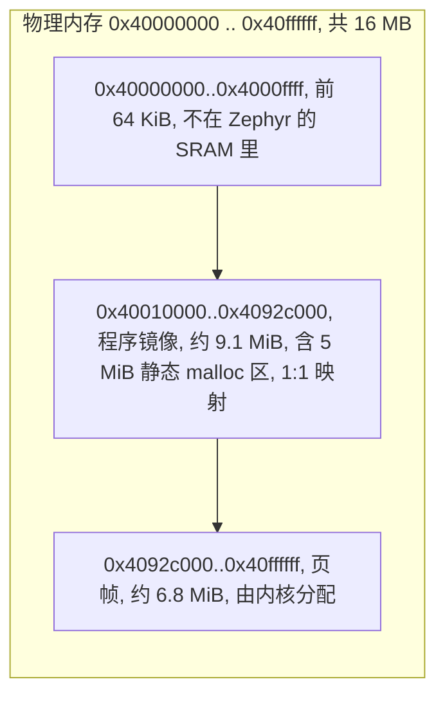

镜像里的静态 malloc 区很重要，驱动给 DMA 用的缓冲区都来自这里，它必须是 1:1 的。如果让 libc 的 malloc 去用所有剩余内存（`CONFIG_COMMON_LIBC_MALLOC_ARENA_SIZE=-1`），它会把页帧拿走，而那些页是 `k_mem_map` 出来的非 1:1 页，DMA 就会读写错地址。所以开 MMU 的时候一定要把 malloc 区设成有限的静态大小，我设的是 5 MiB。

## 虚拟地址空间

Zephyr 的 MMU 抽象里有一个内核虚拟地址空间（`CONFIG_KERNEL_VM_BASE` 起，大小 `CONFIG_KERNEL_VM_SIZE`）。我设成从 `0x40010000` 开始 32 MiB，也就是 `0x40010000 .. 0x4200ffff`。这个范围比物理内存大，物理内存到 `0x40ffffff` 就没了，这是故意的：`k_mem_map` 需要在虚拟空间里找一块连续地址，而物理页帧可以是任意的。

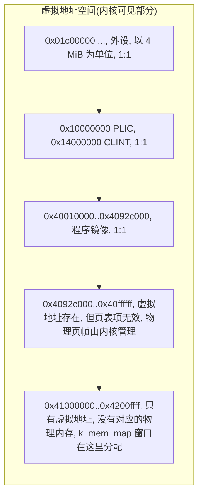

比如板子上 FireRed 的 ROM 窗口被映射到 `0x4100e000`，而物理内存根本没有这个地址，它是纯粹的虚拟地址，每一页由页表指向某个页帧，或者当前不在内存里。

## 页表本身：静态，预先分配

Zephyr 的 `arch_mem_map()` 有一个约束：它是 `void` 函数，不能失败，也不能分配内存。所以页表要事先把整个内核虚拟空间的二级页表全备好：

```c
#define VM_START	ROUND_DOWN(CONFIG_KERNEL_VM_BASE, RISCV_SV32_MEGAPAGE)
#define VM_END		ROUND_UP(CONFIG_KERNEL_VM_BASE + CONFIG_KERNEL_VM_SIZE, RISCV_SV32_MEGAPAGE)
#define L2_TABLES	((VM_END - VM_START) / RISCV_SV32_MEGAPAGE)

static uint32_t root_table[PTES] __aligned(4096);
static uint32_t l2_tables[L2_TABLES][PTES] __aligned(4096);
```

按我们的参数，`VM_START = 0x40000000`，`VM_END = 0x42400000`，`L2_TABLES = 9`，9 张二级表占 36 KiB，加根页表 4 KiB。它们是静态数组，放在镜像里，所以页表自己也是 1:1 的，硬件的页表遍历器和我们读写它们用的是同一个地址。

启动的时候（`z_riscv_mm_init`）把这 9 张表挂到根页表上：

```c
for (unsigned int i = 0; i < L2_TABLES; i++) {
    root_table[(VM_START >> ROOT_SHIFT) + i] = pte_ppn((uintptr_t)l2_tables[i]) | RISCV_PTE_V;
}
```

`ROOT_SHIFT = 22`，虚拟地址右移 22 位就是根页表下标。`0x40000000 >> 22 = 256`，所以用的是根页表的第 256 到 264 项。

查某个虚拟地址对应的二级页表项用 `leaf_pte()`：

```c
static uint32_t *leaf_pte(uintptr_t va)
{
	uint32_t root;

	if (va < VM_START || va >= VM_END) {
		return NULL;
	}
	root = root_table[va >> ROOT_SHIFT];
	if (!pte_is_table(root)) {
		return NULL;
	}

	return &((uint32_t *)pte_phys(root))[(va >> 12) & (PTES - 1U)];
}
```

`pte_is_table` 的意思是 V=1 且 R、W、X 全为 0，也就是这项指向下一级。

## 1:1 映射：外设、镜像和超页

外设寄存器按 4 MiB 一块映射成根页表里的超页叶子，虚拟地址等于物理地址。映射表由 SoC 提供（`soc/allwinner/sun252i_f101/mmu_regions.c`）：

```c
const struct riscv_mmu_region riscv_mmu_regions[] = {
	RISCV_MMU_REGION("ve",    0x01c00000, 0x00400000),  /* video engine */
	RISCV_MMU_REGION("apb0",  0x02000000, 0x00400000),  /* GPIO, PWM, CCU, ADC, audio, I2S */
	RISCV_MMU_REGION("uart",  0x02400000, 0x00400000),
	RISCV_MMU_REGION("sys",   0x03000000, 0x00400000),  /* system control, DMA, SID, MBUS */
	RISCV_MMU_REGION("ahb",   0x04000000, 0x00400000),  /* SD host, SPI, USB */
	RISCV_MMU_REGION("de",    0x05000000, 0x00400000),  /* display engine */
	RISCV_MMU_REGION("disp",  0x05400000, 0x00400000),  /* G2D, MIPI DSI, TCON */
	RISCV_MMU_REGION("wdt",   0x06000000, 0x00400000),
	RISCV_MMU_REGION("plic",  0x10000000, 0x00400000),
	RISCV_MMU_REGION("clint", 0x14000000, 0x00400000),
};
```

一个 4 MiB 超页就是根页表的一项：

```c
root_table[(r->base + off) >> ROOT_SHIFT] =
    pte_ppn(r->base + off) | RISCV_PTE_V | RISCV_PTE_R | RISCV_PTE_W |
    RISCV_PTE_U | RISCV_PTE_A | RISCV_PTE_D;
```

注意 A 和 D 位一开始就置 1。后面讲 A/D 位的时候会说，硬件不会自己置这两位，不预先置好，第一次访问就缺页。

程序镜像里的每一页也要 1:1。最直接的是全用 4 KiB 页映射（`make_leaf(va, K_MEM_PERM_RW)`），但这样有性能问题：镜像有 9 MB，里面是模拟器的堆、全局表等分散访问的数据，TLB 只有 256 项，覆盖不到 1 MiB，不命中很多。实测开 MMU 之后模拟器每帧慢了 4.5%。

解决办法是镜像里被完整占满的 4 MiB 块，用一个超页项代替 1024 个 4 KiB 项。镜像是 `0x40010000..0x4092c000`，所以 `0x40000000..0x40400000` 和 `0x40400000..0x40800000` 两块可以做成超页（第一块开头那 64 KiB 也是内存，可以一起映射），剩下 `0x40800000..0x4092c000`（1.2 MiB，300 页）仍然用 4 KiB 页：

```c
mega_start = ROUND_DOWN((uintptr_t)z_mapped_start, RISCV_SV32_MEGAPAGE);
mega_end = mega_start;
while (mega_end + RISCV_SV32_MEGAPAGE <= (uintptr_t)z_mapped_end) {
    root_table[mega_end >> ROOT_SHIFT] = pte_ppn(mega_end) | RISCV_PTE_V |
        RISCV_PTE_R | RISCV_PTE_W | RISCV_PTE_U | RISCV_PTE_A | RISCV_PTE_D;
    mega_end += RISCV_SV32_MEGAPAGE;
}
for (va = (uintptr_t)z_mapped_start; va < (uintptr_t)z_mapped_end; va += PAGE_SIZE) {
    if (va < mega_start || va >= mega_end) {
        *leaf_pte(va) = make_leaf(va, K_MEM_PERM_RW);
    }
}
```

最后那块没做成超页，是因为镜像后面紧跟着页帧区域，它们不能同时有 1:1 的别名映射，同一块物理内存两个虚拟地址访问，容易出缓存别名问题。

启动信息会打印这个划分：

```
mmu: 1:1 image     0x40010000-0x4092c000, 9328 KiB, 8 MiB in 4 MiB pages, the rest 4 KiB pages
mmu: 300 pages mapped, 0 paged out, 6992 KiB of page frames free
```

300 页就是 `(0x4092c000 - 0x40800000) / 4096 = 300`，可以拿来对账。

用超页之后塞尔达基准每帧耗时：没开 MMU 12.98 ms；开 MMU 用 4 KiB 页 13.56 ms，慢 4.5%；用超页 13.32 ms，慢 2.6%。模拟器画面的 CRC 三者完全一样，只是更快了。

要让超页被正确识别，`arch_page_phys_get()`（虚拟地址转物理地址）要先检查根页表项是不是叶子：

```c
uint32_t root = root_table[va >> ROOT_SHIFT], *pte;

/* 4 MiB 的项: 镜像的一块或者外设寄存器 */
if ((root & RISCV_PTE_V) != 0U && !pte_is_table(root)) {
    if (phys != NULL) {
        *phys = pte_phys(root) | (va & (RISCV_SV32_MEGAPAGE - 1U));
    }
    return 0;
}
```

## 启动顺序

页表在 `z_prep_c`（C 环境刚准备好、内核还没起来）里建好并打开：

```c
#if CONFIG_ARCH_CACHE
	arch_cache_init();
#endif
#if defined(CONFIG_RISCV_MMU)
	z_riscv_mm_init();
#endif
	z_cstart();
```

之后 Zephyr 通用代码的 `z_mem_manage_init()` 会初始化页帧数据库，登记哪些物理页是空闲页帧，哪些被镜像占了。

为了让通用代码知道镜像从哪里开始，链接脚本里加了几行（`include/zephyr/arch/riscv/common/linker.ld`）：

```ld
#ifdef CONFIG_MMU
    z_mapped_start = __rom_region_start;
#endif
...
#ifdef CONFIG_MMU
/* 镜像末尾按页对齐 */
#define LAST_RAM_ALIGN . = ALIGN(CONFIG_MMU_PAGE_SIZE);
#endif
```

后一段让镜像末尾按页对齐，这样镜像的最后一页不会和页帧共用。

这一步可以先单独验证：启动日志里应该有 `mmu:` 开头的几行；先把镜像和外设映射做好、不开请求调页，跑一个已有的完整例子（我用的是 mGBA 播放器），确认画面 CRC 和没开 MMU 时一样，这样就能确定开 MMU 本身不改变任何已有行为；再看启动信息里的页数能不能用上面的公式对上。

# 页表项的三种状态

请求调页的核心就是一个页表项在三种状态间切换。

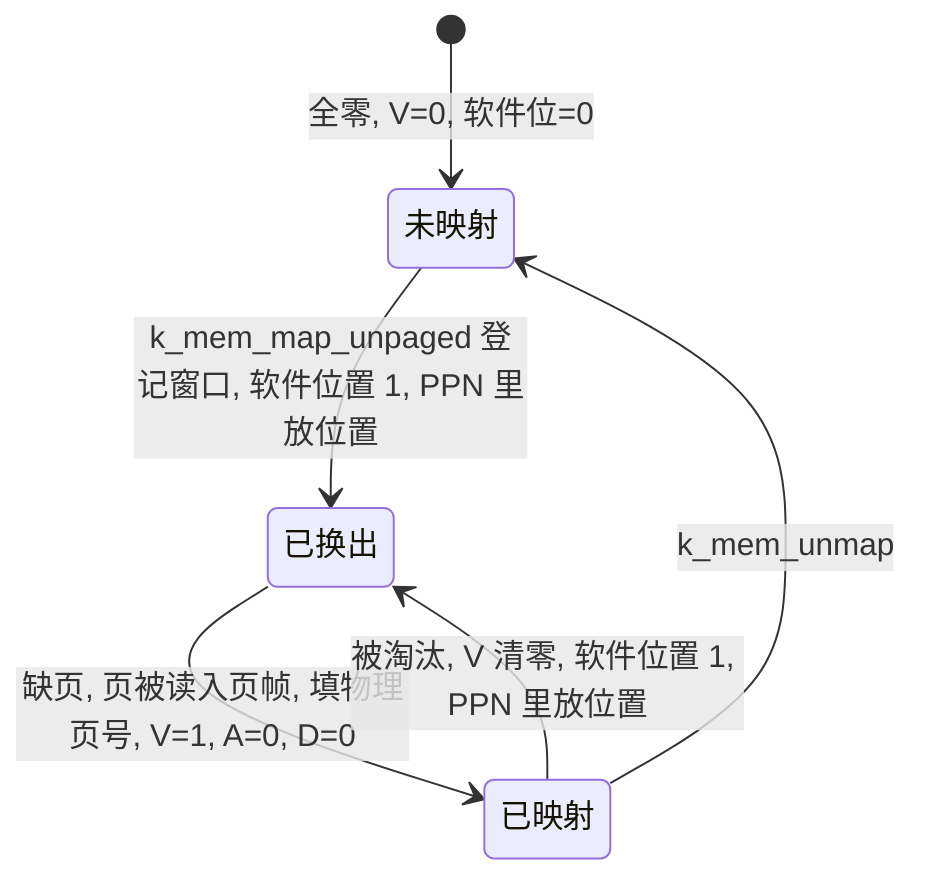

- 未映射：V=0，软件位=0，PPN 全零。访问会缺页，但不是调页引起的，算真错误
- 已换出（paged out）：V=0，软件位（bit 8）=1，PPN 字段里放的是这一页在后备存储里的位置，不是物理页号。访问缺页，走调页处理
- 已映射（paged in）：V=1，PPN 是真实的物理页号。正常访问，A/D 位没置好的时候会缺页，下一节讲

关键点是 V=0 的项，硬件根本不看其它位，所以软件可以随意利用。我把位置放在 PPN 字段里，配合软件位标记。对文件后备存储来说位置就是页在文件里的偏移（以 4 KiB 为单位），所以 FireRed 窗口的页表项里 PPN 依次是 0、1、2……4095。

```c
#define RISCV_PTE_PAGED_OUT	BIT(8)   /* 软件位, RSW 的低位 */
#define RISCV_PTE_PPN_SHIFT	10

static inline uint32_t pte_ppn(uintptr_t phys)  { return (uint32_t)(phys >> 12) << RISCV_PTE_PPN_SHIFT; }
static inline uintptr_t pte_phys(uint32_t pte)  { return (uintptr_t)(pte >> RISCV_PTE_PPN_SHIFT) << 12; }
```

## 换出和换入时 PTE 怎么改

换出（`arch_mem_page_out`）：页帧要被回收了，把位置记下来，清掉 V，保留权限位（R/W/X/U），这样下次换入不用重新算权限：

```c
*pte = pte_ppn(location) | RISCV_PTE_PAGED_OUT | (*pte & RISCV_PTE_PERM_MASK);
pte_sync(pte);
tlb_flush();
```

换入（`arch_mem_page_in`）：数据已经读进页帧，把物理页号填进去，V=1，A=0，D=0：

```c
/* 干净且没访问过: 第一次访问会缺页, 两个位就是这样被追踪的 */
*pte = pte_ppn(phys) | RISCV_PTE_V | (*pte & RISCV_PTE_PERM_MASK);
pte_sync(pte);
tlb_flush();
```

登记窗口（`arch_mem_map` 加 `K_MEM_MAP_UNPAGED` 标志）通过 `make_leaf` 直接做成已换出状态，这里的 `phys` 参数传的其实是位置（文件偏移），每页加 4096：

```c
if ((flags & K_MEM_MAP_UNPAGED) != 0U) {
    return pte_ppn(phys) | RISCV_PTE_PAGED_OUT | pte;
}
```

## pte_sync

RISC-V 硬件的页表遍历器直接读内存，而 CPU 写页表是经过数据缓存的，不把缓存写回的话，遍历器可能读到旧的页表项。所以每次改完页表项都要把它所在的缓存行写回：

```c
static inline void pte_sync(uint32_t *pte)
{
	sys_cache_data_flush_range(pte, sizeof(*pte));
	__asm__ volatile("fence" ::: "memory");
}
```

漏掉这一步的症状很诡异，页表看起来改对了，但偶尔访问到的还是旧映射。

## 页帧自己的状态

页表项描述的是虚拟页到物理页。Zephyr 通用代码还给每个物理页帧维护一份状态（页帧数据库）：

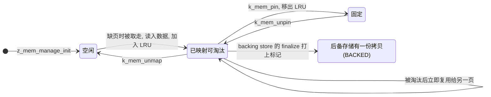

其中 BACKED 标志是文件后备存储的关键：它告诉内核这一页的内容在后备存储里有一份一模一样的，于是淘汰时当干净页，直接丢掉不写回。镜像占用的页帧被标记为保留/固定，不参与调页。

# A 位、D 位和 LRU

## 硬件 A=0 就缺页

RISC-V 规范允许两种实现：一种是硬件访问时自动把 A、D 位置 1，另一种是硬件什么都不做，发现 A=0（或者写的时候 D=0）就报缺页，让软件来置位。这颗 C907 是后一种，这是在裸机探针里验证过的。

这既是麻烦也是机会。麻烦是一个已映射的页，如果 A=0，第一次访问就会缺页，必须有人处理。机会是 A 位正好是置换算法需要的信息：内核想知道这一页最近用过没有，只要把 A 清零，然后看它会不会又缺页，缺页就说明被访问了，处理程序顺手记一下。

所以我不是为了兼容而模拟，而是利用缺页来追踪访问。

## 缺页处理函数

所有 load/store 缺页（`mcause` 13 和 15）先到 `z_riscv_fault`（`arch/riscv/core/fatal.c`），在 Zephyr 原有的 PMP 和用户态错误处理之后加了一段：

```c
#ifdef CONFIG_RISCV_MMU
	{
		unsigned long mcause = csr_read(mcause) & CONFIG_RISCV_MCAUSE_EXCEPTION_MASK;

		if ((mcause == RISCV_EXC_LOAD_PAGE_FAULT || mcause == RISCV_EXC_STORE_PAGE_FAULT) &&
		    z_riscv_mm_page_fault(esf, mcause, csr_read(mtval))) {
			return;
		}
	}
#endif /* CONFIG_RISCV_MMU */
```

返回 true 表示已经处理好，重新执行出错的指令；返回 false 才落到原来的致命错误处理。`z_riscv_mm_page_fault` 的完整逻辑（`arch/riscv/core/mmu.c`）：


对应的代码：

```c
bool z_riscv_mm_page_fault(struct arch_esf *esf, unsigned long mcause, unsigned long addr)
{
	uintptr_t va = ROUND_DOWN(addr, PAGE_SIZE);
	bool store = (mcause == RISCV_EXC_STORE_PAGE_FAULT);
	uint32_t *pte = leaf_pte(va);
	uint32_t entry;

	if (pte == NULL) {
		return false;
	}
	entry = *pte;

	if ((entry & RISCV_PTE_V) != 0U) {
		/* 页在内存里: 硬件要的是 A 位 (store 还有 D 位), 这正是要追踪的 */
		uint32_t want = RISCV_PTE_A | (store ? RISCV_PTE_D : 0U);

		if ((entry & RISCV_PTE_R) == 0U || (store && (entry & RISCV_PTE_W) == 0U) ||
		    (entry & want) == want) {
			return false;
		}
		*pte = entry | want;
		pte_sync(pte);
		tlb_flush();
#ifdef CONFIG_EVICTION_TRACKING
		k_mem_paging_eviction_accessed(pte_phys(entry));
#endif
		return true;
	}
	...
```

## 第一次访问会进两次异常

这里有个细节：`arch_mem_page_in` 把 PTE 设成 V=1、A=0、D=0，所以一个页被换入之后，出错的指令重新执行时会再缺页一次（这次是 V=1 但 A=0），处理程序把 A 置上，指令第三次执行才成功。首次访问一个页要进两次异常，第一次换入，第二次置 A。第二次不涉及 SD 卡，只是几十条指令的事，代价可以忽略。内核统计的 page faults 只数第一种。

不直接让换入的页 A=1，是因为 LRU 需要刚换入的页处于未访问状态，下一次访问时才变成最近使用，见下一节。

## LRU：用 A 位选出被淘汰的页

LRU 的数据结构在 `subsys/demand_paging/eviction/lru.c`，是一个按页帧编号索引的双向链表，用数组表示，省内存：

```c
/* 每个页帧记录队列里前一个和后一个页帧 */
struct lru_pf_idx {
	uint32_t next : PF_IDX_BITS;
	uint32_t prev : PF_IDX_BITS;
};
```

规则是这样的：

- 加入（`k_mem_paging_eviction_add`）：页被换入后，把它的页帧放到队尾
- 访问（`k_mem_paging_eviction_accessed`）：某页因为 A=0 缺页、我们把 A 置 1 的时候通知 LRU，把它的页帧挪到队尾
- 选择（`k_mem_paging_eviction_select`）：取队首的页帧（最久没用），并读它的 D 位判断脏不脏
- 取出时清 A：每当一个页帧从队列里被取走（淘汰，或者因为被访问挪到队尾），如果它原来是队首，新队首页的 A 位就被清零（`lru_pf_remove` 里的 `arch_page_info_get(..., clear_accessed=true)`）。新队首页如果其实在被使用，它马上会缺页（A=0），被挪到队尾，也就不会被淘汰


这样不常访问的页自然聚到队首，常用的页留在队尾。算法是 O(1) 的，稳态下页集合不变的时候没有任何额外缺页。

## 单独验证一下

我写了个小样例（`samples/subsys/demand_paging_anon`）：用 `k_mem_map` 映射 64 页匿名内存，而留给调页的页帧只有 24 个；往每一页写一个由页号决定的图案，再全部读回来校验。预期是 `0 wrong words`，并且统计里 `eviction.dirty` 不为零，因为这些页是脏的，换出时要写到后备存储，这时的后备存储是 RAM 里的一块区域。

这一步跑通就说明页表项三种状态、A/D 模拟、LRU、换入换出都对了，而且还没有涉及 SD 卡。出问题时范围小得多。

# 一次缺页从头到尾

前面的零件到这里串成一条线：程序读 ROM 窗口里的一个字节，而那一页不在内存里。

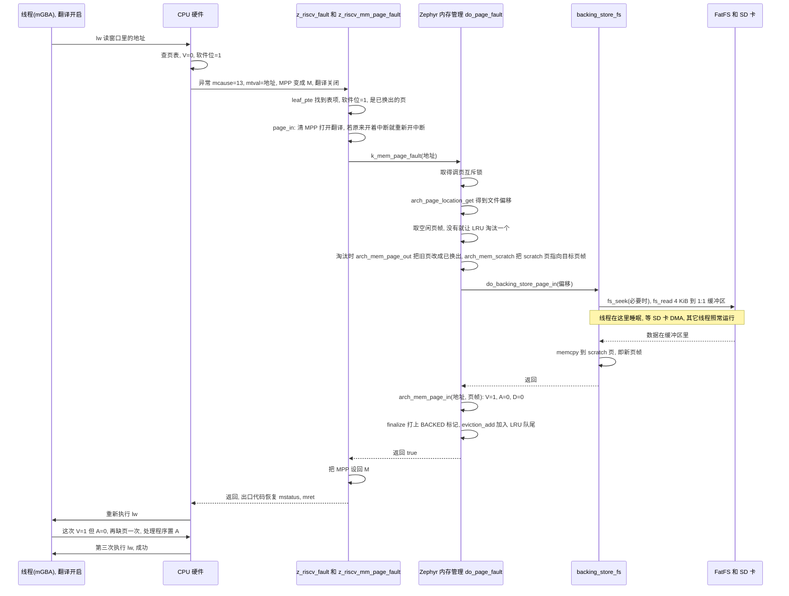

一步一步说：

1. 访问。线程用虚拟地址读窗口里的数据，翻译开启，硬件查页表发现 V=0，触发 load 缺页异常
2. 陷入。硬件做几件事：`mepc` 记下出错指令，`mcause=13`，`mtval` 是出错地址，`MPP←M`（翻译关闭），`MIE←0`（关中断，原来的状态保存在 `MPIE`）。然后跳到 Zephyr 的异常入口 `_isr_wrapper`（`arch/riscv/core/isr.S`），把全部寄存器保存到栈上，再调用 C 的 `z_riscv_fault(esf)`
3. 识别。`z_riscv_fault` 到 `z_riscv_mm_page_fault`，查页表项发现 V=0 且软件位=1，说明是已换出的页，调用 `page_in`

```c
static bool page_in(uintptr_t va, const struct arch_esf *esf)
{
	bool irq_on = (esf->mstatus & MSTATUS_MPIE_EN) != 0U;
	bool ok;

	/* 处理程序是不翻译地跑的, 后备存储要通过 scratch 页填页帧,
	 * 所以从这里开始让访存翻译 */
	csr_clear(mstatus, MSTATUS_MPP);

	/* 缺页发生时中断是开着的, k_mem_page_fault() 也要求开着 */
	if (irq_on) {
		arch_irq_unlock(MSTATUS_IEN);
	}
	ok = k_mem_page_fault((void *)va);
	(void)arch_irq_lock();

	/* 没解决缺页的话, 出口要回到不翻译的状态 */
	csr_set(mstatus, MSTATUS_MPP);

	return ok;
}
```

这里有两个要点：一是清 MPP 打开翻译，因为后面要用 scratch 页；二是只有异常发生时中断是开着的才重新开中断，这样出错时关着中断的代码（比如持有自旋锁的）不会被意外打断，Zephyr 通用代码也要求如此。

4. 通用调页。`k_mem_page_fault` 调用 `kernel/mmu.c` 里的 `do_page_fault`，这是整个调页的主流程：

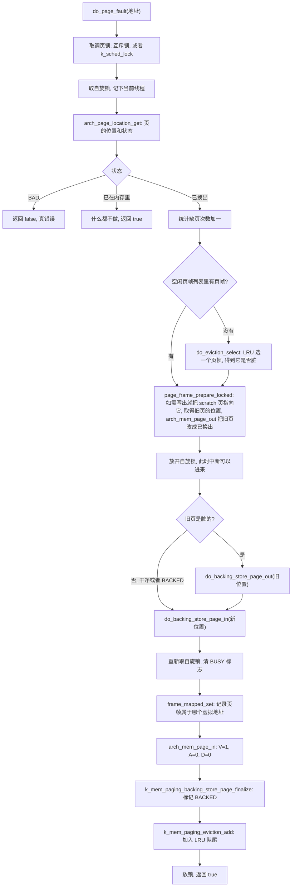

5. 后备存储读页，下一节讲。简单说就是 `fs_read` 把 4 KiB 读进一个 1:1 的对齐缓冲区，再 `memcpy` 到 scratch 页。scratch 页是内核在虚拟地址空间里预留的一页专用地址（`K_MEM_SCRATCH_PAGE`），需要往某个物理页帧里写数据的时候，先让架构层把它映射到那个页帧（`arch_mem_scratch(phys)`），然后通过这个固定的虚拟地址读写。这样后备存储的代码不用知道页帧对应哪个虚拟地址，反正它还没被映射呢
6. 返回。`page_in` 把 MPP 设回 M，函数一路返回，出口代码按栈上保存的 `mstatus`（此时 MPP=M）恢复，然后 `mret`，CPU 回到出错指令重新执行

## 缺页处理为什么可以睡眠

这个问题值得单独讲。缺页处理要读 SD 卡，SD 卡驱动用的是 DMA 加中断：发起读之后线程睡眠，等 DMA 完成的中断来唤醒。而 Zephyr 通用代码在单核上是用 `k_sched_lock()`（锁住调度器）来保证调页操作不被其它线程打断的。调度器被锁住的时候线程不能睡眠，否则没有任何线程能运行，中断之后的唤醒也没人处理，直接死锁。

多核（SMP）下 Zephyr 用互斥锁（`z_mm_paging_lock`），没有这个问题。所以我加了一个配置项 `CONFIG_DEMAND_PAGING_BACKING_STORE_SLEEPS`（`kernel/Kconfig.vm`），让单核也用互斥锁：

```c
/*
 * SMP 上调页操作用互斥锁串行化, 因为那里不能锁调度器;
 * UP 上只要后备存储可能睡眠也用互斥锁, 否则调页期间锁住调度器.
 */
#if defined(CONFIG_SMP) || defined(CONFIG_DEMAND_PAGING_BACKING_STORE_SLEEPS)
#define Z_MM_PAGING_LOCK_IS_MUTEX 1
#endif
```

把 `kernel/mmu.c` 里 `#ifdef CONFIG_SMP` 的几处（`do_page_fault`、`do_mem_evict`、`k_mem_page_frame_evict`）改成 `#ifdef Z_MM_PAGING_LOCK_IS_MUTEX`。

代价是睡眠期间别的线程会运行，如果它们碰巧也访问了同一个还没读进来的页，也会缺页，然后在这把互斥锁上排队。这个选项适合只有一个线程使用分页内存的系统，比如 mGBA 的模拟线程。播放器的视频线程、音频线程在这期间照常运行，所以缺页读 SD 卡时画面和声音不会被卡住。

还有一条硬规矩，不要在持有文件系统锁的时候访问窗口内存。缺页要调 FatFS 读文件，FatFS 有自己的互斥锁，访问窗口的代码如果此刻正持有它，就会死锁。mGBA 只读窗口，没有这个问题，但在自己的应用里要注意。

## 中断和缺页

开了 `CONFIG_DEMAND_PAGING_ALLOW_IRQ`（我开了）的时候，通用代码有一条规则：中断处理函数里禁止缺页（`__ASSERT(!k_is_in_isr(), "ISR page faults are forbidden")`）。我们的架构层正好满足它：中断处理函数运行时翻译是关闭的，看到的全是物理地址，访问的东西都是 1:1 的，不会缺页。这也是下面"什么必须是 1:1"一节的由来。

## 单独验证

写了一个检查校验和的样例（`samples/subsys/demand_paging_fs`）：挂载 SD 卡，用 `k_mem_paging_map_file` 把一个 16 MiB 文件映射成窗口；用 CRC32 通过窗口指针把整个文件读一遍，再用 `fs_read` 普通读一遍，两个 CRC 必须相等；然后随机读 512 个页看延迟。两个 CRC 都是 `84ee4776`，输出 `PASS`。数字在后面的实测数据里。

# 拿 SD 卡上的文件当后备存储

通用调页代码要求后备存储实现一组函数（声明在 `include/zephyr/kernel/mm/demand_paging.h`）。Zephyr 自带的实现只有 RAM 和半主机（semihost）两种，我加了第三种：以文件系统里的一个文件作为后备存储（`subsys/demand_paging/backing_store/backing_store_fs.c`）。

设计上有三点：

- 位置就是文件内偏移。窗口第 N 页对应文件的第 N×4096 字节，不需要任何额外的映射表
- 只读，干净页直接丢弃。文件里的页在内存里永远不会比文件新（ROM 不会变），所以内核淘汰一页的时候，只要这个页帧带着 BACKED 标志，就按干净页处理，不写回，直接把页帧给别人用
- 一次一个文件，一个缓冲区。调页操作被内核串行化，一个静态缓冲区就够了

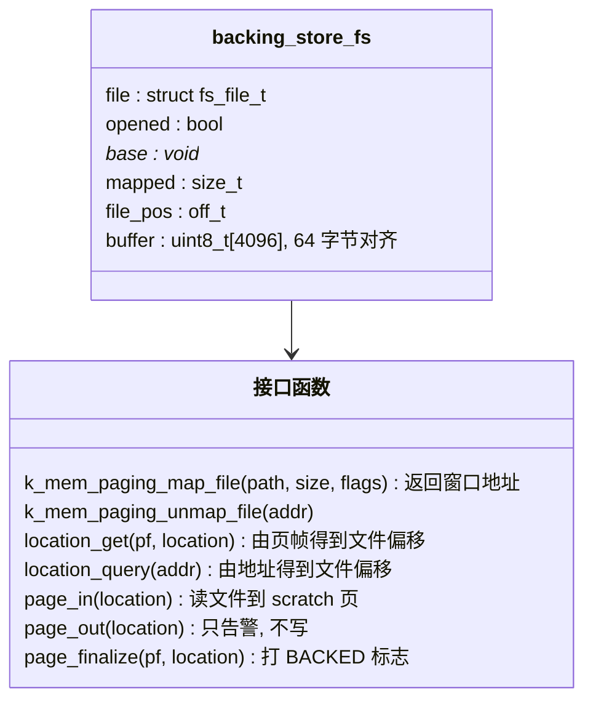

```c
static struct fs_file_t file;
static bool opened;
static void *base;               /* 窗口的起始虚拟地址 */
static size_t mapped;            /* 窗口大小, 向上取整到页 */
/* 下一次读文件从哪里开始, 顺序读的时候可以省掉 seek */
static off_t file_pos = -1;
static uint8_t buffer[PAGE] __aligned(64);
```

## 把文件映射成窗口

```c
void *k_mem_paging_map_file(const char *path, size_t *size, uint32_t flags)
{
	...
	if (fs_open(&file, path, FS_O_READ) != 0) { return NULL; }
	mapped = ROUND_UP(st.size, PAGE);
	opened = true;
	file_pos = 0;

	/* 第一页的位置是 0, 每页加一页的大小; 内容来自文件, 所以页不能被清零 */
	addr = k_mem_map_unpaged(0, mapped, K_MEM_MAP_UNINIT | flags);
	...
	base = addr;
	*size = st.size;
	return addr;
}
```

`k_mem_map_unpaged(location, size, flags)` 是 Zephyr 通用代码里已有的，它在虚拟空间里找一块 `size` 大小的连续地址，前后各留一个不映射的保护页（越界访问立刻缺页），然后对窗口每一页调用 `arch_mem_map`，flags 里带 `K_MEM_MAP_UNPAGED`，于是前面讲的 `make_leaf` 把每个页表项做成已换出，PPN 字段是 `location + 页序号×4096`。

`K_MEM_MAP_UNINIT` 这个标志非常关键。通用的 `k_mem_map_phys_guard` 默认会在映射完成后把整块内存 `memset` 成 0，因为匿名内存应该清零。对我们的窗口，这会把 16 MiB 全部写一遍：逐页触发缺页，而且读进来的内容马上被清成零，文件内容全毁。这是我实际踩的坑，第一次在板子上运行的时候就崩在 `memset(0x4100e000, 0, 16 MiB)` 上（窗口地址 `0x4100e000`，大小 `0x01000000`，`mcause=15`），加上 `K_MEM_MAP_UNINIT` 之后就好了。

## 位置的两个查询

内核淘汰一个页帧的时候，需要知道这页要写回后备存储的哪里（`location_get`）；缺页的时候页表项里已经记着位置。对文件后备存储来说，二者都是地址减去窗口基址：

```c
int k_mem_paging_backing_store_location_query(void *addr, uintptr_t *location)
{
	if (!opened || (uintptr_t)addr < (uintptr_t)base ||
	    (uintptr_t)addr >= (uintptr_t)base + mapped) {
		return -EFAULT;
	}
	*location = (uintptr_t)addr - (uintptr_t)base;
	return 0;
}

int k_mem_paging_backing_store_location_get(struct k_mem_page_frame *pf, uintptr_t *location,
					    bool page_fault)
{
	if (k_mem_page_frame_is_backed(pf)) {
		return k_mem_paging_backing_store_location_query(k_mem_page_frame_to_virt(pf), location);
	}
	/* 只读的后备存储: 其它页没地方换出 */
	return -ENOMEM;
}
```

第二个函数的意思是只有 BACKED 的页帧才有后备存储里的位置。不是 BACKED 的页帧（比如别处 `k_mem_map` 出来的匿名页，它们在文件里没位置）没地方可以换出去，返回 `-ENOMEM`，内核淘汰到这样的页帧会报 "out of backing store memory"（调试版本里断言失败）。所以用文件后备存储的时候，其它 `k_mem_map` 出来的匿名内存要加 `K_MEM_MAP_LOCK` 固定住，不让它们进入置换。

## 换入：读文件

```c
void k_mem_paging_backing_store_page_in(uintptr_t location)
{
	ssize_t n;

	if ((off_t)location != file_pos) {
		if (fs_seek(&file, (off_t)location, FS_SEEK_SET) != 0) { ... k_panic(); }
	}
	n = fs_read(&file, buffer, PAGE);
	if (n < 0) { ... k_panic(); }
	file_pos = (off_t)location + n;
	/* 文件的最后一页 */
	if ((size_t)n < PAGE) {
		memset(buffer + n, 0, PAGE - n);
	}
	memcpy(K_MEM_SCRATCH_PAGE, buffer, PAGE);
}
```

有三个设计点：

1. 为什么先读进 `buffer` 再 `memcpy` 到 scratch 页，不直接读到 scratch 页？因为 SD 卡驱动用 DMA，DMA 需要的是 1:1 的、64 字节对齐的缓冲区（它把指针直接当总线地址用，也要避开缓存行共享的问题）。scratch 页是非 1:1 的，虚拟地址和目标页帧的物理地址完全不同，直接给 DMA 会写到错的物理位置。所以必须经过镜像里的静态缓冲区。多一次 4 KiB 拷贝，相比 SD 卡约 0.7 到 1 ms 的读取可以忽略
2. `file_pos` 优化。顺序读窗口的时候，下一页的位置正好是上一次读完的位置，就不需要 `fs_seek`。FatFS 的 `fs_seek` 要沿着簇链往前走，文件越靠后越慢，顺序读省掉它收益明显
3. 最后一页不满。文件大小不是 4096 整倍数时最后一页读到的字节少，剩下的补零

## 换出：不会发生

```c
void k_mem_paging_backing_store_page_out(uintptr_t location)
{
	/* 文件是不写的: 通过可写映射改过、又没固定的页, 修改会丢掉 */
	LOG_WRN("modified page at %#lx dropped", location);
}
```

文件是只读的，所以换出只是告警。什么时候会被调用？内核选出一个脏页帧（D 位为 1）的时候。只读映射（不带 `K_MEM_PERM_RW`）的页永远不会被写，D 位永远是 0，不会进到这里。如果映射成可写（mGBA 要求可写，下一节会说），被写过的页被淘汰时修改会丢失，所以 mGBA 把可能被写的第一页用 `k_mem_pin` 固定住了。

## 标记 BACKED

```c
void k_mem_paging_backing_store_page_finalize(struct k_mem_page_frame *pf, uintptr_t location)
{
	k_mem_page_frame_set(pf, K_MEM_PAGE_FRAME_BACKED);
}
```

每次换入完成后调用，打上 BACKED。从此这个页帧对内核来说就是后备存储里有一份一模一样的拷贝，淘汰它不用写，直接复用。"干净页直接丢弃"就是这么实现的。

## 预读还没做

现在每次缺页只读 4 KiB。实测 SD 卡随机读 4 KiB 约 1.0 ms，16 KiB 约 1.44 ms，64 KiB 约 3.8 ms，一次读 16 KiB 只比读 4 KiB 多 40%，而顺序访问时能一次换进 4 页。所以缺页时顺带把后面几页也读进来，是明显的优化方向，后面再说。

## 验证

`demand_paging_fs` 样例里 CRC 一致。页帧数也可以对账：样例里空闲页帧 15552 KiB = 3888 页，窗口 4096 页，顺序读一遍之后应该是 4096 次缺页、208 次干净淘汰（4096 − 3888 = 208）。板子上读出来的正好是 `4096 page faults, 208 clean pages dropped`。

# 什么必须是 1:1

这一节是整个项目里最容易踩坑的地方。前面说过线程在翻译开启下运行，中断和异常的处理在翻译关闭下运行，把这个事实翻译成实现规则就是：

- 线程代码用虚拟地址，随意
- 中断处理函数用物理地址，它碰到的所有内存、寄存器地址必须 1:1
- 陷入入口和出口汇编（保存、恢复寄存器）用物理地址，栈和异常帧必须 1:1，镜像里的栈天然满足
- DMA 引擎、SD 卡控制器用物理地址（总线地址），给它们的缓冲区必须 1:1
- 缓存维护指令（`th.dcache.*`）用物理地址，作用的内存必须 1:1
- 窗口内存（非 1:1 的页）是虚拟地址，绝不能交给驱动、DMA、缓存维护，也不能在中断里访问

1:1 的东西有程序镜像（含静态 malloc 区和栈）、外设寄存器（4 MiB 块）。非 1:1 的只有 `k_mem_map` 出来的页，也就是 ROM 窗口、scratch 页等。

## CLINT 和 PLIC 只认 M 态

CLINT（核心本地中断控制器，里面有 `mtime`/`mtimecmp` 计时器）和 PLIC（平台级中断控制器）在这颗 SoC 里只接受 M 态的总线访问。经过页表翻译的访问，总线上带的是用户态身份，它们拒绝，读出来永远是全 1。

这是实际遇到的：翻译开启后系统时间不走，读 `mtime` 得到 `0xffffffff`。

解决办法是给这两个设备写专门的不翻译读写函数，在这一条 load/store 期间临时把 MPRV 清零，然后恢复（`include/zephyr/arch/riscv/mm.h`）：

```c
static inline uint32_t z_riscv_mmode_read32(mem_addr_t addr)
{
	unsigned long mprv = 0x00020000UL; /* MSTATUS_MPRV */
	unsigned long saved;
	uint32_t val;

	__asm__ volatile("csrrc %[s], mstatus, %[m]\n"   /* 读出 mstatus 并清 MPRV */
			 "lw %[v], 0(%[a])\n"            /* 这一次读, 不翻译 */
			 "and %[s], %[s], %[m]\n"        /* 只留下原来 MPRV 的值 */
			 "csrs mstatus, %[s]"            /* 把 MPRV 恢复 */
			 : [s] "=&r"(saved), [v] "=&r"(val)
			 : [m] "r"(mprv), [a] "r"(addr)
			 : "memory");

	return val;
}
```

几点说明：`csrrc` 一条指令同时读旧值并清位，是原子的；如果这几条指令之间来了中断，中断入口保存的 `mstatus` 里 MPRV 是 0，处理完 `mret` 回来 MPRV 仍是 0，序列继续执行，最后一条 `csrs` 把 MPRV 恢复，不会丢状态；不开 MMU 的时候，同名宏直接退化成 `sys_read32`/`sys_write32`，没有任何开销。

用法是把 `drivers/timer/riscv_machine_timer.c` 里读写 `mtime`、`mtimecmp` 全部换成这两个函数（包括防止 64 位寄存器读到一半翻转的"高字、低字、再读高字"循环），`drivers/interrupt_controller/intc_plic.c` 里读写 PLIC 寄存器同理。

## device_map 的坑：一次中断风暴的排查

Zephyr 里驱动初始化时调用 `device_map()` 把设备寄存器映射到虚拟地址，之后驱动用这个地址访问寄存器。开了 MMU 之后，`device_map()` 默认会在内核虚拟空间里分配一个新的虚拟地址（用 `k_mem_map_phys_bare`），这个地址和寄存器的物理地址不同。线程里访问没问题，翻译开着会翻译回去；但中断处理函数里翻译关着，同一个虚拟地址被当成物理地址用，访问到完全错误的地方。

这个问题在我这里表现成一次非常迷惑的挂死：

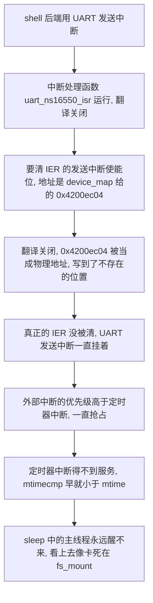

排查是靠 JTAG 完成的：

1. 接上 CKLink 调试器。它的 JTAG 和 SD 卡槽共用 PF0/1/3/5 引脚，要专门构建一个把 SD 关掉、引脚切到 JTAG 的固件
2. 连上之后停下来看 CPU 在哪，每次停下都在 `uart_tx_handle` / `plic_irq_handler` 这类中断函数里
3. 看 `mip`（中断挂起寄存器）是 `0x880`，第 7 位（定时器）和第 11 位（外部）同时挂着；读 `mtime` 是 `0x883296cd`，`mtimecmp` 是 `0x0af53fc0`，定时器早就该响了
4. 看主线程 `z_main_thread`，状态是 `SLEEPING`，没挂在任何等待队列上，它在等定时器
5. 看 UART 的 `IER`（`0x02500c04`）停在 3，发送中断开着；在 `uart_ns16550_irq_tx_disable` 之后再看还是 3，写没生效；再看汇编里驱动用的寄存器地址，是 `0x4200ec04`，不是 `0x02500c04`

修复是新增一个只在 RISC-V MMU 配置下为真的隐藏选项，让 `device_map()` 直接返回物理地址，外设已经 1:1 映射了：

```c
config RISCV_MMU_MMIO_IDENTITY
	bool
	default y if RISCV_MMU
```

```c
static inline void device_map(mm_reg_t *virt_addr, uintptr_t phys_addr,
			      size_t size, uint32_t flags)
{
#if defined(CONFIG_RISCV_MMU_MMIO_IDENTITY)
	/* 寄存器是 1:1 映射的, 中断里也是不翻译地用 */
	ARG_UNUSED(size);
	ARG_UNUSED(flags);
	*virt_addr = phys_addr;
#elif defined(CONFIG_MMU)
	...
```

这一个改动修好了所有驱动在中断里读写寄存器的情况。教训是任何线程里能用、中断里不能用的东西，在这套设计里都要先怀疑是不是地址的问题。

## DMA 和缓存

- 静态 malloc 区：驱动给 DMA 用的缓冲区（显示、音频、SD）全来自 libc 的 malloc 区，它在镜像里，是 1:1 的。`CONFIG_COMMON_LIBC_MALLOC_ARENA_SIZE` 必须设成有限的值，我设 5 MiB。默认的 -1 表示拿走所有空闲内存，那样它会占用页帧，而那些页是非 1:1 的，DMA 立刻出错
- bounce buffer：后备存储读 SD 卡的时候，用镜像里 64 字节对齐的静态缓冲区做 DMA 目标，再拷贝到 scratch 页，前面讲过
- 缓存维护：`th.dcache.*`（平头哥的缓存维护扩展）接受的是物理地址。现在的实现没有在缓存维护里做虚拟到物理的转换，所以规则是不要对窗口内存做缓存维护。真需要的话，在 SoC 的缓存函数里加一步 `arch_page_phys_get`
- 页表本身：页表遍历器读内存、不读缓存，所以每次改页表项都要写回缓存行（`pte_sync`），启动时建完整套页表之后用 `sys_cache_data_flush_all()` 写回一次

## 验证

打开 MMU 之后依次验证：系统计时（`k_uptime_get` 在走）、串口 shell（中断驱动的 UART）、SD 卡读写、显示和音频。哪个出问题，先怀疑是不是某个地方的地址在中断里是非 1:1 的。

# 接到 mGBA 上

到这里内核和架构层都有了：一个 API `k_mem_paging_map_file(path, &size, flags)` 把文件变成一个窗口指针。接下来把它接到 mGBA 上。

## mGBA 怎么拿到 ROM

`GBALoadROM(gba, vf)` 收到一个 `VFile`，对它做这几件事：

1. `vf->size(vf)` 得到 ROM 大小
2. 读 `0xAC` 处的字节判断类型
3. `vf->map(vf, size, MAP_READ)` 拿到一个指向整个 ROM 的指针，保存到 `gba->memory.rom`
4. 对整个 ROM 算一遍 CRC32（`doCrc32`，用来识别游戏）
5. 之后的取指、读数据全部通过这个指针

mGBA 自带一种基于内存的 `VFile`：`VFileFromConstMemory(mem, size)`，它的 `map()` 就是返回那个 `mem` 指针。把窗口指针传给它就完事了，模拟器分不出这是真内存还是窗口。

## gba_open

在 `zephyr-components/mgba/src/gba_player.c` 里：

```c
#ifdef CONFIG_MGBA_ROM_DEMAND_PAGED
	g.rom = k_mem_paging_map_file(rom_path, &rom_len, K_MEM_PERM_RW);
	if (g.rom != NULL) {
		g.rom_mapped = true;
		/* 带时钟或传感器的卡带, 端口在 ROM 的第一页里, 写进去的东西要留住 */
		k_mem_pin(g.rom, CONFIG_MMU_PAGE_SIZE);
		ret = 0;
	} else
#endif
	{
		ret = read_file(rom_path, &g.rom, &rom_len);     /* 回退: 整个读进内存 */
	}
	...
	if (!g.core->loadROM(g.core, VFileFromConstMemory(g.rom, rom_len))) {
```

有两处要说明：

- 为什么映射成可写（`K_MEM_PERM_RW`）？带实时时钟、太阳能传感器的游戏卡带（比如宝可梦红宝石、绿宝石）把 GPIO 端口放在 ROM 地址空间的 `0xC4` 处，模拟器会往 ROM 缓冲区里的这个位置写。窗口只读的话，写就会真的缺页出错，所以映射成可写
- 为什么 `k_mem_pin` 第一页？可写的页被写过就是脏页，而文件后备存储不会写回，被淘汰时修改会丢失。GPIO 端口在第一页（偏移 `0xC4`），把这一页固定在内存里，永远不会被淘汰，写入就一直在

## 写 ROM 区的另一个坑：写时复制

FireRed 运行后不久，在板子上直接崩了：`_pristineCow` 里 `memcpy` 的目的地址是 0。原因是游戏会往 AGB 调试打印端口（也在 ROM 地址空间的高处）写一串魔术数据，mGBA 为了模拟这是个可写的烧录卡，会调用 `_pristineCow`：为整个 32 MiB 的卡带地址空间分配一个匿名的私有拷贝，把 ROM 复制进去，以后写操作写在拷贝里。32 MiB 的分配当然失败，返回 NULL，然后 `memcpy` 往地址 0 写，缺页出错。

我的处理是让这些写操作直接写到窗口里，它们其实只是调试端口的写入，页丢了也不影响游戏。所以对 mGBA 的 `gba/memory.c` 做了一份带一处修改的拷贝（`mgba/src/gba_memory.c`），让 `_pristineCow` 在分页模式下什么都不做：

```c
void _pristineCow(struct GBA* gba) {
#ifdef MGBA_ROM_DEMAND_PAGED
	/* ROM 是请求调页的窗口: 私有拷贝要分配整个 32 MiB 的卡带空间。
	 * 调试打印端口和卡带端口直接写进窗口, 写过又没固定的页会丢掉修改 */
	return;
#endif
	if (!gba->isPristine) {
		return;
	}
	...
```

为什么是拷贝一份文件而不是打补丁？mGBA 是以 git 子模块引入的，保持不动。这个拷贝只在 `CONFIG_MGBA_ROM_DEMAND_PAGED` 开着的时候才有效果，不开的时候和上游行为完全一致。

## 加载时间线

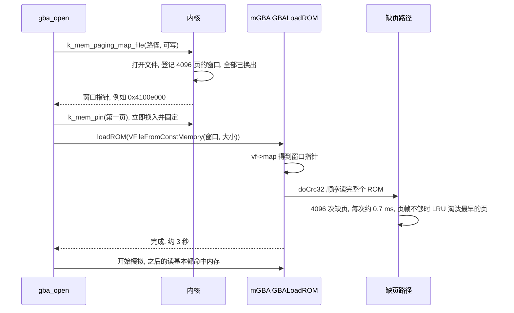

加载大约 3 秒，主要是那一遍 CRC 把 16 MiB 都读了一遍。之后游戏运行时 ROM 访问局部性很强，每 5 秒只有几次到几十次缺页。

## 配置

一个叫 `paged.conf` 的配置片段打开所有需要的东西（`zephyr-components/mgba/samples/gba_player/paged.conf`）：

```
CONFIG_SUN252I_F101_MMU=y
CONFIG_DEMAND_PAGING=y
CONFIG_DEMAND_PAGING_ALLOW_IRQ=y
CONFIG_EVICTION_LRU=y
CONFIG_BACKING_STORE_FS=y
CONFIG_MGBA_ROM_DEMAND_PAGED=y
CONFIG_MGBA_MAX_ROM_SIZE_MB=32
# 有限的 arena: 剩下的内存留给 ROM 的页帧
CONFIG_COMMON_LIBC_MALLOC_ARENA_SIZE=5242880
```

构建时用 `-DEXTRA_CONF_FILE=.../paged.conf` 叠加到示例自己的 `prj.conf` 上。

## 内存账

- 镜像（代码、数据、栈）约 4.1 MiB，含 LVGL、显示、音频、SD 等
- 静态 malloc 区 5 MiB，mGBA 的模拟状态、帧缓冲、音频缓冲都在这里
- 页帧约 6.8 MiB（1748 个），留给 ROM 页
- ROM 窗口 16 MiB（4096 页），虚拟的，不占物理内存

窗口是页帧的 2.3 倍。LRU 管用是因为 ROM 访问局部性强，游戏当前在用的代码和数据只是一小部分，工作集通常小于 6.8 MiB，所以换页很少。

启动日志里应该有 `ROM /SD:/xxx.gba, 16777216 bytes`，`demand_paging_fs` 里加载的 CRC 一致，游戏能起来、有声音。

# 从头做一遍

下面假设你从零开始，面对的是一个支持 Sv32 的 RISC-V 板子和一个能跑的 Zephyr。按顺序一步步做，每个阶段都有检查点，不要跳，否则出了问题范围太大。


1. 裸机探针。先确认这几件事，整个设计都建立在它们之上：`MPRV=1, MPP=U` 时数据访存按页表翻译、取指不翻译；陷入时 MPP 变 M、`mret` 之后变回 U；没有 PMP 放行项时会有访问异常；缺页的 `mcause`/`mtval`/`mepc` 如预期；A 位为 0 会缺页（硬件不自动置位）；CLINT/PLIC 在翻译开启时读出全 1。你的 CPU 如果和这些不同（比如硬件自动置 A/D），设计里相应的部分要调整
2. Kconfig。`arch/riscv/Kconfig` 里加：

```
config RISCV_MMU
	bool "Sv32 MMU for a machine mode kernel"
	depends on !64BIT && !SMP && !RISCV_PMP
	select CPU_HAS_MMU
	select MMU
	select ARCH_HAS_DEMAND_PAGING
	select ARCH_HAS_DEMAND_MAPPING
	select ARCH_SUPPORTS_EVICTION_TRACKING

config RISCV_MMU_MMIO_IDENTITY
	bool
	default y if RISCV_MMU

config RISCV_MMU_BOOT_INFO
	bool "Print the memory map at boot"
	depends on RISCV_MMU
	default y
```

   SoC 的 Kconfig 里加一个总开关（`SUN252I_F101_MMU`，`select RISCV_MMU`），并在 `Kconfig.defconfig` 里给 `KERNEL_VM_SIZE` 一个默认值，这里是 `0x2000000`，32 MiB。`KERNEL_VM_SIZE` 决定了要预备多少张二级页表，每 4 MiB 一张
3. 链接脚本。在 `linker.ld` 里定义 `z_mapped_start`，让镜像末尾按页对齐。通用内存管理代码靠 `z_mapped_start`/`z_mapped_end` 知道镜像占了哪些物理页
4. 头文件 `include/zephyr/arch/riscv/mm.h`。放进去 PTE 位定义（包括自己的软件位）、`struct riscv_mmu_region`、`ARCH_DATA_PAGE_*` 和 `ARCH_UNPAGED_ANON_*` 常量（通用代码要用）、CLINT/PLIC 的不翻译读写函数。在 `arch.h` 里 `#include` 它（`#ifdef CONFIG_MMU`），在 `irq.h` 里加两个异常号：

```c
#define RISCV_EXC_LOAD_PAGE_FAULT 13
#define RISCV_EXC_STORE_PAGE_FAULT 15
```

5. `arch/riscv/core/mmu.c` 的主体。按顺序放：页表（`root_table`、`l2_tables`，4096 对齐）；辅助函数（`pte_ppn`、`pte_phys`、`pte_is_table`、`tlb_flush`、`pte_sync`、`leaf_pte`、`make_leaf`）；`z_riscv_mm_init()`（挂二级表、映射镜像、映射外设、`sys_cache_data_flush_all()`、PMP 放行、写 `satp`、`sfence.vma`、`MPP←U`、`MPRV←1`）。SoC 提供 `riscv_mmu_regions[]`，并在 SoC 的 `CMakeLists.txt` 里 `zephyr_sources_ifdef(CONFIG_SUN252I_F101_MMU mmu_regions.c)`
6. 启动时在 `z_prep_c()` 里，`arch_cache_init()` 之后、`z_cstart()` 之前调用 `z_riscv_mm_init()`
7. 通用内存管理需要的架构接口：`arch_mem_map`、`arch_mem_unmap`、`arch_page_phys_get`。只开 `CONFIG_MMU` 不开 `CONFIG_DEMAND_PAGING` 的话，Zephyr 会用它们给 `k_mem_map` 分配匿名页
8. 缺页入口。在 `fatal.c` 的 `z_riscv_fault` 里加钩子，在 `mmu.c` 里先实现 `z_riscv_mm_page_fault` 的 A/D 位部分，先不管换页
9. CPU 状态切换。`thread.c` 里 `arch_new_thread` 加 `stack_init->mstatus |= MSTATUS_MPRV`；`switch.S` 里 `z_riscv_switch` 末尾加 `csrc mstatus, MPP`
10. CLINT、PLIC、`device_map`。定时器驱动和 PLIC 驱动里所有对 CLINT/PLIC 寄存器的读写换成 `z_riscv_mmode_read32/write32`；`device_map()` 在 `RISCV_MMU_MMIO_IDENTITY` 下直接返回物理地址

做到这里是阶段一的检查点：只实现了 1:1 映射，能启动、能打印、串口和定时器都正常。

11. 打开 `CONFIG_DEMAND_PAGING`、`CONFIG_EVICTION_LRU`，在 `mmu.c` 里补上 `arch_mem_page_out`、`arch_mem_page_in`、`arch_page_location_get`、`arch_page_info_get`、`arch_mem_scratch` 和 `page_in()`，运行 `demand_paging_anon`，应该 0 个错误字，并且有脏页淘汰。这是阶段二的检查点
12. 内核里的小改动：加 `CONFIG_DEMAND_PAGING_BACKING_STORE_SLEEPS`（`kernel/Kconfig.vm`）和 `Z_MM_PAGING_LOCK_IS_MUTEX`（`kernel/mmu.c`），把 `#ifdef CONFIG_SMP` 的三处换成它
13. 文件后备存储。`subsys/demand_paging/backing_store/backing_store_fs.c` 加上 `Kconfig`（`CONFIG_BACKING_STORE_FS`）和 `CMakeLists.txt`，头文件 `include/zephyr/kernel/mm/backing_store_fs.h` 放 `k_mem_paging_map_file`/`k_mem_paging_unmap_file`。阶段三的检查点是 `demand_paging_fs` 样例 CRC 一致、`PASS`。SD 卡里要放一个足够大的文件（这里是 16 MiB），应用的 `prj.conf` 要有 `CONFIG_SDHC`、`CONFIG_FILE_SYSTEM`、FatFS、`CONFIG_MAIN_STACK_SIZE=8192`，缺页读文件的时候栈会很深
14. 应用接入。按上一节来：`k_mem_paging_map_file` 得到窗口指针交给应用；把 malloc 区设成有限大小；不要把窗口交给驱动。阶段四的检查点是应用的行为和以前完全一样（这里是画面 CRC 不变），启动时间多出加载那一遍

## 在这块板子上怎么跑

用 xfel 经 USB 下载，不走 boot0 和 u-boot：

1. 板子断电再上电，每次下载都要重新上电，`exec` 之后 FEL 就没了
2. `xfel ddr f101-s3`（初始化 PSRAM 并打开 UART3 时钟和引脚），`xfel write 0x40010000 zephyr.bin`，`xfel exec 0x40010000`
3. 串口（UART3，PE08/PE09，115200）看输出

构建命令：

```
west build -b f101_evb -d build/dp-fs zephyr/samples/subsys/demand_paging_fs
west build -b f101_evb -d build/gba-kirby zephyr-components/mgba/samples/gba_player \
    -- -DEXTRA_CONF_FILE=$PWD/zephyr-components/mgba/samples/gba_player/paged.conf \
       -DCONFIG_SAMPLE_GBA_ROM=\"/SD:/Kirby.gba\"
```

# 调试和踩过的坑

## 踩过的坑

- 开 MMU 后第一次访存就异常，`mcause` 是 5 或 7。M 态加 MPRV=U 的访问要受 PMP 检查，没有匹配项默认拒绝。加一条覆盖全部地址、可读写执行的 NAPOT PMP。裸机探针里就遇到了
- 系统时间不走，读 `mtime` 得到 `0xffffffff`。CLINT 不接受翻译后的访问。用 `z_riscv_mmode_read32/write32`
- 显示初始化之后挂死。这个不是 MMU 的问题，是 `main` 线程默认栈只有 1 KiB 溢出了，我一开始错怪了 MMU。改 `CONFIG_MAIN_STACK_SIZE=8192`。教训是遇到挂死先排除栈溢出
- 卡死在 `fs_mount`，PC 在 UART 中断里。`device_map()` 给的虚拟地址在中断里被当成物理地址，UART 发送中断关不掉，饿死了定时器。用 `RISCV_MMU_MMIO_IDENTITY`，前面讲过
- 映射 16 MiB 窗口时崩在 `memset`，`mcause=15`。`k_mem_map` 默认把映射清零，对文件窗口既慢又会毁掉内容。用 `K_MEM_MAP_UNINIT`
- 想用 JTAG 调试时 SD 卡不能用。板子的 SD 卡槽和 JTAG 共用 PF0/1/3/5 引脚，调试要单独构建，关掉 SD，把这几个引脚切到 JTAG 复用（复用号 4）

下面这几条是设计时就预防掉的，没有真的遇到过：

- 页表看起来改对了，偶尔仍然访问旧映射：页表遍历器读内存不读数据缓存，所以每次改页表项后写回缓存行（`pte_sync`）
- 手动改 `mstatus.MPP` 的代码有掉进用户态的风险：`mret` 按 MPP 返回，MPP=U 时执行 `mret` 会降到用户态。清了 MPP 的地方走出之前要设回 M（`page_in` 就这样做），或者确认后面的出口会从异常帧恢复 `mstatus`（Zephyr 的出口就是这样）
- 线程恢复后在翻译关闭状态跑了一阵：上下文切换发生在陷入态，MPP 是 M，被恢复的线程本来应该是翻译开启。所以 `z_riscv_switch` 末尾清 MPP
- 启动时 DMA 数据错乱：缓冲区来自 `k_mem_map` 的页（非 1:1），或者 malloc 区被设成了全部空闲内存。malloc 区设成有限静态大小
- 窗口里被写过的数据消失：可写映射的脏页被淘汰时后备存储是只读的，修改丢失。需要保持修改的页用 `k_mem_pin`，mGBA 里把第一页固定了

## 调试手段

1. 启动信息（`CONFIG_RISCV_MMU_BOOT_INFO`）：页表划分、页帧数一目了然，用前面超页那一节的公式对账
2. 缺页统计（`CONFIG_DEMAND_PAGING_STATS`，`k_mem_paging_stats_get`）：缺页次数、干净和脏淘汰次数，用来对账，比如前面的 4096 − 3888 = 208
3. 未处理的异常：Zephyr 的致命错误输出里有 `mcause`、`mtval`、`mepc`、`mstatus`，把 `mepc` 和调用栈用 `addr2line` 转成源码行，先看 `mtval` 是哪个地址、`mcause` 是读还是写
4. JTAG 加 GDB（CKLink 加平头哥的 DebugServer）：停下来后 `info registers pc mstatus mcause mepc mtval satp mip`，读 `mtime`/`mtimecmp`，看 `z_main_thread` 的状态和 `callee_saved.ra`。对系统不动了这类问题，比到处加打印有效得多，那次 UART 中断风暴就是靠它查出来的
5. PC 采样：一个线程定时读被测线程栈上保存的 `mepc`，按 64 字节的块统计热点，再用 `addr2line` 汇总到函数，用来区分卡在哪里和哪里慢
6. 分阶段的样例：先用匿名内存的样例（没有 SD 卡、没有文件系统）验证调页，再用文件样例验证后备存储，最后才接应用

## 还没搞清楚的问题

这里也写一下没解决的：同一份固件（FireRed，分页配置）在几十次运行里偶发出现过两次卡死，一次在启动阶段，一次在游戏运行 7 秒后，重跑就消失了，没找到原因，也没有复现手段。可能的原因有：CPU 提到 960 MHz（之后的版本是 1008 MHz）但没调电压，时钟边缘不稳；SD 卡偶发读超时；或者分页代码里一个很少触发的竞争。如果你的系统出现类似现象，先把 CPU 降频排除时钟因素。

# 实测数据

所有数字都来自板子上的实测（F101 EVB，SD 卡，串口日志）。`demand_paging_fs` 样例没有调频，跑在 FEL 启动后的 600 MHz；mGBA 播放器的数据是在 960 MHz 下量的，后来提到 1008 MHz，声音和帧率略有改善，不影响结论。

## 匿名内存调页

`demand_paging_anon`：`k_mem_map` 映射 64 页，可用页帧只留 24 个，每页写图案再读回校验，0 个错误字，统计里有脏页淘汰（换出到 RAM 后备存储再换入）。

## 文件后备存储

`demand_paging_fs`，16 MiB 文件（FireRed ROM），空闲页帧 15552 KiB（3888 页）：

- 通过窗口顺序读完整个文件：2850 到 2879 ms，4096 次缺页，208 次干净淘汰
- 用 `fs_read` 顺序读同一个文件：1504 到 1508 ms
- 两种读法的 CRC32 都是 `84ee4776`，相等，结果 `PASS`

窗口读法比直接 `fs_read` 慢约一倍，因为每次只读 4 KiB（`fs_read` 是以 64 KiB 为单位），而且每次缺页都有陷入、换入、两次异常的开销。平均每次缺页 `2.9 s / 4096 ≈ 0.7 ms`。

另外随机读 512 页平均 25 到 29 µs 这个数字不能代表缺页延迟，测量时页多半已经在内存里，前面刚把整个文件顺序读过，3888 页还留在页帧里。真实的随机缺页延迟要看 SD 卡读 4 KiB 的时间，约 1.0 ms。

## SD 卡读取速度

随机读，每个文件取平均：

- 4 KiB：约 1.0 ms（FireRed 1063 µs，Kirby 1001 µs）
- 16 KiB：约 1.44 到 1.5 ms
- 64 KiB：约 3.8 ms
- 256 KiB：约 13.6 ms

读 16 KiB 只比读 4 KiB 多 40% 的时间，却能读 4 倍的数据，预读有明显的潜力。

## mGBA 播放器

- FireRed、Kirby 从窗口加载，都能启动运行，声音画面正常（演示动画里偶有重场景超预算，见下）
- 加载时的 CRC 遍历：约 4166（FireRed）到 4246（Kirby）次缺页，约 2418 到 2505 次干净淘汰（页帧只有 1748 个，少于 ROM 的 4096 页）
- 稳态：每 5 秒几次到几十次缺页，进入新场景时会短暂升到 80 多次，几乎不占时间
- 塞尔达基准每帧耗时：没开 MMU 12.98 ms；开 MMU 用 4 KiB 页 13.56 ms（+4.5%）；用 4 MiB 超页 13.32 ms（+2.6%）
- 塞尔达基准的画面 CRC（第 400、600、800、1000、1200 帧）：三种配置完全相同
- 重场景（Kirby 演示中约 105 秒处、FireRed 演示里的几段）：每帧 18 ms 左右，这段时间每 5 秒的缺页只有 0 到 30 次，瓶颈是模拟器解释器本身，不是调页

最后一条很重要。出现卡顿的时候，第一反应常常是不是换页太慢，这里的数据直接排除了它。

## 怎么复现

- 缺页统计：`CONFIG_DEMAND_PAGING_STATS=y`，调用 `k_mem_paging_stats_get(&s)`，看 `s.pagefaults.cnt`、`s.eviction.clean`、`s.eviction.dirty`
- 塞尔达基准：`CONFIG_SAMPLE_GBA_BENCH=y`，每 200 帧打印一次画面 CRC，不限速跑 1200 帧，对比不同配置的 CRC 和耗时
- SD 卡速度：`CONFIG_SAMPLE_GBA_ROM_DIAG=y`，对卡上每个 ROM 文件做随机读测试
