开发板为 YuzukiNeko，SoC 核心为平头哥 C907（rv32imafdcv），16 MB PSRAM，没有 SBI，内核直接运行在 M 态。

目标是让 mGBA 把一个 16 MiB 的 GBA 游戏 ROM 当作 16 MiB 的内存读取，而板子的内存总量只有 16 MB。

实现方式是在 Zephyr 中为 RISC-V 增加 Sv32 MMU 和请求调页（demand paging），以 SD 卡上的文件作为后备存储。mGBA 本身没有修改。

# MMU 基础

已经熟悉 MMU 的可以跳过本节，后文只使用这里涉及的概念。

## 虚拟地址和物理地址

CPU 执行 `lw a0, 0(a1)` 时，`a1` 中是虚拟地址。启用 MMU 后，硬件在访问内存之前把虚拟地址翻译成物理地址。翻译规则保存在内存中的页表里，由操作系统填写。

翻译表不要求一一对应：

- 两个不同的虚拟地址可以指向同一块物理内存
- 一个虚拟地址可以暂时没有对应的物理内存，对应的数据位于 SD 卡
- 虚拟地址空间可以比物理内存大

ROM 窗口使用后两条：虚拟地址空间中有连续 16 MiB，物理内存中只有其中一部分。

## 页

翻译以页为单位。Sv32 中一页为 4 KiB。32 位虚拟地址分为两段，高 20 位是虚拟页号，低 12 位是页内偏移，翻译前后偏移不变。

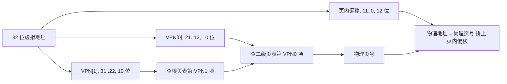

## Sv32：两级页表

Sv32 是 RISC-V 32 位的分页方案，使用两级页表：

- 根页表：1024 项，每项 4 字节，共一页。以虚拟地址的 `VPN[1]`（31 到 22 位）为下标
- 二级页表：同样是 1024 项、4 KiB。根页表项指向二级页表时，以 `VPN[0]`（21 到 12 位）为下标

一张二级页表覆盖 1024 页，即 4 MiB 虚拟地址。根页表项也可以直接作为叶子，此时映射一整块 4 MiB 的超页，不再查第二级。外设和程序镜像的映射会用到超页。

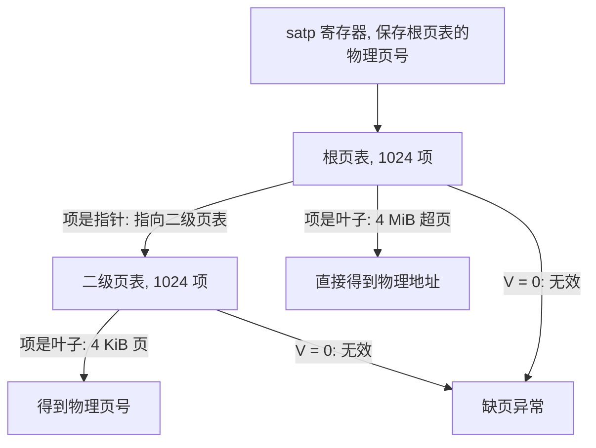

页表项（PTE）为 32 位：

- 31..10 PPN，物理页号，物理地址 = PPN × 4096
- 9..8 RSW，留给软件使用的两位，硬件不读取。本文使用第 8 位标记"已换出"
- 7 D，脏位，该页被写过
- 6 A，访问位，该页被访问过
- 5 G，Global
- 4 U，用户态可访问
- 3 X，可执行
- 2 W，可写
- 1 R，可读
- 0 V，有效。V=0 时访问一定缺页

R、W、X 全为 0 表示该项指向下一级页表，任意一位为 1 表示该项是叶子。

`satp` 寄存器指定页表位置和是否启用：最高位 MODE=1 表示 Sv32，低 22 位是根页表所在物理页的页号。板子运行后 `satp = 0x80040126`，MODE=1，根页表位于 `0x40126000`。

## TLB

每次访问都读两次页表开销过大，硬件使用 TLB 缓存最近翻译过的"虚拟页号 → 物理页号"。这有两点影响：

- 修改页表后需要使用 `sfence.vma` 让 TLB 失效。本实现每修改一项就全部刷新，实现简单，性能不是最优
- TLB 容量有限，这颗 CPU 约为 256 项。访问的页越分散，未命中越多。一个 4 MiB 超页占一项，相当于 1024 个 4 KiB 页，镜像映射一节给出了实测差别

## 缺页异常

页表项 V=0（或权限不足、A/D 位不满足）时，访问不会进行，CPU 转到异常处理程序，并提供：

- `mcause`：原因，13 为读缺页，15 为写缺页
- `mtval`：出错的虚拟地址
- `mepc`：出错指令的地址。处理完成后用 `mret` 返回，CPU 重新执行该指令

请求调页依赖这一机制：缺页处理程序可以执行任意操作，例如从 SD 卡读取 4 KiB，只要在返回前把页表项改为有效，出错的指令重新执行即可成功，程序不感知这一过程。

## 请求调页

流程如下：

1. 一块虚拟内存先登记，页表项全部无效，表示数据尚未读入
2. 程序访问其中一页，触发缺页
3. 内核取一个空闲页帧（一页物理内存），读入数据，把页表项改为指向该页帧，返回后重试
4. 没有空闲页帧时，先淘汰一个正在使用的页（置换）。被淘汰的页如果被修改过（脏页），需要先写回
5. 后备存储保存页的原始内容，换入从这里读取，脏页换出写入这里

Zephyr 内核已有通用的请求调页实现（`kernel/mmu.c`，置换算法位于 `subsys/demand_paging/eviction/`）。缺少的是各架构自己的部分：修改页表项，以及在缺页异常中调用通用代码。Zephyr 4.2 中 RISC-V 没有这一部分，需要自行实现。

# 需求和限制

## 需求

mGBA 加载 ROM 的方式是：取得一个 `VFile`，调用其 `map()` 得到指向整个 ROM 的指针，之后模拟器通过该指针读取。GBA 卡带 ROM 最大 32 MiB，常见的大型游戏为 16 MiB。

板子的内存分配如下：

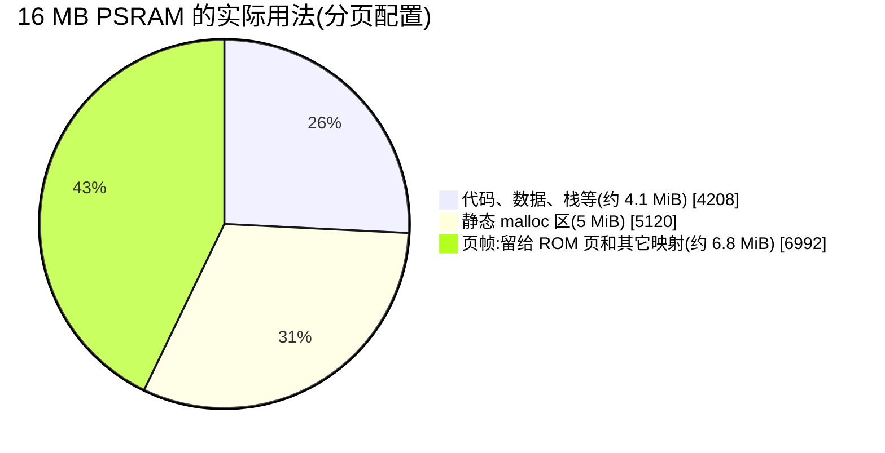

单位为 KiB，三项合计 16320 KiB，等于 Zephyr 识别的 SRAM 大小。`0x40000000` 起的前 64 KiB 不在 Zephyr 的 SRAM 范围内。

16 MiB 的 ROM 大于页帧区域。可选方案有三种：

1. 整个读入内存：容量不足
2. 修改模拟器，由模拟器自己管理缓存，每次读 ROM 先查缓存再读文件。需要修改 mGBA 中数百处 ROM 访问，并且每次取指都会变慢
3. 由操作系统处理：ROM 作为一块虚拟内存，访问不在内存中的页时触发缺页，内核在异常中从 SD 卡读入该页，随后重新执行指令。对 mGBA 没有影响

本文采用第三种。

## 硬件限制

以下限制决定了后续设计：

- 没有 SBI。xfel 把程序送入 RAM 后执行 `exec`，CPU 处于 M 态，内核只能运行在 M 态，无法使用"S 态内核 + SBI"方案。下一节详细说明
- M 态取指不经过页表翻译，因此代码不能换页，整个程序镜像常驻内存
- CLINT、PLIC 只接受 M 态访问，经过页表翻译的访问会被拒绝，需要专门的不翻译读写函数
- 驱动中大量把缓冲区指针直接当作总线地址使用（SD 卡、DMA、显示），因此提供给硬件使用的内存必须虚拟地址等于物理地址（1:1）
- 单核。互斥可以简化，但缺页处理程序必须允许睡眠（等待 SD 卡），需要修改一处内核代码

## 目标

1. 内核和驱动无需修改，看到的地址不变
2. 只有通过 `k_mem_map` 映射的页是非 1:1 的
3. ROM 以只读文件映射的形式提供，页从文件读入，不写回
4. 不依赖模拟器的任何修改

# 整体结构


新增和修改的文件：

- 页表、`arch_mem_map` 等架构接口、缺页入口、A/D 位：`arch/riscv/core/mmu.c`、`include/zephyr/arch/riscv/mm.h`
- 缺页时的 CPU 状态切换：`arch/riscv/core/switch.S`、`thread.c`、`fatal.c`
- CLINT/PLIC 的不翻译读写：`mm.h` 中的 `z_riscv_mmode_read32/write32`，以及 `drivers/timer/riscv_machine_timer.c`、`drivers/interrupt_controller/intc_plic.c`
- 外设的 1:1 映射表：`soc/allwinner/sun252i_f101/mmu_regions.c`
- 允许缺页时睡眠：`kernel/mmu.c`、`kernel/Kconfig.vm`
- 文件后备存储：`subsys/demand_paging/backing_store/backing_store_fs.c`
- mGBA 接入：`zephyr-components/mgba/src/gba_player.c`、`src/gba_memory.c`

通用调页逻辑和 LRU 置换（`kernel/mmu.c`、`subsys/demand_paging/eviction/lru.c`）是 Zephyr 原有的。

# 没有 SBI 时 M 态内核使用 MMU

## 问题

RISC-V 有三种特权级：M 机器态，权限最高，固件（SBI）运行于此；S 监督态，操作系统内核运行于此；U 用户态，应用程序运行于此。

Linux 等系统的标准布局是 SBI 在 M 态，内核在 S 态，应用在 U 态，MMU（`satp`、页表）面向 S 态和 U 态。

这块板子没有 SBI，xfel 把代码送入 RAM 后跳转，CPU 停留在 M 态。RISC-V 规范规定 M 态的取指和普通访存不经过页表翻译，因此内核一直运行在 M 态时，设置 `satp` 不产生翻译。

有两种处理方式：

1. 降到 S 态。用 `mret` 返回到 S 态，自行编写 SBI 垫片（时钟、核间中断、外设访问），并处理中断和异常委托。Zephyr 主线没有 S 态内核，所有 CSR 访问（`mstatus`、`mepc`、`mtvec` 等）和异常入口都要改成 S 态版本，CLINT/PLIC 只接受 M 态访问，需要在 M 态编写垫片。工作量大
2. 留在 M 态，使用访存特权级修改机制。本文采用这种方式

## MPRV 和 MPP

`mstatus` 中有两个相关位域：

- MPP（11..12 位）：进入 M 态异常之前的特权级。`mret` 返回时 CPU 切换到 MPP 指定的特权级
- MPRV（17 位）：`MPRV = 1` 时，load 和 store（仅数据访问，不含取指）按 MPP 指定的特权级进行地址翻译和权限检查，CPU 本身仍处于 M 态

设置 `MPRV = 1`、`MPP = U(0)` 后，M 态中每一次 load/store 都按用户态访问查页表。因此页表叶子项的 U 位需要置 1。取指不受影响，始终使用物理地址。

结论：数据可以是非 1:1 的，通过页表任意映射；代码必须 1:1，整个程序镜像常驻内存，不能换页。程序镜像约 4 MB，这一限制可以接受。ROM 窗口属于数据，可以使用该机制。

## 陷入时的状态变化

翻译是否生效由 MPP 的值决定，硬件在陷入（异常、中断）和 `mret` 时自动改写 MPP。

规范规定：

- 陷入 M 态时，硬件把 MPP 设为陷入前的特权级。内核本来处于 M 态，所以 `MPP = M(3)`。此时 `MPRV = 1` 且 `MPP = M`，等价于以 M 的特权访存，不翻译
- `mret` 时，CPU 回到 MPP 指定的特权级（M），随后硬件把 MPP 设为支持的最低特权级（U）。返回的是 M 态，MPRV 不会被清除，因此 `MPRV = 1, MPP = U`，翻译重新生效

线程代码在翻译开启下运行，中断和异常的入口代码以及中断处理函数在翻译关闭下运行，切换由硬件自动完成。

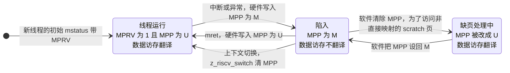

由此产生三个结果：

1. 中断处理函数运行时翻译关闭，访问的所有地址必须是物理地址。中断中会访问的内容（驱动的寄存器基地址、全局数据、栈）都必须 1:1。因此外设使用 1:1 映射，`device_map()` 需要直接返回物理地址，见后文
2. 缺页处理需要手动开启翻译。缺页处理程序在陷入状态下运行，翻译关闭，但需要通过一个非 1:1 的特殊页（scratch 页）向新页帧写入数据，所以要手动清除 MPP，处理完成后再设回 M。设回 M 不是返回正确性所必需的：Zephyr 的异常出口汇编会从栈上的异常帧恢复 `mstatus`（其中 MPP 是陷入时硬件写入的 M），然后才执行 `mret`。设回 M 的目的是让未解决的缺页进入致命错误路径时，处于与普通陷入相同的不翻译状态。另外，`mret` 按 MPP 决定返回的特权级，`MPP = U` 时执行 `mret` 会使 CPU 降到用户态，内核随即异常
3. 线程切换时需要保证翻译开启。例如线程 A 在线程态被打断，线程 B 在陷入态（翻译关闭）中被调度走，之后切回 A：A 原本翻译开启，但此时 MPP 仍是陷入留下的 M，A 会在翻译关闭下运行到下一次 `mret`。处理方式是在 `z_riscv_switch` 末尾清除一次 MPP

## 对应的代码

启用翻译，位于 `z_riscv_mm_init` 末尾：

```c
csr_write(satp, SATP_SV32 | ((uintptr_t)root_table >> 12));
tlb_flush();

/* 从这里开始本代码的 load/store 都会被翻译 */
csr_clear(mstatus, MSTATUS_MPP);   /* MPP = U */
csr_set(mstatus, MSTATUS_MPRV);    /* MPRV = 1 */
```

新线程从第一条指令起即带翻译（`arch_new_thread`）。线程首次运行走异常返回路径，初始 `mstatus` 中 `MPP = M`，`mret` 之后 MPP 变为 U，MPRV 保持 1：

```c
#if defined(CONFIG_RISCV_MMU)
	stack_init->mstatus |= MSTATUS_MPRV;
#endif
```

线程切换后恢复翻译（`switch.S` 中 `z_riscv_switch` 末尾，`ret` 之前）：

```asm
#if defined(CONFIG_RISCV_MMU)
	li t0, 0x1800 /* MSTATUS_MPP */
	csrc mstatus, t0
#endif
	ret
```

还需要配置 PMP（物理内存保护）。PMP 通常不检查 M 态访问，但启用 MPRV 后 load/store 的有效特权级是 U，PMP 会参与检查，没有 PMP 项匹配时 U 态访问默认被拒绝，产生 load/store 访问异常（`mcause` 5 或 7）。因此设置一条覆盖全部地址空间、可读写执行的 NAPOT 项：

```c
#define PMP_ALL_ADDR	0x3fffffffUL	/* NAPOT, 整个 34 位地址空间 */
#define PMP_ALL_CFG	0x1fUL		/* NAPOT, R, W, X */
csr_write(pmpaddr0, PMP_ALL_ADDR);
csr_write(pmpcfg0, PMP_ALL_CFG);
```

因此 Zephyr 自带的 PMP（`CONFIG_RISCV_PMP`）不能同时启用，`RISCV_MMU` 的 Kconfig 中设置了 `depends on !RISCV_PMP`。

## 与降到 S 态的比较

- 留在 M 态：代码不能换页；需要修改页表、缺页入口和少量汇编；CLINT/PLIC 增加不翻译的读写函数即可；已有驱动基本不需要修改；后续实现用户态和多进程受限
- 降到 S 态加 SBI 垫片：代码可以换页；需要修改所有 CSR 访问、异常入口、定时器、中断控制器、核间中断；CLINT/PLIC 需要在 M 态编写垫片；已有驱动同样基本不需要修改；后续可以实现用户态

对于"把 16 MiB 数据文件作为内存使用"这一目标，M 态方案满足需求且改动小得多。需要用户态或需要对代码换页时，应采用 S 态方案，那属于另一个项目。

## 裸机验证

在编写完整实现之前，先编写裸机程序验证上述假设：

1. 在 M 态建立只映射少量区域的页表，写 `satp`，设置 `MPRV=1`、`MPP=U`
2. 访问非 1:1 映射的页，检查数据是否正确
3. 访问 V=0 的页，检查 `mcause` 是否为 13/15，`mtval` 是否为出错地址，`mepc` 是否指向出错指令
4. 去掉 PMP 放行项，检查是否出现 `mcause` 5/7
5. 清除页表项的 A 位，检查是否触发缺页，即硬件是否不会自动置位 A

以上现象均得到确认，后续设计基于这些结果。

# 地址空间和页表布局

## 物理内存

板子的 16 MB PSRAM 起始于 `0x40000000`。Zephyr 识别的 SRAM 起始于 `0x40010000`，前 64 KiB 不在设备树的 SRAM 节点中，物理上同样是内存。

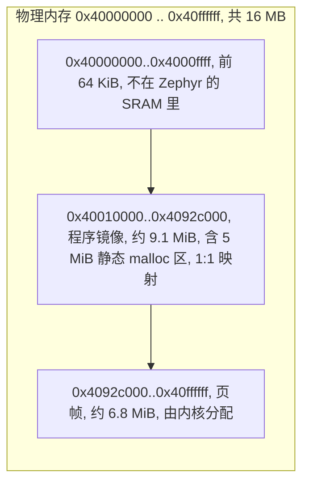

镜像中的静态 malloc 区用于驱动的 DMA 缓冲区，必须是 1:1 的。如果让 libc 的 malloc 使用全部剩余内存（`CONFIG_COMMON_LIBC_MALLOC_ARENA_SIZE=-1`），它会占用页帧，而页帧是 `k_mem_map` 映射出的非 1:1 页，DMA 会读写错误的地址。因此启用 MMU 时 malloc 区必须设置为有限的静态大小，本文设置为 5 MiB。

## 虚拟地址空间

Zephyr 的 MMU 抽象中有内核虚拟地址空间（起始于 `CONFIG_KERNEL_VM_BASE`，大小 `CONFIG_KERNEL_VM_SIZE`）。本文设置为从 `0x40010000` 起 32 MiB，即 `0x40010000 .. 0x4200ffff`。该范围大于物理内存（物理内存止于 `0x40ffffff`），原因是 `k_mem_map` 需要在虚拟空间中找到一块连续地址，而物理页帧可以任意分布。

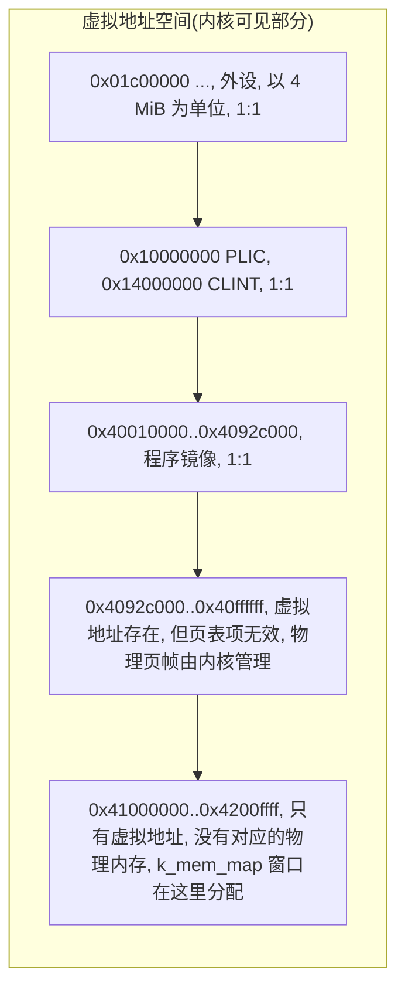

例如 FireRed 的 ROM 窗口映射在 `0x4100e000`，物理内存中不存在该地址，它是纯虚拟地址，每一页由页表指向某个页帧，或者当前不在内存中。

## 页表：静态预分配

Zephyr 的 `arch_mem_map()` 是 `void` 函数，不能失败，也不能分配内存。因此需要预先准备好整个内核虚拟空间的二级页表：

```c
#define VM_START	ROUND_DOWN(CONFIG_KERNEL_VM_BASE, RISCV_SV32_MEGAPAGE)
#define VM_END		ROUND_UP(CONFIG_KERNEL_VM_BASE + CONFIG_KERNEL_VM_SIZE, RISCV_SV32_MEGAPAGE)
#define L2_TABLES	((VM_END - VM_START) / RISCV_SV32_MEGAPAGE)

static uint32_t root_table[PTES] __aligned(4096);
static uint32_t l2_tables[L2_TABLES][PTES] __aligned(4096);
```

按当前参数，`VM_START = 0x40000000`，`VM_END = 0x42400000`，`L2_TABLES = 9`，9 张二级表占 36 KiB，加根页表 4 KiB。它们是静态数组，位于镜像内，页表本身也是 1:1 的，硬件页表遍历和软件读写使用同一地址。

启动时（`z_riscv_mm_init`）把这 9 张表挂到根页表：

```c
for (unsigned int i = 0; i < L2_TABLES; i++) {
    root_table[(VM_START >> ROOT_SHIFT) + i] = pte_ppn((uintptr_t)l2_tables[i]) | RISCV_PTE_V;
}
```

`ROOT_SHIFT = 22`，虚拟地址右移 22 位即为根页表下标。`0x40000000 >> 22 = 256`，使用根页表第 256 到 264 项。

`leaf_pte()` 用于查找虚拟地址对应的二级页表项：

```c
static uint32_t *leaf_pte(uintptr_t va)
{
	uint32_t root;

	if (va < VM_START || va >= VM_END) {
		return NULL;
	}
	root = root_table[va >> ROOT_SHIFT];
	if (!pte_is_table(root)) {
		return NULL;
	}

	return &((uint32_t *)pte_phys(root))[(va >> 12) & (PTES - 1U)];
}
```

`pte_is_table` 表示 V=1 且 R、W、X 全为 0，即该项指向下一级。

## 1:1 映射：外设、镜像和超页

外设寄存器按 4 MiB 一块映射为根页表中的超页叶子，虚拟地址等于物理地址。映射表由 SoC 提供（`soc/allwinner/sun252i_f101/mmu_regions.c`）：

```c
const struct riscv_mmu_region riscv_mmu_regions[] = {
	RISCV_MMU_REGION("ve",    0x01c00000, 0x00400000),  /* video engine */
	RISCV_MMU_REGION("apb0",  0x02000000, 0x00400000),  /* GPIO, PWM, CCU, ADC, audio, I2S */
	RISCV_MMU_REGION("uart",  0x02400000, 0x00400000),
	RISCV_MMU_REGION("sys",   0x03000000, 0x00400000),  /* system control, DMA, SID, MBUS */
	RISCV_MMU_REGION("ahb",   0x04000000, 0x00400000),  /* SD host, SPI, USB */
	RISCV_MMU_REGION("de",    0x05000000, 0x00400000),  /* display engine */
	RISCV_MMU_REGION("disp",  0x05400000, 0x00400000),  /* G2D, MIPI DSI, TCON */
	RISCV_MMU_REGION("wdt",   0x06000000, 0x00400000),
	RISCV_MMU_REGION("plic",  0x10000000, 0x00400000),
	RISCV_MMU_REGION("clint", 0x14000000, 0x00400000),
};
```

一个 4 MiB 超页对应根页表的一项：

```c
root_table[(r->base + off) >> ROOT_SHIFT] =
    pte_ppn(r->base + off) | RISCV_PTE_V | RISCV_PTE_R | RISCV_PTE_W |
    RISCV_PTE_U | RISCV_PTE_A | RISCV_PTE_D;
```

A 和 D 位在建立时即置 1。硬件不会自动置这两位，未预先置位时第一次访问会触发缺页，详见 A/D 位一节。

程序镜像中的每一页也需要 1:1。最直接的做法是全部使用 4 KiB 页映射（`make_leaf(va, K_MEM_PERM_RW)`），但镜像有 9 MB，内容包括模拟器的堆、全局表等分散访问的数据，TLB 约 256 项，覆盖范围不足 1 MiB，未命中较多。实测启用 MMU 后模拟器每帧耗时增加 4.5%。

对应的处理是：镜像中被完整占满的 4 MiB 块使用一个超页项代替 1024 个 4 KiB 项。镜像范围为 `0x40010000..0x4092c000`，因此 `0x40000000..0x40400000` 和 `0x40400000..0x40800000` 两块可以做成超页（第一块起始的 64 KiB 同为内存，可一并映射），剩余的 `0x40800000..0x4092c000`（1.2 MiB，300 页）仍使用 4 KiB 页：

```c
mega_start = ROUND_DOWN((uintptr_t)z_mapped_start, RISCV_SV32_MEGAPAGE);
mega_end = mega_start;
while (mega_end + RISCV_SV32_MEGAPAGE <= (uintptr_t)z_mapped_end) {
    root_table[mega_end >> ROOT_SHIFT] = pte_ppn(mega_end) | RISCV_PTE_V |
        RISCV_PTE_R | RISCV_PTE_W | RISCV_PTE_U | RISCV_PTE_A | RISCV_PTE_D;
    mega_end += RISCV_SV32_MEGAPAGE;
}
for (va = (uintptr_t)z_mapped_start; va < (uintptr_t)z_mapped_end; va += PAGE_SIZE) {
    if (va < mega_start || va >= mega_end) {
        *leaf_pte(va) = make_leaf(va, K_MEM_PERM_RW);
    }
}
```

最后一块没有做成超页，原因是镜像后面紧接页帧区域，两者不能同时存在 1:1 的别名映射：同一块物理内存通过两个虚拟地址访问，会产生缓存别名。

启动信息会打印该划分：

```
mmu: 1:1 image     0x40010000-0x4092c000, 9328 KiB, 8 MiB in 4 MiB pages, the rest 4 KiB pages
mmu: 300 pages mapped, 0 paged out, 6992 KiB of page frames free
```

300 页可以按 `(0x4092c000 - 0x40800000) / 4096 = 300` 核对。

使用超页后，塞尔达基准的每帧耗时：未启用 MMU 12.98 ms；启用 MMU 并使用 4 KiB 页 13.56 ms，增加 4.5%；使用超页 13.32 ms，增加 2.6%。三种配置下模拟器画面的 CRC 完全一致。

为了正确识别超页，`arch_page_phys_get()`（虚拟地址转物理地址）需要先检查根页表项是否为叶子：

```c
uint32_t root = root_table[va >> ROOT_SHIFT], *pte;

/* 4 MiB 的项: 镜像的一块或者外设寄存器 */
if ((root & RISCV_PTE_V) != 0U && !pte_is_table(root)) {
    if (phys != NULL) {
        *phys = pte_phys(root) | (va & (RISCV_SV32_MEGAPAGE - 1U));
    }
    return 0;
}
```

## 启动顺序

页表在 `z_prep_c`（C 环境已准备好、内核尚未启动）中建立并启用：

```c
#if CONFIG_ARCH_CACHE
	arch_cache_init();
#endif
#if defined(CONFIG_RISCV_MMU)
	z_riscv_mm_init();
#endif
	z_cstart();
```

之后 Zephyr 通用代码的 `z_mem_manage_init()` 初始化页帧数据库，登记哪些物理页是空闲页帧，哪些被镜像占用。

为了让通用代码获知镜像起始位置，链接脚本（`include/zephyr/arch/riscv/common/linker.ld`）增加：

```ld
#ifdef CONFIG_MMU
    z_mapped_start = __rom_region_start;
#endif
...
#ifdef CONFIG_MMU
/* 镜像末尾按页对齐 */
#define LAST_RAM_ALIGN . = ALIGN(CONFIG_MMU_PAGE_SIZE);
#endif
```

后一段使镜像末尾按页对齐，镜像的最后一页不会与页帧共用。

这一步可以单独验证：启动日志中应出现 `mmu:` 开头的几行；先完成镜像和外设映射，不启用请求调页，运行一个已有的完整示例（本文使用 mGBA 播放器），确认画面 CRC 与未启用 MMU 时一致，即可确定启用 MMU 本身不改变已有行为；再检查启动信息中的页数能否与上述公式对应。

# 页表项的三种状态

请求调页中，一个页表项在三种状态之间切换。

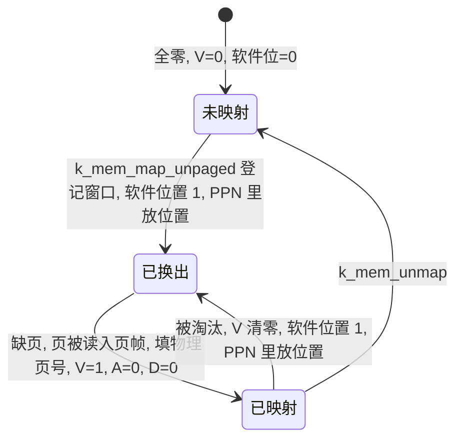

- 未映射：V=0，软件位=0，PPN 全零。访问会缺页，但不属于调页，按真实错误处理
- 已换出（paged out）：V=0，软件位（bit 8）=1，PPN 字段保存该页在后备存储中的位置，不是物理页号。访问时缺页，进入调页处理
- 已映射（paged in）：V=1，PPN 是真实的物理页号。正常访问；A/D 位未满足时会缺页，见下一节

V=0 的项，硬件不读取其余位，软件可以自由使用。本实现把位置存放在 PPN 字段中，并用软件位标记。对文件后备存储，位置即页在文件中的偏移（以 4 KiB 为单位），因此 FireRed 窗口的页表项中 PPN 依次为 0、1、2……4095。

```c
#define RISCV_PTE_PAGED_OUT	BIT(8)   /* 软件位, RSW 的低位 */
#define RISCV_PTE_PPN_SHIFT	10

static inline uint32_t pte_ppn(uintptr_t phys)  { return (uint32_t)(phys >> 12) << RISCV_PTE_PPN_SHIFT; }
static inline uintptr_t pte_phys(uint32_t pte)  { return (uintptr_t)(pte >> RISCV_PTE_PPN_SHIFT) << 12; }
```

## 换出和换入时 PTE 的修改

换出（`arch_mem_page_out`）：页帧被回收，记录位置，清除 V，保留权限位（R/W/X/U），换入时不需要重新计算权限：

```c
*pte = pte_ppn(location) | RISCV_PTE_PAGED_OUT | (*pte & RISCV_PTE_PERM_MASK);
pte_sync(pte);
tlb_flush();
```

换入（`arch_mem_page_in`）：数据已读入页帧，填入物理页号，V=1，A=0，D=0：

```c
/* 干净且没访问过: 第一次访问会缺页, 两个位就是这样被追踪的 */
*pte = pte_ppn(phys) | RISCV_PTE_V | (*pte & RISCV_PTE_PERM_MASK);
pte_sync(pte);
tlb_flush();
```

登记窗口（`arch_mem_map` 加 `K_MEM_MAP_UNPAGED` 标志）通过 `make_leaf` 直接生成已换出状态，此时 `phys` 参数传入的是位置（文件偏移），每页递增 4096：

```c
if ((flags & K_MEM_MAP_UNPAGED) != 0U) {
    return pte_ppn(phys) | RISCV_PTE_PAGED_OUT | pte;
}
```

## pte_sync

RISC-V 硬件的页表遍历器直接读内存，而 CPU 写页表经过数据缓存。缓存行未写回时，遍历器可能读到旧的页表项。因此每次修改页表项后需要写回其所在的缓存行：

```c
static inline void pte_sync(uint32_t *pte)
{
	sys_cache_data_flush_range(pte, sizeof(*pte));
	__asm__ volatile("fence" ::: "memory");
}
```

未执行该步骤时，页表内容已经修改，但访问偶尔仍使用旧映射。

## 页帧的状态

页表项描述虚拟页到物理页的关系。Zephyr 通用代码还为每个物理页帧维护状态（页帧数据库）：

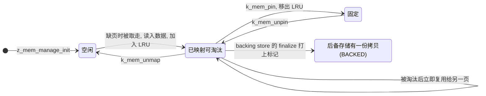

BACKED 标志是文件后备存储的关键：它表示该页的内容在后备存储中有一份相同的拷贝，淘汰时按干净页处理，直接丢弃，不写回。镜像占用的页帧被标记为保留/固定，不参与调页。

# A 位、D 位和 LRU

## 硬件在 A=0 时触发缺页

RISC-V 规范允许两种实现：硬件在访问时自动置位 A、D；或者硬件不修改，发现 A=0（写入时 D=0）就报缺页，由软件置位。C907 属于后者，已在裸机验证中确认。

这带来两点结果。已映射的页在 A=0 时第一次访问会缺页，必须处理。另一方面，A 位正是置换算法需要的信息：内核需要知道一页最近是否使用过，只要把 A 清零，再观察是否再次缺页即可，缺页说明该页被访问，处理程序记录一次。

因此本实现不是为兼容性而模拟 A/D 位，而是用缺页来追踪访问。

## 缺页处理函数

所有 load/store 缺页（`mcause` 13 和 15）首先进入 `z_riscv_fault`（`arch/riscv/core/fatal.c`），在 Zephyr 原有的 PMP 和用户态错误处理之后增加：

```c
#ifdef CONFIG_RISCV_MMU
	{
		unsigned long mcause = csr_read(mcause) & CONFIG_RISCV_MCAUSE_EXCEPTION_MASK;

		if ((mcause == RISCV_EXC_LOAD_PAGE_FAULT || mcause == RISCV_EXC_STORE_PAGE_FAULT) &&
		    z_riscv_mm_page_fault(esf, mcause, csr_read(mtval))) {
			return;
		}
	}
#endif /* CONFIG_RISCV_MMU */
```

返回 true 表示已处理，重新执行出错指令；返回 false 才进入原有的致命错误处理。`z_riscv_mm_page_fault` 的逻辑（`arch/riscv/core/mmu.c`）：

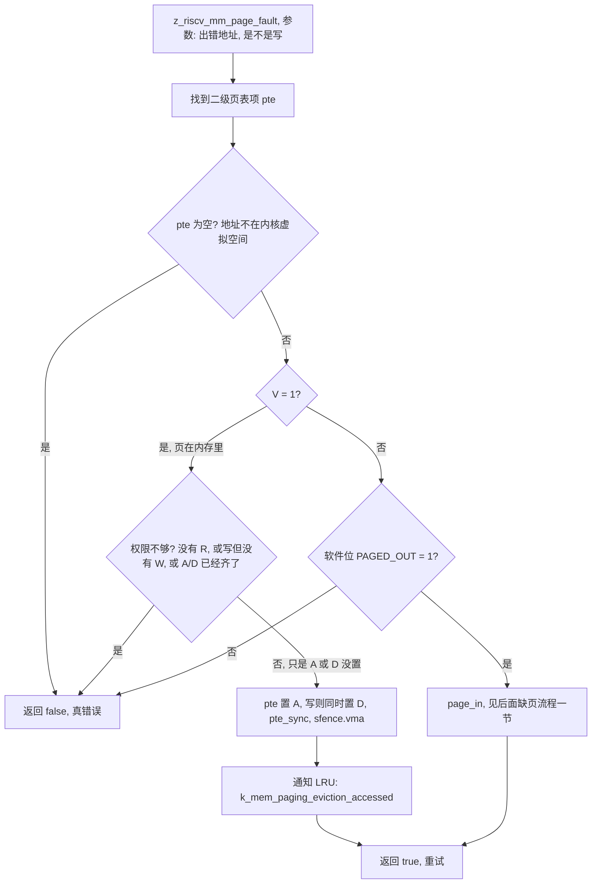

对应代码：

```c
bool z_riscv_mm_page_fault(struct arch_esf *esf, unsigned long mcause, unsigned long addr)
{
	uintptr_t va = ROUND_DOWN(addr, PAGE_SIZE);
	bool store = (mcause == RISCV_EXC_STORE_PAGE_FAULT);
	uint32_t *pte = leaf_pte(va);
	uint32_t entry;

	if (pte == NULL) {
		return false;
	}
	entry = *pte;

	if ((entry & RISCV_PTE_V) != 0U) {
		/* 页在内存里: 硬件要的是 A 位 (store 还有 D 位), 这正是要追踪的 */
		uint32_t want = RISCV_PTE_A | (store ? RISCV_PTE_D : 0U);

		if ((entry & RISCV_PTE_R) == 0U || (store && (entry & RISCV_PTE_W) == 0U) ||
		    (entry & want) == want) {
			return false;
		}
		*pte = entry | want;
		pte_sync(pte);
		tlb_flush();
#ifdef CONFIG_EVICTION_TRACKING
		k_mem_paging_eviction_accessed(pte_phys(entry));
#endif
		return true;
	}
	...
```

## 首次访问产生两次异常

`arch_mem_page_in` 把 PTE 设为 V=1、A=0、D=0，因此页被换入后，出错指令重新执行时会再次缺页（此时 V=1 但 A=0），处理程序置位 A 后，指令第三次执行才成功。首次访问一个页会进入两次异常：第一次换入，第二次置 A。第二次不涉及 SD 卡，约为几十条指令，开销可以忽略。内核统计的 page faults 只计第一种。

换入的页不直接设置 A=1，是因为 LRU 需要刚换入的页处于未访问状态，下一次访问时才记为最近使用，见下一节。

## LRU：根据 A 位选择被淘汰的页

LRU 的实现位于 `subsys/demand_paging/eviction/lru.c`，数据结构是按页帧编号索引的双向链表，以数组形式存放：

```c
/* 每个页帧记录队列里前一个和后一个页帧 */
struct lru_pf_idx {
	uint32_t next : PF_IDX_BITS;
	uint32_t prev : PF_IDX_BITS;
};
```

规则如下：

- 加入（`k_mem_paging_eviction_add`）：页被换入后，其页帧放到队尾
- 访问（`k_mem_paging_eviction_accessed`）：某页因 A=0 缺页并被置 A=1 时通知 LRU，其页帧移到队尾
- 选择（`k_mem_paging_eviction_select`）：取队首页帧（最久未使用），并读取其 D 位判断是否为脏页
- 取出时清 A：页帧从队列中取出（被淘汰，或被访问而移到队尾）时，若其原为队首，则新队首页的 A 位清零（`lru_pf_remove` 中的 `arch_page_info_get(..., clear_accessed=true)`）。新队首页若仍在使用，会立即因 A=0 缺页并被移到队尾，不会被淘汰


不常访问的页集中在队首，常用的页位于队尾。算法复杂度为 O(1)，页集合稳定时不产生额外缺页。

## 单独验证

样例 `samples/subsys/demand_paging_anon` 使用 `k_mem_map` 映射 64 页匿名内存，留给调页的页帧只有 24 个；向每一页写入由页号决定的图案，再全部读回校验。预期结果为 `0 wrong words`，并且统计中 `eviction.dirty` 不为零：这些页是脏页，换出时写入后备存储（此时为 RAM 中的一块区域）。

通过该样例可确认页表项三种状态、A/D 模拟、LRU、换入换出均正确，并且不涉及 SD 卡，出现问题时排查范围较小。

# 缺页处理的完整流程

以下是程序读取 ROM 窗口中一个字节，而该页不在内存中时的完整流程。

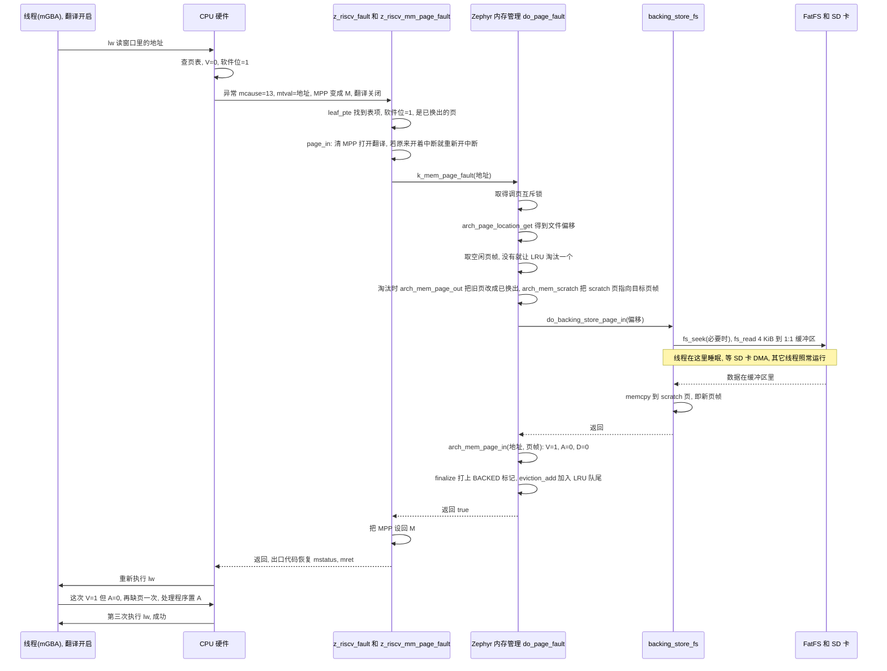

各步骤说明：

1. 访问。线程用虚拟地址读取窗口中的数据，翻译开启，硬件查页表发现 V=0，触发 load 缺页异常
2. 陷入。硬件记录 `mepc`（出错指令）、`mcause=13`、`mtval`（出错地址），`MPP←M`（翻译关闭），`MIE←0`（关中断，原状态保存在 `MPIE`）。随后跳转到 Zephyr 的异常入口 `_isr_wrapper`（`arch/riscv/core/isr.S`），把全部寄存器保存到栈上，再调用 C 函数 `z_riscv_fault(esf)`
3. 识别。`z_riscv_fault` 调用 `z_riscv_mm_page_fault`，查页表项得到 V=0 且软件位=1，确认是已换出的页，调用 `page_in`

```c
static bool page_in(uintptr_t va, const struct arch_esf *esf)
{
	bool irq_on = (esf->mstatus & MSTATUS_MPIE_EN) != 0U;
	bool ok;

	/* 处理程序是不翻译地跑的, 后备存储要通过 scratch 页填页帧,
	 * 所以从这里开始让访存翻译 */
	csr_clear(mstatus, MSTATUS_MPP);

	/* 缺页发生时中断是开着的, k_mem_page_fault() 也要求开着 */
	if (irq_on) {
		arch_irq_unlock(MSTATUS_IEN);
	}
	ok = k_mem_page_fault((void *)va);
	(void)arch_irq_lock();

	/* 没解决缺页的话, 出口要回到不翻译的状态 */
	csr_set(mstatus, MSTATUS_MPP);

	return ok;
}
```

该函数有两点需要说明：清除 MPP 以开启翻译，是因为后续要使用 scratch 页；仅当异常发生时中断是开启的才重新开启中断，这样在关中断状态下出错的代码（例如持有自旋锁的代码）不会被意外打断，Zephyr 通用代码也要求如此。

4. 通用调页。`k_mem_page_fault` 调用 `kernel/mmu.c` 中的 `do_page_fault`，这是调页的主流程：

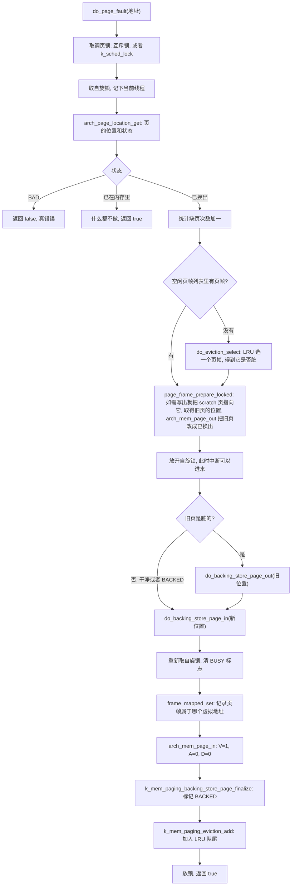

5. 后备存储读页，见下一节。过程是 `fs_read` 把 4 KiB 读入一个 1:1 的对齐缓冲区，再 `memcpy` 到 scratch 页。scratch 页是内核在虚拟地址空间中预留的一页专用地址（`K_MEM_SCRATCH_PAGE`），需要向某个物理页帧写数据时，先由架构层把它映射到该页帧（`arch_mem_scratch(phys)`），再通过这个固定的虚拟地址读写。后备存储代码因此不需要知道页帧对应的虚拟地址，该页帧此时尚未映射
6. 返回。`page_in` 把 MPP 设回 M，函数逐层返回，出口代码按栈上保存的 `mstatus`（此时 MPP=M）恢复，随后 `mret`，CPU 回到出错指令重新执行

## 缺页处理期间的睡眠

缺页处理需要读 SD 卡，SD 卡驱动使用 DMA 加中断：发起读取后线程睡眠，DMA 完成的中断唤醒线程。而 Zephyr 通用代码在单核上使用 `k_sched_lock()`（锁定调度器）保证调页操作不被其它线程打断。调度器被锁定时线程不能睡眠，否则没有线程可运行，中断之后的唤醒也无法处理，形成死锁。

多核（SMP）下 Zephyr 使用互斥锁（`z_mm_paging_lock`），没有该问题。因此增加配置项 `CONFIG_DEMAND_PAGING_BACKING_STORE_SLEEPS`（`kernel/Kconfig.vm`），使单核也使用互斥锁：

```c
/*
 * SMP 上调页操作用互斥锁串行化, 因为那里不能锁调度器;
 * UP 上只要后备存储可能睡眠也用互斥锁, 否则调页期间锁住调度器.
 */
#if defined(CONFIG_SMP) || defined(CONFIG_DEMAND_PAGING_BACKING_STORE_SLEEPS)
#define Z_MM_PAGING_LOCK_IS_MUTEX 1
#endif
```

`kernel/mmu.c` 中 `#ifdef CONFIG_SMP` 的几处（`do_page_fault`、`do_mem_evict`、`k_mem_page_frame_evict`）改为 `#ifdef Z_MM_PAGING_LOCK_IS_MUTEX`。

睡眠期间其它线程会运行，如果它们访问同一个尚未读入的页，也会缺页，并在这把互斥锁上排队。该选项适用于只有一个线程使用分页内存的系统，例如 mGBA 的模拟线程。播放器的视频线程、音频线程在此期间正常运行，因此缺页读取 SD 卡时画面和声音不受影响。

另外，持有文件系统锁时不能访问窗口内存。缺页要调用 FatFS 读文件，FatFS 有自己的互斥锁，访问窗口的代码若此时持有该锁会形成死锁。mGBA 只读窗口，不涉及这一情况，其它应用需要注意。

## 中断和缺页

启用 `CONFIG_DEMAND_PAGING_ALLOW_IRQ`（本文已启用）时，通用代码规定中断处理函数中禁止缺页（`__ASSERT(!k_is_in_isr(), "ISR page faults are forbidden")`）。本实现满足该规定：中断处理函数运行时翻译关闭，使用的全是物理地址，访问的内容都是 1:1 的，不会缺页。这也是后文"1:1 映射的范围"一节的依据。

## 单独验证

校验和样例 `samples/subsys/demand_paging_fs`：挂载 SD 卡，用 `k_mem_paging_map_file` 把一个 16 MiB 文件映射为窗口；先通过窗口指针用 CRC32 读完整个文件，再用 `fs_read` 普通读取一遍，两个 CRC 必须相等；然后随机读 512 页测量延迟。两个 CRC 均为 `84ee4776`，输出 `PASS`。具体数据见实测数据一节。

# 以 SD 卡文件作为后备存储

通用调页代码要求后备存储实现一组函数（声明于 `include/zephyr/kernel/mm/demand_paging.h`）。Zephyr 自带的实现只有 RAM 和半主机（semihost）两种，本文增加第三种：以文件系统中的文件作为后备存储（`subsys/demand_paging/backing_store/backing_store_fs.c`）。

设计要点：

- 位置即文件内偏移。窗口第 N 页对应文件第 N×4096 字节，不需要额外的映射表
- 只读，干净页直接丢弃。ROM 内容不变，内存中的页不会比文件新，因此内核淘汰页帧时，只要该页帧带有 BACKED 标志，就按干净页处理，不写回，页帧直接复用
- 一次一个文件，一个缓冲区。调页操作由内核串行化，一个静态缓冲区足够

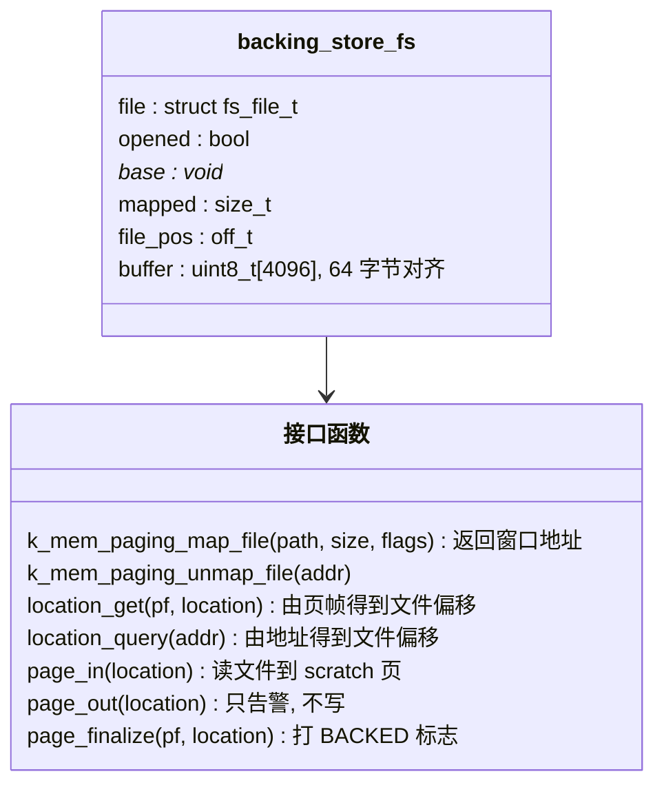

```c
static struct fs_file_t file;
static bool opened;
static void *base;               /* 窗口的起始虚拟地址 */
static size_t mapped;            /* 窗口大小, 向上取整到页 */
/* 下一次读文件从哪里开始, 顺序读的时候可以省掉 seek */
static off_t file_pos = -1;
static uint8_t buffer[PAGE] __aligned(64);
```

## 把文件映射为窗口

```c
void *k_mem_paging_map_file(const char *path, size_t *size, uint32_t flags)
{
	...
	if (fs_open(&file, path, FS_O_READ) != 0) { return NULL; }
	mapped = ROUND_UP(st.size, PAGE);
	opened = true;
	file_pos = 0;

	/* 第一页的位置是 0, 每页加一页的大小; 内容来自文件, 所以页不能被清零 */
	addr = k_mem_map_unpaged(0, mapped, K_MEM_MAP_UNINIT | flags);
	...
	base = addr;
	*size = st.size;
	return addr;
}
```

`k_mem_map_unpaged(location, size, flags)` 是 Zephyr 通用代码中已有的函数，在虚拟空间中查找 `size` 大小的连续地址，前后各保留一个不映射的保护页（越界访问立即缺页），然后对窗口的每一页调用 `arch_mem_map`，flags 中带有 `K_MEM_MAP_UNPAGED`，由前文的 `make_leaf` 把每个页表项生成为已换出状态，PPN 字段为 `location + 页序号×4096`。

`K_MEM_MAP_UNINIT` 必须设置。通用的 `k_mem_map_phys_guard` 默认在映射完成后把整块内存 `memset` 为 0，因为匿名内存需要清零。对于文件窗口，这会向 16 MiB 全部写入：逐页触发缺页，并且读入的内容立即被清为零，文件内容被破坏。板子上首次运行时即在 `memset(0x4100e000, 0, 16 MiB)` 处出错（窗口地址 `0x4100e000`，大小 `0x01000000`，`mcause=15`），加上 `K_MEM_MAP_UNINIT` 后恢复正常。

## 位置查询

内核淘汰页帧时，需要知道该页应写回后备存储的位置（`location_get`）；缺页时页表项中已记录位置。对文件后备存储，两者都是地址减去窗口基址：

```c
int k_mem_paging_backing_store_location_query(void *addr, uintptr_t *location)
{
	if (!opened || (uintptr_t)addr < (uintptr_t)base ||
	    (uintptr_t)addr >= (uintptr_t)base + mapped) {
		return -EFAULT;
	}
	*location = (uintptr_t)addr - (uintptr_t)base;
	return 0;
}

int k_mem_paging_backing_store_location_get(struct k_mem_page_frame *pf, uintptr_t *location,
					    bool page_fault)
{
	if (k_mem_page_frame_is_backed(pf)) {
		return k_mem_paging_backing_store_location_query(k_mem_page_frame_to_virt(pf), location);
	}
	/* 只读的后备存储: 其它页没地方换出 */
	return -ENOMEM;
}
```

只有 BACKED 的页帧在后备存储中有位置。非 BACKED 的页帧（例如其它位置 `k_mem_map` 得到的匿名页，在文件中没有位置）无处换出，返回 `-ENOMEM`，内核淘汰到这类页帧时会报 "out of backing store memory"（调试版本中断言失败）。因此使用文件后备存储时，其它 `k_mem_map` 得到的匿名内存需要加 `K_MEM_MAP_LOCK` 固定，不参与置换。

## 换入：读文件

```c
void k_mem_paging_backing_store_page_in(uintptr_t location)
{
	ssize_t n;

	if ((off_t)location != file_pos) {
		if (fs_seek(&file, (off_t)location, FS_SEEK_SET) != 0) { ... k_panic(); }
	}
	n = fs_read(&file, buffer, PAGE);
	if (n < 0) { ... k_panic(); }
	file_pos = (off_t)location + n;
	/* 文件的最后一页 */
	if ((size_t)n < PAGE) {
		memset(buffer + n, 0, PAGE - n);
	}
	memcpy(K_MEM_SCRATCH_PAGE, buffer, PAGE);
}
```

设计说明：

1. 先读入 `buffer` 再 `memcpy` 到 scratch 页，而不是直接读入 scratch 页。SD 卡驱动使用 DMA，DMA 需要 1:1 且 64 字节对齐的缓冲区（驱动把指针直接作为总线地址使用，同时需要避免缓存行共享）。scratch 页是非 1:1 的，其虚拟地址与目标页帧的物理地址不同，直接交给 DMA 会写入错误的物理位置。因此必须经过镜像中的静态缓冲区。额外的 4 KiB 拷贝相对 SD 卡约 0.7 到 1 ms 的读取时间可以忽略
2. `file_pos` 用于顺序读取。顺序读窗口时，下一页的位置等于上一次读完的位置，不需要 `fs_seek`。FatFS 的 `fs_seek` 需要沿簇链向前遍历，文件位置越靠后耗时越长，顺序读时省去该操作的收益较明显
3. 最后一页不满。文件大小不是 4096 的整数倍时，最后一页读到的字节数不足，剩余部分补零

## 换出：不会发生

```c
void k_mem_paging_backing_store_page_out(uintptr_t location)
{
	/* 文件是不写的: 通过可写映射改过、又没固定的页, 修改会丢掉 */
	LOG_WRN("modified page at %#lx dropped", location);
}
```

文件为只读，换出只输出告警。该函数在内核选出脏页帧（D 位为 1）时调用。只读映射（不带 `K_MEM_PERM_RW`）的页不会被写，D 位始终为 0，不会进入该函数。映射为可写时（mGBA 需要可写，见下一节），被写过的页被淘汰后修改会丢失，因此 mGBA 对可能被写入的第一页使用 `k_mem_pin` 固定。

## 标记 BACKED

```c
void k_mem_paging_backing_store_page_finalize(struct k_mem_page_frame *pf, uintptr_t location)
{
	k_mem_page_frame_set(pf, K_MEM_PAGE_FRAME_BACKED);
}
```

每次换入完成后调用，设置 BACKED 标志。此后内核认为该页帧在后备存储中有一份相同的拷贝，淘汰时不需要写回，直接复用。"干净页直接丢弃"即通过该标志实现。

## 预读

当前每次缺页只读 4 KiB。实测 SD 卡随机读 4 KiB 约 1.0 ms，16 KiB 约 1.44 ms，64 KiB 约 3.8 ms，一次读 16 KiB 只比读 4 KiB 多 40% 的时间，而顺序访问时可以一次换入 4 页。因此缺页时同时读入后续几页是明确的优化方向，目前尚未实现。

## 验证

`demand_paging_fs` 样例中 CRC 一致。页帧数量也可以核对：样例中空闲页帧为 15552 KiB = 3888 页，窗口 4096 页，顺序读完一遍后应为 4096 次缺页、208 次干净淘汰（4096 − 3888 = 208）。板子上的输出为 `4096 page faults, 208 clean pages dropped`，与计算一致。

# 1:1 映射的范围

线程在翻译开启下运行，中断和异常处理在翻译关闭下运行，对应的实现规则如下：

- 线程代码使用虚拟地址，没有限制
- 中断处理函数使用物理地址，访问的所有内存和寄存器地址必须 1:1
- 陷入入口和出口汇编（保存、恢复寄存器）使用物理地址，栈和异常帧必须 1:1，镜像中的栈天然满足
- DMA 引擎、SD 卡控制器使用物理地址（总线地址），提供给它们的缓冲区必须 1:1
- 缓存维护指令（`th.dcache.*`）使用物理地址，作用的内存必须 1:1
- 窗口内存（非 1:1 的页）是虚拟地址，不能交给驱动、DMA、缓存维护，也不能在中断中访问

1:1 的部分有程序镜像（含静态 malloc 区和栈）、外设寄存器（4 MiB 块）。非 1:1 的只有 `k_mem_map` 映射的页，即 ROM 窗口、scratch 页等。

## CLINT 和 PLIC 只接受 M 态访问

CLINT（核心本地中断控制器，包含 `mtime`/`mtimecmp` 计时器）和 PLIC（平台级中断控制器）在这颗 SoC 上只接受 M 态的总线访问。经过页表翻译的访问在总线上带有用户态身份，会被拒绝，读出值恒为全 1。

实际现象是：翻译开启后系统时间不走，读 `mtime` 得到 `0xffffffff`。

处理方式是为这两个设备编写专用的不翻译读写函数，在单条 load/store 期间临时清除 MPRV，之后恢复（`include/zephyr/arch/riscv/mm.h`）：

```c
static inline uint32_t z_riscv_mmode_read32(mem_addr_t addr)
{
	unsigned long mprv = 0x00020000UL; /* MSTATUS_MPRV */
	unsigned long saved;
	uint32_t val;

	__asm__ volatile("csrrc %[s], mstatus, %[m]\n"   /* 读出 mstatus 并清 MPRV */
			 "lw %[v], 0(%[a])\n"            /* 这一次读, 不翻译 */
			 "and %[s], %[s], %[m]\n"        /* 只留下原来 MPRV 的值 */
			 "csrs mstatus, %[s]"            /* 把 MPRV 恢复 */
			 : [s] "=&r"(saved), [v] "=&r"(val)
			 : [m] "r"(mprv), [a] "r"(addr)
			 : "memory");

	return val;
}
```

说明：`csrrc` 一条指令同时读出旧值并清位，是原子操作；若这几条指令之间发生中断，中断入口保存的 `mstatus` 中 MPRV 为 0，处理完 `mret` 返回后 MPRV 仍为 0，序列继续执行，最后一条 `csrs` 恢复 MPRV，状态不会丢失；未启用 MMU 时，同名宏退化为 `sys_read32`/`sys_write32`，没有额外开销。

使用方式是把 `drivers/timer/riscv_machine_timer.c` 中读写 `mtime`、`mtimecmp` 的位置全部换成这两个函数（包括防止 64 位寄存器读取时翻转的"高字、低字、再读高字"循环），`drivers/interrupt_controller/intc_plic.c` 中读写 PLIC 寄存器的位置同样处理。

## device_map 的地址问题：一次中断风暴的排查

Zephyr 驱动初始化时调用 `device_map()` 把设备寄存器映射到虚拟地址，之后用该地址访问寄存器。启用 MMU 后，`device_map()` 默认会在内核虚拟空间中分配一个新的虚拟地址（使用 `k_mem_map_phys_bare`），与寄存器的物理地址不同。线程中访问时翻译开启，会翻译回物理地址，没有问题；中断处理函数中翻译关闭，同一个虚拟地址被当作物理地址，访问到错误的位置。

该问题的表现是系统停在 `fs_mount`：

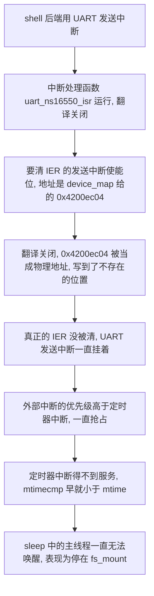

排查通过 JTAG 完成：

1. 连接 CKLink 调试器。其 JTAG 与 SD 卡槽共用 PF0/1/3/5 引脚，需要单独构建关闭 SD、将引脚切换为 JTAG 的固件
2. 连接后暂停，CPU 每次都停在 `uart_tx_handle` / `plic_irq_handler` 等中断函数中
3. `mip`（中断挂起寄存器）为 `0x880`，第 7 位（定时器）和第 11 位（外部）同时挂起；`mtime` 为 `0x883296cd`，`mtimecmp` 为 `0x0af53fc0`，定时器中断早已到期
4. 主线程 `z_main_thread` 状态为 `SLEEPING`，不在任何等待队列上，等待的是定时器
5. UART 的 `IER`（`0x02500c04`）值为 3，发送中断开启；执行 `uart_ns16550_irq_tx_disable` 之后仍为 3，写入未生效；查看汇编，驱动使用的寄存器地址是 `0x4200ec04`，不是 `0x02500c04`

修复方式是新增一个仅在 RISC-V MMU 配置下为真的隐藏选项，使 `device_map()` 直接返回物理地址，外设已经 1:1 映射：

```c
config RISCV_MMU_MMIO_IDENTITY
	bool
	default y if RISCV_MMU
```

```c
static inline void device_map(mm_reg_t *virt_addr, uintptr_t phys_addr,
			      size_t size, uint32_t flags)
{
#if defined(CONFIG_RISCV_MMU_MMIO_IDENTITY)
	/* 寄存器是 1:1 映射的, 中断里也是不翻译地用 */
	ARG_UNUSED(size);
	ARG_UNUSED(flags);
	*virt_addr = phys_addr;
#elif defined(CONFIG_MMU)
	...
```

该修改解决了所有驱动在中断中读写寄存器的情况。结论：在该设计中，凡是线程中正常、中断中异常的现象，首先检查地址是否为 1:1。

## DMA 和缓存

- 静态 malloc 区：驱动用于 DMA 的缓冲区（显示、音频、SD）均来自 libc 的 malloc 区，位于镜像内，是 1:1 的。`CONFIG_COMMON_LIBC_MALLOC_ARENA_SIZE` 必须设为有限值，本文设为 5 MiB。默认值 -1 表示占用全部空闲内存，会占用页帧，而页帧是非 1:1 的，DMA 会出错
- bounce buffer：后备存储读 SD 卡时，使用镜像中 64 字节对齐的静态缓冲区作为 DMA 目标，再拷贝到 scratch 页，见前文
- 缓存维护：`th.dcache.*`（平头哥的缓存维护扩展）接受物理地址。当前实现的缓存维护没有做虚拟地址到物理地址的转换，因此不能对窗口内存做缓存维护。如需支持，应在 SoC 的缓存函数中增加 `arch_page_phys_get` 转换
- 页表本身：页表遍历器读内存而不读缓存，因此每次修改页表项都要写回缓存行（`pte_sync`），启动时建立完整页表后调用一次 `sys_cache_data_flush_all()`

## 验证

启用 MMU 后依次验证：系统计时（`k_uptime_get` 在走）、串口 shell（中断驱动的 UART）、SD 卡读写、显示和音频。某一项出现异常时，首先检查是否有地址在中断中为非 1:1。

# 接入 mGBA

内核和架构层完成后，提供的接口为 `k_mem_paging_map_file(path, &size, flags)`，把文件转换为窗口指针。下面把它接入 mGBA。

## mGBA 获取 ROM 的方式

`GBALoadROM(gba, vf)` 接收一个 `VFile`，执行以下操作：

1. `vf->size(vf)` 获取 ROM 大小
2. 读取 `0xAC` 处的字节判断类型
3. `vf->map(vf, size, MAP_READ)` 获取指向整个 ROM 的指针，保存到 `gba->memory.rom`
4. 对整个 ROM 计算 CRC32（`doCrc32`，用于识别游戏）
5. 之后的取指、读数据均通过该指针

mGBA 自带基于内存的 `VFile`：`VFileFromConstMemory(mem, size)`，其 `map()` 直接返回传入的 `mem` 指针。传入窗口指针即可，模拟器无法区分这是真实内存还是窗口。

## gba_open

位于 `zephyr-components/mgba/src/gba_player.c`：

```c
#ifdef CONFIG_MGBA_ROM_DEMAND_PAGED
	g.rom = k_mem_paging_map_file(rom_path, &rom_len, K_MEM_PERM_RW);
	if (g.rom != NULL) {
		g.rom_mapped = true;
		/* 带时钟或传感器的卡带, 端口在 ROM 的第一页里, 写进去的东西要留住 */
		k_mem_pin(g.rom, CONFIG_MMU_PAGE_SIZE);
		ret = 0;
	} else
#endif
	{
		ret = read_file(rom_path, &g.rom, &rom_len);     /* 回退: 整个读进内存 */
	}
	...
	if (!g.core->loadROM(g.core, VFileFromConstMemory(g.rom, rom_len))) {
```

两处说明：

- 映射为可写（`K_MEM_PERM_RW`）的原因：带实时时钟、太阳能传感器的游戏卡带（例如宝可梦红宝石、绿宝石）把 GPIO 端口放在 ROM 地址空间的 `0xC4` 处，模拟器会向 ROM 缓冲区的该位置写入。窗口为只读时，写入会触发真实的缺页错误，因此映射为可写
- `k_mem_pin` 固定第一页的原因：被写过的可写页是脏页，而文件后备存储不会写回，页被淘汰时修改会丢失。GPIO 端口位于第一页（偏移 `0xC4`），固定该页后不会被淘汰，写入内容持续保留

## 写 ROM 区：写时复制

FireRed 运行不久后在板子上直接异常：`_pristineCow` 中 `memcpy` 的目的地址为 0。原因是游戏会向 AGB 调试打印端口（同样位于 ROM 地址空间高处）写入一串魔术数据，mGBA 为了模拟可写的烧录卡，会调用 `_pristineCow`：为整个 32 MiB 的卡带地址空间分配一份匿名的私有拷贝，把 ROM 复制进去，之后的写操作写入拷贝。32 MiB 的分配失败，返回 NULL，随后 `memcpy` 向地址 0 写入，触发缺页错误。

处理方式是让这些写操作直接写入窗口。它们只是调试端口的写入，页被丢弃不影响游戏运行。为此对 mGBA 的 `gba/memory.c` 做了一份带一处修改的拷贝（`mgba/src/gba_memory.c`），使 `_pristineCow` 在分页模式下不执行任何操作：

```c
void _pristineCow(struct GBA* gba) {
#ifdef MGBA_ROM_DEMAND_PAGED
	/* ROM 是请求调页的窗口: 私有拷贝要分配整个 32 MiB 的卡带空间。
	 * 调试打印端口和卡带端口直接写进窗口, 写过又没固定的页会丢掉修改 */
	return;
#endif
	if (!gba->isPristine) {
		return;
	}
	...
```

采用拷贝文件而不是打补丁，是因为 mGBA 以 git 子模块方式引入，保持不修改。该拷贝只在 `CONFIG_MGBA_ROM_DEMAND_PAGED` 启用时生效，未启用时与上游行为一致。

## 加载时序

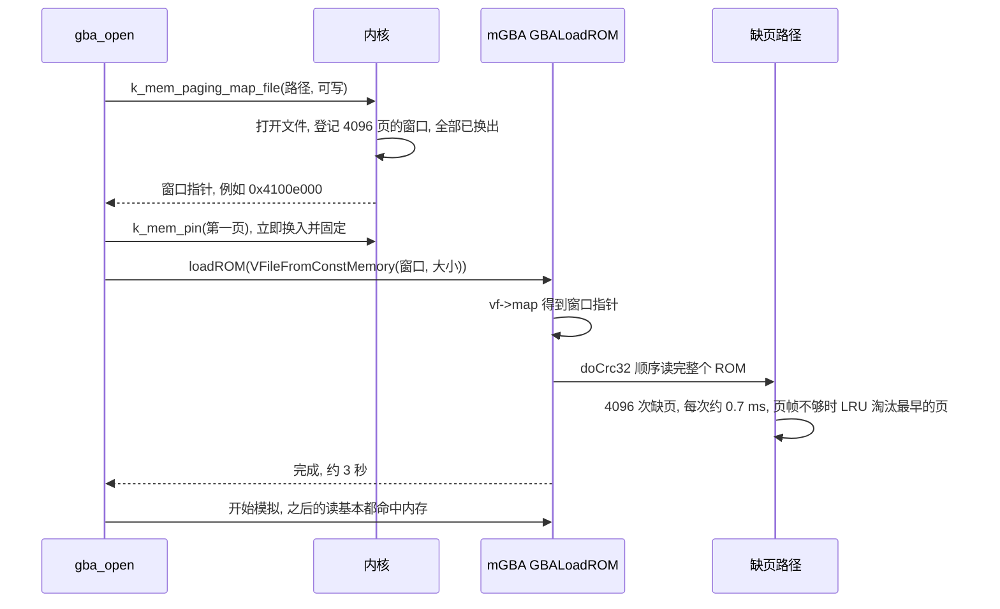

加载约需 3 秒，主要用于 CRC 计算时读取全部 16 MiB。之后游戏运行时 ROM 访问的局部性较强，每 5 秒只有几次到几十次缺页。

## 配置

配置片段 `paged.conf` 启用所需的全部选项（`zephyr-components/mgba/samples/gba_player/paged.conf`）：

```
CONFIG_SUN252I_F101_MMU=y
CONFIG_DEMAND_PAGING=y
CONFIG_DEMAND_PAGING_ALLOW_IRQ=y
CONFIG_EVICTION_LRU=y
CONFIG_BACKING_STORE_FS=y
CONFIG_MGBA_ROM_DEMAND_PAGED=y
CONFIG_MGBA_MAX_ROM_SIZE_MB=32
# 有限的 arena: 剩下的内存留给 ROM 的页帧
CONFIG_COMMON_LIBC_MALLOC_ARENA_SIZE=5242880
```

构建时使用 `-DEXTRA_CONF_FILE=.../paged.conf` 叠加到示例自身的 `prj.conf` 上。

## 内存分配

- 镜像（代码、数据、栈）约 4.1 MiB，包含 LVGL、显示、音频、SD 等
- 静态 malloc 区 5 MiB，mGBA 的模拟状态、帧缓冲、音频缓冲位于其中
- 页帧约 6.8 MiB（1748 个），用于 ROM 页
- ROM 窗口 16 MiB（4096 页），为虚拟地址，不占用物理内存

窗口大小是页帧的 2.3 倍。LRU 有效的原因是 ROM 访问局部性强，游戏当前使用的代码和数据只是一小部分，工作集通常小于 6.8 MiB，换页次数较少。

启动日志中应出现 `ROM /SD:/xxx.gba, 16777216 bytes`，`demand_paging_fs` 中加载的 CRC 一致，游戏正常启动并有声音。

# 实现步骤

以下按顺序说明从零实现的过程，起点为支持 Sv32 的 RISC-V 板子和可运行的 Zephyr。每个阶段设有检查点，按顺序进行，出现问题时排查范围较小。


1. 裸机探针。确认以下行为，整个设计以此为前提：`MPRV=1, MPP=U` 时数据访存按页表翻译、取指不翻译；陷入时 MPP 变为 M、`mret` 之后变回 U；没有 PMP 放行项时产生访问异常；缺页的 `mcause`/`mtval`/`mepc` 符合预期；A 位为 0 时缺页（硬件不自动置位）；CLINT/PLIC 在翻译开启时读出全 1。CPU 行为与此不同时（例如硬件自动置 A/D），设计中相应部分需要调整
2. Kconfig。`arch/riscv/Kconfig` 中增加：

```
config RISCV_MMU
	bool "Sv32 MMU for a machine mode kernel"
	depends on !64BIT && !SMP && !RISCV_PMP
	select CPU_HAS_MMU
	select MMU
	select ARCH_HAS_DEMAND_PAGING
	select ARCH_HAS_DEMAND_MAPPING
	select ARCH_SUPPORTS_EVICTION_TRACKING

config RISCV_MMU_MMIO_IDENTITY
	bool
	default y if RISCV_MMU

config RISCV_MMU_BOOT_INFO
	bool "Print the memory map at boot"
	depends on RISCV_MMU
	default y
```

   SoC 的 Kconfig 中增加总开关（`SUN252I_F101_MMU`，`select RISCV_MMU`），并在 `Kconfig.defconfig` 中为 `KERNEL_VM_SIZE` 设置默认值，本文为 `0x2000000`（32 MiB）。`KERNEL_VM_SIZE` 决定需要预备的二级页表数量，每 4 MiB 一张
3. 链接脚本。`linker.ld` 中定义 `z_mapped_start`，并使镜像末尾按页对齐。通用内存管理代码通过 `z_mapped_start`/`z_mapped_end` 获知镜像占用的物理页
4. 头文件 `include/zephyr/arch/riscv/mm.h`。包含 PTE 位定义（含软件位）、`struct riscv_mmu_region`、`ARCH_DATA_PAGE_*` 和 `ARCH_UNPAGED_ANON_*` 常量（通用代码使用）、CLINT/PLIC 的不翻译读写函数。在 `arch.h` 中 `#include` 该文件（`#ifdef CONFIG_MMU`），在 `irq.h` 中增加两个异常号：

```c
#define RISCV_EXC_LOAD_PAGE_FAULT 13
#define RISCV_EXC_STORE_PAGE_FAULT 15
```

5. `arch/riscv/core/mmu.c` 主体。依次包括：页表（`root_table`、`l2_tables`，4096 对齐）；辅助函数（`pte_ppn`、`pte_phys`、`pte_is_table`、`tlb_flush`、`pte_sync`、`leaf_pte`、`make_leaf`）；`z_riscv_mm_init()`（挂载二级表、映射镜像、映射外设、`sys_cache_data_flush_all()`、PMP 放行、写 `satp`、`sfence.vma`、`MPP←U`、`MPRV←1`）。SoC 提供 `riscv_mmu_regions[]`，并在 SoC 的 `CMakeLists.txt` 中增加 `zephyr_sources_ifdef(CONFIG_SUN252I_F101_MMU mmu_regions.c)`
6. 启动流程。在 `z_prep_c()` 中，`arch_cache_init()` 之后、`z_cstart()` 之前调用 `z_riscv_mm_init()`
7. 通用内存管理所需的架构接口：`arch_mem_map`、`arch_mem_unmap`、`arch_page_phys_get`。只启用 `CONFIG_MMU` 而不启用 `CONFIG_DEMAND_PAGING` 时，Zephyr 使用它们为 `k_mem_map` 分配匿名页
8. 缺页入口。在 `fatal.c` 的 `z_riscv_fault` 中增加钩子，在 `mmu.c` 中先实现 `z_riscv_mm_page_fault` 的 A/D 位部分，暂不处理换页
9. CPU 状态切换。`thread.c` 的 `arch_new_thread` 中增加 `stack_init->mstatus |= MSTATUS_MPRV`；`switch.S` 的 `z_riscv_switch` 末尾增加 `csrc mstatus, MPP`
10. CLINT、PLIC、`device_map`。定时器驱动和 PLIC 驱动中所有对 CLINT/PLIC 寄存器的读写换成 `z_riscv_mmode_read32/write32`；`device_map()` 在 `RISCV_MMU_MMIO_IDENTITY` 下直接返回物理地址

完成以上步骤即达到阶段一的检查点：仅实现 1:1 映射，可以启动、打印，串口和定时器正常。

11. 启用 `CONFIG_DEMAND_PAGING`、`CONFIG_EVICTION_LRU`，在 `mmu.c` 中补充 `arch_mem_page_out`、`arch_mem_page_in`、`arch_page_location_get`、`arch_page_info_get`、`arch_mem_scratch` 和 `page_in()`，运行 `demand_paging_anon`，结果应为 0 个错误字，并有脏页淘汰。这是阶段二的检查点
12. 内核小改动：增加 `CONFIG_DEMAND_PAGING_BACKING_STORE_SLEEPS`（`kernel/Kconfig.vm`）和 `Z_MM_PAGING_LOCK_IS_MUTEX`（`kernel/mmu.c`），把 `#ifdef CONFIG_SMP` 的三处替换为后者
13. 文件后备存储。`subsys/demand_paging/backing_store/backing_store_fs.c` 加上 `Kconfig`（`CONFIG_BACKING_STORE_FS`）和 `CMakeLists.txt`，头文件 `include/zephyr/kernel/mm/backing_store_fs.h` 声明 `k_mem_paging_map_file`/`k_mem_paging_unmap_file`。阶段三的检查点是 `demand_paging_fs` 样例 CRC 一致、输出 `PASS`。SD 卡中需要放置足够大的文件（本文为 16 MiB），应用的 `prj.conf` 需要 `CONFIG_SDHC`、`CONFIG_FILE_SYSTEM`、FatFS、`CONFIG_MAIN_STACK_SIZE=8192`，缺页读文件时调用栈较深
14. 应用接入。按上一节的方式：`k_mem_paging_map_file` 得到窗口指针交给应用；malloc 区设为有限大小；窗口不交给驱动。阶段四的检查点是应用行为与之前一致（本文为画面 CRC 不变），启动时间增加加载一遍的耗时

## 在这块板子上运行

使用 xfel 通过 USB 下载，不经过 boot0 和 u-boot：

1. 板子断电再上电，每次下载都需要重新上电，`exec` 之后 FEL 模式即退出
2. 执行 `xfel ddr f101-s3`（初始化 PSRAM，并打开 UART3 时钟和引脚）、`xfel write 0x40010000 zephyr.bin`、`xfel exec 0x40010000`
3. 通过串口（UART3，PE08/PE09，115200）查看输出

构建命令：

```
west build -b f101_evb -d build/dp-fs zephyr/samples/subsys/demand_paging_fs
west build -b f101_evb -d build/gba-kirby zephyr-components/mgba/samples/gba_player \
    -- -DEXTRA_CONF_FILE=$PWD/zephyr-components/mgba/samples/gba_player/paged.conf \
       -DCONFIG_SAMPLE_GBA_ROM=\"/SD:/Kirby.gba\"
```

# 调试和已遇到的问题

## 已遇到的问题

- 启用 MMU 后第一次访存即异常，`mcause` 为 5 或 7。M 态加 MPRV=U 的访问受 PMP 检查，没有匹配项时默认拒绝。增加一条覆盖全部地址、可读写执行的 NAPOT PMP。裸机探针阶段已出现该现象
- 系统时间不走，读 `mtime` 得到 `0xffffffff`。CLINT 不接受翻译后的访问。使用 `z_riscv_mmode_read32/write32`
- 显示初始化之后系统无响应。原因不是 MMU，而是 `main` 线程默认栈只有 1 KiB，发生溢出，最初误判为 MMU 问题。修改 `CONFIG_MAIN_STACK_SIZE=8192`。结论：出现无响应时先排除栈溢出
- 停在 `fs_mount`，PC 位于 UART 中断中。`device_map()` 返回的虚拟地址在中断中被当作物理地址，UART 发送中断无法关闭，定时器中断得不到服务。使用 `RISCV_MMU_MMIO_IDENTITY`，见前文
- 映射 16 MiB 窗口时在 `memset` 处异常，`mcause=15`。`k_mem_map` 默认把映射清零，对文件窗口既耗时又会破坏内容。使用 `K_MEM_MAP_UNINIT`
- 使用 JTAG 调试时 SD 卡不可用。板子的 SD 卡槽与 JTAG 共用 PF0/1/3/5 引脚，调试需要单独构建，关闭 SD，并把这几个引脚切换为 JTAG 复用（复用号 4）

以下几项在设计阶段已处理，没有实际出现过：

- 页表项已修改，访问仍使用旧映射：页表遍历器读内存而不读数据缓存，因此每次修改页表项后写回缓存行（`pte_sync`）
- 手动修改 `mstatus.MPP` 的代码存在进入用户态的风险：`mret` 按 MPP 返回，MPP=U 时执行 `mret` 会降到用户态。清除 MPP 的位置在退出前需要设回 M（`page_in` 即如此处理），或确认后续的出口会从异常帧恢复 `mstatus`（Zephyr 的出口即如此）
- 线程恢复后在翻译关闭状态下运行：上下文切换发生在陷入态，MPP 为 M，被恢复的线程本应翻译开启。因此 `z_riscv_switch` 末尾清除 MPP
- 启动时 DMA 数据错误：缓冲区来自 `k_mem_map` 的页（非 1:1），或 malloc 区被设为全部空闲内存。malloc 区设为有限的静态大小
- 窗口中被写过的数据丢失：可写映射的脏页被淘汰时，后备存储为只读，修改丢失。需要保留修改的页使用 `k_mem_pin`，mGBA 中固定了第一页

## 调试手段

1. 启动信息（`CONFIG_RISCV_MMU_BOOT_INFO`）：页表划分、页帧数量一目了然，可用超页一节的公式核对
2. 缺页统计（`CONFIG_DEMAND_PAGING_STATS`，`k_mem_paging_stats_get`）：缺页次数、干净和脏淘汰次数，用于核对，例如前文的 4096 − 3888 = 208
3. 未处理的异常：Zephyr 的致命错误输出包含 `mcause`、`mtval`、`mepc`、`mstatus`，用 `addr2line` 把 `mepc` 和调用栈转换为源码行，先确认 `mtval` 是哪个地址、`mcause` 是读还是写
4. JTAG 加 GDB（CKLink 加平头哥 DebugServer）：暂停后执行 `info registers pc mstatus mcause mepc mtval satp mip`，读取 `mtime`/`mtimecmp`，查看 `z_main_thread` 的状态和 `callee_saved.ra`。对于系统无响应的问题，比添加打印更有效，前述 UART 中断风暴即通过该方式定位
5. PC 采样：由一个线程定时读取被测线程栈上保存的 `mepc`，按 64 字节块统计热点，再用 `addr2line` 汇总到函数，用于区分停顿位置和耗时位置
6. 分阶段样例：先用匿名内存样例（无 SD 卡、无文件系统）验证调页，再用文件样例验证后备存储，最后接入应用

## 未确定原因的问题

同一份固件（FireRed，分页配置）在几十次运行中出现过两次无响应，一次在启动阶段，一次在游戏运行 7 秒后，重新运行后不再出现，原因未确定，也没有复现方法。可能的原因包括：CPU 频率提高到 960 MHz（之后版本为 1008 MHz）但未调整电压，时钟边沿不稳定；SD 卡偶发读超时；分页代码中极少触发的竞争。遇到类似现象时，先降低 CPU 频率以排除时钟因素。

# 实测数据

以下数据均来自板子上的实测（F101 EVB，SD 卡，串口日志）。`demand_paging_fs` 样例没有调频，运行在 FEL 启动后的 600 MHz；mGBA 播放器的数据在 960 MHz 下测得，之后频率提高到 1008 MHz，声音和帧率略有改善，不影响结论。

## 匿名内存调页

`demand_paging_anon`：`k_mem_map` 映射 64 页，可用页帧只留 24 个，每页写入图案后读回校验，错误字数为 0，统计中有脏页淘汰（换出到 RAM 后备存储再换入）。

## 文件后备存储

`demand_paging_fs`，16 MiB 文件（FireRed ROM），空闲页帧 15552 KiB（3888 页）：

- 通过窗口顺序读完整个文件：2850 到 2879 ms，4096 次缺页，208 次干净淘汰
- 用 `fs_read` 顺序读同一文件：1504 到 1508 ms
- 两种读法的 CRC32 均为 `84ee4776`，相等，结果 `PASS`

窗口读法比直接 `fs_read` 慢约一倍，原因是每次只读 4 KiB（`fs_read` 以 64 KiB 为单位），并且每次缺页都有陷入、换入以及两次异常的开销。平均每次缺页 `2.9 s / 4096 ≈ 0.7 ms`。

随机读 512 页平均 25 到 29 µs，这一数字不代表缺页延迟：测量时页大多已在内存中，之前已顺序读过整个文件，3888 页仍保留在页帧中。真实的随机缺页延迟取决于 SD 卡读取 4 KiB 的时间，约 1.0 ms。

## SD 卡读取速度

随机读，每个文件取平均：

- 4 KiB：约 1.0 ms（FireRed 1063 µs，Kirby 1001 µs）
- 16 KiB：约 1.44 到 1.5 ms
- 64 KiB：约 3.8 ms
- 256 KiB：约 13.6 ms

读取 16 KiB 只比读取 4 KiB 多 40% 的时间，数据量为 4 倍，预读有明显的收益空间。

## mGBA 播放器

- FireRed、Kirby 从窗口加载，均可启动运行，声音和画面正常（演示动画中部分重场景超出帧时间预算，见下）
- 加载时的 CRC 遍历：约 4166（FireRed）到 4246（Kirby）次缺页，约 2418 到 2505 次干净淘汰（页帧只有 1748 个，少于 ROM 的 4096 页）
- 稳态：每 5 秒几次到几十次缺页，进入新场景时短暂升至 80 多次，占用时间很少
- 塞尔达基准每帧耗时：未启用 MMU 12.98 ms；启用 MMU 使用 4 KiB 页 13.56 ms（+4.5%）；使用 4 MiB 超页 13.32 ms（+2.6%）
- 塞尔达基准的画面 CRC（第 400、600、800、1000、1200 帧）：三种配置完全相同
- 重场景（Kirby 演示约 105 秒处、FireRed 演示中的几段）：每帧 18 ms 左右，这段时间每 5 秒的缺页只有 0 到 30 次，瓶颈在模拟器解释器本身，不在调页

出现卡顿时，需要先确认是否由换页引起，上述数据表明重场景的耗时与换页无关。

## 复现方法

- 缺页统计：`CONFIG_DEMAND_PAGING_STATS=y`，调用 `k_mem_paging_stats_get(&s)`，查看 `s.pagefaults.cnt`、`s.eviction.clean`、`s.eviction.dirty`
- 塞尔达基准：`CONFIG_SAMPLE_GBA_BENCH=y`，每 200 帧打印一次画面 CRC，不限速运行 1200 帧，对比不同配置的 CRC 和耗时
- SD 卡速度：`CONFIG_SAMPLE_GBA_ROM_DIAG=y`，对卡上每个 ROM 文件做随机读测试
