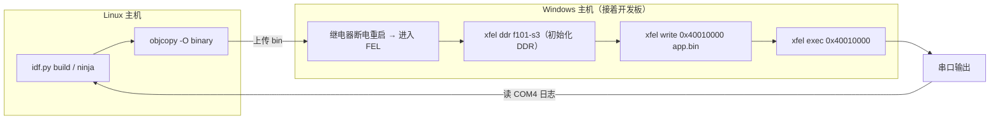
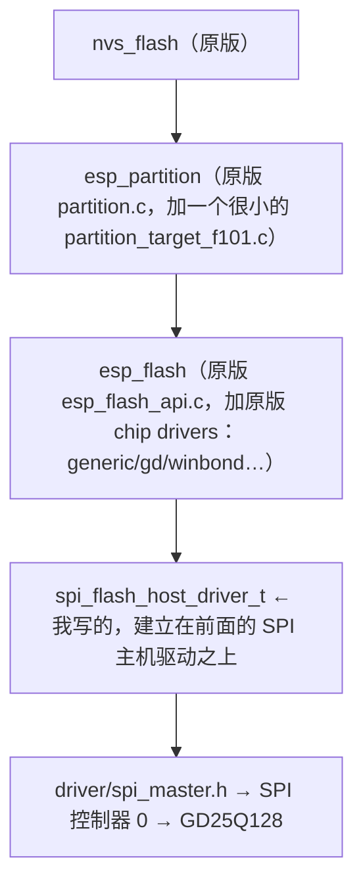

# 前言

F101 是一颗单核的 RISC-V 小 SoC，参数如下：

- 核心是 T-Head 玄铁 C907，rv32imac，带 FPU，MMU 有但是不启用
- 16 MB PSRAM，映射在 `0x40000000`
- 中断：CLINT `0x14000000`（定时器），PLIC `0x10000000`（外设中断）
- 板子上有 4.3 寸 RGB 屏（1024x600）、SD 卡槽、SPI NOR flash、片上音频 codec、USB，还有一堆 UART/I2C/ADC/PWM
- 控制台走 UART3，PE08/PE09

这块板子的开发方式和别的不太一样：没有 bootloader，也没有烧录流程。上电之后停在 FEL（USB 下载模式），在主机上用 `xfel` 把程序写进 PSRAM，然后直接跳过去跑。

这次想做的是把它移植进 ESP-IDF，目标有三条：

1. 用 ESP 风格开发，`idf.py`、`esp_log`、FreeRTOS、`driver/*`、`esp_lcd`、NVS 这些接口原样可用
2. 不引入特殊接口，对外全是 ESP-IDF 标准的头文件和 API，只重写实现
3. 每个功能都要上真板子验证，不是能编译就算完

工具链先沿用 Espressif 的 `riscv32-esp-elf`（esp-15.2），为什么不用玄铁自己的后面会说。

整个开发流程是这样的：



有两个地方要记住。每次下载都要先断电重启，因为 `exec` 之后 FEL 就没了。另外 `xfel ddr` 除了初始化内存，还会顺手把 UART3 的时钟和引脚复用配好，不执行它的话，连裸机程序都没有串口输出。

# 在 IDF 里注册一个新 target

IDF 对非乐鑫的芯片是有先例的，`linux` target 自己就提供了 `soc`、`hal`、`esp_rom`、`esp_hw_support`、`esp_system` 一整套，所以骨架照着 `linux` 和 ESP32-C3 抄就行。

新建的 target 叫 `sun252i-f101`，用预览模式启用：

```bash
idf.py --preview set-target sun252i-f101
```

需要改的入口有四处：

- `Kconfig`：增加 `IDF_TARGET_SUN252I_F101`
- `tools/idf_py_actions/constants.py`：把 target 登记到预览列表
- `tools/cmake/project.cmake`：target 相关的变量，比如 map 文件里的目标名
- `tools/cmake/toolchain-sun252i-f101.cmake`：工具链文件

第一个小坑是命名。命令行里是连字符的 `sun252i-f101`，但 Kconfig 符号和 C 宏里只能用下划线 `SUN252I_F101`。`project.cmake` 里有一处拿 target 名拼符号，要加一行：

```cmake
string(REPLACE "-" "_" idf_target ${idf_target})
```

不加的话链接选项里的符号名是错的。

## RAM 应用

没有 bootloader，也没有 flash 镜像，所以用 IDF 的 RAM 应用类型：

```
CONFIG_APP_BUILD_TYPE_RAM=y
CONFIG_FREERTOS_UNICORE=y
CONFIG_ESP_CONSOLE_UART_CUSTOM=y
CONFIG_ESP_CONSOLE_UART_CUSTOM_NUM_3=y
```

链接地址是 `0x40010000`，前 64 KiB 留给 FEL 阶段用。产物用 `riscv32-esp-elf-objcopy -O binary` 转成裸 bin。

## 为什么不用玄铁工具链

一开始的想法很直接，C907 是玄铁的核，那就用玄铁自己的 GCC。结果一试就撞墙了。玄铁那套是 newlib 工具链，自带的 `stdlib.h`、`string.h` 和 IDF 的 `esp_libc/platform_include` 互相冲突，两边都想定义 `struct timespec`、`_reent` 这类东西。而 Espressif 的 `riscv32-esp-elf` 本来就是给 IDF 配套的，picolibc 的头文件体系和 IDF 是吻合的。

所以先用 Espressif 的工具链把功能跑通，玄铁工具链留作以后的优化项。C907 有自己的扩展指令，比如 T-Head 的缓存维护指令，后面做显示的时候会碰到。

## 每个组件只加 4 行钩子

这里定了一条贯穿全文的原则：尽量少改 IDF 原有的文件。每个需要为 F101 做实现的组件，都在它的 `CMakeLists.txt` 最前面加这几行：

```cmake
idf_build_get_property(target IDF_TARGET)
if(${target} STREQUAL "sun252i-f101")
    include(${CMAKE_CURRENT_LIST_DIR}/sun252i-f101/component.cmake)
    return()
endif()
```

F101 自己的源码、头文件、`idf_component_register(...)` 全都放在该组件下的 `sun252i-f101/` 目录里。这样 diff 很干净，以后 rebase 到新的 IDF 版本也容易。

这里有个很容易搞反的地方，我被绊了两次：同一个 `component.cmake` 里，两种路径的基准目录不一样。`SRCS` 的相对路径是相对于组件目录的，而 `INCLUDE_DIRS` 的相对路径是相对于 `component.cmake` 所在的目录。所以同一个文件里会这样写：

```cmake
idf_component_register(SRCS "sun252i-f101/gpio_f101.c"            # 相对组件目录
                       INCLUDE_DIRS "../include" "include"        # 相对 sun252i-f101/
                       ...)
```

写错了 CMake 会报 `Cannot find source file` 或者 `Include directory ... is not a directory`，路径里会出现 `sun252i-f101/sun252i-f101/include` 这种重复，一眼就能看出是基准搞反了。

# soc / hal / esp_rom 最小骨架

IDF 的头文件体系大量依赖 `soc/soc_caps.h`，驱动代码里的 `#if SOC_XXX_SUPPORTED` 决定哪些功能存在。所以第一步要给新 target 提供这些东西：

- `components/soc/sun252i-f101/include/soc/soc_caps.h`：能力宏，比如有几个 UART、几个 I2C
- `Kconfig.soc_caps.in`：同样的能力在 Kconfig 里再写一份
- `clk_tree_defs.h`：时钟源枚举，`UART_SCLK_DEFAULT`、`GPTIMER_CLK_SRC_DEFAULT` 这些
- `sun252i_f101_ll.h`：自己写的低层寄存器头，PIO、UART、CLINT、CCU 的寄存器偏移和几个小内联函数
- `esp_rom/sun252i-f101`：这颗芯片没有 ESP ROM，`esp_rom_printf`、`esp_rom_delay_us`、crc 之类的都要自己提供

注意 `soc_caps.h` 是 C 宏，`Kconfig.soc_caps.in` 是 Kconfig 符号，两份必须同步。IDF 里有的代码用 `#if SOC_XXX` 读 C 宏，有的 CMake 用 `CONFIG_SOC_XXX` 读 Kconfig，只写一份就会出现这边认为支持、那边认为不支持。后面 LVGL 就吃了这个亏：`esp_lvgl_port` 判断 RGB 屏支不支持用的是 `SOC_LCDCAM_RGB_LCD_SUPPORTED`，我只定义了 `SOC_LCD_RGB_SUPPORTED`，运行时直接报 `This target does not support RGB.`。

另外很多 `esp_hal_*` 组件假设 `${target}/xxx_periph.c` 一定存在。比如 `esp_hal_gpio` 的 CMake 在 `SOC_GPIO_PORT > 0` 时会把 `gpio_hal.c` 编进来，而这些 ESP 的 HAL 对 F101 一点用都没有，寄存器完全不同。我的处理办法是 F101 的驱动组件不去 `REQUIRES` 这些 hal 组件，只把它们的 `include` 目录当头文件源加进来，拿 `hal/gpio_types.h` 这类纯类型头文件。

# 先别碰 IDF，点个灯

在引入 IDF 这个庞然大物之前，先要证明三件事：`xfel` 这条路是通的，代码确实在跑，UART3 有输出。所以先写了一个很小的裸机程序 `bringup`，自带 `start.S` 和链接脚本，链接在 `0x40010000`，轮询 UART3 的 LSR 等发送空闲，然后写 THR。

```bash
${CROSS_COMPILE}gcc -march=rv32imac -mabi=ilp32 -nostdlib -Ttext=0x40010000 ...
objcopy -O binary
```

上板一次就通了，还顺带测出几个后面一直要用的事实：

- UART 重新初始化为 24 MHz 时钟、115200 波特率是可行的
- CLINT 的 `mtime` 是 24 MHz，10 ms 实测 `240025` 个计数
- PA0..PA3 能正常当 GPIO 用，PA4..PA7 永远读 0，不知道是没引出还是被拉低了
- 驱动 PB2 会让控制台挂死。PB0..PB3 是背光的 PWM 引脚，EVB 上拿 PB2 当 GPIO 输出会把背光电路拉成奇怪的状态，之后串口就没输出了

最后一条记在小本本上，测 GPIO 千万别碰 PB0..PB3。

另外这里留下一条后面反复用到的经验：串口没输出的时候，先写个裸机探针确认 xfel、UART 和接线，再去怀疑 IDF。探针能打印，就说明 exec、UART、接线都没问题，故障在软件里。

# 启动与链接

从 `xfel exec` 那一瞬间，到 `app_main()` 被调用，中间的路要自己搭：入口汇编、CSR 初始化、栈、bss 清零、堆的初始化、链接脚本。

## start.S

关键的地方有这么几处：

```asm
    .section .exception_vectors.text, "ax"   /* 镜像里第一个 */
call_start_cpu0:
    csrci mstatus, 8            /* 关全局中断，FEL 的 exec 可能留着 MIE */
    li    t0, 0x2000
    csrs  mstatus, t0           /* FPU 状态设为 initial，后面 LVGL 那节会解释 */
    csrw  mie, zero
    csrw  mip, zero
    li    t0, 0x70013 ; csrw 0x7c2, t0   /* mcor：C907 扩展 CSR */
    li    t0, 0x11ff  ; csrw 0x7c1, t0   /* mhcr：指令/数据缓存等 */
    li    t0, 0x16e30c; csrw 0x7c5, t0   /* mhint：预取/分支预测 */
    fence ; fence.i
    la t0, f101_early_trap ; csrw mtvec, t0   /* 调度器接管之前的陷阱处理 */
    ...
    la sp, _startup_stack_top
    (清 bss)
    call call_start_cpu0_c
```

说明几点：

1. 入口地址必须是 `0x40010000`，因为 `xfel exec` 直接跳那里，链接脚本要保证入口排在镜像最前面
2. `0x7c1/0x7c2/0x7c5` 是玄铁的扩展 CSR（`mhcr`/`mcor`/`mhint`），控制缓存和预取。FEL 退出时的状态没有保证，得自己设
3. `f101_early_trap` 是一个极早期的陷阱处理，在调度器接管 `mtvec` 之前一旦出异常，直接打印 `mcause/mepc/mtval/ra`、abort 字符串和一段栈内容，然后停住。这个小东西救了我很多次，后面那些莫名其妙的崩溃几乎都是靠它打出来的寄存器定位的

## 链接脚本

整个镜像放在一个 16 MB 的区域里：

```
MEMORY { ram_seg (RWX) : org = 0x40010000, len = 0xFF0000 }
REGION_ALIAS("iram_text_seg", ram_seg);  REGION_ALIAS("dram_seg", ram_seg);
REGION_ALIAS("flash_text_seg", ram_seg); ...（所有 IDF 要的段别名都指向同一段）
```

IDF 的链接脚本模板要求有 iram、dram、flash、rtc 一堆区域别名，F101 没有这些区分，所以全部别名到同一块 RAM。代码、数据、堆共用一个区域，`_heap_end` 是 RAM 末尾。

## 入口地址漂移：串口输出 5555UUUU

代码稍微长大一点，板子就只输出一串 `5555UUUU` 之类的乱码，甚至完全沉默。

最早的做法是 `xfel exec <ELF 里的入口地址>`，比如 `0x40010660`。入口函数在 `.text` 里排在别的函数后面，代码一长入口地址就变了，而下载脚本里写死的是旧地址。链接顺序再一变，入口甚至根本不在 `0x40010000`。

后来把 `call_start_cpu0` 放进专门的段 `.exception_vectors.text`，让这个段在镜像里排第一，入口就永远固定在 `0x40010000`，下载脚本也永远是 `exec 0x40010000`。

## 几个启动阶段的小问题

`heap_caps_init` 断言。启动后报 `assert failed: heap_caps_init`。IDF 的启动流程里，`heap_caps_init` 是通过 `ESP_SYSTEM_INIT_FN(init_heap, CORE, 100)` 注册、自动调用的，我在自己的 `cpu_start.c` 里又手动调了一次。把手动调用删掉就好了，IDF 的 init 函数链会做的事，不要重复做。

控制台编号。能看到启动信息，但 `ESP_LOGI` 没输出，或者输出到了没接线的串口。IDF 的 `esp_stdio` 只让选 UART0/1 或 USB，而 F101 的控制台是 UART3。我在 `components/esp_stdio/Kconfig` 里加了 UART2/UART3 的自定义编号选项，在 `sdkconfig.defaults` 里选 `CONFIG_ESP_CONSOLE_UART_CUSTOM_NUM_3=y`。

`esp_rom_printf` 静默。IDF 日志系统是正常的，但早期的 `esp_rom_printf`，也就是启动阶段和 panic 里用的那个，一个字都不出。原因是 IDF 里 `esp_rom_print.c`、`esp_rom_sys.c` 对目标有没有 ROM printf 有硬编码的守卫，F101 不在名单里。给这两个文件各打一处很小的补丁，再在启动时调用 `esp_rom_install_uart_printf()` 装好 UART 输出就行了。这是少数几处不得不改 IDF 原文件的地方之一。

# FreeRTOS 移植

IDF 自带的 RISC-V FreeRTOS 端口是围着 ESP 的中断矩阵和 systimer 设计的，F101 一个都没有。所以新写了一个端口目录 `FreeRTOS-Kernel/portable/sun252i`，在 `freertos/CMakeLists.txt` 里把 `port_dir` 指过去。IDF 的 `esp_additions`（`xTaskCreatePinnedToCore` 等）保留不动。

## tick 和 esp_timer 共用一个比较器

tick 来自 CLINT 的 `mtimecmp`。F101 只有一个定时器比较寄存器，而 FreeRTOS 的 tick 和 `esp_timer` 的 alarm 都要用它。做法是：

- `esp_timer_impl_set_alarm_id()` 算出下一次 alarm 的 mtime 值，交给 FreeRTOS 端口
- 端口每次编程 `mtimecmp`，都取下一个 tick 和下一个 alarm 里较早的那个
- 中断来了先判断是 tick 还是 alarm，分别处理，alarm 回调是 `esp_timer` 初始化时注册进来的

`esp_timer` 本身用 24 MHz 的 `mtime` 当时间源，`esp_timer_get_time()` 就是 `mtime / 24`。

## 外部中断走 PLIC

`esp_intr_alloc(source, ...)` 的 `source` 直接就是 PLIC 的中断号，UART3 是 5，GPIO 的 PE 组是 67，DMA 是 50。写了一个很薄的 `intr_f101.c`：使能、设优先级，在 trap 里 claim、调回调、complete。

## 陷阱帧兼容 RvExcFrame

IDF 的 panic 处理和 `esp_backtrace` 都是按 `RvExcFrame` 的布局读寄存器的，所以任务切换保存的陷阱帧严格按 176 字节、同样的字段顺序排布（`mepc, ra, sp, gp, tp, t0..., mstatus`）。这样 IDF 的 panic 打印直接能用，一个字都不用改。创建任务时手工布置的初始帧是这样：

```c
frame[0]  = (uint32_t)pxCode;            /* mepc */
frame[1]  = (uint32_t)prvTaskExitError;  /* ra   */
frame[2]  = (uint32_t)frame + 176;       /* sp   */
frame[4]  = tls;                         /* tp   */
frame[10] = (uint32_t)pvParameters;      /* a0   */
frame[32] = MSTATUS_MPIE | MSTATUS_MPP_M | (1u << 13);  /* 返回后开中断，FPU=initial */
```

## yield 和 TLS

主动让出 CPU（`taskYIELD()`）执行 `ecall`，在 trap 里走和中断同一条路径：保存上下文、选下一个任务、恢复。单核，所以临界区就是关 MIE。

picolibc 用 `tp` 指向线程本地存储（`errno` 之类）。创建任务时在栈顶开一块，把 `.tdata` 拷进去、`.tbss` 清零，`tp` 指过去，也就是上面帧里的 `frame[4]`。

## mtime / mtimecmp 的 64 位访问

RV32 上 64 位的 `mtime`/`mtimecmp` 要分两次 32 位访问，处理不好就会偶发时间跳变或者丢 tick。这里的写法是：

```c
/* 读 mtime：高-低-高，高位变了就重读 */
do { hi = REG(MTIME+4); lo = REG(MTIME); hi2 = REG(MTIME+4); } while (hi != hi2);

/* 写 mtimecmp：先把高位写成 0xFFFFFFFF，避免中途出现一个很小的比较值而误触发，再写低、再写高 */
REG(MTIMECMP+4) = 0xffffffff;
REG(MTIMECMP)   = (uint32_t)next;
REG(MTIMECMP+4) = (uint32_t)(next >> 32);
```

这颗 SoC 上还有个已知的陷阱：24 MHz 下 `mtime` 低 32 位大约 179 秒回绕一次。我在同一块硬件的另一个系统移植里踩过，tick 比较值的高 32 位漏写成了 0，系统在 179 秒后冻住。所以这里 64 位的 tick 计算、比较值写入全部按 64 位处理，不在任何地方假设只用低 32 位。

# IDF 启动日志

做到这一步，终于看到熟悉的东西了：

```
ESP-ROM:sun252i-f101-fel
Build:Oct  5 2026
rst:0x1 (POWERON),boot:0x0 (FEL_DOWNLOAD)
I (3738) cpu_start: Pro cpu up.
I (3741) cpu_start: Pro cpu start user code
I (3745) cpu_start: cpu freq: 600000000 Hz
I (3749) app_init: Application information:
I (3753) app_init: Project name:     hello_world
I (3774) heap_init: Initializing. RAM available for dynamic allocation:
I (3780) heap_init: At 40034810 len 00FCB7F0 (16173 KiB): RAM
I (3786) main_task: Started on CPU0
I (3786) main_task: Calling app_main()
```

每一行都是某一部分已经工作的证据：开头的 `ESP-ROM` 横幅说明我提供的 `esp_rom` 启动信息没问题；`cpu_start: Pro cpu up` 说明 IDF 的启动流程已经到了我的 `call_start_cpu0_c`；`app_init` 说明 `esp_app_desc` 被正确链接；`heap_init ... 16173 KiB` 说明堆初始化好了，PSRAM 剩下的部分都能用；最后的 `main_task: Started` 和 `Calling app_main()` 说明 FreeRTOS 调度器、任务创建和 tick 都在工作。

之后用 `hello_world` 配延时循环和周期性的 `esp_timer` 回调，确认 tick 和 alarm 共用同一个比较器的时候，两边都能按时触发。内核这一层到这里就算完成了，接下来都是在这个基础上一个一个接驱动。

# 驱动：GPIO / UART / I2C / ADC / SPI / 定时器 / PWM / 看门狗 / SD

每个驱动走的都是同一套路：

1. 对着寄存器手册和已有的参考实现，把寄存器操作写成一个小小的 C 文件
2. 对外实现 IDF 标准头文件里声明的函数（`driver/gpio.h`、`driver/uart.h` 等），头文件一律用 IDF 原版
3. 写一个 `driver_test`，每个功能都带 PASS/FAIL 自检，上板跑
4. 失败了就用日志和寄存器值定位

## GPIO（driver/gpio.h）

F101 的 PIO 一共 6 个 bank（PA..PF），每个 bank 的寄存器间隔 `0x30`：配置寄存器在偏移 0（4 位一个脚）、数据 `0x10`、驱动能力 `0x14`、上下拉 `0x24`。外部中断 EINT 的寄存器块在 `0x200 + 0x20 * bank`。

IDF 的 `gpio_num_t` 是个整数，我定义引脚号 = `bank*32 + n`，再提供 `GPIO_NUM_PA(n)`、`GPIO_NUM_PE(n)` 这类宏。

板上验证，PA0..PA3 的上拉下拉、输出回读都 PASS，`gpio_install_isr_service` 加电平中断、下降沿中断也都 PASS。中间卡了两次。

一次是边沿中断一个都不来，电平中断是好的。我直接把原始 EINT 状态寄存器打印出来对照，拉低、拉高各读一次，发现边沿模式下状态位始终不动。翻寄存器说明才知道，EINT 有个去抖时钟寄存器（块内偏移 +0x18），默认值下边沿检测是没有时钟的。往里写 1，选 24 MHz 去抖时钟，边沿立刻就正常了。

另一次出在 `gpio_config()` 上。它的 `pin_bit_mask` 是 64 位，而 F101 有 192 个脚，PE10 就是 138，所以只能覆盖前 64 个。64 往上的脚要直接用 `gpio_set_direction()` / `gpio_set_level()`，后面音频的功放使能脚 PE10 就是这么处理的。

## UART（driver/uart.h）

F101 的 UART 是 DW-APB 16550 兼容的，寄存器 32 位间隔，时钟 24 MHz，波特率除数 = `24000000 / (16 * baud)`。驱动实现了 `uart_param_config`、`uart_driver_install`、`uart_write_bytes`、`uart_read_bytes`、`uart_set_baudrate` 和回环，接收用 FIFO 中断加 stream buffer。

设 115200，实测除数换算后是 115384，偏差 0.16%，在 1% 以内。回环写 19 字节读回 19 字节，256 字节回环全对，改成 57600 波特率也对。

回环测试一开始多收了一个字节。原因是控制台日志也在同一个 UART3 上，输出漏进了回环，测试前先 `uart_wait_tx_done()` 等发送空闲再开回环就没事了。

F101 有 6 个 UART，IDF 的 `uart_port_t` 枚举只到 `UART_NUM_4`。我给 `hal/uart_types.h` 补了 `UART_NUM_5`（用 `SOC_UART_HP_NUM > 5` 守卫），再把 `SOC_UART_NUM` 改成 6。这又是一处对 IDF 原文件的小改动。

引脚复用上还栽过一次。一开始对所有串口都写复用 6，UART3（PE8/PE9）正好对，别的就都错了。后来做成一张表，每个串口、每个信号允许哪些引脚、对应哪个复用值：

```
UART0  TX PF2        RX PF4        复用 3
UART1  TX PF0 / PB0  RX PF1 / PB1  复用 4
UART2  TX PF4        RX PF5        复用 6
UART3  TX PE8        RX PE9        复用 6
UART4  TX PE2        RX PE3        复用 6
UART5  TX PE4        RX PE5        复用 7
```

`uart_set_pin` 先在表里查，查不到返回 `ESP_ERR_INVALID_ARG`，RTS/CTS 引脚返回 `ESP_ERR_NOT_SUPPORTED`，因为这颗芯片没有对应的引脚。测试里用 UART5 的 PE4/PE5 验证了复用寄存器读回是 7，错误的引脚被拒绝。注意 PF 引脚和 JTAG/SD 共用，PE2 是 USB 的 VBUS 开关，实际使用要避开冲突。

## I2C（driver/i2c_master.h）

TWI 控制器，轮询实现，`i2c_new_master_bus` / `i2c_master_bus_add_device` / `i2c_master_transmit_receive` 都对上了。扫描总线找到一个设备 `0x51`，读寄存器 0 得到 `0x08`，不存在的地址会 NACK，删掉总线再创建也正常。

一开始整条 I2C 一挂就死。我按 I2C1 = PE6/PE7 去配，结果总线完全没有响应，传输永远等不到完成。查表才发现这颗芯片上 TWI1 的引脚是 PE0（SCL）/PE1（SDA），复用 4。引脚复用表不能靠猜，也不能靠相邻的引脚应该一样。

## ADC（esp_adc/adc_oneshot.h）

GPADC，12 位，对上了 `adc_oneshot_new_unit` / `adc_oneshot_config_channel` / `adc_oneshot_read`。实测值：

```
adc ch0: 4091 4093     <- 接了高电平
adc ch1: 3 3           <- 接地
adc ch2: 3 3
adc ch3: 1596 1593     <- 中间电平
PASS adc rejects a channel that is not bonded
```

通道 4..11 能配置成功，但永远等不到转换完成。这颗芯片只引出了 0..3 四个通道，其余的在封装里没有引脚。驱动里对 4..11 直接返回 `ESP_ERR_INVALID_ARG`，测试里专门有一条拒绝未引出通道的用例。

## SPI（driver/spi_master.h）

SPI 控制器 0 对应 `SPI2_HOST`，也就是板载 NOR flash 的 PC0..PC5，控制器 1 对应 `SPI3_HOST`。事务的命令、地址、数据按字节拼进 FIFO，发送和接收各用 64 字节 FIFO 边填边读。

验证是读 JEDEC ID，得到 `c8 40 18`，GigaDevice GD25Q128，16 MB。在 `0x30000` 读到 `FARD`，是板上 Arduino core 的魔数。300 字节读两次一致，换到 24 MHz 仍然一致。这些只读测试不会破坏 flash 内容，测试阶段很安全。后面存储那节里，这个 SPI 驱动会成为 `esp_flash` 的底座。

## 通用定时器（driver/gptimer.h）

HSTIMER 的计数时钟是 200 MHz，驱动里按目标分辨率分频成 1 MHz。

有两个小插曲。一个是定时器快了 8 倍，因为我一开始按 24 MHz 去算分频，翻寄存器说明才确认计数时钟是 200 MHz。另一个是算 `alarm_count` 的时候想用 128 位乘法防溢出，rv32 没有 `__int128`，改成先除后乘，拆成两个 64 位操作。

测下来 gptimer 计数和 `esp_timer` 测得的时间只差 1~3 微秒，周期 alarm 在 105 ms 里触发 9 次（10 ms 周期），单次 alarm 只触发一次。

## PWM（driver/ledc.h）

F101 的 PWM 控制器每个通道对应固定的引脚，IDF 的 LEDC timer + channel 模型映射成通道时钟分频 + 周期寄存器 + 占空寄存器。引脚和通道不对应的时候返回错误。

这里的验证方式和别处不一样。一开始想靠采样引脚电平来验证占空比，结果发现引脚复用到 PWM 之后，GPIO 的电平读回寄存器读不出实际的波形电平。所以测试改成了解码寄存器：

```
pwm ch1 regs: src 24000000 m 0 pre 0 count 24000 active 6000 -> 1000 Hz, duty 25.0%, en 2 gate 2
pwm ch1 regs: ... active 12000 -> 1000 Hz, duty 50.0%
pwm ch1 regs: ... active 18000 -> 1000 Hz, duty 75.0%
pwm ch1 after set_freq(2000): 2000 Hz
```

寄存器解出来的频率和占空比都对得上。

## 任务看门狗（esp_task_wdt.h）

用硬件看门狗加 esp_timer 的定时检查，实现了 `esp_task_wdt_init/add/reset/delete/status`。测试里故意放一个不喂狗的 user，日志会按 IDF 标准格式打出来：

```
E (8543) task_wdt: Task watchdog got triggered. The following tasks/users did not reset the watchdog in time:
E (8553) task_wdt:  - stuck_user (CPU 0)
```

删掉那个 user 之后，看门狗又安静下来，也 PASS。这些 `E (...)` 开头的 error 是故意触发的负面测试，不是故障，测试里有很多这样预期会失败的用例。

## SD 卡（sdmmc_cmd.h）

SMHC0 控制器，`f101_sdmmc_host()` 返回一个 `sdmmc_host_t`，之后的卡初始化、读写都走 IDF 原版的 `sdmmc` 协议层（`sdmmc_card_init`、`sdmmc_read_sectors`、`sdmmc_write_sectors`）。主机实现是轮询、1 位总线、40 MHz。

```
sd card: asdfg, 15728640 sectors of 512 bytes (7680 MiB), 40000 kHz, 1 bit bus, rca 0x1
sector 0 signature: 55 aa
PASS sd write and read back one sector      <- 写后读回
PASS sd original sector restored            <- 测完把原内容还原
```

还有几个容易漏的细节。控制器复位必须先打开模块时钟，否则复位不生效；`sdmmc_host_t` 里 `check_buffer_alignment`、`input_delay_phase = SDMMC_DELAY_PHASE_0` 这几个字段不能漏；协议层会调 `sd_pwr_ctrl_set_io_voltage()`，我的主机没有可调电压，给个桩函数就行。

## 驱动放在哪

驱动不另外打包成一个组件，而是照 IDF 自己的划分拆开，每个组件下开一个 `sun252i-f101/` 目录，也就是前面说的 4 行钩子。应用侧因此和别的 ESP 板子一样，直接 `REQUIRES esp_driver_gpio esp_driver_uart ...`，不需要额外的组件搜索路径。

大致的位置如下：

- gpio：`esp_driver_gpio/sun252i-f101/gpio_f101.c`
- uart、i2c、spi、gptimer、ledc：分别在 `esp_driver_uart`、`esp_driver_i2c`、`esp_driver_spi`、`esp_driver_gptimer`、`esp_driver_ledc` 下的 `sun252i-f101/`
- adc：`esp_adc/sun252i-f101/`
- 任务看门狗：`esp_system/port/soc/sun252i-f101/`
- sdmmc 主机：`esp_driver_sdmmc/sun252i-f101/`，原版协议层在 `sdmmc` 组件自己的 f101 分支里，只编 5 个协议源文件
- `gpio_num.h`、`adc_cali_schemes.h`：各自组件的 `sun252i-f101/include/`

路径基准搞反过一次，就是前面说的 `SRCS` 和 `INCLUDE_DIRS` 的差别。

`sdmmc` 组件还引出了一个链接错误。它的 Kconfig 一被加载，`CONFIG_SD_ENABLE_SDIO_SUPPORT` 默认就是 `y`，协议层的 `sdmmc_init.c` 会引用 `sdmmc_io_*` 函数，而我只编了 5 个协议源文件，链接期直接缺符号。解法是在 `component.cmake` 里按这个配置项条件加入 `sdmmc_io.c`。

到这里 `driver_test`、`display_test` 在板上跑下来都是 `RESULT: PASS (0 failures)`。这一步没有新功能，但它定下了后面所有驱动的放置方式：新驱动一律先问一句，IDF 里它应该在哪个组件。

# 显示

## 第一版

F101 的显示通路是：显示引擎 DE（多个图层、混合、缩放）→ TCON（时序）→ RGB 输出 → 面板 → PWM 背光。显示栈放在 `esp_lcd/sun252i-f101/sunxi/` 里，有 DE、TCON、RGB 编码器、简单面板和 PWM 背光。

整条流水线跟 OS 无关，只有一层 OS 接口要自己实现，就是 `dpy_os_idf.c`，提供内存分配、互斥信号量、延时、中断注册、时钟复位（直接操作 CCU 的 PLL_VIDEO0 / DE / TCON 时钟）、PWM_BL 背光块和缓存维护。板级的流水线图 `disp0 → rgb → panel` 写死在 `dpy_board_f101.c` 里。

第一次点亮打出来的日志：

```
display: core: disp0 -> rgb -> panel: 1024x600@60.794Hz
W display: tcon-clk: pixel clock 49000000 Hz requested, 48000000 Hz possible
I display: tcon-lcd: pixel clock 48000000 Hz (module 288000000 Hz / 6)
```

像素时钟请求 49 MHz，实际只能做到 48 MHz，是模块时钟 288 MHz 的 6 分频，面板能接受，刷新 60.8 Hz。

`display_test` 的自检项：30 个 vsync 用 498 ms，即 60.2 Hz；DE UI0 图层地址寄存器等于我的 framebuffer 地址；TCON 控制寄存器 bit31（使能）是 `0x80000000`；背光等级和 blank 开关，这些都 PASS。

## 缓存维护指令的编码

framebuffer 在 PSRAM 里，CPU 又有数据缓存，写完像素必须把缓存行写回（clean），显示引擎才能读到最新内容。C907 的缓存维护指令是玄铁自己的扩展：`th.dcache.cpa` 按物理地址 clean，`th.dcache.ipa` invalidate，`th.dcache.cipa` clean 加 invalidate。Espressif 的 GCC 不认识这些助记符，所以用 `.word` 写原始编码：

```c
register uintptr_t r asm("a0") = addr;
asm volatile(".word 0x0295000b" :: "r"(r) : "memory");   /* th.dcache.cpa  a0 */
asm volatile(".word 0x02a5000b" :: "r"(r) : "memory");   /* th.dcache.ipa  a0 */
asm volatile(".word 0x02b5000b" :: "r"(r) : "memory");   /* th.dcache.cipa a0 */
```

我最开始写的 `ipa`/`cipa` 编码是凭印象写的，是不对的。后来用玄铁的汇编器把 `th.dcache.ipa a0` / `th.dcache.cipa a0` 汇编出来，对着机器码核对，才改成上面的值。这类裸编码一定要用权威的汇编器反汇编核对一次，写错的症状往往很隐蔽，不是崩溃，而是画面里偶尔冒出旧内容。

缓存行是 64 字节，代码里按 64 字节对齐逐行操作，前后各加 `fence`。

## 显示引擎和 CPU 抢内存带宽

1024x600、16 位色、60 Hz，光扫描就要大约 74 MB/s。如果 CPU 同时大量访问 PSRAM，显示有欠载的风险。所以初始化里把 MBUS 配成显示引擎走最高优先级、CPU 限速到约 500 MB/s，目的是让扫描不会被 CPU 的访存饿死。

## 第二版：换成 esp_lcd 的 RGB 面板

第一版对外是我自己的一套 `f101_display_init() / f101_display_draw_bitmap() / f101_display_set_backlight()`。回头看的时候意识到，这是个特殊接口，跟 ESP 风格这个目标是矛盾的。于是改掉，对外只暴露标准的：

```c
esp_lcd_rgb_panel_config_t cfg = {
    .data_width = 16, .in_color_format = LCD_COLOR_FMT_RGB565,
    .num_fbs = 2,
    .timings = { .h_res = 1024, .v_res = 600 },
};
esp_lcd_new_rgb_panel(&cfg, &panel);
esp_lcd_panel_reset(panel);  esp_lcd_panel_init(panel);
esp_lcd_rgb_panel_get_frame_buffer(panel, 2, &fb0, &fb1);
esp_lcd_panel_draw_bitmap(panel, 0, 0, 1024, 600, fb1);   // 把 framebuffer 本身传进去就是翻页
esp_lcd_panel_set_brightness(panel, 220);                  // 背光
esp_lcd_rgb_panel_register_event_callbacks(panel, &cbs, ctx);   // on_vsync / on_frame_buf_complete
```

对接时的取舍有这么几条：

- 时序和引脚由板级描述决定，`esp_lcd_rgb_panel_config_t` 里只校验分辨率，其余不用
- 多缓冲：`num_fbs` 最多 3。`draw_bitmap` 收到的指针如果就是驱动自己的某个整屏 framebuffer，就不拷贝，直接切换扫描输出，和 ESP 的行为一致；否则按区域拷到当前扫描输出的缓冲并 clean 缓存
- vsync 回调：显示栈只提供等 vsync，所以起了一个高优先级的小任务循环等待，再调用 `on_vsync` / `on_frame_buf_complete`。注意 ESP 原版是在中断里调的，这里是在任务里
- 背光：`esp_lcd_panel_set_brightness(0..255)`，由显示栈自己的 PWM 背光块实现，不用另外配 LEDC
- 不支持的：`mirror`、`swap_xy`、`esp_lcd_rgb_panel_set_pclk` 返回 `ESP_ERR_NOT_SUPPORTED`，而且只能有一个面板

重写后的板上验证：

```
I lcd.rgb: 1024x600 @ 61 Hz, 2 frame buffer(s)
PASS flip to frame buffer 1
30 vsync callbacks in 499 ms (60 Hz)
DE UI0 address 0x40168740, frame buffer 0x40168740    <- 翻页后显示引擎确实在扫描新缓冲
PASS partial bitmap is in the scanned out buffer
```

日志里那些 `E (...) lcd.rgb: ... invalid area` / `mirror is not supported` / `the display engine drives one panel` 是测试故意触发的负面用例：越界区域、不支持的镜像、创建第二个面板，驱动按设计拒绝了它们。

# LVGL 仪表盘

接下来写一个不是测试用例的东西，就是画一个 UI。选了 LVGL，通过 IDF 官方的 `esp_lvgl_port` 组件接进来。界面做成一个 1024x600 的深色仪表盘：标题栏带运行时间、系统信息卡片、剩余堆的环形仪表、背光滑条、滚动折线图。触摸屏还没接，所以滑条和开关暂时按不动，只有数值和图表在动。

## 组件管理器

`lvgl` 和 `esp_lvgl_port` 是 IDF component manager 管的外部组件，写在 `main/idf_component.yml` 里：

```yaml
dependencies:
  lvgl/lvgl: "^9.3.0"
  espressif/esp_lvgl_port: "^2.6.0"
```

第一关就卡住了。配置完一个组件都没下载，直接编译报找不到 `esp_lvgl_port.h`。原因有两个叠在一起：我的环境脚本 `env-idf.sh` 里设了 `IDF_COMPONENT_MANAGER=0`，早期是为了不联网；把它打开之后又崩在 `idf_component_manager` 里，`Version.coerce(os.getenv('ESP_IDF_VERSION'))` 抛 `TypeError: expected string or bytes-like object, got 'NoneType'`，因为没走 IDF 官方的 `export.sh`，`ESP_IDF_VERSION` 环境变量是空的。构建这个应用时手动 `export IDF_COMPONENT_MANAGER=1 ESP_IDF_VERSION=6.1` 就能绕过去。

## 编译错误逐个清

- `esp_lcd_io_i2c.h: driver/i2c_types.h: No such file`：`esp_lcd_panel_io.h` 会把所有总线的头都包含进来。解法是 f101 的 `esp_lcd` 组件 `REQUIRES esp_driver_i2c esp_driver_spi`，并把 parlio/i2s 的头文件目录当纯头文件源加进来
- `LV_COLOR_FORMAT_RGB565_SWAPPED undeclared`：lvgl 9.2 没有这个枚举，`esp_lvgl_port` 2.6 需要更新的 lvgl。依赖改成 `^9.3.0`，实际解析出 9.6.0
- `LV_MEM_SIZE_KILOBYTES is deprecated` 被当成 error：新版 lvgl 改用字节单位的 `LV_MEM_SIZE`，在 `sdkconfig.defaults` 里写 `CONFIG_LV_MEM_SIZE=65536`
- `unknown type name 'soc_periph_lcd_clk_src_t'`：`hal/lcd_types.h` 需要这个类型，在 `clk_tree_defs.h` 里补一个只有 `LCD_CLK_SRC_DEFAULT` 的枚举

## 第一次运行：This target does not support RGB

```
I (3966) LVGL: Starting LVGL task
E (3966) LVGL: lvgl_port_add_disp_rgb(222): This target does not support RGB.
```

`esp_lvgl_port` 里用 `#if (SOC_LCDCAM_RGB_LCD_SUPPORTED && ESP_IDF_VERSION >= ...)` 决定要不要编 RGB 支持，而我只定义了 `SOC_LCD_RGB_SUPPORTED`。补上 `SOC_LCDCAM_RGB_LCD_SUPPORTED`，`soc_caps.h` 和 `Kconfig.soc_caps.in` 两处都要补，就是前面说的那份能力描述的老教训。补完之后 RGB 路径就编进来了。

## 第二次运行：Guru Meditation Error

UI 起来了，打印一句 `ui running`，然后立刻崩溃：

```
Guru Meditation Error: Core  0 panic'ed (Unknown reason).
MEPC    : 0x40074f30  RA      : 0x40017cb4  SP      : 0x4030e590
...
MSTATUS : 0x00001880  MTVEC   : 0x40016c34  MCAUSE  : 0x00000002  MTVAL   : 0x002024f3
```

先看 `MCAUSE = 2`，是非法指令异常。对非法指令异常来说，`mtval` 通常就是出错那条指令的机器码，拆开 `0x002024f3`：

```
0x002024f3 = 0000 0000 0010 0000 0010 0100 1111 0011
opcode[6:0]   = 1110011 = 0x73  -> SYSTEM 类指令
rd[11:7]      = 01001   = x9 (s1)
funct3[14:12] = 010     = CSRRS
csr[31:20]    = 0x002   = frm（浮点舍入模式）
```

也就是 `csrrs s1, frm, zero`，汇编别名 `frrm s1`，读浮点舍入模式 CSR。

再到 ELF 里看 `MEPC` 对应的函数：

```bash
riscv32-esp-elf-addr2line -pfie lvgl_ui.elf 0x40074f30 0x40017cb4
# __floatsisf at .../libgcc/soft-fp/floatsisf.c:39
# update_cb  at .../main/lvgl_ui_main.c:182
```

反汇编同一地址确认是 `40074f30:  002024f3   frrm s1`。调用链是 UI 定时器回调 `update_cb`（里面用 `sinf()` 画正弦波）调到 libgcc 的软浮点 `__floatsisf`（int 转 float）。

原因是这样的：应用是按 rv32imac 编的，没有 F 扩展，浮点全部走软件实现。可 libgcc 的 soft-fp 实现里会先 `frrm` 读一下舍入模式，而 `mstatus.FS = 0`（浮点单元关闭）的时候，任何访问浮点 CSR 的指令都是非法指令。之前所有测试都没用过浮点，所以一直没暴露。

这颗芯片其实是有 FPU 的，所以 CSR 能被访问，只要把它打开就行。两处都要改：

```asm
/* start.S：启动时把 FS 设成 initial(01) */
li   t0, 0x2000
csrs mstatus, t0
```
```c
/* port.c：新建任务的初始陷阱帧的 mstatus 也要带上 FS，否则第一次任务切换 mret 之后
   mstatus 又被帧里的值覆盖，FS 重新变成 0 */
frame[32] = MSTATUS_MPIE | MSTATUS_MPP_M | (1u << 13);
```

应用依然按 rv32imac 软浮点编译，所以任务切换不需要保存浮点寄存器，只是 FS 位要保持打开，让 `frm` 可读。这个坑不只属于 LVGL，任何用到浮点的第三方库都会碰到，`sinf`、`printf("%f")` 都一样。

修好之后：

```
I (5053) lvgl_ui: ui running
I (5053) main_task: Returned from app_main()
```

连续跑了 10 秒以上没有崩溃，定时器每 0.5 秒刷一次仪表盘数据。

# 存储：esp_flash → esp_partition → NVS

想要的效果是跟 ESP32 上一模一样：

```c
nvs_flash_init();
nvs_open("test", NVS_READWRITE, &h);
nvs_set_u32(h, "boots", n);  nvs_commit(h);
```

NVS 往下是 `esp_partition`，再往下是 `esp_flash`，再往下才是硬件。这里的做法是这三层全用 IDF 原版，只在最底下提供一个 `spi_flash_host_driver_t`，也就是 IDF 里 flash 芯片驱动对主机的抽象接口，用它去操作 NOR flash。



板上 flash 里本来就有东西：`0x30000` 是 Arduino core，魔数 `FARD`，`0x500000` 是一个 sketch，前面还有 boot 相关的内容。所以所有擦写都限制在 `0x800000` 之后，那一块是专门留来做实验的空区域。分区表放在 `0x800000`，`CONFIG_PARTITION_TABLE_OFFSET=0x800000`，后面是：

```
# Name,   Type, SubType, Offset,   Size
nvs,      data, nvs,     0x801000, 0x6000
storage,  data, 0x40,    0x807000, 0x10000
```

## 一堆缺失的头文件

IDF 的 `esp_flash_api.c` 默认建立在 ESP 的 MSPI 硬件上，所以它会 include 一批我没有的头：`hal/spi_flash_ll.h`、`hal/spi_flash_encrypted_ll.h`、`esp_private/spi_share_hw_ctrl.h`、`esp_efuse.h`、`bootloader_util.h` 等等。

处理办法是写最小的垫片头文件，放在组件自己的 `sun252i-f101/include/` 下，而且要排在 `INCLUDE_DIRS` 最前面，这样才能压过 `esp_hal_mspi/include` 里的同名头文件。比如 `hal/spi_flash_hal.h` 的垫片里只定义 esp_flash 层真正用到的几个类型：

```c
typedef struct {
    spi_flash_host_inst_t inst;   /* 必须是第一个成员 */
    void *spi;                    /* 非 NULL 表示这个 chip 已经可用 */
    uint32_t slicer_flags;
} spi_flash_hal_context_t;
```

原因是 `esp_flash_api.c` 里有这样的检查：`((memspi_host_inst_t*)chip->host)->spi == NULL` 就返回 `ESP_ERR_INVALID_ARG`。也就是说它假设 `chip->host` 一定是个 memspi 上下文，我的 host 结构把这个上下文放在第一个成员，正好满足这个假设。

另外还有几项：

- `spi_flash_mmap()` 没有 MMU 可用，用读到一块 RAM 里再返回指针来模拟，分区表就是这么读的
- `partition.c` 用到的 `esp_efuse_is_flash_encryption_enabled()`、`bootloader_util_regions_overlap()` 都给桩
- `CONFIG_PARTITION_TABLE_MD5=n`，因为没有 `esp_rom_md5`
- NVS 的加密分区代码引用了 mbedtls 的 XTS，我提供一个 `mbedtls/private/aes.h` 垫片和一组全部返回不支持的桩函数。这样编译链接都能过，但加密的 NVS 分区会被拒绝

## 第一次上板：读得到，擦除卡死

```
I (4659) storage_test: PASS read at 0x30000
        <- 此后串口再没有任何输出
```

读 ID 是 `c8 40 18`，16 MiB，读 `0x30000` 得到 `FARD`，都对了，但第一次擦除就卡住了。没有 panic，没有日志，纯粹是死循环。我先在 host 的 `common_command` 里临时加了一行 `TRACE`，把每条 flash 命令打出来，结果是擦除之前一条命令都没发出去，说明卡在 esp_flash 层，还没到 SPI。

翻 `spi_flash_chip_generic_wait_idle()`：

```c
while (!chip->host->driver->host_status(chip->host) && timeout_us > 0) { ... delay ... }
```

`host_status()` 要求主机空闲的时候返回非零，而我返回了 0，于是 `wait_idle`（超时设成了无限）就永远在这个循环里转。改成 `return 1;` 就行了，我的所有传输都是轮询完成的，主机永远是空闲的。擦除立刻通过。

## 第二次：写入崩溃

```
E (6442) spi_flash: host_common_command(50): 24 bit addresses only
Guru Meditation Error: Core  0 panic'ed (Unknown reason).
MEPC    : 0xb0a66a64   RA : 0xb0a66c3a ...   MCAUSE : 0x00000002  MTVAL : 0x55555557
Stack memory:
400318c0: 0xccc5beb7 0xe8e1dad3 0x04fdf6ef 0x2019120b ...
```

`MEPC` 是个乱码地址，栈里却整整齐齐地躺着 `0xccc5beb7 0xe8e1dad3 ...`，这些正是测试里写入的数据模式 `i*7+3`。也就是栈被写入的数据覆盖了。

去看 `spi_flash_chip_generic_write()`：

```c
uint8_t temp_buffer[64];                // "spiflash hal max length of write no longer than 64byte"
...
uint32_t page_len = host->driver->write_data_slicer(...);   // 我的 slicer 返回了整页 256 字节
memcpy(temp_buffer + left_off, buffer, write_len);          // 往 64 字节的栈数组里拷了 256 字节
```

IDF 的通用芯片驱动默认主机一次最多处理 64 字节，这是 ESP MSPI 硬件的限制，每一片都先拷到栈上的 `temp_buffer[64]` 里。我的 slicer 按页边界返回 256 字节，直接把栈冲坏了。第一步的修复是让 write slicer 最多返回 64 字节。

## 第三次：读也一样，崩在 free

写过了，读回来又崩：

```
assert failed: heap_caps_free heap_caps_base.c:80 (heap != NULL && "free() target pointer is outside heap areas")
```

`addr2line` 出来的调用栈是 `os_release_temp_buffer → free`，但传进 `release_temp_buffer` 的指针是 `0x645d564f`，又是数据模式。同样的问题，这次在读路径：`spi_flash_chip_generic_read()` 里也有一个 `temp_buffer[64]`，而我的 read slicer 一次最多返回 4096 字节。栈溢出把 `esp_flash_read` 自己栈帧里的 `temp_buffer` 局部变量（本来应该是 NULL）覆盖成了数据，于是 `free()` 了一个野指针。

这里我先走了一小段弯路。我以为是 `free(NULL)` 触发的断言，于是给 `os_release_temp_buffer` 加了 `if (buf)` 判空。IDF 确实会传 NULL 过来，判空本身没错，但不是根因。再加一条 `TRACE` 打印出 `release_temp 0x645d564f`，才看清这根本不是 NULL，而是被踩坏的值。数据模式的值出现在不该出现的地方，就要想到栈或者缓冲区溢出。

真正的修复有两处。一是把 read slicer 也限到 64，让原版路径安全。二是在默认 chip 初始化完成之后，给检测出的 chip 驱动打补丁：复制一份 `spi_flash_chip_t`，把 `read` 换成我的 `chip_read`，直接从 flash 读到调用者缓冲，每次最多 4096 字节；把 `write` 换成 `chip_write`，按页对齐、每页最多 256 字节，逐页调用原来的 `set_chip_write_protect` 和 `program_page`。这样 IDF 的其他逻辑，擦除、等待空闲、写保护检查，还是原版，只有数据搬运这一层绕开了 64 字节的限制。

## 第四次：数据对不上

不崩了，但读回校验失败：

```
read back: ESP_OK, first 03 0a 11 18 (wrote 03 0a 11 18)
542 bytes differ, first at 56: wrote 8b read ff (next 92 ff / 99 ff)
```

前 56 个字节是对的，之后全是 `0xff`，也就是擦除后的值，说明后面的页根本没被写进去。测试写的是从页内偏移 200 开始的 600 字节，所以第一段 56 字节、刚好补满当前页的写成功了，之后每一次 256 字节的整页写入全都无事发生。

线索在 IDF 的类型定义里：

```c
typedef struct {
    uint8_t reserved;
    uint8_t mosi_len;     /* Output data length, in bytes */
    uint8_t miso_len;     /* Input data length, in bytes */
    ...
} spi_flash_trans_t;
```

`mosi_len` / `miso_len` 是 8 位的，因为 ESP 的硬件一次最多 64 字节。我的整页写入长度是 256，赋值给 `uint8_t` 就变成了 0，等于写 0 字节。

修法是让 `host_program_page` 和 `host_read` 不再走 `spi_flash_trans_t`，直接构造 `spi_transaction_t`，它的长度字段是 `size_t`。其余短命令，读 ID、读状态、写使能之类，仍然走 `common_command`。

## 全部通过

```
PASS read back
I (354) storage_test: 4 KiB sector: erase 14475 us, program 4584 us, read 4860 us
I (414) storage_test: PASS find nvs partition
nvs at 0x801000 size 0x6000, storage at 0x807000 size 0x10000
PASS partition write / read / mmap content ...
PASS nvs set/get i8 u16 i64 string blob ...
PASS boot counter persisted
PASS 400 rewrites of one key
nvs: used 38 free 718 total 756 namespaces 1
RESULT: PASS (0 failures)
```

掉电保持也验了，专门又断电重启一次再跑，`boot counter was 1 (ESP_OK)`，上一次写进去的计数从 flash 里读回来了。

测试里最后一个失败是我自己预期错了。我以为用 `nvs_get_u8` 读一个 `i8` 类型的键会得到 `ESP_ERR_NVS_TYPE_MISMATCH`，实际拿到的是 `ESP_ERR_NVS_NOT_FOUND`。NVS 的键哈希里包含了类型，类型不同就找不到，这是 IDF 的真实行为，把测试预期改成读不到即可。

还有一件和 flash 无关但和这一节相关的事。引入 `partition_table` 之后，`esptool_py` 也被带进了构建，默认的 `ninja all` 最后一步生成 `.bin` 会因为没装 esptool 而失败。所以对这类应用，我直接 `ninja storage_test.elf`，再自己 `objcopy`。

# DMA：链表驱动 + esp_async_memcpy

F101 的 DMA 控制器基地址是 `0x03002000`，12 个通道，每个通道按一条内存里的描述符链工作。一个描述符 32 字节：`cfg`（位宽、突发、源和目的的 DRQ 编号、是否 IO 模式也就是地址不递增）、`src`、`dst`、`len`、`para`、`next`。链尾的 `next = 0xfffff800`，做成环就把最后一个的 `next` 指回第一个。

接口很简单：往通道的 `LLI_ADDR` 写首个描述符地址，`ENABLE=1`。中断分三种，一个块完成（PACKAGE）、整条链完成（QUEUE）、超时。总线时钟和复位门在 CCU 的 `0x70c`，bit0 是门，bit16 是复位，另外还有 MBUS 门 `0x804`。PLIC 中断号 50。

## 为什么没有对接 ESP 的 GDMA API

IDF 有一套 `gdma_*` API，但它的模型是 TX 通道加 RX 通道成对，各自一条独立的描述符链。比如内存到内存的拷贝，TX 链描述源缓冲区，RX 链描述目的缓冲区。F101 的描述符里源和目的是在同一个描述符里的，两种模型对不上，硬套会很别扭。

所以我分成了两层：

1. 私有层 `esp_private/dma_f101.h`，按 F101 的实际硬件来设计：`f101_dma_new_channel`、`f101_dma_start(chan, cfg, blocks, n)`（cfg 里有方向 M2M/M2P/P2M、DRQ、位宽、突发、是否循环、是否每块事件、回调）、`f101_dma_stop`、`f101_dma_get_position`
2. 公开层只实现 IDF 标准的 `esp_async_memcpy.h`（`esp_async_memcpy_install / esp_async_memcpy / uninstall`），应用拿到的还是熟悉的 API。后面音频的 I2S 驱动直接用私有层

## 实现要点

- 缓存：拷贝前把源 clean、把目的 clean+invalidate，防止之前的脏缓存行在 DMA 写完之后被写回、把 DMA 的数据覆盖掉；拷贝完成后再 invalidate 目的。描述符自己也要 clean，因为硬件是从内存读它，描述符按 64 字节对齐分配
- 位宽：地址和长度都是 4 的倍数时用 4 字节位宽，否则退回 1 字节位宽，慢但是正确
- 队列：`backlog` 个请求排队，依次启动，回调在中断里调用。第 9 个请求队列满了，返回 `ESP_ERR_NO_MEM`
- 中断里的调度：回调返回 true 表示唤醒了更高优先级的任务，ISR 末尾调 `portYIELD_FROM_ISR()`

## 测试

`dma_test` 第一次上板就全部通过了：

```
PASS copy 4 KiB aligned / copy 100000 bytes / copy 1000 bytes unaligned / copy one byte / copy 12 bytes
PASS queue accepts the backlog and refuses the rest
PASS queued copies finish in order / queued copies are correct
1 MiB: dma 7118 us (147 MB/s), cpu memcpy 2384 us (439 MB/s)
PASS one event per block and one done        <- 三块链：2 个 BLOCK 事件 + 1 个 DONE
```

注意这个速度，DMA 反而比 CPU memcpy 慢，147 对 439 MB/s。具体瓶颈我没有深挖，推测是 CPU 对 PSRAM 的大块顺序访问本来就很高效，有缓存有预取，而 DMA 这条路径的带宽更低。所以在这颗芯片上，`esp_async_memcpy` 的价值是不占 CPU，不是更快。真正用得上 DMA 的地方是后面的音频。

# 音频：driver/i2s_std.h 对接片上 codec

F101 的音频有三块：片上 codec（数字 DAC/ADC 加模拟耳放、麦克风输入级）、I2S0、S/PDIF。EVB 上 I2S0 的引脚没有可用的引出，它的 PE0..PE4 和 SDC2 复用，PE2 还是 USB 的 VBUS 开关，所以我把 `I2S_NUM_0` 映射成了片上 codec。

接口的对应关系是这样的：

- TX 通道对应 codec 的 DAC FIFO（DRQ 7），RX 通道对应 codec 的 ADC FIFO（单声道）
- `i2s_channel_init_std_mode` 里的采样率、位宽（16 位，24/32 位按 32 位字处理）、单声道或立体声，用来配 FIFO 控制寄存器和时钟
- `gpio_cfg` 直接忽略，内部 codec 没有引脚
- `dma_desc_num × dma_frame_num` 对应环形缓冲的周期数乘每周期帧数
- `on_sent / on_recv` 对应每个周期完成时的事件，`on_send_q_ovf / on_recv_q_ovf` 对应 TX 欠载和 RX 溢出

模拟部分，耳放、功放、音量、输入选择，ESP 没有对应的标准 API，这些在 ESP 里归外部 codec 芯片加 `esp_codec_dev`，所以我放进了一个很小的额外头文件 `driver/i2s_f101_codec.h`：`set_volume / set_mute / set_hp_gain / set_input_volume / set_mic_gain / select_input`。耳放和板上功放（PE10 使能）随 TX 通道一起上电下电，`i2s_channel_enable(tx)` 里上电，`i2s_channel_disable(tx)` 里断电，应用不用管。

## 两个采样率族

音频时钟来自 PLL_AUDIO1，不同的采样率需要两种 PLL 设置：

- 48 kHz 族，包括 8/12/16/24/32/48/96/192 kHz：PLL 设 3.072 GHz，÷5 得到 614.4 MHz，再得到 24.576 MHz
- 44.1 kHz 族，包括 11.025/22.05/44.1/88.2/176.4 kHz：PLL 设 2.1676 GHz，小数分频，寄存器 `0x180 = 0xc000a234`，÷2 得到 22.5792 MHz

PLL 是共享的，所以 TX 和 RX 在同一时刻必须在同一个族里。驱动里对 PLL 做了引用计数，第一个用户启动 PLL，最后一个用户释放，另一个族的用户来请求时返回 `ESP_ERR_INVALID_STATE`。44.1 kHz 族的采样率要换算成 48 kHz 族的等效码，比如 44100 乘 48000 除 44100 得到 48000 的码，FIFO 的采样率选择寄存器用同一套分频码。

## 环形缓冲和 DMA

每个通道分配 `desc_num` 个周期，每个周期 `frame_num × frame_bytes` 字节，周期之间按 64 字节对齐，也就是缓存行。DMA 是一条循环链，每块结束触发一次事件。

TX 这边，`i2s_channel_write` 往下一个空闲周期里拷数据，环满了就等信号量，DMA 播完一个周期，ISR 给信号量。这里的关键设计是：周期被 DMA 消费之后，ISR 立刻把它清零并写回缓存。否则环转一圈回来、应用又没来得及写新数据的时候，DMA 会把上一圈的旧数据再播一遍，听感上就是重复的爆音。清零之后欠载时播的是静音，同时触发 `on_send_q_ovf`。

RX 这边，DMA 往周期里写，ISR 在周期完成时标记可读，`i2s_channel_read` 按顺序取。要注意的是，DMA 上报一个周期完成的时候，这个周期最后几个字可能还没落到内存。所以 RX 路径延后一个周期，处理的是上一个周期，那个肯定是完整的。代价是约一个周期的延迟，16 kHz、240 帧就是 15 ms。

还有一点，周期长度必须正好等于一个 block。之前在别的实现里试过把周期补长到 64 字节对齐，结果在 882 帧一块的 44.1 kHz 下，实际播放速度变成了 63/64，采样率偏了。所以这里周期缓冲的 `stride` 对齐 64，但 DMA 块长度严格等于周期数据长度。

## 编译时又撞上 soc caps

`i2s_std.h` 的默认时钟配置宏里用了 `.ext_clk_freq_hz`，这个字段受 `SOC_I2S_HW_VERSION_2` 控制；默认时钟源 `I2S_CLK_SRC_DEFAULT` 来自 `soc_periph_i2s_clk_src_t`。所以要在 `soc_caps.h` 里补 `SOC_I2S_SUPPORTED / SOC_I2S_NUM / SOC_I2S_HW_VERSION_2`，在 `clk_tree_defs.h` 里补那个枚举。前面那条能力描述的教训又应验了一次，IDF 公共头文件里的能力宏，其实就是类型和宏默认值的开关。

另一个小坑是板上功放的使能脚是 PE10，引脚号 138，`gpio_config()` 的 64 位 mask 覆盖不到，所以用 `gpio_set_direction(138, GPIO_MODE_OUTPUT)`，前面 GPIO 那节说过。

## 测试结果

`audio_test` 的输出：

```
I (9791)  audio_test: PASS 48000 Hz: 3 s of tone written
I (9801)  audio_test: 48000 Hz: 596 periods in 2974996 us -> 48000.1 Hz
I (11831) audio_test: 16000 Hz: 130 periods in 1934999 us -> 16000.0 Hz
I (13891) audio_test: 44100 Hz: 364 periods in 1975509 us -> 44100.0 Hz
PASS an unsupported rate is refused         <- 12345 Hz
I (14281) audio_test: starved: 60 periods, 60 underruns
PASS an unfed stream reports underruns
PASS init RX 16 kHz mono
PASS one second of samples read
read 32000 bytes in 1040 ms (expected 1000 at 16 kHz), recv events 67, overflows 0
microphone: min 203 max 222 mean 213.0 rms 2.3
PASS duplex: 100 blocks out and in
RESULT: PASS (0 failures)
```

实测采样率是这么来的：`on_sent` 回调里记录每个周期完成的时间戳，用 `(周期数-1) × 240 帧 ÷ 首尾时间差` 反推帧率。它直接反映 codec 的时钟，而不是软件延时。结果是 48000.1 / 16000.0 / 44100.0 Hz，而且同一个通道可以依次在 48k 族和 44.1k 族之间切换，`i2s_channel_reconfig_std_clock` 里会释放旧 PLL 再按新族启动。

中间有个测试自己写错的小插曲。第一次跑，读 1 秒采样这一项失败了：

```
read 30720 bytes in 998 ms (expected 1000 at 16 kHz)    <- 要的是 32000 字节
```

我的测试用 1000 ms 超时去读恰好 1 秒的数据，但 RX 路径从 `enable` 到第一个可读周期有约 30 ms 的启动延迟，再加上延后一个周期，1 秒的超时耗尽时只读到 30720 字节，64 个周期。驱动没问题，是测试没留余量。把超时改成 2000 ms 之后，读完 32000 字节用了 1040 ms，通过。

麦克风那一项 `min 203 max 222 rms 2.3`，说明 ADC 采到的是底噪。没有声源的时候输出是一个很小但会动的值，不是常数 0，证明采集链路在工作。

这一轮跑下来，采样率是精确的，数据流连续，欠载和溢出事件正确，模拟路径的寄存器也已经配置。

# 零碎的几块

## 芯片信息和 MAC

`esp_chip_info()`、`esp_read_mac()` 这类 API 很多代码会调。F101 没有 ESP 的 eFuse MAC，只能自己造。

`esp_chip_info()` 的话，在 `esp_chip_info.h` 里给 `chip_model_t` 加了 `CHIP_SUN252I_F101 = 1001`。MAC 是对 128 位 chip id（SID 熔丝的前 4 个字）做 FNV-1a 哈希，取 6 字节，置位本地管理、清除组播位，保证是合法的单播本地 MAC。STA 用基地址，SoftAP 是它的本地化变体，BT 是 +2，ETH 是 +3，`esp_base_mac_addr_set()` 可以覆盖。

第一版读出来的 chip id 是垃圾，打印出来 `72c04300 72c04300 72c04300 72c04300`，四个字完全一样，明显不对。

SID 的读时序是：写索引、写读命令加密钥、等控制寄存器 bit1 清零、把控制寄存器清回去、再读数据寄存器。我之前没等 bit1，也没清控制寄存器，读到的只是上一次的残留。修好以后读出 `72c04300 7a40490c 8413c010 348a204e`，MAC `96:1d:4e:5f:76:89`，每次重启都一致。

这个 bug 还有个副作用，`esp_random()` 用 chip id 当种子之一，之前种子也是错的。

## esp_cache_msync

显示、DMA、音频都需要写回和失效缓存。起初显示栈里有一份自己的缓存函数，后来 DMA 又需要，就把它整理成 IDF 标准的 `esp_cache_msync(addr, size, flags)`（`ESP_CACHE_MSYNC_FLAG_DIR_C2M` / `DIR_M2C` / `INVALIDATE` / `UNALIGNED`），放在 `esp_hw_support` 里，显示栈的旧函数改成对它的内联封装。改完之后把显示测试又在板子上重跑了一遍，确认仍然通过。

# 还没做的

- I2S0 硬件和 S/PDIF（板子上没引出引脚，或者数据路径没调通），`esp_codec_dev` 也没做
- USB、触摸屏（FT5446）；AIC8800 WiFi 和 SPIF 控制器决定不做
- UART1/2 的实物引脚验证、PWM 的真实波形
- 换用玄铁工具链，这样可以用到 T-Head 的缓存指令助记符等扩展

# 复现

代码在 `esp-idf` 的 `sun252i-f101` 分支，测试应用在 `idf-apps/`：

```bash
. ./env-idf.sh
cd idf-apps/driver_test && idf.py --preview set-target sun252i-f101 && ninja driver_test.elf
riscv32-esp-elf-objcopy -O binary build/driver_test.elf build/driver_test.bin
# 断电重启进入 FEL 后：
xfel ddr f101-s3 && xfel write 0x40010000 driver_test.bin && xfel exec 0x40010000
```

`hello_world`、`bringup`（裸机探针）、`driver_test`、`display_test`、`lvgl_ui`、`storage_test`、`dma_test`、`audio_test` 都是自检程序，最后一行是 `RESULT: PASS (0 failures)`。仓库里还有一份更短的速查笔记 `PORTING_SUN252I_F101.md`。

# 总结

回头看，这次适配里最花时间的其实不是写驱动，而是三类边界问题。

第一类是 IDF 对 ESP 硬件的隐含假设：64 字节缓冲、8 位长度字段、`host_status` 的极性、memspi 上下文那个结构，这些在 ESP 上永远成立，换了硬件就是一个个静默的炸弹。

第二类是两套能力描述，C 宏和 Kconfig，再加上各种只提供类型的头文件。缺一个枚举、缺一个宏，都要等编译或者运行时才报错。

第三类是缓存和 DMA、浮点和 CSR 这些 CPU 内部状态。错了之后症状通常离根因很远，画面残留、数据损坏、偶发崩溃都算，要靠寄存器、反汇编和日志里那些异常值一点点往回倒推。

几条通用的经验：每个驱动都带自检和负面用例；失败时先看那些出现在不该出现的地方的值；机器码用权威工具核对；对 IDF 原代码的假设保持怀疑，但尽量不改它，改到它的假设成立的那一层就行。
