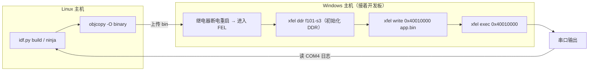
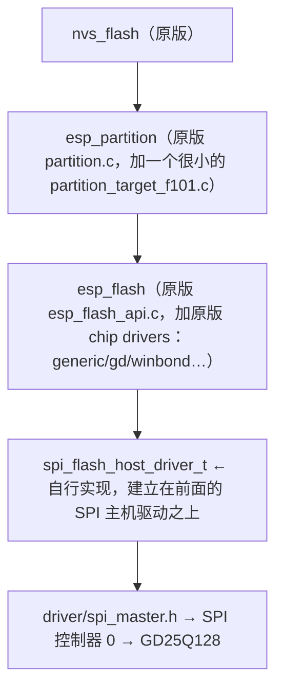

# 前言

F101 是一颗单核 RISC-V SoC，参数如下：

- 核心为 T-Head 玄铁 C907，rv32imac，带 FPU，带 MMU，MMU 不启用
- 16 MB PSRAM，映射在 `0x40000000`
- 中断：CLINT `0x14000000`（定时器），PLIC `0x10000000`（外设中断）
- 板载 4.3 寸 RGB 屏（1024x600）、SD 卡槽、SPI NOR flash、片上音频 codec、USB，以及若干 UART/I2C/ADC/PWM
- 控制台使用 UART3，引脚 PE08/PE09

该板没有 bootloader，也没有烧录流程。上电后停在 FEL（USB 下载模式），主机用 `xfel` 把程序写入 PSRAM，然后直接跳转执行。

本次工作是把 F101 移植到 ESP-IDF，目标有三条：

1. 使用 ESP 风格开发，`idf.py`、`esp_log`、FreeRTOS、`driver/*`、`esp_lcd`、NVS 等接口保持原样
2. 不引入特殊接口，对外全部是 ESP-IDF 标准头文件和 API，只重写实现
3. 每个功能都在真实硬件上验证，编译通过不视为完成

工具链沿用 Espressif 的 `riscv32-esp-elf`（esp-15.2），不使用玄铁工具链的原因见后文。

开发流程如下：



有两点需要注意：

- 每次下载前都要断电重启，`exec` 之后 FEL 模式退出
- `xfel ddr` 除了初始化内存，还会配置 UART3 的时钟和引脚复用。不执行该命令时，裸机程序也没有串口输出

# 在 IDF 里注册新 target

IDF 中已有非乐鑫芯片的先例，`linux` target 自带 `soc`、`hal`、`esp_rom`、`esp_hw_support`、`esp_system` 一整套实现。骨架参考 `linux` 和 ESP32-C3 两个 target。

新 target 名称为 `sun252i-f101`，以预览模式启用：

```bash
idf.py --preview set-target sun252i-f101
```

需要修改四处入口：

- `Kconfig`：增加 `IDF_TARGET_SUN252I_F101`
- `tools/idf_py_actions/constants.py`：把 target 加入预览列表
- `tools/cmake/project.cmake`：target 相关变量，例如 map 文件中的目标名
- `tools/cmake/toolchain-sun252i-f101.cmake`：工具链文件

命令行中的 target 名使用连字符（`sun252i-f101`），Kconfig 符号和 C 宏只能使用下划线（`SUN252I_F101`）。`project.cmake` 中有一处用 target 名拼接符号，需要增加：

```cmake
string(REPLACE "-" "_" idf_target ${idf_target})
```

缺少这一行时，链接选项中的符号名不正确。

## RAM 应用

没有 bootloader 和 flash 镜像，使用 IDF 的 RAM 应用类型：

```
CONFIG_APP_BUILD_TYPE_RAM=y
CONFIG_FREERTOS_UNICORE=y
CONFIG_ESP_CONSOLE_UART_CUSTOM=y
CONFIG_ESP_CONSOLE_UART_CUSTOM_NUM_3=y
```

链接地址为 `0x40010000`，前 64 KiB 保留给 FEL 阶段使用。构建产物用 `riscv32-esp-elf-objcopy -O binary` 转换为裸 bin。

## 工具链选择

C907 是玄铁核心，最初尝试使用玄铁自己的 GCC。该工具链基于 newlib，自带的 `stdlib.h`、`string.h` 与 IDF 的 `esp_libc/platform_include` 冲突，两边都定义了 `struct timespec`、`_reent` 等类型。Espressif 的 `riscv32-esp-elf` 与 IDF 配套，picolibc 的头文件体系与 IDF 一致。

因此先使用 Espressif 工具链完成功能，玄铁工具链作为后续优化项。玄铁工具链可以使用 T-Head 的扩展指令，例如显示部分用到的缓存维护指令。

## 组件钩子

原则是尽量少修改 IDF 原有文件。需要为 F101 做实现的组件，在其 `CMakeLists.txt` 开头增加以下内容：

```cmake
idf_build_get_property(target IDF_TARGET)
if(${target} STREQUAL "sun252i-f101")
    include(${CMAKE_CURRENT_LIST_DIR}/sun252i-f101/component.cmake)
    return()
endif()
```

F101 的源码、头文件和 `idf_component_register(...)` 都放在该组件下的 `sun252i-f101/` 目录。这样与 IDF 上游的 diff 范围小，rebase 到新版本时改动少。

同一个 `component.cmake` 中，两类路径的基准目录不同：`SRCS` 的相对路径相对于组件目录，`INCLUDE_DIRS` 的相对路径相对于 `component.cmake` 所在目录。

```cmake
idf_component_register(SRCS "sun252i-f101/gpio_f101.c"            # 相对组件目录
                       INCLUDE_DIRS "../include" "include"        # 相对 sun252i-f101/
                       ...)
```

基准目录写错时，CMake 报 `Cannot find source file` 或 `Include directory ... is not a directory`，路径中出现 `sun252i-f101/sun252i-f101/include` 这样的重复段。

# soc / hal / esp_rom 最小骨架

IDF 的头文件体系依赖 `soc/soc_caps.h`，驱动代码中的 `#if SOC_XXX_SUPPORTED` 决定功能是否存在。新 target 需要提供以下内容：

- `components/soc/sun252i-f101/include/soc/soc_caps.h`：能力宏，例如 UART、I2C 的数量
- `Kconfig.soc_caps.in`：同样的能力在 Kconfig 中的定义
- `clk_tree_defs.h`：时钟源枚举，例如 `UART_SCLK_DEFAULT`、`GPTIMER_CLK_SRC_DEFAULT`
- `sun252i_f101_ll.h`：低层寄存器头，包含 PIO、UART、CLINT、CCU 的寄存器偏移和少量内联函数
- `esp_rom/sun252i-f101`：该芯片没有 ESP ROM，`esp_rom_printf`、`esp_rom_delay_us`、crc 等需要自行提供

`soc_caps.h` 是 C 宏，`Kconfig.soc_caps.in` 是 Kconfig 符号，两份定义需要保持同步。IDF 中部分代码用 `#if SOC_XXX` 读取 C 宏，部分 CMake 逻辑用 `CONFIG_SOC_XXX` 读取 Kconfig。LVGL 部分遇到过这个问题：`esp_lvgl_port` 用 `SOC_LCDCAM_RGB_LCD_SUPPORTED` 判断是否支持 RGB 屏，而此前只定义了 `SOC_LCD_RGB_SUPPORTED`，运行时报 `This target does not support RGB.`。

部分 `esp_hal_*` 组件假定 `${target}/xxx_periph.c` 存在。例如 `esp_hal_gpio` 的 CMake 在 `SOC_GPIO_PORT > 0` 时编译 `gpio_hal.c`，而 ESP 的 HAL 与 F101 的寄存器不兼容。处理方式是 F101 的驱动组件不 `REQUIRES` 这些 hal 组件，只把它们的 `include` 目录作为头文件来源，使用 `hal/gpio_types.h` 这类纯类型头文件。

# 裸机验证

引入 IDF 之前，先验证三件事：`xfel` 流程可用、代码在运行、UART3 有输出。为此写了裸机程序 `bringup`，包含 `start.S` 和链接脚本，链接在 `0x40010000`，轮询 UART3 的 LSR 等待发送空闲，然后写 THR。

```bash
${CROSS_COMPILE}gcc -march=rv32imac -mabi=ilp32 -nostdlib -Ttext=0x40010000 ...
objcopy -O binary
```

上板一次通过，同时得到以下结论：

- UART 重新初始化为 24 MHz 时钟、115200 波特率可行
- CLINT 的 `mtime` 为 24 MHz，10 ms 实测 `240025` 个计数
- PA0..PA3 可以作为 GPIO 使用，PA4..PA7 始终读 0，原因未确认（未引出或被拉低）
- 驱动 PB2 会使控制台停止输出。PB0..PB3 是背光 PWM 引脚，在 EVB 上将 PB2 作为 GPIO 输出会改变背光电路状态，之后串口无输出。测试 GPIO 时避开 PB0..PB3

串口没有输出时，先用裸机探针确认 xfel、UART 和接线。探针能够打印，说明 exec、UART、接线正常，问题在软件。

# 启动与链接

从 `xfel exec` 到 `app_main()` 被调用，需要自行实现入口汇编、CSR 初始化、栈、bss 清零、堆初始化和链接脚本。

## start.S

```asm
    .section .exception_vectors.text, "ax"   /* 镜像里第一个 */
call_start_cpu0:
    csrci mstatus, 8            /* 关全局中断，FEL 的 exec 可能保留 MIE */
    li    t0, 0x2000
    csrs  mstatus, t0           /* FPU 状态设为 initial，见 LVGL 一节 */
    csrw  mie, zero
    csrw  mip, zero
    li    t0, 0x70013 ; csrw 0x7c2, t0   /* mcor：C907 扩展 CSR */
    li    t0, 0x11ff  ; csrw 0x7c1, t0   /* mhcr：指令/数据缓存等 */
    li    t0, 0x16e30c; csrw 0x7c5, t0   /* mhint：预取/分支预测 */
    fence ; fence.i
    la t0, f101_early_trap ; csrw mtvec, t0   /* 调度器接管之前的陷阱处理 */
    ...
    la sp, _startup_stack_top
    (清 bss)
    call call_start_cpu0_c
```

说明：

1. 入口地址必须是 `0x40010000`。`xfel exec` 直接跳转到该地址，链接脚本需要保证入口位于镜像最前
2. `0x7c1/0x7c2/0x7c5` 是玄铁扩展 CSR（`mhcr`/`mcor`/`mhint`），控制缓存和预取。FEL 退出时这些寄存器的状态没有保证，需要显式设置
3. `f101_early_trap` 是调度器接管 `mtvec` 之前的陷阱处理，异常时打印 `mcause/mepc/mtval/ra`、abort 字符串和一段栈内容，然后停止。后续的崩溃定位大部分依赖它的输出

## 链接脚本

整个镜像放在一个 16 MB 区域内：

```
MEMORY { ram_seg (RWX) : org = 0x40010000, len = 0xFF0000 }
REGION_ALIAS("iram_text_seg", ram_seg);  REGION_ALIAS("dram_seg", ram_seg);
REGION_ALIAS("flash_text_seg", ram_seg); ...（所有 IDF 需要的段别名都指向同一段）
```

IDF 的链接脚本模板需要 iram、dram、flash、rtc 等区域别名。F101 没有这些区分，全部别名到同一块 RAM。代码、数据、堆共用一个区域，`_heap_end` 为 RAM 末尾。

## 入口地址漂移

代码增大后，板子只输出 `5555UUUU` 之类的乱码，或完全没有输出。

原因：最初的做法是 `xfel exec <ELF 里的入口地址>`，例如 `0x40010660`。入口函数在 `.text` 中排在其他函数之后，代码量变化时入口地址随之变化，而下载脚本中写死的是旧地址。链接顺序变化后，入口甚至不在 `0x40010000`。

处理：把 `call_start_cpu0` 放进专用段 `.exception_vectors.text`，使该段在镜像中排第一。入口固定为 `0x40010000`，下载脚本固定使用 `exec 0x40010000`。

## 启动阶段的其他问题

**`heap_caps_init` 断言。** 启动后报 `assert failed: heap_caps_init`。IDF 通过 `ESP_SYSTEM_INIT_FN(init_heap, CORE, 100)` 注册并自动调用 `heap_caps_init`，自行实现的 `cpu_start.c` 中又手动调用了一次。删除手动调用后正常。

**控制台编号。** 能看到启动信息，但 `ESP_LOGI` 没有输出，或者输出到未接线的串口。IDF 的 `esp_stdio` 只允许选择 UART0/1 或 USB，F101 的控制台是 UART3。在 `components/esp_stdio/Kconfig` 中增加 UART2/UART3 的自定义编号选项，并在 `sdkconfig.defaults` 中设置 `CONFIG_ESP_CONSOLE_UART_CUSTOM_NUM_3=y`。

**`esp_rom_printf` 无输出。** IDF 日志系统正常，但早期阶段和 panic 中使用的 `esp_rom_printf` 没有输出。原因是 `esp_rom_print.c`、`esp_rom_sys.c` 对目标是否有 ROM printf 有硬编码判断，F101 不在列表内。对这两个文件各加一处小补丁，并在启动时调用 `esp_rom_install_uart_printf()` 安装 UART 输出。这是少数需要修改 IDF 原文件的位置之一。

# FreeRTOS 移植

IDF 自带的 RISC-V FreeRTOS 端口依赖 ESP 的中断矩阵和 systimer，F101 均没有。因此新增端口目录 `FreeRTOS-Kernel/portable/sun252i`，并在 `freertos/CMakeLists.txt` 中把 `port_dir` 指向该目录。IDF 的 `esp_additions`（`xTaskCreatePinnedToCore` 等）保持不变。

## tick 与 esp_timer 共用比较器

tick 由 CLINT 的 `mtimecmp` 产生。F101 只有一个定时器比较寄存器，FreeRTOS tick 和 `esp_timer` 的 alarm 都需要使用：

- `esp_timer_impl_set_alarm_id()` 计算下一次 alarm 的 mtime 值，交给 FreeRTOS 端口
- 端口每次编程 `mtimecmp` 时，取下一个 tick 和下一个 alarm 中较早的一个
- 中断到来时先判断是 tick 还是 alarm 并分别处理，alarm 回调在 `esp_timer` 初始化时注册

`esp_timer` 使用 24 MHz 的 `mtime` 作为时间源，`esp_timer_get_time()` 返回 `mtime / 24`。

## 外部中断

外部中断由 PLIC 处理。`esp_intr_alloc(source, ...)` 的 `source` 直接使用 PLIC 中断号：UART3 为 5，GPIO 的 PE 组为 67，DMA 为 50。`intr_f101.c` 实现使能、设置优先级，以及在 trap 中 claim、调用回调、complete。

## 陷阱帧

IDF 的 panic 处理和 `esp_backtrace` 按 `RvExcFrame` 的布局读取寄存器。任务切换保存的陷阱帧按 176 字节、相同的字段顺序排布（`mepc, ra, sp, gp, tp, t0..., mstatus`），IDF 的 panic 打印无需修改即可使用。创建任务时的初始帧如下：

```c
frame[0]  = (uint32_t)pxCode;            /* mepc */
frame[1]  = (uint32_t)prvTaskExitError;  /* ra   */
frame[2]  = (uint32_t)frame + 176;       /* sp   */
frame[4]  = tls;                         /* tp   */
frame[10] = (uint32_t)pvParameters;      /* a0   */
frame[32] = MSTATUS_MPIE | MSTATUS_MPP_M | (1u << 13);  /* 返回后开中断，FPU=initial */
```

## yield 与 TLS

`taskYIELD()` 执行 `ecall`，在 trap 中与中断走同一条路径：保存上下文、选择下一个任务、恢复。系统为单核，临界区通过关闭 MIE 实现。

picolibc 通过 `tp` 访问线程本地存储（`errno` 等）。创建任务时在栈顶分配一块 TLS 区域，复制 `.tdata`，清零 `.tbss`，并把 `tp` 指向该区域，对应上面初始帧中的 `frame[4]`。

## mtime / mtimecmp 的 64 位访问

RV32 上 64 位的 `mtime`/`mtimecmp` 需要分两次 32 位访问。访问方式不当会出现时间跳变或 tick 丢失。实现如下：

```c
/* 读 mtime：高-低-高，高位变化则重读 */
do { hi = REG(MTIME+4); lo = REG(MTIME); hi2 = REG(MTIME+4); } while (hi != hi2);

/* 写 mtimecmp：先把高位写成 0xFFFFFFFF，避免中间状态出现较小的比较值而误触发，再写低位、再写高位 */
REG(MTIMECMP+4) = 0xffffffff;
REG(MTIMECMP)   = (uint32_t)next;
REG(MTIMECMP+4) = (uint32_t)(next >> 32);
```

24 MHz 下 `mtime` 低 32 位约 179 秒回绕一次。同一块硬件上的另一个系统移植中，tick 比较值的高 32 位被写成 0，系统在 179 秒后停止运行。此处的 tick 计算和比较值写入全部按 64 位处理，不假设只使用低 32 位。

# IDF 启动日志

完成上述部分后，输出标准的 IDF 启动日志：

```
ESP-ROM:sun252i-f101-fel
Build:Oct  5 2026
rst:0x1 (POWERON),boot:0x0 (FEL_DOWNLOAD)
I (3738) cpu_start: Pro cpu up.
I (3741) cpu_start: Pro cpu start user code
I (3745) cpu_start: cpu freq: 600000000 Hz
I (3749) app_init: Application information:
I (3753) app_init: Project name:     hello_world
I (3774) heap_init: Initializing. RAM available for dynamic allocation:
I (3780) heap_init: At 40034810 len 00FCB7F0 (16173 KiB): RAM
I (3786) main_task: Started on CPU0
I (3786) main_task: Calling app_main()
```

各行对应的验证内容：

- `ESP-ROM` 横幅：自行提供的 `esp_rom` 启动信息输出正常
- `cpu_start: Pro cpu up`：IDF 启动流程到达 `call_start_cpu0_c`
- `app_init`：`esp_app_desc` 链接正确
- `heap_init ... 16173 KiB`：堆初始化完成，PSRAM 剩余空间可用
- `main_task: Started` 和 `Calling app_main()`：FreeRTOS 调度器、任务创建和 tick 正常

之后用 `hello_world` 配合延时循环和周期性 `esp_timer` 回调，确认 tick 与 alarm 共用比较器时两者都按时触发。内核部分到此完成，后续在此基础上添加驱动。

# 驱动：GPIO / UART / I2C / ADC / SPI / 定时器 / PWM / 看门狗 / SD

各驱动的实现流程相同：

1. 对照寄存器手册和已有参考实现，把寄存器操作写成独立的 C 文件
2. 对外实现 IDF 标准头文件（`driver/gpio.h`、`driver/uart.h` 等）中声明的函数，头文件使用 IDF 原版
3. 编写 `driver_test`，每个功能带 PASS/FAIL 自检，在板上运行
4. 失败时根据日志和寄存器值定位

## GPIO（driver/gpio.h）

PIO 共 6 个 bank（PA..PF），每个 bank 的寄存器间隔为 `0x30`：配置寄存器在偏移 0（每个引脚 4 位），数据寄存器 `0x10`，驱动能力 `0x14`，上下拉 `0x24`。外部中断 EINT 的寄存器块位于 `0x200 + 0x20 * bank`。

IDF 的 `gpio_num_t` 是整数，定义引脚号为 `bank*32 + n`，并提供 `GPIO_NUM_PA(n)`、`GPIO_NUM_PE(n)` 等宏。

板上验证：PA0..PA3 的上拉、下拉、输出回读均 PASS，通过 `gpio_install_isr_service` 配置的电平中断和下降沿中断均 PASS。过程中遇到两个问题。

**边沿中断不触发。** 电平中断正常，边沿中断始终没有。打印原始 EINT 状态寄存器，拉低、拉高各读一次，边沿模式下状态位保持不变。查阅寄存器说明，EINT 有去抖时钟寄存器（块内偏移 +0x18），默认值下边沿检测没有时钟。写入 1 选择 24 MHz 去抖时钟后，边沿中断正常。

**`gpio_config()` 的范围。** `pin_bit_mask` 为 64 位，F101 有 192 个引脚（PE10 为 138），`gpio_config()` 只能覆盖前 64 个。编号 64 以上的引脚直接使用 `gpio_set_direction()` / `gpio_set_level()`。音频功放使能脚 PE10 即采用这种方式。

## UART（driver/uart.h）

F101 的 UART 兼容 DW-APB 16550，寄存器间隔 32 位，时钟 24 MHz，波特率除数为 `24000000 / (16 * baud)`。驱动实现了 `uart_param_config`、`uart_driver_install`、`uart_write_bytes`、`uart_read_bytes`、`uart_set_baudrate` 和回环，接收使用 FIFO 中断加 stream buffer。

115200 波特率下，除数换算后的实际值为 115384，偏差 0.16%，在 1% 以内。回环写入 19 字节读回 19 字节，256 字节回环数据一致，57600 波特率下同样一致。

回环测试开始时多收到一个字节。原因是控制台日志也走 UART3，输出进入了回环。测试前先调用 `uart_wait_tx_done()` 等待发送空闲，再开启回环，问题消除。

F101 有 6 个 UART，IDF 的 `uart_port_t` 枚举只到 `UART_NUM_4`。在 `hal/uart_types.h` 中增加 `UART_NUM_5`（用 `SOC_UART_HP_NUM > 5` 条件编译），并把 `SOC_UART_NUM` 改为 6。这是对 IDF 原文件的又一处小改动。

引脚复用最初对所有串口使用复用值 6，只有 UART3（PE8/PE9）正确。修改后使用查找表，记录每个串口、每个信号允许的引脚及对应复用值：

```
UART0  TX PF2        RX PF4        复用 3
UART1  TX PF0 / PB0  RX PF1 / PB1  复用 4
UART2  TX PF4        RX PF5        复用 6
UART3  TX PE8        RX PE9        复用 6
UART4  TX PE2        RX PE3        复用 6
UART5  TX PE4        RX PE5        复用 7
```

`uart_set_pin` 先查表，查不到返回 `ESP_ERR_INVALID_ARG`。RTS/CTS 引脚返回 `ESP_ERR_NOT_SUPPORTED`，该芯片没有对应引脚。测试中用 UART5 的 PE4/PE5 验证了复用寄存器读回值为 7，且错误引脚被拒绝。PF 引脚与 JTAG/SD 共用，PE2 是 USB 的 VBUS 开关，使用时需要避开冲突。

## I2C（driver/i2c_master.h）

TWI 控制器，轮询实现，`i2c_new_master_bus`、`i2c_master_bus_add_device`、`i2c_master_transmit_receive` 均已对接。总线扫描找到设备 `0x51`，读寄存器 0 得到 `0x08`；不存在的地址返回 NACK；删除总线后重新创建正常。

最初将 I2C1 配置为 PE6/PE7，总线无响应，传输一直无法完成。查表确认该芯片的 TWI1 引脚是 PE0（SCL）/PE1（SDA），复用值 4。引脚复用关系以手册为准，不能按相邻引脚推断。

## ADC（esp_adc/adc_oneshot.h）

GPADC，12 位，对接 `adc_oneshot_new_unit`、`adc_oneshot_config_channel`、`adc_oneshot_read`。实测值：

```
adc ch0: 4091 4093     <- 接高电平
adc ch1: 3 3           <- 接地
adc ch2: 3 3
adc ch3: 1596 1593     <- 中间电平
PASS adc rejects a channel that is not bonded
```

通道 4..11 可以配置成功，但转换始终不完成。该芯片只引出通道 0..3，其余通道在封装上没有引脚。驱动对 4..11 返回 `ESP_ERR_INVALID_ARG`，测试中包含拒绝未引出通道的用例。

## SPI（driver/spi_master.h）

SPI 控制器 0 对应 `SPI2_HOST`，连接板载 NOR flash（PC0..PC5），控制器 1 对应 `SPI3_HOST`。事务的命令、地址、数据按字节写入 FIFO，发送和接收各使用 64 字节 FIFO，边填充边读取。

验证结果：JEDEC ID 为 `c8 40 18`（GigaDevice GD25Q128，16 MB）；`0x30000` 处读到 `FARD`，是板上 Arduino core 的魔数；300 字节读取两次结果一致，24 MHz 下同样一致。这些是只读测试，不会修改 flash 内容。该 SPI 驱动是后文 `esp_flash` 的底层。

## 通用定时器（driver/gptimer.h）

HSTIMER 的计数时钟为 200 MHz，驱动按目标分辨率分频到 1 MHz。

开发中有两个问题：

- 定时器速度快了 8 倍。分频按 24 MHz 计算，查阅寄存器说明后确认计数时钟为 200 MHz
- 计算 `alarm_count` 时曾使用 128 位乘法防止溢出，rv32 没有 `__int128`。改为先除后乘，拆成两次 64 位运算

测试结果：gptimer 计数与 `esp_timer` 测得的时间相差 1~3 微秒；周期 alarm 在 105 ms 内触发 9 次（周期 10 ms）；单次 alarm 只触发一次。

## PWM（driver/ledc.h）

F101 的 PWM 控制器每个通道对应固定引脚。IDF 的 LEDC timer + channel 模型映射为通道时钟分频、周期寄存器和占空比寄存器。引脚与通道不对应时返回错误。

PWM 的验证方式不同于其他驱动。引脚复用为 PWM 后，GPIO 的电平读回寄存器不反映实际波形，无法通过采样引脚电平验证占空比。测试改为解码寄存器：

```
pwm ch1 regs: src 24000000 m 0 pre 0 count 24000 active 6000 -> 1000 Hz, duty 25.0%, en 2 gate 2
pwm ch1 regs: ... active 12000 -> 1000 Hz, duty 50.0%
pwm ch1 regs: ... active 18000 -> 1000 Hz, duty 75.0%
pwm ch1 after set_freq(2000): 2000 Hz
```

解码得到的频率和占空比与设置值一致。

## 任务看门狗（esp_task_wdt.h）

使用硬件看门狗加 esp_timer 定时检查，实现 `esp_task_wdt_init/add/reset/delete/status`。测试中注册一个不喂狗的 user，日志按 IDF 标准格式输出：

```
E (8543) task_wdt: Task watchdog got triggered. The following tasks/users did not reset the watchdog in time:
E (8553) task_wdt:  - stuck_user (CPU 0)
```

删除该 user 后看门狗不再触发，测试 PASS。日志中以 `E (...)` 开头的 error 是有意触发的负面测试，不是故障。测试中有多个这样的预期失败用例。

## SD 卡（sdmmc_cmd.h）

使用 SMHC0 控制器。`f101_sdmmc_host()` 返回 `sdmmc_host_t`，卡初始化和读写使用 IDF 原版 `sdmmc` 协议层（`sdmmc_card_init`、`sdmmc_read_sectors`、`sdmmc_write_sectors`）。主机实现为轮询方式、1 位总线、40 MHz。

```
sd card: asdfg, 15728640 sectors of 512 bytes (7680 MiB), 40000 kHz, 1 bit bus, rca 0x1
sector 0 signature: 55 aa
PASS sd write and read back one sector      <- 写后读回
PASS sd original sector restored            <- 测试后恢复原内容
```

实现时需要注意的细节：

- 控制器复位前必须先打开模块时钟，否则复位不生效
- `sdmmc_host_t` 中的 `check_buffer_alignment`、`input_delay_phase = SDMMC_DELAY_PHASE_0` 等字段需要填写
- 协议层会调用 `sd_pwr_ctrl_set_io_voltage()`，该主机没有可调电压，提供空实现即可

## 驱动的放置

驱动不单独打包成一个组件，而是按 IDF 的组件划分，在对应组件下建立 `sun252i-f101/` 目录，使用前文的组件钩子。应用侧与其他 ESP 板子相同，直接 `REQUIRES esp_driver_gpio esp_driver_uart ...`，不需要额外的组件搜索路径。

各驱动的位置：

- gpio：`esp_driver_gpio/sun252i-f101/gpio_f101.c`
- uart、i2c、spi、gptimer、ledc：分别位于 `esp_driver_uart`、`esp_driver_i2c`、`esp_driver_spi`、`esp_driver_gptimer`、`esp_driver_ledc` 下的 `sun252i-f101/`
- adc：`esp_adc/sun252i-f101/`
- 任务看门狗：`esp_system/port/soc/sun252i-f101/`
- sdmmc 主机：`esp_driver_sdmmc/sun252i-f101/`；原版协议层位于 `sdmmc` 组件自己的 f101 分支，只编译 5 个协议源文件
- `gpio_num.h`、`adc_cali_schemes.h`：各自组件的 `sun252i-f101/include/`

`sdmmc` 组件出现过一个链接错误。其 Kconfig 被加载后，`CONFIG_SD_ENABLE_SDIO_SUPPORT` 默认为 `y`，协议层的 `sdmmc_init.c` 引用 `sdmmc_io_*` 函数，而只编译了 5 个协议源文件，链接时缺少符号。处理方式是在 `component.cmake` 中按该配置项条件加入 `sdmmc_io.c`。

此时 `driver_test`、`display_test` 在板上均为 `RESULT: PASS (0 failures)`。新增驱动时，先确定它在 IDF 中对应的组件，再按该组件的结构放置。

# 显示

## 第一版

F101 的显示通路为：显示引擎 DE（多图层、混合、缩放）→ TCON（时序）→ RGB 输出 → 面板 → PWM 背光。显示栈位于 `esp_lcd/sun252i-f101/sunxi/`，包含 DE、TCON、RGB 编码器、简单面板和 PWM 背光。

整条流水线与操作系统无关，只有一层 OS 接口需要实现，即 `dpy_os_idf.c`，提供内存分配、互斥信号量、延时、中断注册、时钟和复位（直接操作 CCU 的 PLL_VIDEO0 / DE / TCON 时钟）、PWM_BL 背光块和缓存维护。板级流水线 `disp0 → rgb → panel` 在 `dpy_board_f101.c` 中固定。

首次点亮的日志：

```
display: core: disp0 -> rgb -> panel: 1024x600@60.794Hz
W display: tcon-clk: pixel clock 49000000 Hz requested, 48000000 Hz possible
I display: tcon-lcd: pixel clock 48000000 Hz (module 288000000 Hz / 6)
```

像素时钟请求 49 MHz，实际为 48 MHz（模块时钟 288 MHz 的 6 分频），面板可以接受，刷新率 60.8 Hz。

`display_test` 的自检项均 PASS：30 个 vsync 用时 498 ms（60.2 Hz）；DE UI0 图层地址寄存器等于 framebuffer 地址；TCON 控制寄存器 bit31（使能）为 `0x80000000`；背光等级和 blank 开关正常。

## 缓存维护指令编码

framebuffer 位于 PSRAM，CPU 带有数据缓存。像素写入后需要把缓存行写回（clean），显示引擎才能读到最新内容。C907 的缓存维护指令是玄铁扩展：`th.dcache.cpa` 按物理地址 clean，`th.dcache.ipa` invalidate，`th.dcache.cipa` clean 加 invalidate。Espressif 的 GCC 不识别这些助记符，使用 `.word` 写入原始编码：

```c
register uintptr_t r asm("a0") = addr;
asm volatile(".word 0x0295000b" :: "r"(r) : "memory");   /* th.dcache.cpa  a0 */
asm volatile(".word 0x02a5000b" :: "r"(r) : "memory");   /* th.dcache.ipa  a0 */
asm volatile(".word 0x02b5000b" :: "r"(r) : "memory");   /* th.dcache.cipa a0 */
```

`ipa`、`cipa` 的编码最初凭记忆写入，数值不正确。之后用玄铁的汇编器分别汇编 `th.dcache.ipa a0` 和 `th.dcache.cipa a0`，按机器码核对后修正为上面的值。手写的原始编码需要用权威汇编器核对。编码错误时不一定崩溃，现象可能只是画面中偶尔出现旧内容。

缓存行为 64 字节，代码按 64 字节对齐逐行操作，前后各加一条 `fence`。

## 显示引擎与 CPU 的内存带宽

1024x600、16 位色、60 Hz 的扫描带宽约为 74 MB/s。CPU 同时大量访问 PSRAM 时，显示可能欠载。初始化时配置 MBUS：显示引擎使用最高优先级，CPU 限速约 500 MB/s，使扫描不受 CPU 访存影响。

## 第二版：esp_lcd 的 RGB 面板

第一版对外提供自定义接口 `f101_display_init() / f101_display_draw_bitmap() / f101_display_set_backlight()`。这与"不引入特殊接口"的目标不一致，因此改为只暴露标准接口：

```c
esp_lcd_rgb_panel_config_t cfg = {
    .data_width = 16, .in_color_format = LCD_COLOR_FMT_RGB565,
    .num_fbs = 2,
    .timings = { .h_res = 1024, .v_res = 600 },
};
esp_lcd_new_rgb_panel(&cfg, &panel);
esp_lcd_panel_reset(panel);  esp_lcd_panel_init(panel);
esp_lcd_rgb_panel_get_frame_buffer(panel, 2, &fb0, &fb1);
esp_lcd_panel_draw_bitmap(panel, 0, 0, 1024, 600, fb1);   // 传入 framebuffer 本身即为翻页
esp_lcd_panel_set_brightness(panel, 220);                  // 背光
esp_lcd_rgb_panel_register_event_callbacks(panel, &cbs, ctx);   // on_vsync / on_frame_buf_complete
```

对接时的处理：

- 时序和引脚由板级描述决定，`esp_lcd_rgb_panel_config_t` 中只校验分辨率，其他字段不使用
- 多缓冲：`num_fbs` 最大为 3。`draw_bitmap` 收到的指针是驱动自己的某个整屏 framebuffer 时，不拷贝，直接切换扫描输出，与 ESP 行为一致；否则按区域拷贝到当前扫描输出的缓冲，并 clean 缓存
- vsync 回调：显示栈只提供等待 vsync 的接口，因此创建一个高优先级任务循环等待，再调用 `on_vsync` / `on_frame_buf_complete`。ESP 原版在中断中调用，此处在任务中调用
- 背光：`esp_lcd_panel_set_brightness(0..255)`，由显示栈自己的 PWM 背光块实现，不需要另外配置 LEDC
- 不支持的功能：`mirror`、`swap_xy`、`esp_lcd_rgb_panel_set_pclk` 返回 `ESP_ERR_NOT_SUPPORTED`；只支持一个面板

改写后的板上验证：

```
I lcd.rgb: 1024x600 @ 61 Hz, 2 frame buffer(s)
PASS flip to frame buffer 1
30 vsync callbacks in 499 ms (60 Hz)
DE UI0 address 0x40168740, frame buffer 0x40168740    <- 翻页后显示引擎扫描新缓冲
PASS partial bitmap is in the scanned out buffer
```

日志中的 `E (...) lcd.rgb: ... invalid area`、`mirror is not supported`、`the display engine drives one panel` 是有意触发的负面用例：越界区域、不支持的镜像、创建第二个面板，驱动按设计拒绝。

# LVGL 仪表盘

在显示驱动之上运行一个实际的 UI。使用 LVGL，通过 IDF 官方的 `esp_lvgl_port` 组件接入。界面为 1024x600 的深色仪表盘，包含：标题栏（带运行时间）、系统信息卡片、剩余堆的环形仪表、背光滑条、滚动折线图。触摸屏尚未接入，滑条和开关暂时无法操作，只有数值和图表更新。

## 组件管理器

`lvgl` 和 `esp_lvgl_port` 是由 IDF component manager 管理的外部组件，在 `main/idf_component.yml` 中声明：

```yaml
dependencies:
  lvgl/lvgl: "^9.3.0"
  espressif/esp_lvgl_port: "^2.6.0"
```

配置后没有下载任何组件，编译报找不到 `esp_lvgl_port.h`。原因有两个：

- 环境脚本 `env-idf.sh` 中设置了 `IDF_COMPONENT_MANAGER=0`，早期用于避免联网
- 打开该选项后，`idf_component_manager` 中 `Version.coerce(os.getenv('ESP_IDF_VERSION'))` 抛出 `TypeError: expected string or bytes-like object, got 'NoneType'`。没有使用 IDF 官方的 `export.sh`，`ESP_IDF_VERSION` 环境变量为空

构建该应用时手动设置 `export IDF_COMPONENT_MANAGER=1 ESP_IDF_VERSION=6.1` 可以绕过。

## 编译错误

- `esp_lcd_io_i2c.h: driver/i2c_types.h: No such file`：`esp_lcd_panel_io.h` 会包含所有总线的头文件。处理方式是 f101 的 `esp_lcd` 组件增加 `REQUIRES esp_driver_i2c esp_driver_spi`，并把 parlio/i2s 的头文件目录作为纯头文件来源加入
- `LV_COLOR_FORMAT_RGB565_SWAPPED undeclared`：lvgl 9.2 没有该枚举，`esp_lvgl_port` 2.6 需要更新的 lvgl。依赖改为 `^9.3.0`，实际解析为 9.6.0
- `LV_MEM_SIZE_KILOBYTES is deprecated` 被当作 error：新版 lvgl 改用以字节为单位的 `LV_MEM_SIZE`，在 `sdkconfig.defaults` 中设置 `CONFIG_LV_MEM_SIZE=65536`
- `unknown type name 'soc_periph_lcd_clk_src_t'`：`hal/lcd_types.h` 需要该类型，在 `clk_tree_defs.h` 中增加只含 `LCD_CLK_SRC_DEFAULT` 的枚举

## 第一次运行：This target does not support RGB

```
I (3966) LVGL: Starting LVGL task
E (3966) LVGL: lvgl_port_add_disp_rgb(222): This target does not support RGB.
```

`esp_lvgl_port` 用 `#if (SOC_LCDCAM_RGB_LCD_SUPPORTED && ESP_IDF_VERSION >= ...)` 决定是否编译 RGB 支持，而当时只定义了 `SOC_LCD_RGB_SUPPORTED`。在 `soc_caps.h` 和 `Kconfig.soc_caps.in` 中同时增加 `SOC_LCDCAM_RGB_LCD_SUPPORTED` 后，RGB 路径被编译进来。

## 第二次运行：Guru Meditation Error

UI 启动并打印 `ui running` 后立即崩溃：

```
Guru Meditation Error: Core  0 panic'ed (Unknown reason).
MEPC    : 0x40074f30  RA      : 0x40017cb4  SP      : 0x4030e590
...
MSTATUS : 0x00001880  MTVEC   : 0x40016c34  MCAUSE  : 0x00000002  MTVAL   : 0x002024f3
```

`MCAUSE = 2` 表示非法指令异常。非法指令异常中 `mtval` 通常是出错指令的机器码，对 `0x002024f3` 解码：

```
0x002024f3 = 0000 0000 0010 0000 0010 0100 1111 0011
opcode[6:0]   = 1110011 = 0x73  -> SYSTEM 类指令
rd[11:7]      = 01001   = x9 (s1)
funct3[14:12] = 010     = CSRRS
csr[31:20]    = 0x002   = frm（浮点舍入模式）
```

即 `csrrs s1, frm, zero`，汇编别名 `frrm s1`，读取浮点舍入模式 CSR。

用 ELF 查找 `MEPC` 对应的函数：

```bash
riscv32-esp-elf-addr2line -pfie lvgl_ui.elf 0x40074f30 0x40017cb4
# __floatsisf at .../libgcc/soft-fp/floatsisf.c:39
# update_cb  at .../main/lvgl_ui_main.c:182
```

反汇编同一地址为 `40074f30:  002024f3   frrm s1`。调用链为：UI 定时器回调 `update_cb`（使用 `sinf()` 生成正弦波）调用 libgcc 的软浮点函数 `__floatsisf`（int 转 float）。

应用按 rv32imac 编译，没有 F 扩展，浮点运算全部由软件实现。libgcc 的 soft-fp 实现会先执行 `frrm` 读取舍入模式，而 `mstatus.FS = 0`（浮点单元关闭）时，访问浮点 CSR 的指令属于非法指令。之前的测试没有使用浮点，因此没有触发。

该芯片带有 FPU，CSR 可以访问，只需要打开 FS。需要修改两处：

```asm
/* start.S：启动时把 FS 设为 initial(01) */
li   t0, 0x2000
csrs mstatus, t0
```
```c
/* port.c：新建任务的初始陷阱帧中 mstatus 也要带上 FS。
   第一次任务切换 mret 后，mstatus 会被帧中的值覆盖 */
frame[32] = MSTATUS_MPIE | MSTATUS_MPP_M | (1u << 13);
```

应用仍按 rv32imac 软浮点编译，任务切换不需要保存浮点寄存器，只需要保持 FS 位打开，使 `frm` 可读。该问题不限于 LVGL，使用浮点的第三方库（`sinf`、`printf("%f")` 等）都会遇到。

修改后：

```
I (5053) lvgl_ui: ui running
I (5053) main_task: Returned from app_main()
```

连续运行 10 秒以上没有崩溃，定时器每 0.5 秒刷新一次仪表盘数据。

# 存储：esp_flash → esp_partition → NVS

目标是使用方式与 ESP32 相同：

```c
nvs_flash_init();
nvs_open("test", NVS_READWRITE, &h);
nvs_set_u32(h, "boots", n);  nvs_commit(h);
```

NVS 之下是 `esp_partition`，再往下是 `esp_flash`，最下层是硬件。这三层全部使用 IDF 原版，只在最底层提供一个 `spi_flash_host_driver_t`（IDF 中 flash 芯片驱动使用的主机抽象接口），通过它访问 NOR flash。



板载 flash 中已有内容：`0x30000` 是 Arduino core（魔数 `FARD`），`0x500000` 是一个 sketch，前面还有 boot 相关内容。所有擦写限制在 `0x800000` 之后，该区域是空闲的实验区。分区表位于 `0x800000`（`CONFIG_PARTITION_TABLE_OFFSET=0x800000`），分区如下：

```
# Name,   Type, SubType, Offset,   Size
nvs,      data, nvs,     0x801000, 0x6000
storage,  data, 0x40,    0x807000, 0x10000
```

## 缺失的头文件

IDF 的 `esp_flash_api.c` 默认基于 ESP 的 MSPI 硬件，会包含 F101 上不存在的头文件：`hal/spi_flash_ll.h`、`hal/spi_flash_encrypted_ll.h`、`esp_private/spi_share_hw_ctrl.h`、`esp_efuse.h`、`bootloader_util.h` 等。

处理方式是编写最小的垫片头文件，放在组件的 `sun252i-f101/include/` 下，并排在 `INCLUDE_DIRS` 最前面，使其优先于 `esp_hal_mspi/include` 中的同名头文件。例如 `hal/spi_flash_hal.h` 的垫片只定义 esp_flash 层实际用到的类型：

```c
typedef struct {
    spi_flash_host_inst_t inst;   /* 必须是第一个成员 */
    void *spi;                    /* 非 NULL 表示该 chip 可用 */
    uint32_t slicer_flags;
} spi_flash_hal_context_t;
```

`esp_flash_api.c` 中有检查：`((memspi_host_inst_t*)chip->host)->spi == NULL` 时返回 `ESP_ERR_INVALID_ARG`。该检查假定 `chip->host` 是 memspi 上下文。host 结构把这个上下文放在第一个成员，满足该假定。

其他处理：

- `spi_flash_mmap()` 没有可用的 MMU，改为读取到一块 RAM 后返回指针来模拟，分区表通过这种方式读取
- `partition.c` 用到的 `esp_efuse_is_flash_encryption_enabled()`、`bootloader_util_regions_overlap()` 提供空实现
- `CONFIG_PARTITION_TABLE_MD5=n`，因为没有 `esp_rom_md5`
- NVS 的加密分区代码引用 mbedtls 的 XTS。提供 `mbedtls/private/aes.h` 垫片和一组全部返回不支持的函数，使编译链接通过，加密的 NVS 分区会被拒绝

## 第一次上板：读正常，擦除停止响应

```
I (4659) storage_test: PASS read at 0x30000
        <- 此后串口没有任何输出
```

读 ID 为 `c8 40 18`，容量 16 MiB，读 `0x30000` 得到 `FARD`，均正确。第一次擦除时停止响应，没有 panic，没有日志，进入死循环。在 host 的 `common_command` 中临时加入 `TRACE`，打印每条 flash 命令。擦除之前没有任何命令发出，说明阻塞发生在 esp_flash 层，尚未到达 SPI。

查看 `spi_flash_chip_generic_wait_idle()`：

```c
while (!chip->host->driver->host_status(chip->host) && timeout_us > 0) { ... delay ... }
```

`host_status()` 在主机空闲时需要返回非零值，实现中返回了 0，`wait_idle`（超时设置为无限）因此一直在该循环中。改为 `return 1;` 后问题消除。所有传输都是轮询完成的，主机始终处于空闲状态。修改后擦除通过。

## 第二次：写入崩溃

```
E (6442) spi_flash: host_common_command(50): 24 bit addresses only
Guru Meditation Error: Core  0 panic'ed (Unknown reason).
MEPC    : 0xb0a66a64   RA : 0xb0a66c3a ...   MCAUSE : 0x00000002  MTVAL : 0x55555557
Stack memory:
400318c0: 0xccc5beb7 0xe8e1dad3 0x04fdf6ef 0x2019120b ...
```

`MEPC` 是无效地址，栈中是 `0xccc5beb7 0xe8e1dad3 ...`，与测试写入的数据模式 `i*7+3` 一致，说明栈被写入的数据覆盖。

`spi_flash_chip_generic_write()` 中：

```c
uint8_t temp_buffer[64];                // "spiflash hal max length of write no longer than 64byte"
...
uint32_t page_len = host->driver->write_data_slicer(...);   // slicer 返回了整页 256 字节
memcpy(temp_buffer + left_off, buffer, write_len);          // 向 64 字节的栈数组拷贝了 256 字节
```

IDF 通用芯片驱动假定主机一次最多处理 64 字节（ESP MSPI 硬件的限制），每个分片先拷贝到栈上的 `temp_buffer[64]`。实现的 slicer 按页边界返回 256 字节，造成栈溢出。第一步修改是让 write slicer 最多返回 64 字节。

## 第三次：读取时 free 断言失败

写入通过后，读取崩溃：

```
assert failed: heap_caps_free heap_caps_base.c:80 (heap != NULL && "free() target pointer is outside heap areas")
```

`addr2line` 得到的调用栈为 `os_release_temp_buffer → free`，传入 `release_temp_buffer` 的指针是 `0x645d564f`，同样是数据模式。读路径存在相同问题：`spi_flash_chip_generic_read()` 中也有 `temp_buffer[64]`，而 read slicer 一次最多返回 4096 字节。栈溢出把 `esp_flash_read` 栈帧中的局部变量 `temp_buffer`（应为 NULL）覆盖成了数据，`free()` 因此收到无效指针。

排查过程中先怀疑是 `free(NULL)` 触发断言，在 `os_release_temp_buffer` 中增加了 `if (buf)` 判空。IDF 确实会传入 NULL，判空本身正确，但不是根因。再加一条 `TRACE` 打印 `release_temp 0x645d564f`，确认该值不是 NULL，而是被覆盖的数据。数据模式的值出现在不应出现的位置时，应检查栈或缓冲区溢出。

修复分两部分：

1. 把 read slicer 也限制为 64 字节，使原版路径安全
2. 默认 chip 初始化完成后，对检测到的 chip 驱动打补丁：复制一份 `spi_flash_chip_t`，把 `read` 替换为 `chip_read`，直接从 flash 读入调用者缓冲，每次最多 4096 字节；把 `write` 替换为 `chip_write`，按页对齐，每页最多 256 字节，逐页调用原有的 `set_chip_write_protect` 和 `program_page`

这样擦除、等待空闲、写保护检查等逻辑仍使用 IDF 原版，只有数据传输这一层绕开了 64 字节限制。

## 第四次：数据不一致

不再崩溃，但读回校验失败：

```
read back: ESP_OK, first 03 0a 11 18 (wrote 03 0a 11 18)
542 bytes differ, first at 56: wrote 8b read ff (next 92 ff / 99 ff)
```

前 56 个字节正确，之后全是 `0xff`（擦除后的值），后面的页没有写入。测试从页内偏移 200 开始写 600 字节，第一段 56 字节（补满当前页）写入成功，之后每次 256 字节的整页写入均没有生效。

IDF 的类型定义中：

```c
typedef struct {
    uint8_t reserved;
    uint8_t mosi_len;     /* Output data length, in bytes */
    uint8_t miso_len;     /* Input data length, in bytes */
    ...
} spi_flash_trans_t;
```

`mosi_len` / `miso_len` 为 8 位，对应 ESP 硬件一次最多 64 字节的限制。整页写入长度 256 赋值给 `uint8_t` 后为 0，即写入 0 字节。

修复方式：`host_program_page` 和 `host_read` 不再使用 `spi_flash_trans_t`，直接构造 `spi_transaction_t`，其长度字段为 `size_t`。读 ID、读状态、写使能等短命令仍使用 `common_command`。

## 全部通过

```
PASS read back
I (354) storage_test: 4 KiB sector: erase 14475 us, program 4584 us, read 4860 us
I (414) storage_test: PASS find nvs partition
nvs at 0x801000 size 0x6000, storage at 0x807000 size 0x10000
PASS partition write / read / mmap content ...
PASS nvs set/get i8 u16 i64 string blob ...
PASS boot counter persisted
PASS 400 rewrites of one key
nvs: used 38 free 718 total 756 namespaces 1
RESULT: PASS (0 failures)
```

掉电保持也做了验证：断电重启后再次运行，输出 `boot counter was 1 (ESP_OK)`，上一次写入的计数从 flash 中读回。

测试中有一项失败是测试预期不正确。预期用 `nvs_get_u8` 读取 `i8` 类型的键会返回 `ESP_ERR_NVS_TYPE_MISMATCH`，实际返回 `ESP_ERR_NVS_NOT_FOUND`。NVS 的键哈希包含类型信息，类型不同时找不到该键，这是 IDF 的实际行为。测试预期改为读不到。

引入 `partition_table` 后，`esptool_py` 也会被加入构建，默认 `ninja all` 的最后一步生成 `.bin` 时，因为没有安装 esptool 而失败。这类应用改为执行 `ninja storage_test.elf`，再手动 `objcopy`。

# DMA：链表驱动与 esp_async_memcpy

F101 的 DMA 控制器基地址为 `0x03002000`，共 12 个通道，每个通道按内存中的描述符链工作。一个描述符为 32 字节：`cfg`（位宽、突发、源和目的的 DRQ 编号、是否 IO 模式即地址不递增）、`src`、`dst`、`len`、`para`、`next`。链尾 `next = 0xfffff800`，将最后一个描述符的 `next` 指回第一个即构成环。

启动方式：把首个描述符地址写入通道的 `LLI_ADDR`，再设置 `ENABLE=1`。中断分三种：块完成（PACKAGE）、整条链完成（QUEUE）、超时。总线时钟和复位门位于 CCU `0x70c`，bit0 为时钟门，bit16 为复位；另有 MBUS 门 `0x804`。PLIC 中断号为 50。

## 与 ESP GDMA API 的关系

IDF 的 `gdma_*` API 采用 TX 通道与 RX 通道成对的模型，各自有独立的描述符链。例如内存到内存拷贝时，TX 链描述源缓冲，RX 链描述目的缓冲。F101 的描述符中源和目的在同一个描述符里，两种模型不对应，因此不对接 GDMA API。

实现分为两层：

1. 私有层 `esp_private/dma_f101.h`，按 F101 硬件设计：`f101_dma_new_channel`、`f101_dma_start(chan, cfg, blocks, n)`（cfg 包含方向 M2M/M2P/P2M、DRQ、位宽、突发、是否循环、是否每块事件、回调）、`f101_dma_stop`、`f101_dma_get_position`
2. 公开层只实现 IDF 标准的 `esp_async_memcpy.h`（`esp_async_memcpy_install / esp_async_memcpy / uninstall`）。音频的 I2S 驱动直接使用私有层

## 实现要点

- 缓存：拷贝前对源地址做 clean，对目的地址做 clean + invalidate，避免之前的脏缓存行在 DMA 写完后被写回，覆盖 DMA 数据；拷贝完成后再对目的地址做 invalidate。描述符由硬件从内存读取，因此也需要 clean，描述符按 64 字节对齐分配
- 位宽：地址和长度均为 4 的倍数时使用 4 字节位宽，否则退回 1 字节位宽
- 队列：`backlog` 个请求排队依次启动，回调在中断中调用。第 9 个请求在队列已满时返回 `ESP_ERR_NO_MEM`
- 中断调度：回调返回 true 表示唤醒了更高优先级的任务，ISR 末尾调用 `portYIELD_FROM_ISR()`

## 测试

`dma_test` 首次上板全部通过：

```
PASS copy 4 KiB aligned / copy 100000 bytes / copy 1000 bytes unaligned / copy one byte / copy 12 bytes
PASS queue accepts the backlog and refuses the rest
PASS queued copies finish in order / queued copies are correct
1 MiB: dma 7118 us (147 MB/s), cpu memcpy 2384 us (439 MB/s)
PASS one event per block and one done        <- 三块链：2 个 BLOCK 事件 + 1 个 DONE
```

DMA 的速度低于 CPU memcpy（147 MB/s 对 439 MB/s）。具体瓶颈没有深入分析，推测是 CPU 对 PSRAM 的大块顺序访问有缓存和预取，效率较高，而 DMA 路径的带宽较低。在该芯片上，`esp_async_memcpy` 的作用是不占用 CPU，而不是提高速度。DMA 实际用到的场景是后面的音频。

# 音频：driver/i2s_std.h 对接片上 codec

F101 的音频包含三部分：片上 codec（数字 DAC/ADC、模拟耳放、麦克风输入级）、I2S0、S/PDIF。EVB 上 I2S0 的引脚没有可用的引出，其 PE0..PE4 与 SDC2 复用，PE2 还是 USB 的 VBUS 开关。因此把 `I2S_NUM_0` 映射到片上 codec。

接口对应关系：

- TX 通道对应 codec 的 DAC FIFO（DRQ 7），RX 通道对应 codec 的 ADC FIFO（单声道）
- `i2s_channel_init_std_mode` 中的采样率、位宽（16 位；24/32 位按 32 位字处理）、单声道或立体声，用于配置 FIFO 控制寄存器和时钟
- `gpio_cfg` 被忽略，内部 codec 没有引脚
- `dma_desc_num × dma_frame_num` 对应环形缓冲的周期数乘以每周期帧数
- `on_sent / on_recv` 对应每个周期完成事件，`on_send_q_ovf / on_recv_q_ovf` 对应 TX 欠载和 RX 溢出

模拟部分（耳放、功放、音量、输入选择）在 ESP 中没有对应的标准 API，通常由外部 codec 芯片配合 `esp_codec_dev` 处理。这部分放在一个额外的头文件 `driver/i2s_f101_codec.h` 中：`set_volume / set_mute / set_hp_gain / set_input_volume / set_mic_gain / select_input`。耳放和板上功放（PE10 使能）随 TX 通道上电和下电：`i2s_channel_enable(tx)` 时上电，`i2s_channel_disable(tx)` 时断电，应用不需要处理。

## 两个采样率族

音频时钟来自 PLL_AUDIO1，两类采样率需要不同的 PLL 设置：

- 48 kHz 族（8/12/16/24/32/48/96/192 kHz）：PLL 设为 3.072 GHz，÷5 得到 614.4 MHz，再得到 24.576 MHz
- 44.1 kHz 族（11.025/22.05/44.1/88.2/176.4 kHz）：PLL 设为 2.1676 GHz，使用小数分频，寄存器 `0x180 = 0xc000a234`，÷2 得到 22.5792 MHz

PLL 为共享资源，TX 和 RX 同时只能处于同一个族。驱动对 PLL 做引用计数：第一个用户启动 PLL，最后一个用户释放。另一个族的用户请求时返回 `ESP_ERR_INVALID_STATE`。44.1 kHz 族的采样率需要换算为 48 kHz 族的等效码（例如 44100 乘 48000 除 44100 得到 48000 的码），FIFO 的采样率选择寄存器使用同一套分频码。

## 环形缓冲与 DMA

每个通道分配 `desc_num` 个周期，每个周期 `frame_num × frame_bytes` 字节，周期之间按 64 字节（缓存行）对齐。DMA 使用循环链，每个块结束触发一次事件。

TX 方向：`i2s_channel_write` 向下一个空闲周期拷贝数据，环满时等待信号量；DMA 播完一个周期后，ISR 释放信号量。周期被 DMA 消费后，ISR 立即将其清零并写回缓存。如果不清零，环转完一圈而应用尚未写入新数据时，DMA 会再次播放上一圈的旧数据，听感上是重复的爆音。清零后欠载时播放静音，同时触发 `on_send_q_ovf`。

RX 方向：DMA 向周期写入数据，ISR 在周期完成时标记可读，`i2s_channel_read` 按顺序读取。DMA 上报一个周期完成时，该周期最后几个字可能尚未写入内存，因此 RX 路径延后一个周期，处理的是上一个周期，该周期数据完整。代价是约一个周期的延迟，16 kHz、240 帧时为 15 ms。

周期长度必须等于一个 DMA 块的长度。在其他实现中尝试过把周期补齐到 64 字节对齐，44.1 kHz 下每块 882 帧时，实际播放速度变为 63/64，采样率出现偏差。因此周期缓冲的 `stride` 按 64 对齐，DMA 块长度严格等于周期数据长度。

## soc caps

`i2s_std.h` 的默认时钟配置宏使用 `.ext_clk_freq_hz` 字段，该字段由 `SOC_I2S_HW_VERSION_2` 控制；默认时钟源 `I2S_CLK_SRC_DEFAULT` 来自 `soc_periph_i2s_clk_src_t`。需要在 `soc_caps.h` 中增加 `SOC_I2S_SUPPORTED / SOC_I2S_NUM / SOC_I2S_HW_VERSION_2`，并在 `clk_tree_defs.h` 中增加该枚举。IDF 公共头文件中的能力宏同时控制类型定义和宏的默认值。

板上功放使能脚为 PE10（编号 138），超出 `gpio_config()` 的 64 位 mask 范围，使用 `gpio_set_direction(138, GPIO_MODE_OUTPUT)` 设置，见 GPIO 一节。

## 测试结果

`audio_test` 的输出：

```
I (9791)  audio_test: PASS 48000 Hz: 3 s of tone written
I (9801)  audio_test: 48000 Hz: 596 periods in 2974996 us -> 48000.1 Hz
I (11831) audio_test: 16000 Hz: 130 periods in 1934999 us -> 16000.0 Hz
I (13891) audio_test: 44100 Hz: 364 periods in 1975509 us -> 44100.0 Hz
PASS an unsupported rate is refused         <- 12345 Hz
I (14281) audio_test: starved: 60 periods, 60 underruns
PASS an unfed stream reports underruns
PASS init RX 16 kHz mono
PASS one second of samples read
read 32000 bytes in 1040 ms (expected 1000 at 16 kHz), recv events 67, overflows 0
microphone: min 203 max 222 mean 213.0 rms 2.3
PASS duplex: 100 blocks out and in
RESULT: PASS (0 failures)
```

实测采样率的计算方式：在 `on_sent` 回调中记录每个周期完成的时间戳，用 `(周期数-1) × 240 帧 ÷ 首尾时间差` 反推帧率。该值反映 codec 的实际时钟，而不是软件延时。结果为 48000.1 / 16000.0 / 44100.0 Hz。同一个通道可以依次在 48k 族和 44.1k 族之间切换，`i2s_channel_reconfig_std_clock` 会释放旧 PLL，再按新的族启动。

第一次运行时，读取 1 秒采样的用例失败：

```
read 30720 bytes in 998 ms (expected 1000 at 16 kHz)    <- 期望 32000 字节
```

测试使用 1000 ms 超时读取恰好 1 秒的数据，而 RX 路径从 `enable` 到第一个可读周期有约 30 ms 的启动延迟，再加上延后一个周期，1 秒超时结束时只读到 30720 字节（64 个周期）。这是测试的超时设置没有留出余量，驱动本身正常。超时改为 2000 ms 后，读取 32000 字节用时 1040 ms，通过。

麦克风一项的结果为 `min 203 max 222 rms 2.3`，是 ADC 采集到的底噪。没有声源时输出是一个很小但有变化的值，不是常数 0，说明采集链路工作正常。

测试结果表明：采样率准确，数据流连续，欠载和溢出事件正确，模拟路径的寄存器已配置。

# 其他部分

## 芯片信息与 MAC

`esp_chip_info()`、`esp_read_mac()` 等 API 被许多代码调用。F101 没有 ESP 的 eFuse MAC，需要自行生成。

`esp_chip_info.h` 中为 `chip_model_t` 增加 `CHIP_SUN252I_F101 = 1001`。MAC 由 128 位 chip id（SID 熔丝的前 4 个字）经 FNV-1a 哈希后取 6 字节，置位本地管理位、清除组播位，得到合法的单播本地 MAC。STA 使用基地址，SoftAP 使用其本地化变体，BT 为 +2，ETH 为 +3，可通过 `esp_base_mac_addr_set()` 覆盖。

第一版读出的 chip id 无效，输出为 `72c04300 72c04300 72c04300 72c04300`，四个字相同。

SID 的读时序为：写索引、写读命令和密钥、等待控制寄存器 bit1 清零、将控制寄存器清回、读数据寄存器。第一版没有等待 bit1，也没有清控制寄存器，读到的是上一次的残留值。修正后读出 `72c04300 7a40490c 8413c010 348a204e`，MAC 为 `96:1d:4e:5f:76:89`，每次重启保持一致。

`esp_random()` 使用 chip id 作为种子之一，该问题修复后种子也随之正确。

## esp_cache_msync

显示、DMA、音频都需要缓存的写回和失效操作。最初显示栈中有一份自己的缓存函数，DMA 同样需要后，整理为 IDF 标准的 `esp_cache_msync(addr, size, flags)`（`ESP_CACHE_MSYNC_FLAG_DIR_C2M` / `DIR_M2C` / `INVALIDATE` / `UNALIGNED`），放在 `esp_hw_support` 中。显示栈原有函数改为对它的内联封装。修改后在板上重新运行了显示测试，结果仍为通过。

# 未完成部分

- I2S0 硬件和 S/PDIF（板上没有引出引脚，或数据路径尚未调通），`esp_codec_dev` 未实现
- USB、触摸屏（FT5446）；AIC8800 WiFi 和 SPIF 控制器决定不实现
- UART1/2 的实际引脚验证、PWM 的实际波形验证
- 改用玄铁工具链，以便使用 T-Head 缓存指令助记符等扩展

# 复现

代码位于 `esp-idf` 的 `sun252i-f101` 分支，测试应用位于 `idf-apps/`：

```bash
. ./env-idf.sh
cd idf-apps/driver_test && idf.py --preview set-target sun252i-f101 && ninja driver_test.elf
riscv32-esp-elf-objcopy -O binary build/driver_test.elf build/driver_test.bin
# 断电重启进入 FEL 后：
xfel ddr f101-s3 && xfel write 0x40010000 driver_test.bin && xfel exec 0x40010000
```

`hello_world`、`bringup`（裸机探针）、`driver_test`、`display_test`、`lvgl_ui`、`storage_test`、`dma_test`、`audio_test` 均为自检程序，最后一行是 `RESULT: PASS (0 failures)`。仓库中另有较短的速查笔记 `PORTING_SUN252I_F101.md`。

# 总结

本次适配耗时最多的不是驱动编写，而是三类边界问题。

**IDF 对 ESP 硬件的隐含假设。** 包括 64 字节缓冲、8 位长度字段、`host_status` 的返回值极性、memspi 上下文结构。这些假设在 ESP 上始终成立，更换硬件后会在运行时静默出错。

**两套能力描述。** C 宏与 Kconfig 各有一份，另外还有一些只提供类型的头文件。缺少一个枚举或宏时，要到编译或运行时才会报错。

**缓存、DMA、浮点和 CSR 等 CPU 内部状态。** 这类问题的症状与根因距离较远，例如画面残留、数据损坏、偶发崩溃。定位依赖寄存器、反汇编和日志中的异常值，逐步回溯。

调试中形成的做法：

- 每个驱动都带自检和负面用例
- 失败时检查出现在不应出现位置的值
- 机器码用权威工具核对
- 对 IDF 原代码的假设保持怀疑，尽量不修改原代码，而是在使其假设成立的那一层处理
