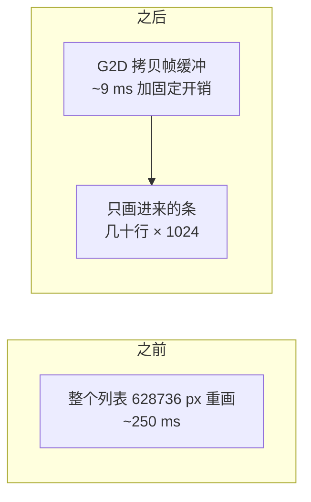
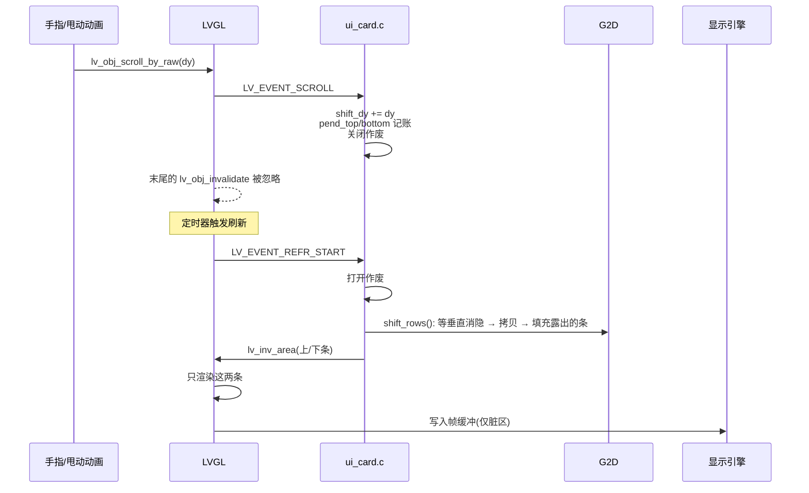
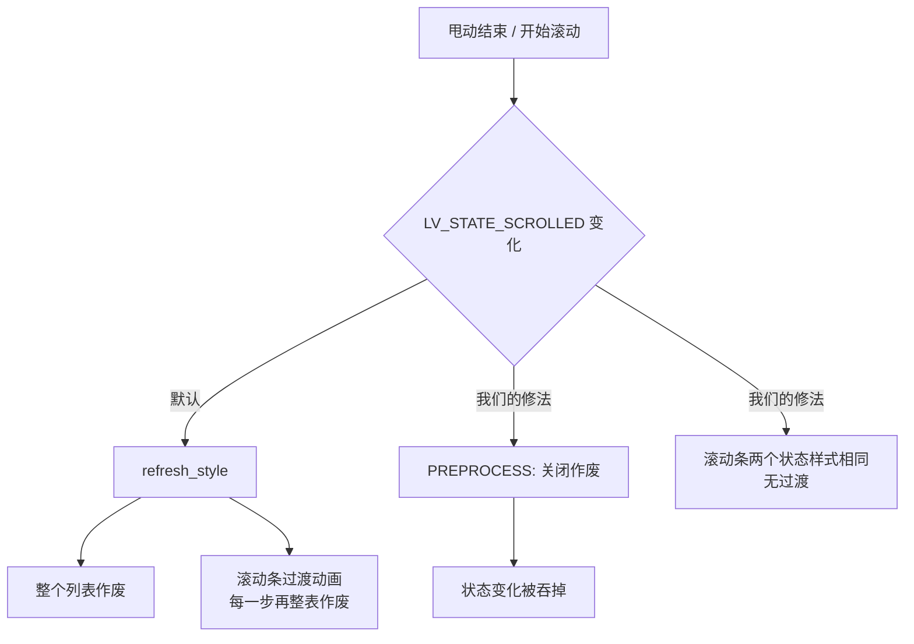

F101 上跑的是 Zephyr，屏幕 1024x614，应用是一个电视端的 B 站客户端，主界面是一个列表，最多放 100 张卡片，每张卡片有封面和几个文字控件，滚动由 LVGL 自己处理。

# 问题

一开始的状态是这样的：滚一步 CPU 要花 250 ~ 350 ms，帧率大概 3 fps，手指一拖就卡成 PPT。

先看 LVGL 滚动是怎么做的。手指移动之后，容器里所有子对象的坐标整体平移，然后把整个容器区域标记为脏（invalidate），下一次刷新再把这块区域整个重画一遍，写回帧缓冲。

这里重画的是 1024x614 = 628736 个像素，要读封面、读字形、做混合，再整块写回 PSRAM。F101 是 600MHz 单核，算力其实还行，卡的是内存带宽。实测整块重画约 250 ms，加上别的开销一步滚动大概 354 ms。


# 思路

滚动一步，屏幕上 95% 的内容只是整体上下挪了几十个像素，真正要重新画的只有从边缘进来的那一条。

所以可以把活拆开：

- 帧缓冲里已经有的像素，交给 G2D 整块拷贝，几毫秒的事
- 新进来的那一条（几十到一两百行），还是让 LVGL 画



要做到这个，需要解决这几件事：

1. LVGL 默认会作废整个列表。在 `LV_EVENT_SCROLL` 里临时关掉作废（`lv_display_enable_invalidation`），脏区由应用自己维护
2. 拷贝放在 `LV_EVENT_REFR_START` 里做，一帧内的多次滚动合并成一次
3. 记录上边和下边各进来多少行（`pend_top` / `pend_bottom`），刷新开始时用 `lv_inv_area` 只作废这两条
4. 卡片太多，只给屏幕附近的行创建控件
5. 封面直接存 XRGB8888，格式转换也交给 G2D

# 第一版实现

## 列表的状态

在列表结构体里加四个字段：

```c
struct ui_grid {
	lv_obj_t *obj;
	...
	int last_scroll;		/* 上一次滚动事件时的滚动位置 */
	int pend_top, pend_bottom;	/* 顶部/底部进来了多少行，还没画 */
	int shift_dy;			/* 本帧累计要搬的行数，正数是内容上移 */
	bool no_shift;			/* 下一次滚动是跳转，整表重画 */
};
```

`no_shift` 是给 `scroll_to` 用的，切换列表、回到顶部这种跳转，不走快速路径，老老实实整表重画。

一次滚动从事件到屏幕的过程大概是这样：



## 滚动事件里只记账

```c
static void scrolled(lv_event_t *e)          /* LV_EVENT_SCROLL */
{
	struct ui_grid *g = lv_event_get_user_data(e);
	lv_display_t *d = lv_display_get_default();
	lv_area_t r;
	int y = lv_obj_get_scroll_y(g->obj), dy = y - g->last_scroll, h;

	g->last_scroll = y;
	g->covers_dirty = true;
	if (!IS_ENABLED(CONFIG_BILI_SCROLL_SHIFT) || dy == 0) {
		return;
	}
	lv_obj_get_coords(g->obj, &r);
	h = lv_area_get_height(&r);
	if (g->no_shift) {
		stat.jump++;                       /* 跳转：整表画 */
	} else if (lv_obj_has_flag(g->obj, LV_OBJ_FLAG_HIDDEN) ||
		   lv_obj_has_flag(lv_obj_get_parent(g->obj), LV_OBJ_FLAG_HIDDEN)) {
		stat.hidden++;                     /* 看不见，不用管 */
	} else if (g->shift_dy + dy >= h || -(g->shift_dy + dy) >= h) {
		stat.big++;                        /* 一帧走了一屏以上，搬没有意义 */
	} else if (!move_pending(d, &r, dy)) {
		stat.pending++;                    /* 后面会讲 */
	} else if (!shift_ready()) {
		stat.not_ready++;
	} else {
		stat.shifted++;
		g->shift_dy += dy;
		goto moved;
	}
	/* 上面任何一个例外，都放弃快路径，让 LVGL 整表重画 */
	if (inv_off) {
		lv_display_enable_invalidation(d, true);
		inv_off = false;
	}
	g->pend_top = g->pend_bottom = 0;
	g->shift_dy = 0;
	return;
moved:
	if (dy > 0) {                              /* 内容上移，底部进来 dy 行 */
		g->pend_bottom = MIN(h, g->pend_bottom + dy);
		g->pend_top = MAX(0, g->pend_top - dy);
	} else {
		g->pend_top = MIN(h, g->pend_top - dy);
		g->pend_bottom = MAX(0, g->pend_bottom + dy);
	}
	if (!inv_off) {
		lv_display_enable_invalidation(d, false);   /* 关掉整表作废 */
		inv_off = true;
	}
	refresh_soon(d);
}
```

每一条例外分支我都留了一个计数器（`jump` / `hidden` / `big` / `pending` / `not_ready`），后面调性能基本全靠这几个数。

这里有个细节，`LV_EVENT_SCROLL` 是在 `lv_obj_scroll_by_raw()` 里面、最后那次 `lv_obj_invalidate(obj)` **之前**发出来的，所以在回调里关掉作废，LVGL 随后那次整表作废就会被吃掉。作废开关是个计数器，`false` 加一，`true` 减一，必须成对调用。

## 刷新开始时搬像素

```c
static void add_strips(lv_event_t *e)          /* LV_EVENT_REFR_START */
{
	lv_display_t *d = lv_display_get_default();

	if (inv_off) {
		lv_display_enable_invalidation(d, true);   /* 开回来，进来的条要能作废 */
		inv_off = false;
	}
	for (int i = 0; i < GRIDS; i++) {
		struct ui_grid *g = registry[i];
		lv_area_t r, a;

		if (g == NULL || (g->pend_top == 0 && g->pend_bottom == 0 && g->shift_dy == 0)) {
			continue;
		}
		lv_obj_get_coords(g->obj, &r);
		if (g->shift_dy != 0 && shift_rows(r.y1, lv_area_get_height(&r), g->shift_dy) != 0) {
			stat.failed++;                     /* 搬失败，整表重画 */
			lv_inv_area(d, &r);
		} else {
			if (g->pend_top > 0) {
				a = r;
				a.y2 = r.y1 + g->pend_top - 1;
				lv_inv_area(d, &a);
			}
			if (g->pend_bottom > 0) {
				a = r;
				a.y1 = r.y2 - g->pend_bottom + 1;
				lv_inv_area(d, &a);
			}
		}
		g->pend_top = g->pend_bottom = 0;
		g->shift_dy = 0;
	}
}
```

这个回调挂在显示对象的 `LV_EVENT_REFR_START` 上。`REFR_START` 在 `lv_refr_now` 开头发出，这时 LVGL 还没开始收集待重画区域，所以这里新加的 `lv_inv_area` 会在同一轮刷新里一起画掉。

不在滚动事件里直接搬有两个原因。一是触摸采样比刷新快，一帧里会来好几次滚动，而 G2D 每次调用都有大概 1.2 ms 的固定延迟；二是帧缓冲这时候正在被显示引擎扫描，每改一次都多一次出接缝的机会，下一节会说。

另外 `ui_run` 每一轮开头会调一次 `ui_grids_scroll_flush()`，把作废重新打开，如果还有没处理的位移就再触发一次刷新。不然关掉作废之后一直没刷新，别处正常的重画也会被一起吃掉。

## shift_rows()

整个方案的核心在 `gfx/shift.c`，先看向下滚（内容上移）的情况：

```c
int shift_rows(int y, int h, int dy)
{
	int n = dy < 0 ? -dy : dy, moved = h - n, first_new, ret;
	struct g2d_surface f, b;
	struct g2d_rect src, dst, strip;
	size_t bytes;

	if (!shift_ready() || n == 0 || moved <= 0 || y < 0 || y + h > (int)fb_h) {
		return -EINVAL;
	}
	bytes = (size_t)moved * stride;
	if (dy < 0) {
		/* 向上滚，内容下移，见下一节 */
		...
	} else {
		surfaces(&f, &b);
		sys_cache_data_flush_range(fb + (size_t)(y + n) * stride, bytes); /* CPU 画的脏行先写回 */
		display_sunxi_wait_vsync(disp, 40);                               /* 对齐垂直消隐 */
		src = (struct g2d_rect){0, y + n, fb_w, moved};
		dst = (struct g2d_rect){0, y, fb_w, moved};
		ret = g2d_blit(g2d, &f, &src, &f, &dst, G2D_ROTATE_0, G2D_FLAG_NO_CACHE_OPS);
		first_new = y + moved;
	}
	if (ret == 0) {
		strip = (struct g2d_rect){0, first_new, fb_w, n};
		g2d_fill(g2d, &f, &strip, PAGE_COLOR);            /* 露出的条先填底色 */
	}
	sys_cache_data_invd_range(fb + (size_t)y * stride, (size_t)h * stride);

	return ret;
}
```

缓存有三个地方要注意，缺一个就会偶发位置错乱：

- 搬之前，CPU 刚画完还在 D-cache 里的行要先 flush，不然 G2D 读到的是旧的
- `G2D_FLAG_NO_CACHE_OPS` 是告诉驱动缓存我自己管，不要每次都对整块区域做 flush / invalidate
- 搬完之后，CPU 再读这块区域（LVGL 局部重画要读背景）之前要 invalidate，不然读到的是旧缓存

# 快速滚动时的拖影

G2D 搬运跑通之后速度一下就上来了，但是测试后发现快速滚动的时候有拖影。

原因是显示引擎在不停地从上到下扫描帧缓冲。如果扫描到一半的时候我们原地改了像素，扫描线上面读到的是改之前的，下面读到的是改之后的，中间就是一条接缝。滚得快的时候这条接缝看起来就是重影。


## 对齐垂直消隐

先给显示驱动补一个等垂直消隐的接口，底层的 `display_wait_vsync()` 本来就有，只是没有导出：

```c
int display_sunxi_wait_vsync(const struct device *dev, uint32_t timeout_ms)
{
	ARG_UNUSED(dev);

	return display_wait_vsync(timeout_ms);
}
```

G2D 搬一整块 1024x600 级别的区域，比显示引擎扫过同样大小的区域要快。所以只要从消隐开始、自上而下搬，既不会追上扫描线，也不会被扫描线追上，扫描线看到的要么全是旧的，要么全是新的。

## 向上滚不能原地搬

"自上而下搬"对内容上移是成立的，因为源行在目标行下面，读永远在写之前。反过来内容下移的时候，源行在目标行上面，自上而下搬会把还没读的源行覆盖掉。实测 G2D 做重叠拷贝，上移一次就对，下移会有部分行重复。

所以向上滚的时候先把要搬的行拷到一块中转缓冲里，等消隐到了再从中转缓冲写回帧缓冲：

```c
if (dy < 0) {
	if (bounce_size < bytes) {
		shift_release();
		bounce = aligned_alloc(64, bytes);
		if (bounce == NULL) {
			return -ENOMEM;
		}
		bounce_size = bytes;
		/* 只有 G2D 往里写，不能留 CPU 的脏缓存行，不然以后会盖掉 G2D 的结果 */
		sys_cache_data_flush_and_invd_range(bounce, bytes);
	}
	surfaces(&f, &b);
	/* 帧缓冲 → 中转缓冲，和扫描无关，现在就做 */
	sys_cache_data_flush_range(fb + (size_t)y * stride, bytes);
	src = (struct g2d_rect){0, y, fb_w, moved};
	dst = (struct g2d_rect){0, 0, fb_w, moved};
	ret = g2d_blit(g2d, &f, &src, &b, &dst, G2D_ROTATE_0, G2D_FLAG_NO_CACHE_OPS);
	if (ret != 0) {
		return ret;
	}
	/* 等消隐，再从中转缓冲 → 帧缓冲，下移 n 行 */
	display_sunxi_wait_vsync(disp, 40);
	src = (struct g2d_rect){0, 0, fb_w, moved};
	dst = (struct g2d_rect){0, y + n, fb_w, moved};
	ret = g2d_blit(g2d, &b, &src, &f, &dst, G2D_ROTATE_0, G2D_FLAG_NO_CACHE_OPS);
	first_new = y;
}
```

两个方向的流程对比如下：


中转缓冲只在第一次向上滚的时候分配，`aligned_alloc(64, ...)` 是为了满足 G2D 的对齐要求。进播放页的时候用 `shift_release()` 还给堆，因为播视频的时候内存很紧，只剩 3MB 左右。

## 露出来的条先填底色

搬完之后，露出来的那一条里还是别处的内容，因为拷贝不会清掉源位置。LVGL 画完这一条之前，如果扫描线刚好扫过，就会看到一小段错位的画面。所以搬完马上用页面底色填一下：

```c
if (ret == 0) {
	strip = (struct g2d_rect){0, first_new, fb_w, n};
	g2d_fill(g2d, &f, &strip, PAGE_COLOR);   /* 0xff0b0f14，和页面背景一致 */
}
```

这样最坏也就是闪一条不到一帧的底色。

顺带一提，G2D 对 alpha 为 0 的像素写出来的也是 0（透明黑）。界面层的透明像素本来就是 0，所以搬前搬后一致，不会有残影。但是这也意味着后面逐像素比较的时候，不能直接拿 alpha 去判断。

# 降低新增一条的成本

像素搬完了，边缘进来的那一条卡片本身也要尽量便宜。

## 只给看得见的行建控件

100 张卡片每张 6 个子控件，全建出来 LVGL 的堆不够，遍历布局也受不了。做法是只给屏幕上下各多一张卡片高度的范围建控件，出了这个范围的销毁，封面还给缓存：

```c
static void window_rows(struct ui_grid *g, int *first, int *last)
{
	int row_h = ui_card_height() + MARGIN;
	int top = lv_obj_get_scroll_y(g->obj), vh = lv_obj_get_height(g->obj);
	int rows = (g->built + CARD_COLS - 1) / CARD_COLS;

	*first = MAX(0, (top - row_h) / row_h);
	*last = MIN(rows - 1, (top + vh + row_h) / row_h);
}

/* ui_grid_sync() 里 */
for (int i = 0; i < g->built; i++) {
	int row = i / CARD_COLS;
	struct ui_card *c = &g->cards[i];

	if (row >= first && row <= last) {
		if (c->obj == NULL && app_video(g->list, i, &v)) {
			card_build(g, i, &v);
			changed = true;
		}
	} else if (c->obj != NULL && (row < first - 1 || row > last + 1)) {
		card_destroy(c);
		changed = true;
	}
}
```

销毁的阈值比创建的多一行，这样滚动位置在边界上来回抖的时候，不会不停地建了又销毁。

## 封面直接用 XRGB8888

封面是 JPEG，视频引擎解码出来是 NV12。原来是 CPU 转成 RGB565 再给 LVGL 混合，但 LVGL 的渲染目标是 ARGB8888，RGB565 每个像素都要先扩展一遍才能混合。

现在封面缓冲直接存 XRGB8888（`COVER_STRIDE 960`，64 字节对齐），LVGL 同格式拷贝。NV12 到 XRGB8888 的转换和缩放用一次 `g2d_blit` 搞定，CPU 只留一个兜底：

```c
static void to_xrgb(const struct vdec_frame *f, uint32_t *out)
{
	static const struct device *const g2d = DEVICE_DT_GET(DT_NODELABEL(g2d));

	if (device_is_ready(g2d)) {
		struct g2d_surface src = {
			.format = G2D_PIXFMT_NV12, .width = f->width, .height = f->height,
			.plane = {(void *)f->plane[0], (void *)f->plane[1]},
			.pitch = {f->stride[0], f->stride[1]},
		};
		struct g2d_surface dst = {
			.format = G2D_PIXFMT_XRGB8888, .width = COVER_STRIDE / 4, .height = COVER_H,
			.plane = {out}, .pitch = {COVER_STRIDE},
		};
		struct g2d_rect sr = {0, 0, f->width, f->height}, dr = {0, 0, COVER_W, COVER_H};

		if (g2d_blit(g2d, &src, &sr, &dst, &dr, G2D_ROTATE_0, G2D_FLAG_YUV_FULL_RANGE) == 0) {
			return;
		}
	}
	to_xrgb_c(f, out);                      /* 兜底，CPU 逐像素转 */
}
```

视频引擎不认的 JPEG（比如 4:4:4）改用软件解码 tjpgd。tjpgd 回调里给的字节顺序是 B、G、R，我一开始写反了，表现就是部分图片颜色是反的：

```c
((uint32_t *)s->out)[y * s->stride + x] =
	0xff000000U | (uint32_t)p[2] << 16 | (uint32_t)p[1] << 8 | p[0];
```

## 圆角换成两张 A8 蒙版

卡片原来用 `clip_corner` 做圆角，LVGL 会先把整张卡片画到一个临时图层里再裁，实测每帧要多花大概十分之一的时间。

改成在封面上面两个角各盖一张 10x10 的 A8 蒙版，重着色成页面底色，看起来和裁剪一样，但是没有临时图层了：

```c
#define CORNER		10
#define CORNER_STRIDE	16
static uint8_t corner_px[2][CORNER_STRIDE * CORNER] __aligned(4);
static lv_image_dsc_t corner_dsc[2];

static void corners_init(void)
{
	for (int y = 0; y < CORNER; y++) {
		for (int x = 0; x < CORNER; x++) {
			float dx = x + 0.5f - CORNER, dy = y + 0.5f - CORNER;
			float a = sqrtf(dx * dx + dy * dy) - CORNER + 0.5f;   /* 圆内 0，圆外 1 */
			uint8_t v = a <= 0.0f ? 0 : (a >= 1.0f ? 255 : (uint8_t)(a * 255.0f));

			corner_px[0][y * CORNER_STRIDE + x] = v;                  /* 左上角 */
			corner_px[1][y * CORNER_STRIDE + CORNER - 1 - x] = v;     /* 右上角，镜像 */
		}
	}
	for (int k = 0; k < 2; k++) {
		corner_dsc[k] = (lv_image_dsc_t){
			.header = {.magic = LV_IMAGE_HEADER_MAGIC, .cf = LV_COLOR_FORMAT_A8,
				   .w = CORNER, .h = CORNER, .stride = CORNER_STRIDE},
			.data_size = sizeof(corner_px[k]),
			.data = corner_px[k],
		};
	}
}

/* card_build() 里，盖在封面上方 */
for (int k = 0; k < 2; k++) {
	lv_obj_t *m = lv_image_create(o);

	lv_obj_remove_flag(m, LV_OBJ_FLAG_CLICKABLE);
	lv_image_set_src(m, &corner_dsc[k]);
	lv_obj_set_pos(m, k ? CARD_W - CORNER : 0, 0);
	lv_obj_set_style_image_recolor(m, C_BG, 0);
	lv_obj_set_style_image_recolor_opa(m, LV_OPA_COVER, 0);
}
```

## 字形缓存

标题用 TinyTTF 实时栅格化，新进来一行要渲染几十个字，缓存命中率直接决定这一行画多久。TinyTTF 的缓存是按字形个数算的，不是按字节：

```c
/* 一屏卡片里中号字大概 150 个不同的字，其他字号只有几个 */
#define GLYPH_CACHE_S	160
#define GLYPH_CACHE_M	320
#define GLYPH_CACHE_L	64

ui_font_s = make(18, GLYPH_CACHE_S);
ui_font_m = make(22, GLYPH_CACHE_M);
ui_font_l = make(28, GLYPH_CACHE_L);
```

开小了要反复栅格化，开大了吃堆。我中间有一版没设上限，LVGL 的堆看起来像在慢慢泄漏，最后按"一屏大概出现多少个不同的字"定了固定大小。

## 关掉滚动条

```c
lv_obj_set_scrollbar_mode(g->obj, LV_SCROLLBAR_MODE_OFF);
```

滚动条画在列表区域里面，会跟着像素一起被搬走留下残影。它的渐隐动画还会带来别的问题，后面再说。

# 验证

这种搬像素的优化最容易"看起来对"，所以我做了一个逐像素的对比：

1. 自动把第一页按 48px 一步、250ms 一拍往下滚
2. 每一步打印帧耗时和滚动事件的统计
3. 滚完之后等封面全部加载完（`cover_pending() == 0`），截一张屏幕快照 A
4. 强制整区重画一次，截快照 B
5. 逐像素比较 A 和 B，打印差异像素数

差异必须是 0 才算对。第一次跑出来是 125176 / 628736 个像素不同，我还以为是搬运有 bug，查了很久才发现是 A 和 B 之间又有封面加载完了，两张图根本不是同一时刻的内容。加上"先等封面静止"之后差异为 0。

还有一个坑，自测里不能用 `lv_obj_scroll_by()`。它会发 `SCROLL_BEGIN` / `SCROLL_END`，状态一变整个对象就被作废了，永远进不了快速路径，我早期自测一直没生效就是因为这个。要用 `lv_obj_scroll_by_raw()`，真实的手指拖动走的也是这个：

```c
void ui_home_scroll(int dy)
{
	...
	lv_obj_scroll_by_raw(g->obj, 0, -step);
}
```

# 还是慢

改完之后主观上好了一些，但测试后发现快速滚动还是会卡。继续瞎猜效率太低了，于是加了一套调试用的观测代码（Kconfig `BILI_SCROLL_LOG`，默认关）：

```c
static void add_strips(lv_event_t *e)
{
	refr_start_ms = k_uptime_get_32();
	...  /* 搬运 + 作废进来的条 */
	if (IS_ENABLED(CONFIG_BILI_SCROLL_LOG)) {
		dirty_areas = dirty_px = 0;
		for (uint32_t k = 0; k < d->inv_p; k++) {
			if (!d->inv_area_joined[k]) {
				dirty_areas++;
				dirty_px += lv_area_get_width(&d->inv_areas[k]) *
					    lv_area_get_height(&d->inv_areas[k]);
			}
		}
	}
}

static void note_refresh(lv_event_t *e)        /* LV_EVENT_REFR_READY，慢的才打印 */
{
	if (IS_ENABLED(CONFIG_BILI_SCROLL_LOG)) {
		uint32_t total = k_uptime_get_32() - refr_start_ms;

		if (total > 40) {
			printk("scroll: dirty %u areas %u px, refresh %u ms (shift %u ms for %u rows) "
			       "moved %u jump %u hidden %u far %u pending %u failed %u\n",
			       dirty_areas, dirty_px, total, shift_ms, shift_steps,
			       stat.shifted, stat.jump, stat.hidden, stat.big, stat.pending, stat.failed);
		}
		shift_ms = shift_steps = 0;
	}
}
```

跑出来的一行长这样：

```
scroll: dirty 2 areas 628736 px, refresh 133 ms (shift 14 ms for 52 rows) moved 758 jump 0 hidden 0 far 0 pending 7 failed 0
```

可以看到脏区是 628736 像素，正好是整个列表，但搬运只花了 14 ms，说明时间不在搬运上，而是有人把整表作废了。`pending` 一直在涨，对应下一节的问题。如果 shift 是 20 ~ 37 ms、脏区只有几万到二十万像素、刷新 40 ~ 80 ms，那就是正常的快速路径，剩下的开销是新进来那一行本身的绘制。

另外我还加了个采样剖析，每 2ms 采一次主线程保存的 PC，再用 `addr2line` 映射。不过大概一半的样本落在 PC 为 0 的分组里，那是线程正在跑、没有保存上下文的时刻，所以它只能告诉我 memcpy 和缓存刷新占比不大，指不出具体位置。最后定位问题靠的是脏区日志和后面那条调用栈。

# 待重画区域要跟着画面走

第一轮日志里 `pending` 几乎每帧加 1，同时有大量"shift 0 行、刷新 100 ms 以上"的记录。

原因是我在 `scrolled()` 里写过一条保护：滚动发生的时候，如果列表里已经有别的待重画区域（比如某张封面刚加载完，那张卡片的区域正在等着重画），就放弃搬运，整表重画。因为一旦搬了，这些待重画区域的坐标就和屏幕内容对不上了。

但快速滚动的时候封面是不停到的，几乎每一帧都命中这个判断，快速路径基本没怎么生效。

解决办法是不放弃，让待重画区域跟着画面一起移动。LVGL 的待重画区域存在 `d->inv_areas[]` 里（`d->inv_area_joined[i]` 为真表示已经合并到别的区域，要忽略），搬像素之前，把完全在列表内的区域整体平移 `-dy` 再裁剪，只要有一块伸出了列表边界，才回退整表重画：

```c
static bool move_pending(lv_display_t *d, const lv_area_t *r, int dy)
{
	/* 第一遍只检查，不改。有一块伸出列表就放弃 */
	for (uint32_t i = 0; i < d->inv_p; i++) {
		lv_area_t x;

		if (!d->inv_area_joined[i] && lv_area_intersect(&x, &d->inv_areas[i], r) &&
		    !lv_area_is_in(&d->inv_areas[i], r, 0)) {
			return false;
		}
	}
	/* 第二遍，全在列表内，整体平移并裁剪 */
	for (uint32_t i = 0; i < d->inv_p; i++) {
		lv_area_t *a = &d->inv_areas[i], x;

		if (d->inv_area_joined[i] || !lv_area_intersect(&x, a, r)) {
			continue;
		}
		a->y1 -= dy;
		a->y2 -= dy;
		if (!lv_area_intersect(a, a, r)) {
			d->inv_area_joined[i] = 1;     /* 移出列表了，不用画了 */
		}
	}

	return true;
}
```

分两遍是避免改到一半发现要回退。改完之后 `pending` 从将近 200 次降到了 0。

# 找整表作废的来源

回退没了之后，日志里还是有一部分刷新的脏区是整个 628736 像素。这时 `inv_off` 一直是 0，说明不是我关掉作废的那个时间窗口里，`pending` / `far` / `jump` 也都没涨。到这里继续猜已经没用了，必须知道是谁作废的。

我的做法是给显示对象挂一个 `LV_EVENT_INVALIDATE_AREA` 的回调，对 ≥1000x500 的作废打印出来，并沿着帧指针往回走打印返回地址。编译的时候加 `-DCONFIG_FRAME_POINTER=y`，只用来这次定位。Zephyr 的 `arch_stack_walk` 在这个上下文里只能回溯 1~3 帧而且指向 `main`，没法用，所以手工遍历 `fp[-1]`（返回地址）和 `fp[-2]`（上一帧的 fp），再用 `addr2line` 解析：

```c
static void big_inv(lv_event_t *e)                    /* LV_EVENT_INVALIDATE_AREA */
{
	const lv_area_t *a = lv_event_get_param(e);
	static int n;

	if (lv_area_get_width(a) >= 1000 && lv_area_get_height(a) >= 500 && n < 40) {
		uintptr_t *fp = __builtin_frame_address(0);

		n++;
		printk("big invalidate %d,%d..%d,%d inv_off %d:", (int)a->x1, (int)a->y1,
		       (int)a->x2, (int)a->y2, inv_off);
		for (int i = 0; i < 14 && fp != NULL && ((uintptr_t)fp & 3) == 0 && fp[-1] != 0; i++) {
			printk(" %lx", (unsigned long)fp[-1]);
			if (fp[-2] <= (uintptr_t)fp) {
				break;
			}
			fp = (uintptr_t *)fp[-2];
		}
		printk("\n");
	}
}
```

板子上打出来：

```
big invalidate 0,124..1023,737 inv_off 0: 40039512 40018cd4 4005c0e2 4004f5c2 4004f538 4005464a ...
```

用 `addr2line -f -e zephyr.elf` 解析，注意一定要用同一次构建出来的 ELF：

```
lv_display_send_event
lv_inv_area
lv_obj_invalidate_area
lv_obj_invalidate
lv_obj_refresh_style
update_obj_state
lv_obj_remove_state              <- 去掉 LV_STATE_SCROLLED
lv_obj_event_base
lv_indev_scroll_throw_handler    <- 甩动结束
```

原来是 LVGL 自己在 `lv_obj.c` 里处理 `SCROLL_BEGIN` / `SCROLL_END` 的时候，会加上和去掉 `LV_STATE_SCROLLED`：

```c
else if(code == LV_EVENT_SCROLL_BEGIN) {
    lv_obj_add_state(obj, LV_STATE_SCROLLED);
}
else if(code == LV_EVENT_SCROLL_END) {
    lv_obj_remove_state(obj, LV_STATE_SCROLLED);
    ...
}
```

状态一变，`update_obj_state()` 就会调 `lv_obj_refresh_style()`，然后整个对象被作废。这不是应用里的调用，所以在应用代码里怎么搜都搜不到。

## 用 PREPROCESS 包住状态变化

LVGL 的事件回调可以带 `LV_EVENT_PREPROCESS` 标志，带这个标志的回调会先于类自己的默认处理执行，不带的在默认处理之后执行。那就在默认处理之前关掉作废，之后再打开：

```c
/*
 * LVGL 在滚动开始和结束时给列表设置的滚动状态会刷新样式，导致整个列表重画
 * （甩动结束时一次刷新 100 ms 以上）。列表没有给这个状态配样式，
 * 所以状态变化的时候把作废关掉就行。
 */
static void state_guard_on(lv_event_t *e)      /* 默认处理之前：关作废 */
{
	lv_display_enable_invalidation(lv_display_get_default(), false);
}

static void state_guard_off(lv_event_t *e)     /* 默认处理之后：开作废 */
{
	lv_display_enable_invalidation(lv_display_get_default(), true);
}

/* ui_grid_create() 里 */
if (IS_ENABLED(CONFIG_BILI_SCROLL_SHIFT)) {
	lv_obj_add_event_cb(g->obj, state_guard_on,  LV_EVENT_SCROLL_BEGIN | LV_EVENT_PREPROCESS, NULL);
	lv_obj_add_event_cb(g->obj, state_guard_on,  LV_EVENT_SCROLL_END   | LV_EVENT_PREPROCESS, NULL);
	lv_obj_add_event_cb(g->obj, state_guard_off, LV_EVENT_SCROLL_BEGIN, NULL);
	lv_obj_add_event_cb(g->obj, state_guard_off, LV_EVENT_SCROLL_END,   NULL);
}
```

这里要用两个回调。`lv_event_get_code()` 会把 `PREPROCESS` 位去掉（`return e->code & ~LV_EVENT_PREPROCESS`），在同一个回调里没法区分是前处理还是后处理。作废开关是计数器，成对调用就行，嵌套在 `scrolled()` 里的 `inv_off` 里面也没问题。

# 滚动条的过渡动画

继续测，大部分刷新已经正常了，但还有零星的整表作废。这次抓到的调用栈指向 `trans_anim_cb`，是样式过渡动画：

```
anim_timer → trans_anim_cb → lv_obj_refresh_style → lv_obj_invalidate
```

默认主题给对象的滚动条部分（`LV_PART_SCROLLBAR`）定义了两套样式，普通状态 `bg_opa = 40%`，`LV_STATE_SCROLLED` 状态 `bg_opa = 100%`，还带一个过渡动画（`lv_theme_default.c` 里的 `scrollbar` 和 `scrollbar_scrolled`）。就算滚动条模式设成了 `OFF`，状态变化的时候过渡动画照样会启动，动画的每一步都会把整个对象作废。

处理办法是让这个部分在所有状态下样式都一样，并且把过渡去掉。本地样式（`lv_obj_set_style_*`）优先级比主题高，所以两个状态各设一次：

```c
for (int st = 0; st < 2; st++) {
	lv_style_selector_t sel = LV_PART_SCROLLBAR | (st ? LV_STATE_SCROLLED : 0);

	lv_obj_set_style_bg_opa(g->obj, LV_OPA_TRANSP, sel);
	lv_obj_set_style_transition(g->obj, NULL, sel);
}
```

两个状态一样之后，`update_obj_state()` 比较前后样式发现没差别，直接返回，既不建动画，也不作废。



# 结果

| | 之前 | 之后 |
| --- | --- | --- |
| 一步滚动 CPU 时间 | 约 354 ms | 约 30 ms |
| 滚动时的脏区 | 628736 px | 几万到二十万 px |
| 快速滚动拖影 | 有 | 没有 |
| `pending` 回退 | 近 200 | 0 |
| 慢刷新（>40ms） | 90 ~ 180 ms，很多 | 40 ~ 80 ms，和新进来的行数成正比 |

像素和整区重画逐像素比较，差异为 0。最后一轮测试下来，滑动已经顺畅很多了。

# 相关文件

- `zephyr-components/bilibili-tv/src/ui/ui_card.c`：窗口化网格、滚动事件、`move_pending`、`state_guard`、观测日志
- `zephyr-components/bilibili-tv/src/gfx/shift.c`：G2D 搬运（消隐对齐、中转缓冲、预填充）
- `zephyr-components/bilibili-tv/src/ui/cover.c`：封面 XRGB8888 缓存与 G2D 格式转换
- `zephyr-components/bilibili-tv/src/ui/fonts.c`：字形缓存大小
- `zephyr/drivers/display/sunxi/display_sunxi.c`：`display_sunxi_wait_vsync()`
- Kconfig：`BILI_SCROLL_SHIFT`（快速路径）、`BILI_COVER_G2D`（G2D 转封面格式）、`BILI_SCROLL_LOG`（慢刷新日志 + 剖析）
