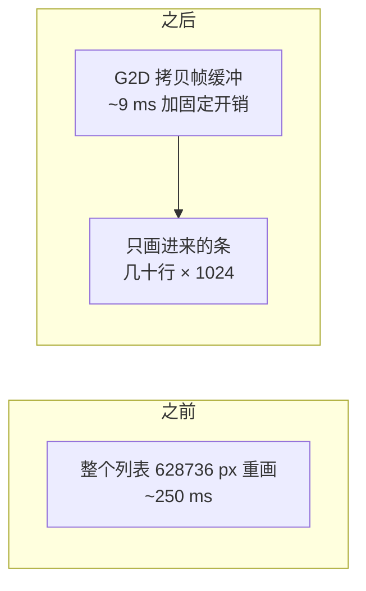
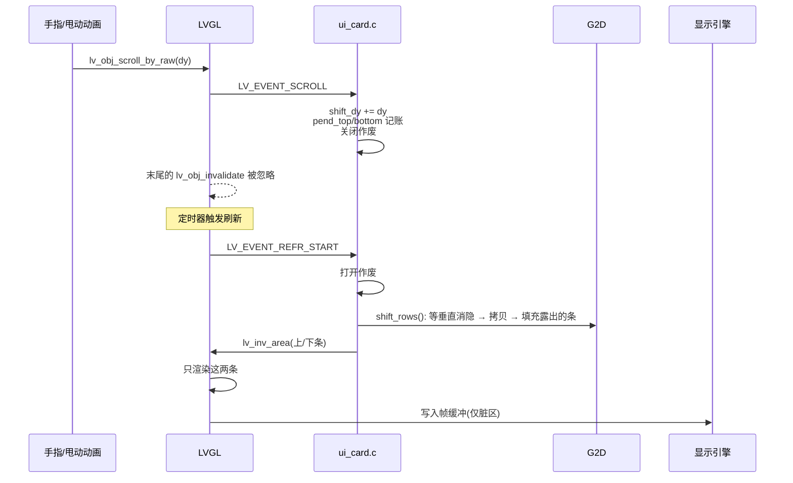
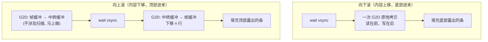
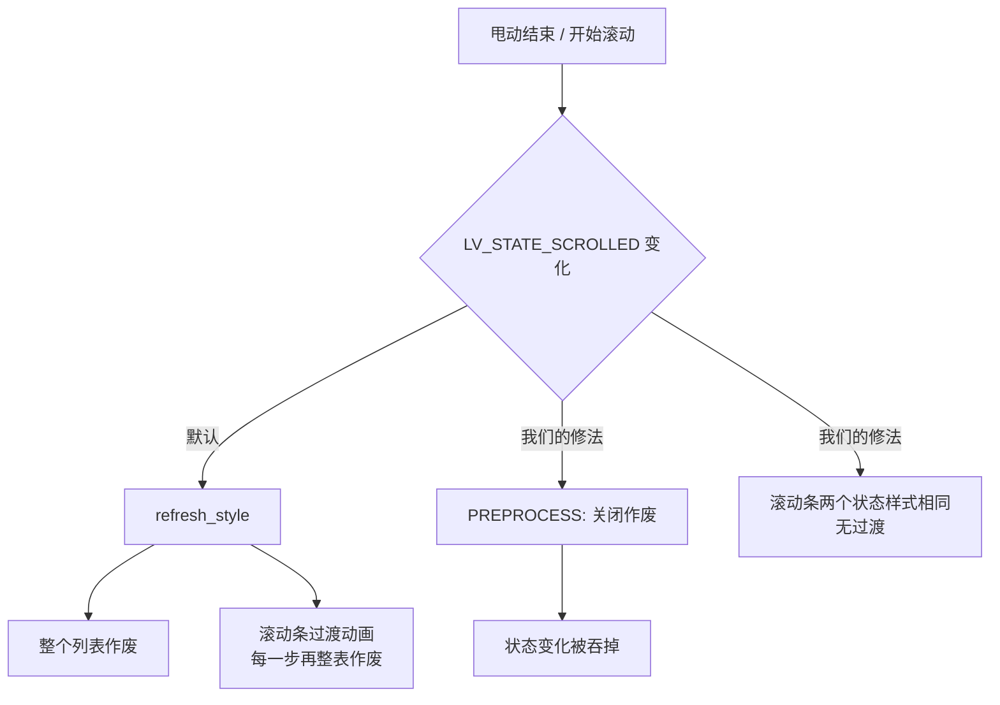

# 在 600 MHz 单核 RISC-V 上把 LVGL 列表滑顺

## 起点：一步滚动 250～350 ms

应用是一个跑在 Zephyr 上的电视端客户端，屏幕 1024×614，列表最多放 100 张卡片，每张卡片包含封面和几个文字控件，滚动由 LVGL 自己处理。

LVGL 的滚动机制是：手指移动后，容器内所有子对象的坐标整体平移，容器所占的区域被整体作废（invalidate），下一次刷新把这块区域重画一遍，再写回帧缓冲。

瓶颈不在算力，在**内存带宽**。重画一次 1024×614 的区域，需要读取封面、读取字形、完成混合，再把整块写回帧缓冲，实测约 250 ms；加上上层开销，一步滚动的 CPU 时间约 354 ms，实际帧率只有 3 帧每秒左右，拖动时卡顿明显。


## 思路：滚动本质上是像素拷贝

滚动一步，屏幕上约 95% 的内容位置关系并没有变化，只是整体上下平移了几十个像素，真正需要重新绘制的只有从屏幕边缘进入的那一条窄带。因此可以把问题拆成两半：已经存在于帧缓冲里的像素，交给 G2D（2D 图形加速器）整块拷贝，只需要几毫秒；新进入的那一条（几十到一两百行）仍然由 LVGL 绘制。



要做到这一点，需要解决五件事。

| 问题 | 方案 |
| --- | --- |
| LVGL 默认会作废整个列表 | 在 `LV_EVENT_SCROLL` 中暂时关闭作废（`lv_display_enable_invalidation`），由应用层维护作废范围 |
| 由谁拷贝、何时拷贝 | G2D 加速器；在 `LV_EVENT_REFR_START` 时执行，一帧内的多次滚动合并成一次 |
| 只重画哪一部分 | 记录 `pend_top / pend_bottom`（上边与下边各新进入多少行），刷新开始时用 `lv_inv_area` 只作废这两条 |
| 卡片数量过多 | 窗口化：只为屏幕附近的行创建控件 |
| 封面格式转换开销 | 封面直接以 XRGB8888 存储，格式转换也交给 G2D |

---

## 第一版实现

### 每个列表要维护的状态

`ui_priv.h` 中列表结构体上为快速滚动增加了四个字段：

```c
struct ui_grid {
	lv_obj_t *obj;			/**< the scrolling container */
	...
	int last_scroll;		/**< scroll position at the last scroll event */
	int pend_top, pend_bottom;	/**< rows that came in at the top / bottom and are not drawn yet */
	int shift_dy;			/**< scroll steps whose move of the picture waits for the refresh */
	bool no_shift;			/**< the next scroll is a jump: draw everything */
};
```

- `last_scroll`：上一次滚动事件发生时的滚动位置，用于计算这一步的位移；
- `shift_dy`：本帧内累计需要拷贝的行数，正值表示内容上移，即向下滚动；
- `pend_top` / `pend_bottom`：新进入屏幕、尚未绘制的行数；
- `no_shift`：应用主动调用 `scroll_to` 造成的跳转（切换列表、回到顶部），这类位移**不走快速路径**，直接整表重画。

### 一次滚动从事件到屏幕



这里有一处需要注意的实现细节：`LV_EVENT_SCROLL` 是在 `lv_obj_scroll_by_raw()` 内部、最后一次 `lv_obj_invalidate(obj)` **之前**发出的，因此在回调中关闭作废，LVGL 随后那次整表作废就会被忽略。作废开关是一个计数器，`lv_display_enable_invalidation(d, false)` 加一、`true` 减一，必须成对调用。

> 另外，`lv_obj_scroll_by()`（不带 `_raw`）会发出 `SCROLL_BEGIN` / `SCROLL_END`，这两个事件会改变列表的"滚动中"状态，同样导致整表作废，后面单独说明。我早期的自测一直没有进入快速路径，原因就是用了这个接口。

### 滚动事件中只更新状态，不触发绘制

```c
static void scrolled(lv_event_t *e)          /* LV_EVENT_SCROLL */
{
	struct ui_grid *g = lv_event_get_user_data(e);
	lv_display_t *d = lv_display_get_default();
	lv_area_t r;
	int y = lv_obj_get_scroll_y(g->obj), dy = y - g->last_scroll, h;

	g->last_scroll = y;
	g->covers_dirty = true;
	if (!IS_ENABLED(CONFIG_BILI_SCROLL_SHIFT) || dy == 0) {
		return;
	}
	lv_obj_get_coords(g->obj, &r);
	h = lv_area_get_height(&r);
	if (g->no_shift) {
		stat.jump++;                       /* 跳转: 整表画 */
	} else if (lv_obj_has_flag(g->obj, LV_OBJ_FLAG_HIDDEN) ||
		   lv_obj_has_flag(lv_obj_get_parent(g->obj), LV_OBJ_FLAG_HIDDEN)) {
		stat.hidden++;                     /* 看不见: 不用管 */
	} else if (g->shift_dy + dy >= h || -(g->shift_dy + dy) >= h) {
		stat.big++;                        /* 一帧走过一屏以上: 搬没有意义 */
	} else if (!move_pending(d, &r, dy)) {
		stat.pending++;                    /* 见"回退到整屏重画"一节 */
	} else if (!shift_ready()) {
		stat.not_ready++;
	} else {
		/* 搬运推迟到刷新开始时, 一帧里的多步只搬一次 */
		stat.shifted++;
		g->shift_dy += dy;
		goto moved;
	}
	{
		/* 任何一个例外: 放弃快路径, 让 LVGL 照常整表重画 */
		if (inv_off) {
			lv_display_enable_invalidation(d, true);
			inv_off = false;
		}
		g->pend_top = g->pend_bottom = 0;
		g->shift_dy = 0;
		return;
	}
moved:
	if (dy > 0) {                              /* 内容上移: 底部进来 dy 行 */
		g->pend_bottom = MIN(h, g->pend_bottom + dy);
		g->pend_top = MAX(0, g->pend_top - dy);
	} else {
		g->pend_top = MIN(h, g->pend_top - dy);
		g->pend_bottom = MAX(0, g->pend_bottom + dy);
	}
	if (!inv_off) {
		lv_display_enable_invalidation(d, false);   /* 关闭整表作废 */
		inv_off = true;
	}
	refresh_soon(d);                           /* 让刷新定时器尽快跑 */
}
```

我给每一条例外分支都留了一个计数器（`stat.jump` / `hidden` / `big` / `pending` / `not_ready`），后续定位性能问题时主要依赖这些计数。

### 刷新开始时拷贝像素，只作废新增的两条

```c
/* the rows that came in are drawn: they join the areas that wait, in the refresh that is starting */
static void add_strips(lv_event_t *e)          /* LV_EVENT_REFR_START */
{
	lv_display_t *d = lv_display_get_default();

	if (inv_off) {
		lv_display_enable_invalidation(d, true);   /* 开回来, 新进来的条要能作废 */
		inv_off = false;
	}
	for (int i = 0; i < GRIDS; i++) {
		struct ui_grid *g = registry[i];
		lv_area_t r, a;

		if (g == NULL || (g->pend_top == 0 && g->pend_bottom == 0 && g->shift_dy == 0)) {
			continue;
		}
		lv_obj_get_coords(g->obj, &r);
		if (g->shift_dy != 0 && shift_rows(r.y1, lv_area_get_height(&r), g->shift_dy) != 0) {
			/* 搬失败: 整个列表重画 */
			stat.failed++;
			lv_inv_area(d, &r);
		} else {
			if (g->pend_top > 0) {            /* 只作废进来的上条 */
				a = r;
				a.y2 = r.y1 + g->pend_top - 1;
				lv_inv_area(d, &a);
			}
			if (g->pend_bottom > 0) {         /* 只作废进来的下条 */
				a = r;
				a.y1 = r.y2 - g->pend_bottom + 1;
				lv_inv_area(d, &a);
			}
		}
		g->pend_top = g->pend_bottom = 0;
		g->shift_dy = 0;
	}
}
```

这个回调挂在显示对象的 `LV_EVENT_REFR_START` 上（`lv_display_add_event_cb(..., LV_EVENT_REFR_START, ...)`）。`REFR_START` 在 `lv_refr_now` 的开头发出，此时 LVGL 还没有开始收集待重画区域，因此这时新增的 `lv_inv_area` 会被同一轮刷新一起绘制。

之所以不在滚动事件里直接拷贝，而要推迟到 `REFR_START`：触摸采样频率可能高于刷新频率，一帧内会出现多次滚动，而 G2D 每次调用都有约 1.2 ms 的固定延迟；更重要的是，帧缓冲此时正被显示引擎扫描输出，每改写一次都会增加出现接缝的机会（见"快速滚动时的拖影"）。

另外还有一个兜底处理：界面主循环（`ui_run`）每一轮开头调用一次 `ui_grids_scroll_flush()`，把作废重新打开，并在仍有未处理位移时触发一次刷新，避免关闭作废之后由于没有刷新，把其他位置的正常重画一并忽略。

```c
void ui_grids_scroll_flush(void)
{
	lv_display_t *d = lv_display_get_default();
	bool waiting = false;

	if (inv_off) {
		lv_display_enable_invalidation(d, true);
		inv_off = false;
	}
	for (int i = 0; i < GRIDS; i++) {
		waiting |= registry[i] != NULL && (registry[i]->pend_top != 0 ||
			   registry[i]->pend_bottom != 0 || registry[i]->shift_dy != 0);
	}
	if (waiting) {
		refresh_soon(d);
	}
}
```

### shift_rows()：G2D 拷贝

这是整个方案的核心函数，位于 `gfx/shift.c`。先看整体结构，其中几处处理，是我为解决后面两节提到的问题而加入的：

```c
int shift_rows(int y, int h, int dy)
{
	int n = dy < 0 ? -dy : dy, moved = h - n, first_new, ret;
	struct g2d_surface f, b;
	struct g2d_rect src, dst, strip;
	size_t bytes;

	if (!shift_ready() || n == 0 || moved <= 0 || y < 0 || y + h > (int)fb_h) {
		return -EINVAL;
	}
	bytes = (size_t)moved * stride;
	if (dy < 0) {
		/* 向下滚: 内容下移, 顶部进来。见"滑得快会拖影"一节: 这个方向不能在帧缓冲内原地拷贝 */
		...
	} else {
		/* 向上滚: 内容上移, 底部进来 */
		surfaces(&f, &b);
		sys_cache_data_flush_range(fb + (size_t)(y + n) * stride, bytes); /* CPU 画的脏行先写回 */
		display_sunxi_wait_vsync(disp, 40);                               /* 对齐垂直消隐 */
		src = (struct g2d_rect){0, y + n, fb_w, moved};
		dst = (struct g2d_rect){0, y, fb_w, moved};
		ret = g2d_blit(g2d, &f, &src, &f, &dst, G2D_ROTATE_0, G2D_FLAG_NO_CACHE_OPS);
		first_new = y + moved;
	}
	if (ret == 0) {
		strip = (struct g2d_rect){0, first_new, fb_w, n};
		g2d_fill(g2d, &f, &strip, PAGE_COLOR);            /* 露出的条先填底色 */
	}
	sys_cache_data_invd_range(fb + (size_t)y * stride, (size_t)h * stride); /* CPU 之后要读的行丢掉旧缓存 */

	return ret;
}
```

有三个与缓存有关的前提，缺一个都会出现偶发的位置错乱：

1. 拷贝之前，CPU 刚写好、仍在 D-cache 中的行必须先 `flush`，G2D 才能读到；
2. `G2D_FLAG_NO_CACHE_OPS` 告诉驱动缓存由调用方维护，不要每次操作都对整块区域做 flush / invalidate；
3. 拷贝之后，CPU 再次读取这块区域（LVGL 局部重画需要读取背景）之前要 `invalidate`，否则 CPU 会读到旧缓存。

---

## 快速滚动时的拖影

G2D 拷贝跑通之后速度立刻提升，但用户反馈快速滚动时屏幕上会出现拖影。

显示引擎在连续地**从上到下扫描帧缓冲并输出**。如果在扫描进行到一半时原地改写像素，扫描线上方读到的是改写前的像素，下方读到的是改写后的像素，两者之间会出现一条接缝；快速滚动时，这条接缝就表现为拖影，也就是同一内容的重影。


### 与垂直消隐对齐

先给显示驱动补一个等待垂直消隐的接口。底层等待 vsync 的函数本来就有，只是没有对外暴露：

```c
/* display_sunxi.c */
int display_sunxi_wait_vsync(const struct device *dev, uint32_t timeout_ms)
{
	ARG_UNUSED(dev);

	return display_wait_vsync(timeout_ms);
}
```

G2D 拷贝一整块 1024×600 级别的区域，比显示引擎扫过同一块区域更快，因此只要**从消隐开始、自上而下**拷贝，既不会追上扫描线，也不会被扫描线追上，整个过程中扫描线看到的要么全是旧内容，要么全是新内容。

### 向下滚动无法原地拷贝

"自上而下拷贝"对内容上移（向下滚动）是成立的：源行在目标行的下方，读取始终发生在写入之前。反方向则不成立，内容下移时源行在目标行的上方，自上而下拷贝会覆盖尚未读取的源行。实测 G2D 的重叠拷贝，上移一次即可得到正确结果，**下移则会出现部分行重复**。

因此向上滚动时先把需要拷贝的行复制到一块中转缓冲区，等消隐到来后再从中转缓冲区写回帧缓冲：

```c
if (dy < 0) {
	if (bounce_size < bytes) {
		shift_release();
		bounce = aligned_alloc(64, bytes);
		if (bounce == NULL) {
			return -ENOMEM;
		}
		bounce_size = bytes;
		/* 只有 G2D 往里写: 不能留 CPU 的脏缓存行, 否则以后会盖掉 G2D 的结果 */
		sys_cache_data_flush_and_invd_range(bounce, bytes);
	}
	surfaces(&f, &b);
	/* 第一步: 帧缓冲 → 中转缓冲(这一步和扫描无关, 现在就做) */
	sys_cache_data_flush_range(fb + (size_t)y * stride, bytes);
	src = (struct g2d_rect){0, y, fb_w, moved};
	dst = (struct g2d_rect){0, 0, fb_w, moved};
	ret = g2d_blit(g2d, &f, &src, &b, &dst, G2D_ROTATE_0, G2D_FLAG_NO_CACHE_OPS);
	if (ret != 0) {
		return ret;
	}
	/* 第二步: 等消隐, 再从中转缓冲 → 帧缓冲(下移 n 行) */
	display_sunxi_wait_vsync(disp, 40);
	src = (struct g2d_rect){0, 0, fb_w, moved};
	dst = (struct g2d_rect){0, y + n, fb_w, moved};
	ret = g2d_blit(g2d, &b, &src, &f, &dst, G2D_ROTATE_0, G2D_FLAG_NO_CACHE_OPS);
	first_new = y;
}
```



中转缓冲区只在第一次向上滚动时分配（`aligned_alloc(64, …)` 用于满足 G2D 的对齐要求），进入播放页时由 `shift_release()` 归还给堆。播放视频时内存比较紧张，空闲内存只有 3 MB 左右。

### 露出的区域先填充底色

拷贝完成后，露出来的那一条里仍然是其他行的内容，因为拷贝不会清除源位置。在 LVGL 把它绘制完成之前，如果扫描线正好经过那里，用户会看到一小段位置错乱的内容。因此拷贝后立即用页面底色填充：

```c
if (ret == 0) {
	strip = (struct g2d_rect){0, first_new, fb_w, n};
	g2d_fill(g2d, &f, &strip, PAGE_COLOR);   /* 0xff0b0f14, 和 UI 的页面背景一致 */
}
```

这样最坏情况只是显示一条持续不超过一帧的底色，而不是其他位置的画面。

> G2D 有一个特性：alpha 为 0 的像素写出的值也是 0，即透明黑。界面层的透明像素本来就是 0，因此拷贝前后结果一致，不会产生残影；也正因为如此，后面的逐像素比较不能直接用 alpha 来判断。

---

## 降低新增一条的成本

拷贝像素只解决了已有内容，从屏幕边缘进入的那一条卡片本身也需要尽量便宜。

### 只为可见范围内的行创建控件

列表最多 100 张卡片，每张 6 个子控件，全部创建会超出 LVGL 的堆容量，布局遍历的开销也无法接受。做法是只为"屏幕上下各多出约一张卡片高度"范围内的行创建控件，**离开这个范围的行销毁，封面归还缓存**。

```c
/* the first and the last row that have to have widgets: the screen and a card's height around it */
static void window_rows(struct ui_grid *g, int *first, int *last)
{
	int row_h = ui_card_height() + MARGIN;
	int top = lv_obj_get_scroll_y(g->obj), vh = lv_obj_get_height(g->obj);
	int rows = (g->built + CARD_COLS - 1) / CARD_COLS;

	*first = MAX(0, (top - row_h) / row_h);
	*last = MIN(rows - 1, (top + vh + row_h) / row_h);
}

/* 在 ui_grid_sync() 里: 窗口里的行建控件, 窗口外两行以上的销毁 */
for (int i = 0; i < g->built; i++) {
	int row = i / CARD_COLS;
	struct ui_card *c = &g->cards[i];

	if (row >= first && row <= last) {
		if (c->obj == NULL && app_video(g->list, i, &v)) {
			card_build(g, i, &v);       /* 滚进窗口: 建 */
			changed = true;
		}
	} else if (c->obj != NULL && (row < first - 1 || row > last + 1)) {
		card_destroy(c);                    /* 离开窗口: 毁, 封面还回缓存 */
		changed = true;
	}
}
```

销毁的阈值比创建的阈值多一行（`first - 1`、`last + 1`），形成迟滞，避免滚动位置在边界附近反复变化时不断创建和销毁。

### 封面直接使用 XRGB8888

封面是 JPEG，视频引擎解码输出 NV12。原先的做法是 CPU 先转成 RGB565 再交给 LVGL 混合，但 LVGL 的渲染目标是 ARGB8888，RGB565 的每个像素都需要先扩展再参与混合。现在封面缓冲直接存放 `XRGB8888`（`COVER_STRIDE 960`，64 字节对齐），LVGL 按相同格式拷贝；NV12 到 XRGB8888 的转换与缩放由一次 `g2d_blit` 完成，CPU 只保留兜底实现：

```c
static void to_xrgb(const struct vdec_frame *f, uint32_t *out)
{
	static const struct device *const g2d = DEVICE_DT_GET(DT_NODELABEL(g2d));

	if (device_is_ready(g2d)) {
		struct g2d_surface src = {
			.format = G2D_PIXFMT_NV12, .width = f->width, .height = f->height,
			.plane = {(void *)f->plane[0], (void *)f->plane[1]},
			.pitch = {f->stride[0], f->stride[1]},
		};
		struct g2d_surface dst = {
			.format = G2D_PIXFMT_XRGB8888, .width = COVER_STRIDE / 4, .height = COVER_H,
			.plane = {out}, .pitch = {COVER_STRIDE},
		};
		struct g2d_rect sr = {0, 0, f->width, f->height}, dr = {0, 0, COVER_W, COVER_H};

		if (g2d_blit(g2d, &src, &sr, &dst, &dr, G2D_ROTATE_0, G2D_FLAG_YUV_FULL_RANGE) == 0) {
			return;                 /* G2D 做完了转换 + 缩放 */
		}
	}
	to_xrgb_c(f, out);                      /* 兜底: CPU 逐像素转 */
}
```

视频引擎拒绝的 JPEG（4:4:4 等）改用软件解码（tjpgd）。tjpgd 传给 LVGL 的回调中字节顺序是 B、G、R，这里曾经写反，表现为部分图片颜色反转：

```c
/* the decoder of LVGL delivers the bytes of a pixel as blue, green, red */
((uint32_t *)s->out)[y * s->stride + x] =
	0xff000000U | (uint32_t)p[2] << 16 | (uint32_t)p[1] << 8 | p[0];
```

### 圆角改用两张 A8 蒙版

使用 `clip_corner` 时，LVGL 会把整张卡片先绘制到一个临时图层中，实测**每帧增加约十分之一的时间**。改为在封面的两个上角各覆盖一张 10×10 的 A8 蒙版，重着色为页面底色，视觉效果与裁剪一致，但不再产生图层：

```c
#define CORNER		10
#define CORNER_STRIDE	16
static uint8_t corner_px[2][CORNER_STRIDE * CORNER] __aligned(4);
static lv_image_dsc_t corner_dsc[2];

static void corners_init(void)
{
	for (int y = 0; y < CORNER; y++) {
		for (int x = 0; x < CORNER; x++) {
			float dx = x + 0.5f - CORNER, dy = y + 0.5f - CORNER;
			float a = sqrtf(dx * dx + dy * dy) - CORNER + 0.5f;   /* 圆内 0, 圆外 1 */
			uint8_t v = a <= 0.0f ? 0 : (a >= 1.0f ? 255 : (uint8_t)(a * 255.0f));

			corner_px[0][y * CORNER_STRIDE + x] = v;                        /* 左上角 */
			corner_px[1][y * CORNER_STRIDE + CORNER - 1 - x] = v;          /* 右上角: 镜像 */
		}
	}
	for (int k = 0; k < 2; k++) {
		corner_dsc[k] = (lv_image_dsc_t){
			.header = {.magic = LV_IMAGE_HEADER_MAGIC, .cf = LV_COLOR_FORMAT_A8,
				   .w = CORNER, .h = CORNER, .stride = CORNER_STRIDE},
			.data_size = sizeof(corner_px[k]),
			.data = corner_px[k],
		};
	}
}

/* 在 card_build() 里, 盖在封面上方 */
for (int k = 0; k < 2; k++) {
	lv_obj_t *m = lv_image_create(o);

	lv_obj_remove_flag(m, LV_OBJ_FLAG_CLICKABLE);
	lv_image_set_src(m, &corner_dsc[k]);
	lv_obj_set_pos(m, k ? CARD_W - CORNER : 0, 0);
	lv_obj_set_style_image_recolor(m, C_BG, 0);          /* 蒙版着成页面底色 */
	lv_obj_set_style_image_recolor_opa(m, LV_OPA_COVER, 0);
}
```

### 字形缓存大小按一屏的用字量确定

标题使用 TinyTTF 实时栅格化，新的一行进入屏幕时需要渲染几十个新字，缓存命中率直接决定这一行的渲染时间。TinyTTF 的缓存按字形个数计算，而不是按字节：

```c
/* ~150 distinct glyphs of the middle size are needed on a screen of cards, the other sizes only a few */
#define GLYPH_CACHE_S	160
#define GLYPH_CACHE_M	320
#define GLYPH_CACHE_L	64

ui_font_s = make(18, GLYPH_CACHE_S);
ui_font_m = make(22, GLYPH_CACHE_M);
ui_font_l = make(28, GLYPH_CACHE_L);
```

缓存过小会导致反复栅格化，过大又会占用堆空间。有一版把缓存开成没有上限，LVGL 的堆看起来就像在缓慢泄漏。最终按"一屏卡片大约出现多少个不同的字"确定固定大小。

### 关闭滚动条

```c
lv_obj_set_scrollbar_mode(g->obj, LV_SCROLLBAR_MODE_OFF);   /* it would move with the picture */
```

滚动条绘制在列表区域内，会随像素一起被拷贝而留下残影；它的显示和淡出动画还会带来另一个问题，见"滚动条的过渡动画"。

---

## 验证：与整区重画逐像素比较

拷贝像素这类优化最容易出现"看起来正确"的情况，因此自测中做了一次像素级的对比：

1. 自动将第一页按 48 px 一步、250 ms 一个节拍滚动；
2. 每一步打印帧耗时和滚动事件的处理统计；
3. 滚动完成后等待封面全部加载完毕（`cover_pending() == 0`），记录屏幕快照 A；
4. 强制整区重画一次，记录快照 B；
5. 逐像素比较 A 和 B，打印差异像素数。

**差异必须为 0 才算正确**。第一次运行的结果是 125176 / 628736 个像素不同，我一度以为拷贝出错，排查很久后确认是 A 和 B 之间又有封面加载完成，两次快照比较的内容并不属于同一时刻。补上"先等封面静止"这一前提后，差异为 0。

另外，自测中不能使用 `lv_obj_scroll_by()`：它会发出 `SCROLL_BEGIN` / `SCROLL_END`，状态变化会导致整个对象作废，快速路径永远不会进入。必须使用 `lv_obj_scroll_by_raw()`，真实的手指拖动走的也是这个接口：

```c
/* ui_home.c, 自测用 */
void ui_home_scroll(int dy)
{
	...
	lv_obj_scroll_by_raw(g->obj, 0, -step);
}
```

---

## 慢刷新仍然存在

完成上述修改后，主观流畅度有所改善，但用户仍反馈快速滚动时有卡顿。继续依赖推测效率很低，于是加入了一套只在调试选项下启用的观测手段（Kconfig `BILI_SCROLL_LOG`，默认关闭）：

```c
static uint32_t refr_start_ms, shift_ms, shift_steps, dirty_areas, dirty_px;

/* REFR_START: 记起点, 并统计脏区 */
static void add_strips(lv_event_t *e)
{
	refr_start_ms = k_uptime_get_32();
	...  /* 搬运 + 作废进来的条 */
	if (IS_ENABLED(CONFIG_BILI_SCROLL_LOG)) {
		dirty_areas = dirty_px = 0;
		for (uint32_t k = 0; k < d->inv_p; k++) {
			if (!d->inv_area_joined[k]) {                 /* 没被合并掉的脏区 */
				dirty_areas++;
				dirty_px += lv_area_get_width(&d->inv_areas[k]) *
					    lv_area_get_height(&d->inv_areas[k]);
			}
		}
	}
}

/* REFR_READY: 慢的才打印 */
static void note_refresh(lv_event_t *e)
{
	if (IS_ENABLED(CONFIG_BILI_SCROLL_LOG)) {
		uint32_t total = k_uptime_get_32() - refr_start_ms;

		if (total > 40) {
			printk("scroll: dirty %u areas %u px, refresh %u ms (shift %u ms for %u rows) "
			       "moved %u jump %u hidden %u far %u pending %u failed %u\n",
			       dirty_areas, dirty_px, total, shift_ms, shift_steps,
			       stat.shifted, stat.jump, stat.hidden, stat.big, stat.pending, stat.failed);
		}
		shift_ms = shift_steps = 0;
	}
}
```

`shift_rows()` 的耗时也在 `add_strips()` 中用 `k_uptime_get_32()` 记录到 `shift_ms`。

日志中的一行如下：

```
scroll: dirty 2 areas 628736 px, refresh 133 ms (shift 14 ms for 52 rows) moved 758 jump 0 hidden 0 far 0 pending 7 failed 0
```

阅读方式：

- 脏区为 628736 像素，正好是整个列表（1024×614），而拷贝只用了 14 ms，说明耗时不在拷贝，而是有代码把整表作废了；
- `pending` 持续增加，对应下一节的回退；
- `shift` 在 20～37 ms、脏区只有几万到二十万像素、刷新 40～80 ms，这属于正常的快速路径，剩余开销来自新增那一行的绘制本身。

此外还加了采样剖析（`prof_start` / `prof_report`，每 2 ms 采样一次主线程保存的 PC，再用 `addr2line` 映射）。这里有一点需要说明：约一半样本落在"PC 为 0"的分组中，对应线程正在运行、没有保存上下文的时刻，因此它只能说明 memcpy 和缓存刷新所占比例不大，无法指出具体位置。最终定位问题依靠的是脏区日志和后面那条调用栈。

---

## 待重画区域需要跟随画面移动

第一轮日志中，`pending` 几乎每帧加 1，同时大量出现"shift 0 rows、刷新 100 ms 以上"的记录。

原因是我在 `scrolled()` 中写过一条保护逻辑：如果滚动发生时，列表区域内已经存在其他待重画区域（例如某张封面刚加载完成，对应卡片的区域正在等待重画），就放弃拷贝、改为整表重画，因为一旦拷贝，这些待重画区域的坐标就与屏幕内容不再对应。而快速滚动时封面持续到达，几乎每一帧都会命中这条判断，**快速路径实际上很少生效**。

解决方法是不再放弃，**让待重画区域跟随画面一起移动**。LVGL 的待重画区域保存在 `d->inv_areas[]` 中（`d->inv_area_joined[i]` 表示该项已合并到其他区域，应当忽略），拷贝像素之前，把完全位于列表内的区域整体平移 `-dy` 并重新裁剪；只要有一块超出列表边界，才回退到整表重画：

```c
/*
 * Drawing that waits inside the list (a cover that arrived) moves with the picture: its area is
 * moved by the step. False when one of the areas reaches out of the list, then everything is drawn.
 */
static bool move_pending(lv_display_t *d, const lv_area_t *r, int dy)
{
	/* 第一遍: 只检查, 不改动。有一块伸出列表就放弃 */
	for (uint32_t i = 0; i < d->inv_p; i++) {
		lv_area_t x;

		if (!d->inv_area_joined[i] && lv_area_intersect(&x, &d->inv_areas[i], r) &&
		    !lv_area_is_in(&d->inv_areas[i], r, 0)) {
			return false;
		}
	}
	/* 第二遍: 全部在列表内, 整体平移 -dy 并裁到列表内 */
	for (uint32_t i = 0; i < d->inv_p; i++) {
		lv_area_t *a = &d->inv_areas[i], x;

		if (d->inv_area_joined[i] || !lv_area_intersect(&x, a, r)) {
			continue;
		}
		a->y1 -= dy;
		a->y2 -= dy;
		if (!lv_area_intersect(a, a, r)) {
			d->inv_area_joined[i] = 1;     /* 移出列表了: 这一块不用画了 */
		}
	}

	return true;
}
```

分两遍处理是为了避免"修改到一半才发现需要回退"。

修改之后，`pending` 回退由近 200 次降到 0。

---

## 定位整表作废的来源

回退消除之后，日志中仍有一部分刷新的脏区是整个 628736 像素，同时 `inv_off` 始终为 0，说明不在应用关闭作废的时间窗口内，`pending` / `far` / `jump` 也都没有增加。此时必须确定作废的来源，继续推测已经没有帮助。

我采用的做法是给显示对象挂一个 `LV_EVENT_INVALIDATE_AREA` 回调，对 ≥1000×500 的作废加以记录，并在回调中沿帧指针回溯、打印返回地址链。编译时加入 `-DCONFIG_FRAME_POINTER=y`，仅用于这次定位。Zephyr 的 `arch_stack_walk` 在这个上下文中只能回溯 1~3 帧，而且指向 `main`，无法使用，所以手工遍历 `fp[-1]`（返回地址）和 `fp[-2]`（上一帧的 `fp`），再用 `addr2line` 解析：

```c
static void big_inv(lv_event_t *e)                    /* LV_EVENT_INVALIDATE_AREA */
{
	const lv_area_t *a = lv_event_get_param(e);
	static int n;

	if (lv_area_get_width(a) >= 1000 && lv_area_get_height(a) >= 500 && n < 40) {
		uintptr_t *fp = __builtin_frame_address(0);

		n++;
		printk("big invalidate %d,%d..%d,%d inv_off %d:", (int)a->x1, (int)a->y1,
		       (int)a->x2, (int)a->y2, inv_off);
		for (int i = 0; i < 14 && fp != NULL && ((uintptr_t)fp & 3) == 0 && fp[-1] != 0; i++) {
			printk(" %lx", (unsigned long)fp[-1]);   /* 返回地址 */
			if (fp[-2] <= (uintptr_t)fp) {              /* 防止走飞 */
				break;
			}
			fp = (uintptr_t *)fp[-2];                   /* 上一帧 */
		}
		printk("\n");
	}
}
```

板子上输出的一行为：

```
big invalidate 0,124..1023,737 inv_off 0: 40039512 40018cd4 4005c0e2 4004f5c2 4004f538 4005464a ...
```

用 `addr2line -f -e zephyr.elf 0x…` 解析，注意要使用同一次构建产生的 ELF：

```
lv_display_send_event            ← 作废事件本身
lv_inv_area
lv_obj_invalidate_area
lv_obj_invalidate                ← 整个对象
lv_obj_refresh_style             ← 样式刷新
update_obj_state                 ← 状态变化
lv_obj_remove_state              ← 去掉 LV_STATE_SCROLLED
lv_obj_event_base                ← 对象的默认事件处理
lv_indev_scroll_throw_handler    ← 甩动结束
```

原因是 LVGL 自身在 `SCROLL_BEGIN` / `SCROLL_END` 的默认处理中（`lv_obj.c`）添加和移除 `LV_STATE_SCROLLED`：

```c
else if(code == LV_EVENT_SCROLL_BEGIN) {
    lv_obj_add_state(obj, LV_STATE_SCROLLED);
}
else if(code == LV_EVENT_SCROLL_END) {
    lv_obj_remove_state(obj, LV_STATE_SCROLLED);
    ...
}
```

状态一旦变化，`update_obj_state()` 就会调用 `lv_obj_refresh_style()`，进而作废整个对象。这**不是应用代码中的调用**，因此在应用代码里怎么找都不会有结果。

### 用 PREPROCESS 标志包住状态变化

LVGL 的事件回调可以携带 `LV_EVENT_PREPROCESS` 标志，带这个标志的回调**先于类自身的默认处理**执行，不带的在其后执行。因此在默认处理之前关闭作废、之后重新打开即可：

```c
/*
 * The scrolling state that LVGL sets on the list at the start and the end of a scroll refreshes its
 * style, and that draws the whole list again (a refresh of 100 ms and more at the end of a fling).
 * The list has no style of that state: the invalidation is off while the state changes.
 */
static void state_guard_on(lv_event_t *e)      /* 默认处理之前: 关闭作废 */
{
	lv_display_enable_invalidation(lv_display_get_default(), false);
}

static void state_guard_off(lv_event_t *e)     /* 默认处理之后: 打开作废 */
{
	lv_display_enable_invalidation(lv_display_get_default(), true);
}

/* 在 ui_grid_create() 里 */
if (IS_ENABLED(CONFIG_BILI_SCROLL_SHIFT)) {
	lv_obj_add_event_cb(g->obj, state_guard_on,  LV_EVENT_SCROLL_BEGIN | LV_EVENT_PREPROCESS, NULL);
	lv_obj_add_event_cb(g->obj, state_guard_on,  LV_EVENT_SCROLL_END   | LV_EVENT_PREPROCESS, NULL);
	lv_obj_add_event_cb(g->obj, state_guard_off, LV_EVENT_SCROLL_BEGIN, NULL);
	lv_obj_add_event_cb(g->obj, state_guard_off, LV_EVENT_SCROLL_END,   NULL);
}
```

有两点需要注意：

- 必须使用两个回调。`lv_event_get_code()` 会去掉 `PREPROCESS` 位（`return e->code & ~LV_EVENT_PREPROCESS`），在同一个回调中无法根据事件码区分前处理和后处理；
- 作废开关是计数器，前后成对调用；嵌套在 `scrolled()` 已经使用的 `inv_off` 开关中也没有问题。

列表本身没有为该状态配置过样式，因此忽略这次状态变化对显示没有影响。

---

## 滚动条的过渡动画

继续测试后，大部分刷新已经正常，但仍存在零星的整表作废。这次抓到的调用链指向 `trans_anim_cb`，也就是样式过渡动画：

```
anim_timer → trans_anim_cb → lv_obj_refresh_style → lv_obj_invalidate
```

默认主题为对象的滚动条部分（`LV_PART_SCROLLBAR`）定义了两套样式：普通状态下 `bg_opa = 40%`，`LV_STATE_SCROLLED` 状态下 `bg_opa = 100%`，并带有一个过渡动画（`lv_theme_default.c` 中的 `scrollbar` 和 `scrollbar_scrolled`）。即使把滚动条模式设为 `OFF`，状态变化时过渡动画仍会启动，**动画的每一步都会作废整个对象**。

我的处理是让这个部分在所有状态下样式保持一致，并显式去掉过渡。本地样式（`lv_obj_set_style_*`）的优先级高于主题样式，因此在两个状态下分别设置一次：

```c
/*
 * The theme fades the (hidden) scroll bar in and out with a style transition, and every step of
 * that draws the whole list again: the scroll bar looks the same in every state.
 */
for (int st = 0; st < 2; st++) {
	lv_style_selector_t sel = LV_PART_SCROLLBAR | (st ? LV_STATE_SCROLLED : 0);

	lv_obj_set_style_bg_opa(g->obj, LV_OPA_TRANSP, sel);
	lv_obj_set_style_transition(g->obj, NULL, sel);
}
```

两个状态完全相同之后，`update_obj_state()` 比较前后样式时发现没有差异，直接返回，既不创建过渡动画，也不作废。



---

## 结果

| 项 | 之前 | 之后 |
| --- | --- | --- |
| 一步滚动的 CPU 时间 | ~354 ms | ~30 ms（G2D 拷贝 + 只绘制新增的一条） |
| 整个列表重画 | 每步都有 | 只在跳转、换页时出现 |
| 滚动时脏区 | 628736 px（整表） | 几万～二十万 px（新增的一条 + 到达的封面） |
| 快速滚动拖影 | 有 | 无（用户确认） |
| "回退整表"（`pending`）计数 | 近 200 | 0 |
| 像素正确性 | - | 与整区重画逐像素比较，差异 0 |
| 慢刷新（>40 ms）的典型值 | 90～180 ms，且数量很多 | 40～80 ms，与新增的行数成正比 |

最后一轮的反馈是"好很多了"。

---

## 附：相关文件与选项

- `zephyr-components/bilibili-tv/src/ui/ui_card.c`：窗口化网格、滚动事件、`move_pending`、`state_guard`、观测日志
- `zephyr-components/bilibili-tv/src/gfx/shift.c`：G2D 拷贝（消隐对齐、中转缓冲、预填充）
- `zephyr-components/bilibili-tv/src/ui/cover.c`：封面 XRGB8888 缓存与 G2D 格式转换
- `zephyr-components/bilibili-tv/src/ui/fonts.c`：字形缓存大小
- `zephyr/drivers/display/sunxi/display_sunxi.c`：`display_sunxi_wait_vsync()`
- Kconfig：`BILI_SCROLL_SHIFT`（快速路径）、`BILI_COVER_G2D`（G2D 转封面格式）、`BILI_SCROLL_LOG`（慢刷新日志 + 剖析）
