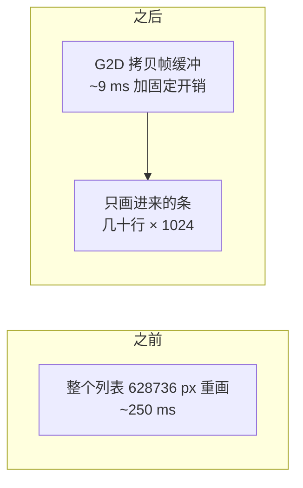
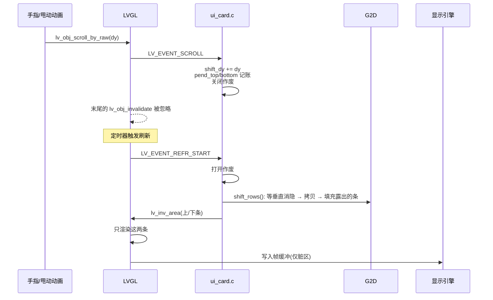
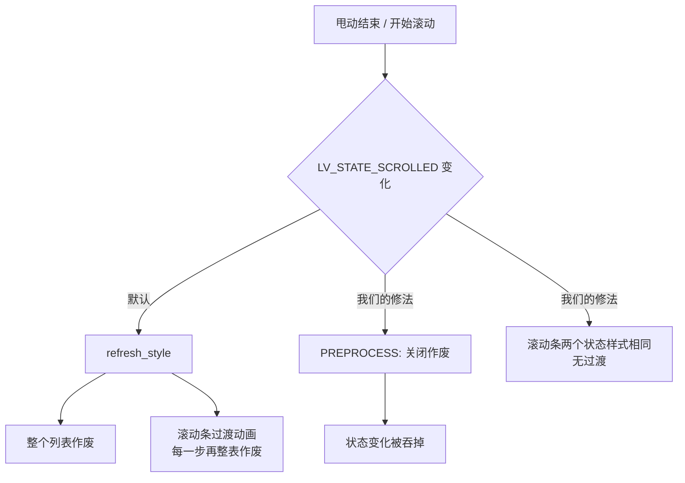

# 在 600 MHz 单核 RISC-V 上把 LVGL 列表滑顺

## 起点：滚一步要 250～350 ms

LVGL 的滚动是这么做的：手指移动，容器里所有子对象的坐标整体平移，容器这一整块区域被作废（invalidate），下一次刷新把整块重画一遍，再写进帧缓冲。

瓶颈不在算力，在**内存带宽**。1024×614 的一块区域重画一次，要读封面、读字形、做混合，然后整块写回帧缓冲，实测约 250 ms；加上上层开销，一步滚动的 CPU 时间大约 354 ms。手指一拖就是 3 帧每秒，谈不上跟手。


## 思路：滚动就是搬像素

滚动一步，屏幕上 95% 的内容只是整体上移或下移了几十个像素，真正要新画的只有**从边上进来的那一条**。所以思路是用 2D 加速器（G2D）把帧缓冲里已有的像素整块搬过去，几毫秒的事；再只让 LVGL 重画进来的那一条，几十到一两百行。



要做到这点，有五件事要解决。

| 问题 | 方案 |
| --- | --- |
| LVGL 默认会作废整个列表 | 在 `LV_EVENT_SCROLL` 里暂时关闭作废（`lv_display_enable_invalidation`），自己记账 |
| 谁来搬像素、什么时候搬 | G2D 加速器；在 `LV_EVENT_REFR_START` 时执行，一帧里的多步合并成一次 |
| 只画哪里 | 记下 `pend_top / pend_bottom`（上边和下边各进来了多少行），刷新开始时用 `lv_inv_area` 只作废这两条 |
| 卡片太多 | 虚拟化：只给屏幕附近的行建控件 |
| 封面太贵 | 封面直接存 XRGB8888，格式转换也交给 G2D |

---

## 第一版：搬像素，只画进来的那条

### 每个网格要记的账

`ui_priv.h` 里网格结构体上专门为滚动加了几个字段：

```c
struct ui_grid {
	lv_obj_t *obj;			/**< the scrolling container */
	...
	int last_scroll;		/**< scroll position at the last scroll event */
	int pend_top, pend_bottom;	/**< rows that came in at the top / bottom and are not drawn yet */
	int shift_dy;			/**< scroll steps whose move of the picture waits for the refresh */
	bool no_shift;			/**< the next scroll is a jump: draw everything */
};
```

- `last_scroll`：上一次滚动事件时的滚动位置，用来算这一步走了多少；
- `shift_dy`：这一帧里累计要搬的行数，正数表示内容上移、也就是向下滚；
- `pend_top` / `pend_bottom`：新进来、还没画的行数；
- `no_shift`：代码里主动 `scroll_to` 的跳转（换列表、回顶部），不走快路径，直接整表画。

### 一次滚动到屏幕的完整路径



这里有个必须踩准的地方：`LV_EVENT_SCROLL` 是在 `lv_obj_scroll_by_raw()` 内部、最后一次 `lv_obj_invalidate(obj)` **之前**发出来的，所以在回调里把作废关掉，LVGL 随后那次整表作废就会被吞掉。作废开关是个计数器，`lv_display_enable_invalidation(d, false)` 加一、`true` 减一，得成对用。

> 还有一点：`lv_obj_scroll_by()`（不带 `_raw`）会发 `SCROLL_BEGIN`/`SCROLL_END`，那会改"滚动中"状态，也会整表作废，后面单独说。早先自测一直走不到快路径，就是因为用了它。

### 滚动事件里只记账，不画

```c
static void scrolled(lv_event_t *e)          /* LV_EVENT_SCROLL */
{
	struct ui_grid *g = lv_event_get_user_data(e);
	lv_display_t *d = lv_display_get_default();
	lv_area_t r;
	int y = lv_obj_get_scroll_y(g->obj), dy = y - g->last_scroll, h;

	g->last_scroll = y;
	g->covers_dirty = true;
	if (!IS_ENABLED(CONFIG_BILI_SCROLL_SHIFT) || dy == 0) {
		return;
	}
	lv_obj_get_coords(g->obj, &r);
	h = lv_area_get_height(&r);
	if (g->no_shift) {
		stat.jump++;                       /* 跳转: 整表画 */
	} else if (lv_obj_has_flag(g->obj, LV_OBJ_FLAG_HIDDEN) ||
		   lv_obj_has_flag(lv_obj_get_parent(g->obj), LV_OBJ_FLAG_HIDDEN)) {
		stat.hidden++;                     /* 看不见: 不用管 */
	} else if (g->shift_dy + dy >= h || -(g->shift_dy + dy) >= h) {
		stat.big++;                        /* 一帧走过一屏以上: 搬没有意义 */
	} else if (!move_pending(d, &r, dy)) {
		stat.pending++;                    /* 见"回退到整屏重画"一节 */
	} else if (!shift_ready()) {
		stat.not_ready++;
	} else {
		/* 搬运推迟到刷新开始时, 一帧里的多步只搬一次 */
		stat.shifted++;
		g->shift_dy += dy;
		goto moved;
	}
	{
		/* 任何一个例外: 放弃快路径, 让 LVGL 照常整表重画 */
		if (inv_off) {
			lv_display_enable_invalidation(d, true);
			inv_off = false;
		}
		g->pend_top = g->pend_bottom = 0;
		g->shift_dy = 0;
		return;
	}
moved:
	if (dy > 0) {                              /* 内容上移: 底部进来 dy 行 */
		g->pend_bottom = MIN(h, g->pend_bottom + dy);
		g->pend_top = MAX(0, g->pend_top - dy);
	} else {
		g->pend_top = MIN(h, g->pend_top - dy);
		g->pend_bottom = MAX(0, g->pend_bottom + dy);
	}
	if (!inv_off) {
		lv_display_enable_invalidation(d, false);   /* 关闭整表作废 */
		inv_off = true;
	}
	refresh_soon(d);                           /* 让刷新定时器尽快跑 */
}
```

每个例外都配了一个计数器（`stat.jump` / `hidden` / `big` / `pending` / `not_ready`），后面查"为什么还慢"全靠它们。

### 刷新开始：搬像素，只作废进来的条

```c
/* the rows that came in are drawn: they join the areas that wait, in the refresh that is starting */
static void add_strips(lv_event_t *e)          /* LV_EVENT_REFR_START */
{
	lv_display_t *d = lv_display_get_default();

	if (inv_off) {
		lv_display_enable_invalidation(d, true);   /* 开回来, 新进来的条要能作废 */
		inv_off = false;
	}
	for (int i = 0; i < GRIDS; i++) {
		struct ui_grid *g = registry[i];
		lv_area_t r, a;

		if (g == NULL || (g->pend_top == 0 && g->pend_bottom == 0 && g->shift_dy == 0)) {
			continue;
		}
		lv_obj_get_coords(g->obj, &r);
		if (g->shift_dy != 0 && shift_rows(r.y1, lv_area_get_height(&r), g->shift_dy) != 0) {
			/* 搬失败: 整个列表重画 */
			stat.failed++;
			lv_inv_area(d, &r);
		} else {
			if (g->pend_top > 0) {            /* 只作废进来的上条 */
				a = r;
				a.y2 = r.y1 + g->pend_top - 1;
				lv_inv_area(d, &a);
			}
			if (g->pend_bottom > 0) {         /* 只作废进来的下条 */
				a = r;
				a.y1 = r.y2 - g->pend_bottom + 1;
				lv_inv_area(d, &a);
			}
		}
		g->pend_top = g->pend_bottom = 0;
		g->shift_dy = 0;
	}
}
```

这个函数挂在显示对象的 `LV_EVENT_REFR_START` 上（`lv_display_add_event_cb(..., LV_EVENT_REFR_START, ...)`）。`REFR_START` 在 `lv_refr_now` 开头发出，这时 LVGL 还没开始收集脏区去渲染，所以此刻加的 `lv_inv_area` 会被这一轮渲染一起画掉。

为什么不放在滚动事件里搬、要等到 `REFR_START`：触摸采样频率可能比刷新快，一帧里会来好几步滚动，而 G2D 每次操作都有约 1.2 ms 的固定延迟；更要紧的是帧缓冲正在被显示引擎扫描，每改写一次就多一次接缝风险。

还留了个兜底：界面主循环（`ui_run`）每一轮开头调用一次 `ui_grids_scroll_flush()`，把作废开回来，并在还有账没清的时候催一下刷新，免得关了作废之后因为没有刷新，把别处该有的正常重画也一起吞掉。

```c
void ui_grids_scroll_flush(void)
{
	lv_display_t *d = lv_display_get_default();
	bool waiting = false;

	if (inv_off) {
		lv_display_enable_invalidation(d, true);
		inv_off = false;
	}
	for (int i = 0; i < GRIDS; i++) {
		waiting |= registry[i] != NULL && (registry[i]->pend_top != 0 ||
			   registry[i]->pend_bottom != 0 || registry[i]->shift_dy != 0);
	}
	if (waiting) {
		refresh_soon(d);
	}
}
```

### shift_rows()：G2D 搬运

这是整个方案的核心，放在 `gfx/shift.c`。先看结构，里面每个看着多余的步骤都是被后面那些问题逼出来的：

```c
int shift_rows(int y, int h, int dy)
{
	int n = dy < 0 ? -dy : dy, moved = h - n, first_new, ret;
	struct g2d_surface f, b;
	struct g2d_rect src, dst, strip;
	size_t bytes;

	if (!shift_ready() || n == 0 || moved <= 0 || y < 0 || y + h > (int)fb_h) {
		return -EINVAL;
	}
	bytes = (size_t)moved * stride;
	if (dy < 0) {
		/* 向下滚: 内容下移, 顶部进来。见"滑得快会拖影"一节: 这个方向不能在帧缓冲内原地拷贝 */
		...
	} else {
		/* 向上滚: 内容上移, 底部进来 */
		surfaces(&f, &b);
		sys_cache_data_flush_range(fb + (size_t)(y + n) * stride, bytes); /* CPU 画的脏行先写回 */
		display_sunxi_wait_vsync(disp, 40);                               /* 对齐垂直消隐 */
		src = (struct g2d_rect){0, y + n, fb_w, moved};
		dst = (struct g2d_rect){0, y, fb_w, moved};
		ret = g2d_blit(g2d, &f, &src, &f, &dst, G2D_ROTATE_0, G2D_FLAG_NO_CACHE_OPS);
		first_new = y + moved;
	}
	if (ret == 0) {
		strip = (struct g2d_rect){0, first_new, fb_w, n};
		g2d_fill(g2d, &f, &strip, PAGE_COLOR);            /* 露出的条先填底色 */
	}
	sys_cache_data_invd_range(fb + (size_t)y * stride, (size_t)h * stride); /* CPU 之后要读的行丢掉旧缓存 */

	return ret;
}
```

三个和缓存有关的细节，漏一个就会偶发错位的花屏：

1. 搬运之前，CPU 刚画好、还躺在 D-cache 里的行必须先 `flush`，G2D 才能读到；
2. `G2D_FLAG_NO_CACHE_OPS` 是告诉驱动"缓存我自己管"，不要每次操作都整块 flush / invalidate；
3. 搬完之后，CPU 再读这块区域（LVGL 局部重画要读背景）之前要 `invalidate`，否则 CPU 会读到旧缓存。

---

## 滑快了会拖影

G2D 搬运跑通之后速度立刻上来了，但用户反馈：滑太快会出现 UI 拖影。

显示引擎在不停地**从上到下扫描帧缓冲输出**。我在扫描扫到一半的时候原地搬像素，扫描线上方读到的是搬之前的像素，下方读到的是搬之后的，中间就多出一条接缝；滚得快的时候，这条接缝就是拖影、双影。


### 跟着消隐搬

先给显示驱动补一个等垂直消隐的接口，底层等 vsync 的函数本来就有，只是没暴露出来：

```c
/* display_sunxi.c */
int display_sunxi_wait_vsync(const struct device *dev, uint32_t timeout_ms)
{
	ARG_UNUSED(dev);

	return display_wait_vsync(timeout_ms);
}
```

G2D 搬完一整块 1024×600 级别的区域，比显示引擎扫完同样区域快，所以只要**从消隐开始、从上到下搬**，既不会追上扫描线，也不会被扫描线追上，整个过程中扫描线看到的要么全是旧的、要么全是新的。

### 向下滚不能原地拷贝

"从上到下搬"对内容上移、也就是向下滚是对的：源行在目标行的下方，读在前、写在后。反过来就错了，内容下移时源行在目标行的上方，从上往下拷会把还没读的源行覆盖掉。实测 G2D 的重叠拷贝，**上移一次到位是对的，下移会出现部分行重复**。

所以向上滚先把要搬的行拷到一块中转缓冲区，等消隐时再从中转缓冲拷回帧缓冲：

```c
if (dy < 0) {
	if (bounce_size < bytes) {
		shift_release();
		bounce = aligned_alloc(64, bytes);
		if (bounce == NULL) {
			return -ENOMEM;
		}
		bounce_size = bytes;
		/* 只有 G2D 往里写: 不能留 CPU 的脏缓存行, 否则以后会盖掉 G2D 的结果 */
		sys_cache_data_flush_and_invd_range(bounce, bytes);
	}
	surfaces(&f, &b);
	/* 第一步: 帧缓冲 → 中转缓冲(这一步和扫描无关, 现在就做) */
	sys_cache_data_flush_range(fb + (size_t)y * stride, bytes);
	src = (struct g2d_rect){0, y, fb_w, moved};
	dst = (struct g2d_rect){0, 0, fb_w, moved};
	ret = g2d_blit(g2d, &f, &src, &b, &dst, G2D_ROTATE_0, G2D_FLAG_NO_CACHE_OPS);
	if (ret != 0) {
		return ret;
	}
	/* 第二步: 等消隐, 再从中转缓冲 → 帧缓冲(下移 n 行) */
	display_sunxi_wait_vsync(disp, 40);
	src = (struct g2d_rect){0, 0, fb_w, moved};
	dst = (struct g2d_rect){0, y + n, fb_w, moved};
	ret = g2d_blit(g2d, &b, &src, &f, &dst, G2D_ROTATE_0, G2D_FLAG_NO_CACHE_OPS);
	first_new = y;
}
```


中转缓冲区只在第一次向上滚时分配（`aligned_alloc(64, …)` 是 G2D 要求的对齐），进播放页时 `shift_release()` 还给堆，因为播放视频的时候内存很紧，空闲只有 3 MB 左右。

### 露出的那条先填底色

搬完之后，露出来的那一条里是别的行的拷贝，搬运不会清掉源位置。在 LVGL 把它画好之前，如果屏幕刚好扫到那里，看到的就是一小段错位的内容。所以搬完立刻用页面底色填平：

```c
if (ret == 0) {
	strip = (struct g2d_rect){0, first_new, fb_w, n};
	g2d_fill(g2d, &f, &strip, PAGE_COLOR);   /* 0xff0b0f14, 和 UI 的页面背景一致 */
}
```

这样最坏情况也就是一条一帧以内的底色，而不是别处的画面。

> G2D 有个特性：alpha 为 0 的像素写出来是 0，也就是透明黑。界面层的"透明像素"本来就是 0，所以搬运前后一致、不会有残影；也是因为这个，后面逐像素比较不能拿 alpha 去比。

---

## 让进来的那条尽量便宜

搬像素只解决了已有内容，从边上进来的那条卡片本身也得便宜。

### 只给看得见的行建控件

列表最多 100 张卡片，每张 6 个子控件，全建起来 LVGL 的堆和布局遍历都吃不消。做法是只给"屏幕上下各多一张卡片高度"范围内的行建控件，**滚出去的行销毁、封面还回缓存**。

```c
/* the first and the last row that have to have widgets: the screen and a card's height around it */
static void window_rows(struct ui_grid *g, int *first, int *last)
{
	int row_h = ui_card_height() + MARGIN;
	int top = lv_obj_get_scroll_y(g->obj), vh = lv_obj_get_height(g->obj);
	int rows = (g->built + CARD_COLS - 1) / CARD_COLS;

	*first = MAX(0, (top - row_h) / row_h);
	*last = MIN(rows - 1, (top + vh + row_h) / row_h);
}

/* 在 ui_grid_sync() 里: 窗口里的行建控件, 窗口外两行以上的销毁 */
for (int i = 0; i < g->built; i++) {
	int row = i / CARD_COLS;
	struct ui_card *c = &g->cards[i];

	if (row >= first && row <= last) {
		if (c->obj == NULL && app_video(g->list, i, &v)) {
			card_build(g, i, &v);       /* 滚进窗口: 建 */
			changed = true;
		}
	} else if (c->obj != NULL && (row < first - 1 || row > last + 1)) {
		card_destroy(c);                    /* 离开窗口: 毁, 封面还回缓存 */
		changed = true;
	}
}
```

销毁的阈值比建的阈值多留一行（`first - 1`、`last + 1`），形成迟滞，避免在边界上来回滚时反复建、反复毁。

### 封面直接存 XRGB8888

封面是 JPEG，视频引擎解出来是 NV12。原来 CPU 转 RGB565 再交给 LVGL 混合，但 LVGL 的渲染目标是 ARGB8888，RGB565 每个像素都得先扩展再混合。现在封面缓冲直接存 `XRGB8888`（`COVER_STRIDE 960`，64 字节对齐），LVGL 按同格式拷贝；NV12 转 XRGB8888 加缩放用一次 `g2d_blit`，CPU 只留兜底：

```c
static void to_xrgb(const struct vdec_frame *f, uint32_t *out)
{
	static const struct device *const g2d = DEVICE_DT_GET(DT_NODELABEL(g2d));

	if (device_is_ready(g2d)) {
		struct g2d_surface src = {
			.format = G2D_PIXFMT_NV12, .width = f->width, .height = f->height,
			.plane = {(void *)f->plane[0], (void *)f->plane[1]},
			.pitch = {f->stride[0], f->stride[1]},
		};
		struct g2d_surface dst = {
			.format = G2D_PIXFMT_XRGB8888, .width = COVER_STRIDE / 4, .height = COVER_H,
			.plane = {out}, .pitch = {COVER_STRIDE},
		};
		struct g2d_rect sr = {0, 0, f->width, f->height}, dr = {0, 0, COVER_W, COVER_H};

		if (g2d_blit(g2d, &src, &sr, &dst, &dr, G2D_ROTATE_0, G2D_FLAG_YUV_FULL_RANGE) == 0) {
			return;                 /* G2D 做完了转换 + 缩放 */
		}
	}
	to_xrgb_c(f, out);                      /* 兜底: CPU 逐像素转 */
}
```

视频引擎拒掉的 JPEG（4:4:4 之类）走软件解码 tjpgd。tjpgd 给 LVGL 的回调里字节顺序是 B、G、R，这里写反过一次，表现是部分图片反色：

```c
/* the decoder of LVGL delivers the bytes of a pixel as blue, green, red */
((uint32_t *)s->out)[y * s->stride + x] =
	0xff000000U | (uint32_t)p[2] << 16 | (uint32_t)p[1] << 8 | p[0];
```

### 圆角用两张 A8 蒙版

`clip_corner` 会让 LVGL 把整张卡片先画进一个临时图层，实测每帧多花约十分之一的时间。改成在封面的两个上角各盖一张 10×10 的 A8 蒙版，重着色成页面底色，看起来和裁剪一样，但不产生图层：

```c
#define CORNER		10
#define CORNER_STRIDE	16
static uint8_t corner_px[2][CORNER_STRIDE * CORNER] __aligned(4);
static lv_image_dsc_t corner_dsc[2];

static void corners_init(void)
{
	for (int y = 0; y < CORNER; y++) {
		for (int x = 0; x < CORNER; x++) {
			float dx = x + 0.5f - CORNER, dy = y + 0.5f - CORNER;
			float a = sqrtf(dx * dx + dy * dy) - CORNER + 0.5f;   /* 圆内 0, 圆外 1 */
			uint8_t v = a <= 0.0f ? 0 : (a >= 1.0f ? 255 : (uint8_t)(a * 255.0f));

			corner_px[0][y * CORNER_STRIDE + x] = v;                        /* 左上角 */
			corner_px[1][y * CORNER_STRIDE + CORNER - 1 - x] = v;          /* 右上角: 镜像 */
		}
	}
	for (int k = 0; k < 2; k++) {
		corner_dsc[k] = (lv_image_dsc_t){
			.header = {.magic = LV_IMAGE_HEADER_MAGIC, .cf = LV_COLOR_FORMAT_A8,
				   .w = CORNER, .h = CORNER, .stride = CORNER_STRIDE},
			.data_size = sizeof(corner_px[k]),
			.data = corner_px[k],
		};
	}
}

/* 在 card_build() 里, 盖在封面上方 */
for (int k = 0; k < 2; k++) {
	lv_obj_t *m = lv_image_create(o);

	lv_obj_remove_flag(m, LV_OBJ_FLAG_CLICKABLE);
	lv_image_set_src(m, &corner_dsc[k]);
	lv_obj_set_pos(m, k ? CARD_W - CORNER : 0, 0);
	lv_obj_set_style_image_recolor(m, C_BG, 0);          /* 蒙版着成页面底色 */
	lv_obj_set_style_image_recolor_opa(m, LV_OPA_COVER, 0);
}
```

### 字形缓存按一屏的字数定

标题用 TinyTTF 现场栅格化，新一行进来要渲染几十个新字，缓存命中率直接决定这一行的渲染时间。TinyTTF 的缓存是按"字形个数"算的，不是字节：

```c
/* ~150 distinct glyphs of the middle size are needed on a screen of cards, the other sizes only a few */
#define GLYPH_CACHE_S	160
#define GLYPH_CACHE_M	320
#define GLYPH_CACHE_L	64

ui_font_s = make(18, GLYPH_CACHE_S);
ui_font_m = make(22, GLYPH_CACHE_M);
ui_font_l = make(28, GLYPH_CACHE_L);
```

缓存太小会反复栅格化，**太大又吃堆**，有一版把缓存开得没有上限，LVGL 的堆看起来就像在慢慢泄漏。最后按"一屏卡片大约出现多少不同的字"定死大小。

### 关掉滚动条

```c
lv_obj_set_scrollbar_mode(g->obj, LV_SCROLLBAR_MODE_OFF);   /* it would move with the picture */
```

滚动条画在列表区域里，会跟着像素一起被搬动、留下残影；它的显示和淡出动画后面还会再惹一次麻烦。

---

## 证明搬得对：和整区重画逐像素比

搬像素这种优化最容易"看起来对"，所以自测里做了一次像素级的对比：

1. 自动把第一页按 48 px 一步、250 ms 一个节拍滚动；
2. 每一步打印帧耗时和滚动事件的处理统计；
3. 滚完等封面全部加载完（`cover_pending() == 0`），记下屏幕快照 A；
4. 强制整区重画一次，记下快照 B；
5. 逐像素比较 A 和 B，打印差异像素数。

**差异必须是 0 才算对**。第一次跑出来是 125176 / 628736 个像素不同，我以为搬错了，查了很久才发现是 A 和 B 之间又有封面加载进来，两次快照比的根本不是同一时刻的内容。把"先等封面静止"补上之后，差异为 0。

另外，自测里不能用 `lv_obj_scroll_by()`，它会发 `SCROLL_BEGIN`/`SCROLL_END`，状态一变整个对象作废，快路径永远走不到；要用 `lv_obj_scroll_by_raw()`，真实手指拖动走的就是 `_raw`：

```c
/* ui_home.c, 自测用 */
void ui_home_scroll(int dy)
{
	...
	lv_obj_scroll_by_raw(g->obj, 0, -step);
}
```

---

## 慢刷新还在

做完上面这些，手感"好了一些"，但用户还是说滑太快有点卡顿。到这一步再靠猜就是浪费时间，于是加了一套只在调试选项下打开的观测（Kconfig `BILI_SCROLL_LOG`，默认关）：

```c
static uint32_t refr_start_ms, shift_ms, shift_steps, dirty_areas, dirty_px;

/* REFR_START: 记起点, 并统计脏区 */
static void add_strips(lv_event_t *e)
{
	refr_start_ms = k_uptime_get_32();
	...  /* 搬运 + 作废进来的条 */
	if (IS_ENABLED(CONFIG_BILI_SCROLL_LOG)) {
		dirty_areas = dirty_px = 0;
		for (uint32_t k = 0; k < d->inv_p; k++) {
			if (!d->inv_area_joined[k]) {                 /* 没被合并掉的脏区 */
				dirty_areas++;
				dirty_px += lv_area_get_width(&d->inv_areas[k]) *
					    lv_area_get_height(&d->inv_areas[k]);
			}
		}
	}
}

/* REFR_READY: 慢的才打印 */
static void note_refresh(lv_event_t *e)
{
	if (IS_ENABLED(CONFIG_BILI_SCROLL_LOG)) {
		uint32_t total = k_uptime_get_32() - refr_start_ms;

		if (total > 40) {
			printk("scroll: dirty %u areas %u px, refresh %u ms (shift %u ms for %u rows) "
			       "moved %u jump %u hidden %u far %u pending %u failed %u\n",
			       dirty_areas, dirty_px, total, shift_ms, shift_steps,
			       stat.shifted, stat.jump, stat.hidden, stat.big, stat.pending, stat.failed);
		}
		shift_ms = shift_steps = 0;
	}
}
```

`shift_rows()` 的耗时也在 `add_strips()` 里用 `k_uptime_get_32()` 夹着记下来（`shift_ms`）。

日志一行长这样：

```
scroll: dirty 2 areas 628736 px, refresh 133 ms (shift 14 ms for 52 rows) moved 758 jump 0 hidden 0 far 0 pending 7 failed 0
```

读法：

- 脏区 628736 像素，正好是整个列表（1024×614），而搬运只花了 14 ms，慢的不是搬，是有人把整表作废了；
- `pending` 在涨，对应下面那条回退；
- `shift` 在 20～37 ms、脏区只有几万到二十万像素、刷新 40～80 ms，这是正常的快路径，剩下的开销是进来那一条的渲染本身。

另外还打了采样剖析（`prof_start` / `prof_report`，每 2 ms 采一次主线程保存的 PC，再用 `addr2line` 映射）。这里踩了一下：约一半样本落在"PC 为 0"的桶里，线程正在运行、没有保存的上下文，所以它只能说明 memcpy 和缓存刷新的占比不大，指不出元凶。真正把问题定位下来的是脏区日志和后面那次调用栈。

---

## 待画区域要跟着画面一起移动

第一轮日志里，`pending` 几乎每帧加 1，同时大量出现"shift 0 rows、刷新 100 ms 以上"的行。

原因是我在 `scrolled()` 里写过一条"保护"：滚动发生时，如果列表区域里已经有别的待重画区域（比如某张封面刚加载完、这张卡的区域在等重画），就放弃搬运、整表重画，因为一搬，那块待画区域的坐标就和屏幕内容对不上了。而快速滚动时封面源源不断地到达，几乎每一帧都命中这条保护，快路径形同虚设。

改法是不放弃，**让待画区域跟着画面一起移动**。LVGL 的待画区域就在 `d->inv_areas[]` 里（`d->inv_area_joined[i]` 表示这条已被合并到别处、要忽略），搬像素之前把完全落在列表内的区域整体平移 `-dy` 再裁剪；只要有一块伸出列表边界，才回退：

```c
/*
 * Drawing that waits inside the list (a cover that arrived) moves with the picture: its area is
 * moved by the step. False when one of the areas reaches out of the list, then everything is drawn.
 */
static bool move_pending(lv_display_t *d, const lv_area_t *r, int dy)
{
	/* 第一遍: 只检查, 不改动。有一块伸出列表就放弃 */
	for (uint32_t i = 0; i < d->inv_p; i++) {
		lv_area_t x;

		if (!d->inv_area_joined[i] && lv_area_intersect(&x, &d->inv_areas[i], r) &&
		    !lv_area_is_in(&d->inv_areas[i], r, 0)) {
			return false;
		}
	}
	/* 第二遍: 全部在列表内, 整体平移 -dy 并裁到列表内 */
	for (uint32_t i = 0; i < d->inv_p; i++) {
		lv_area_t *a = &d->inv_areas[i], x;

		if (d->inv_area_joined[i] || !lv_area_intersect(&x, a, r)) {
			continue;
		}
		a->y1 -= dy;
		a->y2 -= dy;
		if (!lv_area_intersect(a, a, r)) {
			d->inv_area_joined[i] = 1;     /* 移出列表了: 这一块不用画了 */
		}
	}

	return true;
}
```

分两遍是为了避免"改了一半又发现要回退"。

效果是 `pending` 回退从近 200 次降到 0。

---

## 是谁在作废整个列表

回退没了，日志里还是有一部分刷新的脏区是整个 628736 像素，而且 `inv_off` 总是 0，说明不在我关作废的窗口里，`pending` / `far` / `jump` 也都没涨。到这一步只能去问"是谁在作废"，再猜下去没有意义。

给显示对象挂一个 `LV_EVENT_INVALIDATE_AREA` 回调，遇到 ≥1000×500 的作废就记录，并在回调里沿帧指针往回走、打印返回地址链。编译时加 `-DCONFIG_FRAME_POINTER=y`，只用于这次定位。Zephyr 的 `arch_stack_walk` 在这个上下文里只能回溯 1~3 帧、而且指向 `main`，用不了，所以手工遍历 `fp[-1]`（返回地址）和 `fp[-2]`（上一帧的 `fp`），再用 `addr2line` 解析：

```c
static void big_inv(lv_event_t *e)                    /* LV_EVENT_INVALIDATE_AREA */
{
	const lv_area_t *a = lv_event_get_param(e);
	static int n;

	if (lv_area_get_width(a) >= 1000 && lv_area_get_height(a) >= 500 && n < 40) {
		uintptr_t *fp = __builtin_frame_address(0);

		n++;
		printk("big invalidate %d,%d..%d,%d inv_off %d:", (int)a->x1, (int)a->y1,
		       (int)a->x2, (int)a->y2, inv_off);
		for (int i = 0; i < 14 && fp != NULL && ((uintptr_t)fp & 3) == 0 && fp[-1] != 0; i++) {
			printk(" %lx", (unsigned long)fp[-1]);   /* 返回地址 */
			if (fp[-2] <= (uintptr_t)fp) {              /* 防止走飞 */
				break;
			}
			fp = (uintptr_t *)fp[-2];                   /* 上一帧 */
		}
		printk("\n");
	}
}
```

板子上打出来的那一行：

```
big invalidate 0,124..1023,737 inv_off 0: 40039512 40018cd4 4005c0e2 4004f5c2 4004f538 4005464a ...
```

`addr2line -f -e zephyr.elf 0x…`，要用同一次构建的 ELF：

```
lv_display_send_event            ← 作废事件本身
lv_inv_area
lv_obj_invalidate_area
lv_obj_invalidate                ← 整个对象
lv_obj_refresh_style             ← 样式刷新
update_obj_state                 ← 状态变化
lv_obj_remove_state              ← 去掉 LV_STATE_SCROLLED
lv_obj_event_base                ← 对象的默认事件处理
lv_indev_scroll_throw_handler    ← 甩动结束
```

原来是 LVGL 自己在 `SCROLL_BEGIN` / `SCROLL_END` 的默认处理里（`lv_obj.c`）加和去 `LV_STATE_SCROLLED`：

```c
else if(code == LV_EVENT_SCROLL_BEGIN) {
    lv_obj_add_state(obj, LV_STATE_SCROLLED);
}
else if(code == LV_EVENT_SCROLL_END) {
    lv_obj_remove_state(obj, LV_STATE_SCROLLED);
    ...
}
```

状态一变，`update_obj_state()` 就走 `lv_obj_refresh_style()`，进而把整个对象作废。这**不是我代码里的调用**，所以之前怎么翻自己的代码都找不到。

### 用 PREPROCESS 把这次状态变化包起来

LVGL 的事件回调可以带 `LV_EVENT_PREPROCESS` 标志，带这个标志的回调**先于类自身的默认处理**运行，不带的在其后。那么在默认处理之前关掉作废、之后开回来就行了：

```c
/*
 * The scrolling state that LVGL sets on the list at the start and the end of a scroll refreshes its
 * style, and that draws the whole list again (a refresh of 100 ms and more at the end of a fling).
 * The list has no style of that state: the invalidation is off while the state changes.
 */
static void state_guard_on(lv_event_t *e)      /* 默认处理之前: 关闭作废 */
{
	lv_display_enable_invalidation(lv_display_get_default(), false);
}

static void state_guard_off(lv_event_t *e)     /* 默认处理之后: 打开作废 */
{
	lv_display_enable_invalidation(lv_display_get_default(), true);
}

/* 在 ui_grid_create() 里 */
if (IS_ENABLED(CONFIG_BILI_SCROLL_SHIFT)) {
	lv_obj_add_event_cb(g->obj, state_guard_on,  LV_EVENT_SCROLL_BEGIN | LV_EVENT_PREPROCESS, NULL);
	lv_obj_add_event_cb(g->obj, state_guard_on,  LV_EVENT_SCROLL_END   | LV_EVENT_PREPROCESS, NULL);
	lv_obj_add_event_cb(g->obj, state_guard_off, LV_EVENT_SCROLL_BEGIN, NULL);
	lv_obj_add_event_cb(g->obj, state_guard_off, LV_EVENT_SCROLL_END,   NULL);
}
```

两点要注意：

- 必须是两个回调。`lv_event_get_code()` 会把 `PREPROCESS` 位去掉（`return e->code & ~LV_EVENT_PREPROCESS`），同一个回调里没法靠事件码区分是前处理还是后处理；
- 作废开关是计数器，前后成对调用；嵌套在 `scrolled()` 已经在用的 `inv_off` 开关里也没问题。

列表本身没有为这个状态配过样式，所以这次状态变化被吞掉，对显示没有影响。

---

## 滚动条的过渡动画

再测，大部分好了，但还有零星的整表刷新。这次抓到的调用链指向 `trans_anim_cb`，也就是样式过渡动画：

```
anim_timer → trans_anim_cb → lv_obj_refresh_style → lv_obj_invalidate
```

默认主题给对象的滚动条部分（`LV_PART_SCROLLBAR`）设了两套样式：普通态 `bg_opa = 40%`，`LV_STATE_SCROLLED` 态 `bg_opa = 100%`，还带一个过渡动画（`lv_theme_default.c` 里的 `scrollbar` 和 `scrollbar_scrolled`）。就算把滚动条模式设成 `OFF`，状态一变，过渡动画照样启动，**每一步动画都作废整个对象**。

改法是让这个部分在所有状态下样式一致，并显式去掉过渡。本地样式（`lv_obj_set_style_*`）的优先级高于主题样式，两个状态各设一遍就行：

```c
/*
 * The theme fades the (hidden) scroll bar in and out with a style transition, and every step of
 * that draws the whole list again: the scroll bar looks the same in every state.
 */
for (int st = 0; st < 2; st++) {
	lv_style_selector_t sel = LV_PART_SCROLLBAR | (st ? LV_STATE_SCROLLED : 0);

	lv_obj_set_style_bg_opa(g->obj, LV_OPA_TRANSP, sel);
	lv_obj_set_style_transition(g->obj, NULL, sel);
}
```

两个状态完全相同之后，`update_obj_state()` 比较前后样式、发现没有差别，直接返回，既不创建过渡动画，也不作废。



---

## 成果

| 项 | 之前 | 之后 |
| --- | --- | --- |
| 一步滚动的 CPU 时间 | ~354 ms | ~30 ms（G2D 搬运 + 只画进来的条） |
| 整个列表重画 | 每步都有 | 只剩跳转、换页 |
| 滚动时脏区 | 628736 px（整表） | 几万～二十万 px（进来的条 + 到达的封面） |
| 快速滚动拖影 | 有 | 无（用户确认） |
| "回退整表"（`pending`）计数 | 近 200 | 0 |
| 像素正确性 | - | 与整区重画逐像素比较，差异 0 |
| 慢刷新（>40 ms）的典型值 | 90～180 ms 且很多 | 40～80 ms，与进来的行数成正比 |

最后一轮的反馈是"好很多了"。

---

## 附：相关文件与选项

- `zephyr-components/bilibili-tv/src/ui/ui_card.c`：虚拟化网格、滚动事件、`move_pending`、`state_guard`、观测日志
- `zephyr-components/bilibili-tv/src/gfx/shift.c`：G2D 搬运（消隐对齐、中转缓冲、预填充）
- `zephyr-components/bilibili-tv/src/ui/cover.c`：封面 XRGB8888 缓存与 G2D 格式转换
- `zephyr-components/bilibili-tv/src/ui/fonts.c`：字形缓存大小
- `zephyr/drivers/display/sunxi/display_sunxi.c`：`display_sunxi_wait_vsync()`
- Kconfig：`BILI_SCROLL_SHIFT`（快路径）、`BILI_COVER_G2D`（G2D 转封面格式）、`BILI_SCROLL_LOG`（慢刷新日志 + 剖析）
