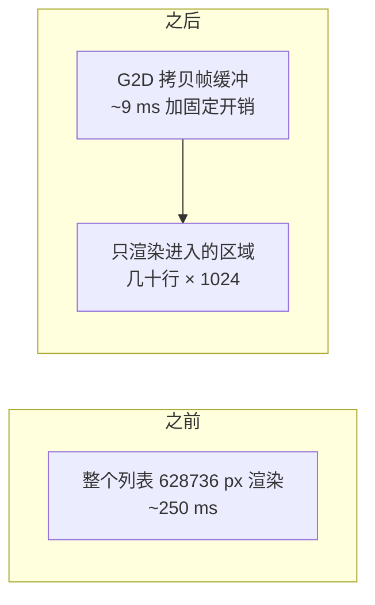
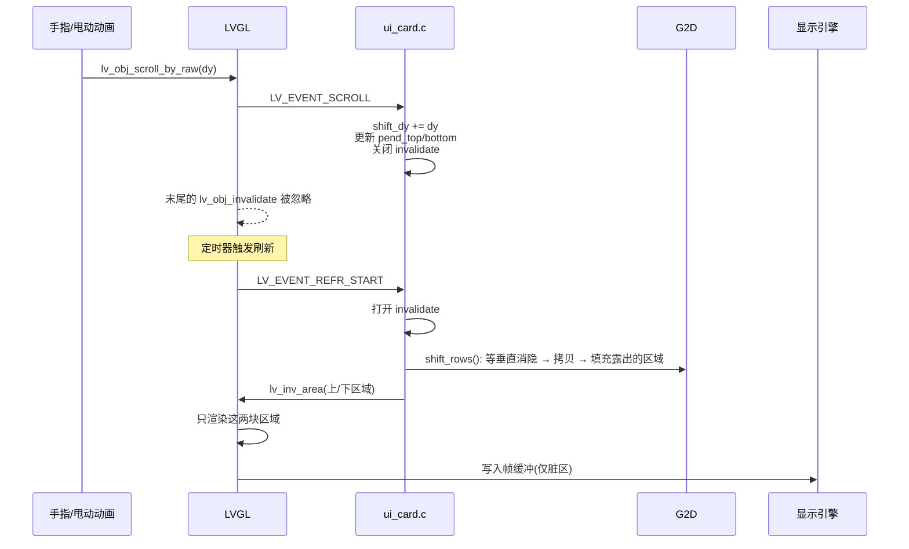
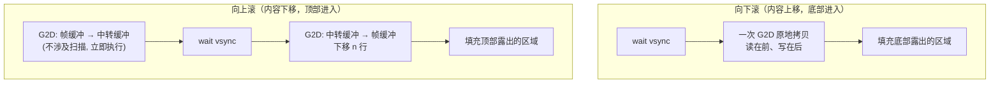
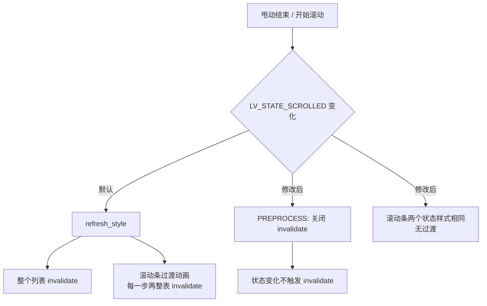

F101 上运行 Zephyr，屏幕分辨率 1024x614。应用是一个电视端的 B 站客户端，主界面是一个列表，最多 100 张卡片，每张卡片包含封面和若干文字控件，滚动由 LVGL 处理。

# 问题

优化前，滚动一步的 CPU 时间为 250 ~ 350 ms，帧率约 3 fps。

LVGL 的滚动流程：手指移动后，容器内所有子对象的坐标整体平移，整个容器区域被 invalidate，下一次刷新时整块区域重新渲染并写入帧缓冲。

这里重新渲染的区域是 1024x614 = 628736 个像素，需要读取封面和字形、做混合，再整块写回 PSRAM。F101 为 600MHz 单核，瓶颈在内存带宽。实测整块重新渲染约 250 ms，加上其他开销，一步滚动约 354 ms。


# 方案

滚动一步时，屏幕上约 95% 的内容只是整体上下平移了几十个像素，需要重新渲染的只有从边缘进入的一条区域。

处理方式分为两部分：

- 帧缓冲中已有的像素，使用 G2D 整块拷贝，耗时几毫秒
- 新进入的区域（几十到一两百行），由 LVGL 渲染



需要实现以下几点：

1. LVGL 默认 invalidate 整个列表。在 `LV_EVENT_SCROLL` 中临时关闭 invalidate（`lv_display_enable_invalidation`），需要渲染的区域由应用自己维护
2. 拷贝在 `LV_EVENT_REFR_START` 中执行，同一帧内的多次滚动合并为一次
3. 记录顶部和底部各进入多少行（`pend_top` / `pend_bottom`），刷新开始时用 `lv_inv_area` 只 invalidate 这两条
4. 只为屏幕附近的行创建控件
5. 封面直接以 XRGB8888 存储，格式转换由 G2D 完成

# 实现

## 列表状态

列表结构体增加四个字段：

```c
struct ui_grid {
	lv_obj_t *obj;
	...
	int last_scroll;		/* 上一次滚动事件时的滚动位置 */
	int pend_top, pend_bottom;	/* 顶部/底部进入的行数，没渲染 */
	int shift_dy;			/* 本帧累计需要拷贝的行数，正数为内容上移 */
	bool no_shift;			/* 下一次滚动是跳转，整表渲染 */
};
```

`no_shift` 用于 `scroll_to`。切换列表、回到顶部这类跳转不使用滚动拷贝，整表渲染。

一次滚动从事件到屏幕的流程：



## 滚动事件

滚动事件中只更新状态，不执行拷贝和渲染：

```c
static void scrolled(lv_event_t *e)          /* LV_EVENT_SCROLL */
{
	struct ui_grid *g = lv_event_get_user_data(e);
	lv_display_t *d = lv_display_get_default();
	lv_area_t r;
	int y = lv_obj_get_scroll_y(g->obj), dy = y - g->last_scroll, h;

	g->last_scroll = y;
	g->covers_dirty = true;
	if (!IS_ENABLED(CONFIG_BILI_SCROLL_SHIFT) || dy == 0) {
		return;
	}
	lv_obj_get_coords(g->obj, &r);
	h = lv_area_get_height(&r);
	if (g->no_shift) {
		stat.jump++;                       /* 跳转：整表渲染 */
	} else if (lv_obj_has_flag(g->obj, LV_OBJ_FLAG_HIDDEN) ||
		   lv_obj_has_flag(lv_obj_get_parent(g->obj), LV_OBJ_FLAG_HIDDEN)) {
		stat.hidden++;                     /* 不可见：不处理 */
	} else if (g->shift_dy + dy >= h || -(g->shift_dy + dy) >= h) {
		stat.big++;                        /* 一帧滚动超过一屏：不拷贝 */
	} else if (!move_pending(d, &r, dy)) {
		stat.pending++;                    /* 见"待渲染区域"一节 */
	} else if (!shift_ready()) {
		stat.not_ready++;
	} else {
		stat.shifted++;
		g->shift_dy += dy;
		goto moved;
	}
	/* 以上任一情况都不拷贝，由 LVGL 整表渲染 */
	if (inv_off) {
		lv_display_enable_invalidation(d, true);
		inv_off = false;
	}
	g->pend_top = g->pend_bottom = 0;
	g->shift_dy = 0;
	return;
moved:
	if (dy > 0) {                              /* 内容上移，底部进入 dy 行 */
		g->pend_bottom = MIN(h, g->pend_bottom + dy);
		g->pend_top = MAX(0, g->pend_top - dy);
	} else {
		g->pend_top = MIN(h, g->pend_top - dy);
		g->pend_bottom = MAX(0, g->pend_bottom + dy);
	}
	if (!inv_off) {
		lv_display_enable_invalidation(d, false);   /* 关闭整表 invalidate */
		inv_off = true;
	}
	refresh_soon(d);
}
```

每个例外分支各有一个计数器（`jump` / `hidden` / `big` / `pending` / `not_ready`），用于后面分析性能。

`LV_EVENT_SCROLL` 在 `lv_obj_scroll_by_raw()` 内部发出，位置在最后一次 `lv_obj_invalidate(obj)` **之前**。在回调中关闭 invalidate 后，LVGL 随后的整表 invalidate 不会生效。invalidate 开关是计数器，`false` 加一，`true` 减一，必须成对调用。

## 刷新开始

```c
static void add_strips(lv_event_t *e)          /* LV_EVENT_REFR_START */
{
	lv_display_t *d = lv_display_get_default();

	if (inv_off) {
		lv_display_enable_invalidation(d, true);   /* 重新打开，进入的区域需要 invalidate */
		inv_off = false;
	}
	for (int i = 0; i < GRIDS; i++) {
		struct ui_grid *g = registry[i];
		lv_area_t r, a;

		if (g == NULL || (g->pend_top == 0 && g->pend_bottom == 0 && g->shift_dy == 0)) {
			continue;
		}
		lv_obj_get_coords(g->obj, &r);
		if (g->shift_dy != 0 && shift_rows(r.y1, lv_area_get_height(&r), g->shift_dy) != 0) {
			stat.failed++;                     /* 拷贝失败，整表渲染 */
			lv_inv_area(d, &r);
		} else {
			if (g->pend_top > 0) {
				a = r;
				a.y2 = r.y1 + g->pend_top - 1;
				lv_inv_area(d, &a);
			}
			if (g->pend_bottom > 0) {
				a = r;
				a.y1 = r.y2 - g->pend_bottom + 1;
				lv_inv_area(d, &a);
			}
		}
		g->pend_top = g->pend_bottom = 0;
		g->shift_dy = 0;
	}
}
```

该回调注册在显示对象的 `LV_EVENT_REFR_START` 上。`REFR_START` 在 `lv_refr_now` 开头发出，此时 LVGL 还没有收集需要渲染的区域，因此这里调用的 `lv_inv_area` 会在同一轮刷新中渲染。

拷贝没有放在滚动事件中，原因有两个：

- 触摸采样频率高于刷新频率，一帧内可能有多次滚动事件，而 G2D 每次调用有约 1.2 ms 的固定延迟
- 帧缓冲正在被显示引擎扫描，每次修改都可能在画面上产生接缝，见下一节

`ui_run` 每一轮开头调用 `ui_grids_scroll_flush()`：重新打开 invalidate，如果仍有未处理的位移，则触发一次刷新。否则关闭 invalidate 之后如果没有刷新，其他位置的正常渲染请求也会被忽略。

## shift_rows()

`shift_rows()` 位于 `gfx/shift.c`，负责 G2D 拷贝。以下是向下滚动（内容上移）的实现：

```c
int shift_rows(int y, int h, int dy)
{
	int n = dy < 0 ? -dy : dy, moved = h - n, first_new, ret;
	struct g2d_surface f, b;
	struct g2d_rect src, dst, strip;
	size_t bytes;

	if (!shift_ready() || n == 0 || moved <= 0 || y < 0 || y + h > (int)fb_h) {
		return -EINVAL;
	}
	bytes = (size_t)moved * stride;
	if (dy < 0) {
		/* 向上滚动，内容下移，见下一节 */
		...
	} else {
		surfaces(&f, &b);
		sys_cache_data_flush_range(fb + (size_t)(y + n) * stride, bytes); /* CPU 写入的行先写回内存 */
		display_sunxi_wait_vsync(disp, 40);                               /* 等垂直消隐 */
		src = (struct g2d_rect){0, y + n, fb_w, moved};
		dst = (struct g2d_rect){0, y, fb_w, moved};
		ret = g2d_blit(g2d, &f, &src, &f, &dst, G2D_ROTATE_0, G2D_FLAG_NO_CACHE_OPS);
		first_new = y + moved;
	}
	if (ret == 0) {
		strip = (struct g2d_rect){0, first_new, fb_w, n};
		g2d_fill(g2d, &f, &strip, PAGE_COLOR);            /* 露出的区域填充底色 */
	}
	sys_cache_data_invd_range(fb + (size_t)y * stride, (size_t)h * stride);

	return ret;
}
```

缓存维护有三个位置：

- 拷贝前：对 CPU 写入、仍在 D-cache 中的行执行 flush，G2D 才能读到最新数据
- `G2D_FLAG_NO_CACHE_OPS`：G2D 驱动不再对整块区域执行 flush / invalidate，由调用方维护缓存
- 拷贝后：CPU 读取该区域之前（LVGL 局部渲染需要读取背景）执行 invalidate，使 CPU 读取内存中的新数据

# 快速滚动时的拖影

G2D 拷贝实现后，测试发现快速滚动时画面出现拖影。

显示引擎持续地从上到下扫描帧缓冲。如果在扫描过程中原地修改像素，扫描线以上读到的是修改前的数据，以下读到的是修改后的数据，两者之间形成接缝，快速滚动时表现为重影。


## 对齐垂直消隐

显示驱动中等待垂直消隐的函数 `display_wait_vsync()` 已经存在，需要对外导出：

```c
int display_sunxi_wait_vsync(const struct device *dev, uint32_t timeout_ms)
{
	ARG_UNUSED(dev);

	return display_wait_vsync(timeout_ms);
}
```

G2D 拷贝一块 1024x600 级别的区域，速度比显示引擎扫描同样区域更快。从垂直消隐开始、按从上到下的顺序拷贝，拷贝位置不会追上扫描线，也不会被扫描线追上。整个过程中，扫描线读到的要么全部是旧内容，要么全部是新内容。

## 向上滚动

从上到下拷贝适用于内容上移（向下滚动）：源行在目标行下方，读取先于写入。

内容下移（向上滚动）时，源行在目标行上方，从上到下拷贝会覆盖尚未读取的源行。实测 G2D 的重叠拷贝，上移结果正确，下移会出现部分行重复。

因此向上滚动时，先把需要拷贝的行拷贝到中转缓冲，垂直消隐到来后再从中转缓冲写回帧缓冲：

```c
if (dy < 0) {
	if (bounce_size < bytes) {
		shift_release();
		bounce = aligned_alloc(64, bytes);
		if (bounce == NULL) {
			return -ENOMEM;
		}
		bounce_size = bytes;
		/* 中转缓冲只由 G2D 写入，需要清除 CPU 的脏缓存行，否则之后会覆盖 G2D 的结果 */
		sys_cache_data_flush_and_invd_range(bounce, bytes);
	}
	surfaces(&f, &b);
	/* 帧缓冲 → 中转缓冲，与扫描无关，立即执行 */
	sys_cache_data_flush_range(fb + (size_t)y * stride, bytes);
	src = (struct g2d_rect){0, y, fb_w, moved};
	dst = (struct g2d_rect){0, 0, fb_w, moved};
	ret = g2d_blit(g2d, &f, &src, &b, &dst, G2D_ROTATE_0, G2D_FLAG_NO_CACHE_OPS);
	if (ret != 0) {
		return ret;
	}
	/* 等垂直消隐，中转缓冲 → 帧缓冲，下移 n 行 */
	display_sunxi_wait_vsync(disp, 40);
	src = (struct g2d_rect){0, 0, fb_w, moved};
	dst = (struct g2d_rect){0, y + n, fb_w, moved};
	ret = g2d_blit(g2d, &b, &src, &f, &dst, G2D_ROTATE_0, G2D_FLAG_NO_CACHE_OPS);
	first_new = y;
}
```

两个方向的流程：



中转缓冲在第一次向上滚动时分配，`aligned_alloc(64, ...)` 用于满足 G2D 的对齐要求。进入播放页时通过 `shift_release()` 释放。播放视频时空闲内存约 3 MB。

## 填充底色

拷贝完成后，露出的区域仍然是其他位置的内容，因为拷贝不会清除源位置。在 LVGL 渲染完成之前，如果扫描线经过该区域，会显示错位的内容。因此拷贝后立即用页面底色填充：

```c
if (ret == 0) {
	strip = (struct g2d_rect){0, first_new, fb_w, n};
	g2d_fill(g2d, &f, &strip, PAGE_COLOR);   /* 0xff0b0f14，与页面背景一致 */
}
```

这样露出的区域最多显示不超过一帧的底色。

G2D 对 alpha 为 0 的像素写出的值也是 0（透明黑）。界面层的透明像素本身就是 0，因此拷贝前后一致，不产生残影。同样因为这一点，后面的逐像素比较不能用 alpha 判断。

# 降低新增区域的绘制开销

## 窗口化

列表最多 100 张卡片，每张 6 个子控件。全部创建会超出 LVGL 堆的容量，布局遍历的耗时也过高。因此只为屏幕上下各扩展一张卡片高度范围内的行创建控件，超出范围的行销毁，封面归还缓存：

```c
static void window_rows(struct ui_grid *g, int *first, int *last)
{
	int row_h = ui_card_height() + MARGIN;
	int top = lv_obj_get_scroll_y(g->obj), vh = lv_obj_get_height(g->obj);
	int rows = (g->built + CARD_COLS - 1) / CARD_COLS;

	*first = MAX(0, (top - row_h) / row_h);
	*last = MIN(rows - 1, (top + vh + row_h) / row_h);
}

/* ui_grid_sync() */
for (int i = 0; i < g->built; i++) {
	int row = i / CARD_COLS;
	struct ui_card *c = &g->cards[i];

	if (row >= first && row <= last) {
		if (c->obj == NULL && app_video(g->list, i, &v)) {
			card_build(g, i, &v);
			changed = true;
		}
	} else if (c->obj != NULL && (row < first - 1 || row > last + 1)) {
		card_destroy(c);
		changed = true;
	}
}
```

销毁范围比创建范围多一行（`first - 1`、`last + 1`），滚动位置在边界附近往复时不会反复创建和销毁。

## 封面格式

封面为 JPEG，视频引擎解码输出 NV12。原来由 CPU 转换为 RGB565 再交给 LVGL 混合。LVGL 的渲染目标是 ARGB8888，RGB565 的每个像素需要先扩展才能混合。

现在封面缓冲直接使用 XRGB8888（`COVER_STRIDE 960`，64 字节对齐），LVGL 按相同格式拷贝。NV12 到 XRGB8888 的转换和缩放由一次 `g2d_blit` 完成，CPU 实现作为兜底：

```c
static void to_xrgb(const struct vdec_frame *f, uint32_t *out)
{
	static const struct device *const g2d = DEVICE_DT_GET(DT_NODELABEL(g2d));

	if (device_is_ready(g2d)) {
		struct g2d_surface src = {
			.format = G2D_PIXFMT_NV12, .width = f->width, .height = f->height,
			.plane = {(void *)f->plane[0], (void *)f->plane[1]},
			.pitch = {f->stride[0], f->stride[1]},
		};
		struct g2d_surface dst = {
			.format = G2D_PIXFMT_XRGB8888, .width = COVER_STRIDE / 4, .height = COVER_H,
			.plane = {out}, .pitch = {COVER_STRIDE},
		};
		struct g2d_rect sr = {0, 0, f->width, f->height}, dr = {0, 0, COVER_W, COVER_H};

		if (g2d_blit(g2d, &src, &sr, &dst, &dr, G2D_ROTATE_0, G2D_FLAG_YUV_FULL_RANGE) == 0) {
			return;
		}
	}
	to_xrgb_c(f, out);                      /* 兜底：CPU 逐像素转换 */
}
```

视频引擎不支持的 JPEG（如 4:4:4）使用 tjpgd 软件解码。tjpgd 回调中像素的字节顺序为 B、G、R，早期实现中顺序写反，部分图片颜色反转：

```c
((uint32_t *)s->out)[y * s->stride + x] =
	0xff000000U | (uint32_t)p[2] << 16 | (uint32_t)p[1] << 8 | p[0];
```

## 圆角

卡片原先使用 `clip_corner` 实现圆角，LVGL 会先把整张卡片渲染到临时图层再裁剪，实测每帧耗时增加约 10%。

改为在封面上方的两个角各覆盖一张 10x10 的 A8 蒙版，重着色为页面底色。显示效果与裁剪一致，且不产生临时图层：

```c
#define CORNER		10
#define CORNER_STRIDE	16
static uint8_t corner_px[2][CORNER_STRIDE * CORNER] __aligned(4);
static lv_image_dsc_t corner_dsc[2];

static void corners_init(void)
{
	for (int y = 0; y < CORNER; y++) {
		for (int x = 0; x < CORNER; x++) {
			float dx = x + 0.5f - CORNER, dy = y + 0.5f - CORNER;
			float a = sqrtf(dx * dx + dy * dy) - CORNER + 0.5f;   /* 圆内 0，圆外 1 */
			uint8_t v = a <= 0.0f ? 0 : (a >= 1.0f ? 255 : (uint8_t)(a * 255.0f));

			corner_px[0][y * CORNER_STRIDE + x] = v;                  /* 左上角 */
			corner_px[1][y * CORNER_STRIDE + CORNER - 1 - x] = v;     /* 右上角，镜像 */
		}
	}
	for (int k = 0; k < 2; k++) {
		corner_dsc[k] = (lv_image_dsc_t){
			.header = {.magic = LV_IMAGE_HEADER_MAGIC, .cf = LV_COLOR_FORMAT_A8,
				   .w = CORNER, .h = CORNER, .stride = CORNER_STRIDE},
			.data_size = sizeof(corner_px[k]),
			.data = corner_px[k],
		};
	}
}

/* card_build()，覆盖在封面上方 */
for (int k = 0; k < 2; k++) {
	lv_obj_t *m = lv_image_create(o);

	lv_obj_remove_flag(m, LV_OBJ_FLAG_CLICKABLE);
	lv_image_set_src(m, &corner_dsc[k]);
	lv_obj_set_pos(m, k ? CARD_W - CORNER : 0, 0);
	lv_obj_set_style_image_recolor(m, C_BG, 0);
	lv_obj_set_style_image_recolor_opa(m, LV_OPA_COVER, 0);
}
```

## 字形缓存

标题使用 TinyTTF 实时栅格化。新的一行进入屏幕时需要渲染几十个字，缓存命中率决定这一行的渲染耗时。TinyTTF 的缓存大小按字形个数计算，不按字节：

```c
/* 一屏卡片中，中号字约 150 个不同的字形，其他字号数量较少 */
#define GLYPH_CACHE_S	160
#define GLYPH_CACHE_M	320
#define GLYPH_CACHE_L	64

ui_font_s = make(18, GLYPH_CACHE_S);
ui_font_m = make(22, GLYPH_CACHE_M);
ui_font_l = make(28, GLYPH_CACHE_L);
```

缓存过小会导致重复栅格化，过大会占用堆空间。缓存不设上限时，LVGL 堆的占用会随滚动持续增长，现象与内存泄漏相同，需要注意。因此按一屏卡片中不同字形的数量确定固定大小。

## 滚动条

```c
lv_obj_set_scrollbar_mode(g->obj, LV_SCROLLBAR_MODE_OFF);
```

滚动条绘制在列表区域内，会随像素一起被拷贝，在画面上留下残影。滚动条的渐隐动画另有影响，见"滚动条的过渡动画"一节。

# 验证

为验证拷贝结果的正确性，自测中增加了逐像素比较：

1. 自动将第一页按每步 48 px、每 250 ms 一步向下滚动
2. 每一步打印帧耗时和滚动事件的统计
3. 滚动结束后等待封面全部加载完成（`cover_pending() == 0`），保存屏幕快照 A
4. 强制整区重新渲染一次，保存快照 B
5. 逐像素比较 A 和 B，打印差异像素数

差异像素数必须为 0。第一次测试结果为 125176 / 628736 个像素不同。排查后确认是 A 和 B 之间又有封面加载完成，两张快照不是同一时刻的内容。增加"等待封面加载完成"这一前提后，差异为 0。

自测中不能使用 `lv_obj_scroll_by()`。该接口会发出 `SCROLL_BEGIN` / `SCROLL_END`，状态变化会导致整个对象被 invalidate，滚动拷贝不会生效。需要使用 `lv_obj_scroll_by_raw()`，手指拖动使用的也是这个接口：

```c
void ui_home_scroll(int dy)
{
	...
	lv_obj_scroll_by_raw(g->obj, 0, -step);
}
```

# 慢刷新分析

上述修改完成后，测试发现快速滚动时仍有卡顿。为此增加了调试用的统计和日志（Kconfig `BILI_SCROLL_LOG`，默认关闭）：

```c
static void add_strips(lv_event_t *e)
{
	refr_start_ms = k_uptime_get_32();
	...  /* 拷贝 + invalidate 进入的区域 */
	if (IS_ENABLED(CONFIG_BILI_SCROLL_LOG)) {
		dirty_areas = dirty_px = 0;
		for (uint32_t k = 0; k < d->inv_p; k++) {
			if (!d->inv_area_joined[k]) {
				dirty_areas++;
				dirty_px += lv_area_get_width(&d->inv_areas[k]) *
					    lv_area_get_height(&d->inv_areas[k]);
			}
		}
	}
}

static void note_refresh(lv_event_t *e)        /* LV_EVENT_REFR_READY，仅耗时超过 40 ms 时打印 */
{
	if (IS_ENABLED(CONFIG_BILI_SCROLL_LOG)) {
		uint32_t total = k_uptime_get_32() - refr_start_ms;

		if (total > 40) {
			printk("scroll: dirty %u areas %u px, refresh %u ms (shift %u ms for %u rows) "
			       "moved %u jump %u hidden %u far %u pending %u failed %u\n",
			       dirty_areas, dirty_px, total, shift_ms, shift_steps,
			       stat.shifted, stat.jump, stat.hidden, stat.big, stat.pending, stat.failed);
		}
		shift_ms = shift_steps = 0;
	}
}
```

日志示例：

```
scroll: dirty 2 areas 628736 px, refresh 133 ms (shift 14 ms for 52 rows) moved 758 jump 0 hidden 0 far 0 pending 7 failed 0
```

日志的解读：

- 脏区为 628736 像素，等于整个列表的面积，而拷贝只用了 14 ms。说明耗时不在拷贝上，整个列表被 invalidate 了
- `pending` 持续增加，对应下一节的问题
- shift 为 20 ~ 37 ms、脏区为几万到二十万像素、刷新耗时 40 ~ 80 ms 时，属于正常情况，其余耗时是新进入区域的渲染

另外增加了采样剖析：每 2 ms 采样一次主线程保存的 PC，再用 `addr2line` 映射到函数。约一半的样本落在 PC 为 0 的分组，对应线程正在运行、没有保存上下文的时刻。因此剖析结果只能说明 memcpy 和缓存刷新的占比不高，无法定位具体位置。最终的定位依据是脏区日志和后面的调用栈。

# 待渲染区域

第一轮日志中，`pending` 几乎每帧加 1，同时有大量 shift 为 0 行、刷新耗时 100 ms 以上的记录。

原因在 `scrolled()` 中：滚动发生时如果列表内已经存在其他待渲染区域（例如某张封面刚加载完成，对应卡片的区域等待渲染），就放弃拷贝，整表渲染。拷贝之后，这些待渲染区域的坐标与屏幕内容不再对应。快速滚动时封面持续到达，几乎每一帧都命中这个判断，滚动拷贝很少生效。

处理方式是不放弃拷贝，让待渲染区域跟随画面一起移动。LVGL 的待渲染区域保存在 `d->inv_areas[]` 中，`d->inv_area_joined[i]` 为真表示该项已合并到其他区域，需要忽略。拷贝之前，把完全位于列表内的区域整体平移 `-dy` 并重新裁剪。只有存在超出列表边界的区域时，才回退为整表渲染：

```c
static bool move_pending(lv_display_t *d, const lv_area_t *r, int dy)
{
	/* 第一遍：只检查，不修改。存在超出列表的区域则放弃 */
	for (uint32_t i = 0; i < d->inv_p; i++) {
		lv_area_t x;

		if (!d->inv_area_joined[i] && lv_area_intersect(&x, &d->inv_areas[i], r) &&
		    !lv_area_is_in(&d->inv_areas[i], r, 0)) {
			return false;
		}
	}
	/* 第二遍：全部在列表内，整体平移并裁剪 */
	for (uint32_t i = 0; i < d->inv_p; i++) {
		lv_area_t *a = &d->inv_areas[i], x;

		if (d->inv_area_joined[i] || !lv_area_intersect(&x, a, r)) {
			continue;
		}
		a->y1 -= dy;
		a->y2 -= dy;
		if (!lv_area_intersect(a, a, r)) {
			d->inv_area_joined[i] = 1;     /* 已移出列表，不需要渲染 */
		}
	}

	return true;
}
```

分两遍处理，避免修改到一半才发现需要回退。

修改后，`pending` 从近 200 次降到 0。

# 整表 invalidate 的来源

`pending` 回退消除后，日志中仍有部分刷新的脏区是整个 628736 像素。此时 `inv_off` 为 0，说明不在应用关闭 invalidate 的时间窗口内，`pending` / `far` / `jump` 也没有增加。需要确认 invalidate 的来源。

方法是给显示对象注册 `LV_EVENT_INVALIDATE_AREA` 回调，对宽度 ≥ 1000 且高度 ≥ 500 的 invalidate 打印返回地址链。编译时加 `-DCONFIG_FRAME_POINTER=y`，仅用于这次定位。Zephyr 的 `arch_stack_walk` 在这个上下文中只能回溯 1 ~ 3 帧，且指向 `main`，无法使用，因此手工遍历 `fp[-1]`（返回地址）和 `fp[-2]`（上一帧的 fp），再用 `addr2line` 解析：

```c
static void big_inv(lv_event_t *e)                    /* LV_EVENT_INVALIDATE_AREA */
{
	const lv_area_t *a = lv_event_get_param(e);
	static int n;

	if (lv_area_get_width(a) >= 1000 && lv_area_get_height(a) >= 500 && n < 40) {
		uintptr_t *fp = __builtin_frame_address(0);

		n++;
		printk("big invalidate %d,%d..%d,%d inv_off %d:", (int)a->x1, (int)a->y1,
		       (int)a->x2, (int)a->y2, inv_off);
		for (int i = 0; i < 14 && fp != NULL && ((uintptr_t)fp & 3) == 0 && fp[-1] != 0; i++) {
			printk(" %lx", (unsigned long)fp[-1]);
			if (fp[-2] <= (uintptr_t)fp) {
				break;
			}
			fp = (uintptr_t *)fp[-2];
		}
		printk("\n");
	}
}
```

串口输出：

```
big invalidate 0,124..1023,737 inv_off 0: 40039512 40018cd4 4005c0e2 4004f5c2 4004f538 4005464a ...
```

使用 `addr2line -f -e zephyr.elf` 解析，需要使用同一次构建生成的 ELF：

```
lv_display_send_event
lv_inv_area
lv_obj_invalidate_area
lv_obj_invalidate
lv_obj_refresh_style
update_obj_state
lv_obj_remove_state              <- 移除 LV_STATE_SCROLLED
lv_obj_event_base
lv_indev_scroll_throw_handler    <- 甩动结束
```

LVGL 在 `lv_obj.c` 中处理 `SCROLL_BEGIN` / `SCROLL_END` 时，会添加和移除 `LV_STATE_SCROLLED`：

```c
else if(code == LV_EVENT_SCROLL_BEGIN) {
    lv_obj_add_state(obj, LV_STATE_SCROLLED);
}
else if(code == LV_EVENT_SCROLL_END) {
    lv_obj_remove_state(obj, LV_STATE_SCROLLED);
    ...
}
```

状态变化后，`update_obj_state()` 调用 `lv_obj_refresh_style()`，整个对象被 invalidate。该调用来自 LVGL 内部，不在应用代码中。

## PREPROCESS

LVGL 的事件回调可以带 `LV_EVENT_PREPROCESS` 标志。带该标志的回调先于类自身的默认处理执行，不带的在默认处理之后执行。因此在默认处理之前关闭 invalidate，之后再打开：

```c
/*
 * LVGL 在滚动开始和结束时给列表设置滚动状态，会刷新样式并导致整个列表重新渲染
 * （甩动结束时一次刷新 100 ms 以上）。列表没有为该状态配置样式，
 * 状态变化期间关闭 invalidate 即可。
 */
static void state_guard_on(lv_event_t *e)      /* 默认处理之前：关闭 invalidate */
{
	lv_display_enable_invalidation(lv_display_get_default(), false);
}

static void state_guard_off(lv_event_t *e)     /* 默认处理之后：打开 invalidate */
{
	lv_display_enable_invalidation(lv_display_get_default(), true);
}

/* ui_grid_create() */
if (IS_ENABLED(CONFIG_BILI_SCROLL_SHIFT)) {
	lv_obj_add_event_cb(g->obj, state_guard_on,  LV_EVENT_SCROLL_BEGIN | LV_EVENT_PREPROCESS, NULL);
	lv_obj_add_event_cb(g->obj, state_guard_on,  LV_EVENT_SCROLL_END   | LV_EVENT_PREPROCESS, NULL);
	lv_obj_add_event_cb(g->obj, state_guard_off, LV_EVENT_SCROLL_BEGIN, NULL);
	lv_obj_add_event_cb(g->obj, state_guard_off, LV_EVENT_SCROLL_END,   NULL);
}
```

需要两个回调。`lv_event_get_code()` 会清除 `PREPROCESS` 位（`return e->code & ~LV_EVENT_PREPROCESS`），同一个回调中无法区分是前处理还是后处理。

invalidate 开关是计数器，前后成对调用即可。与 `scrolled()` 中 `inv_off` 控制的开关嵌套使用也没有问题。

# 滚动条的过渡动画

继续测试，大部分刷新恢复正常，仍有少量整表 invalidate。调用栈指向 `trans_anim_cb`，即样式过渡动画：

```
anim_timer → trans_anim_cb → lv_obj_refresh_style → lv_obj_invalidate
```

默认主题为对象的滚动条部分（`LV_PART_SCROLLBAR`）定义了两套样式：普通状态下 `bg_opa = 40%`，`LV_STATE_SCROLLED` 状态下 `bg_opa = 100%`，并带有过渡动画（`lv_theme_default.c` 中的 `scrollbar` 和 `scrollbar_scrolled`）。即使滚动条模式设为 `OFF`，状态变化时过渡动画仍然启动，动画的每一步都会 invalidate 整个对象。

处理方式是让该部分在所有状态下样式一致，并去掉过渡。本地样式（`lv_obj_set_style_*`）优先级高于主题样式，在两个状态下各设置一次：

```c
for (int st = 0; st < 2; st++) {
	lv_style_selector_t sel = LV_PART_SCROLLBAR | (st ? LV_STATE_SCROLLED : 0);

	lv_obj_set_style_bg_opa(g->obj, LV_OPA_TRANSP, sel);
	lv_obj_set_style_transition(g->obj, NULL, sel);
}
```

两个状态的样式相同后，`update_obj_state()` 比较前后样式没有差异，直接返回，不创建过渡动画，也不 invalidate。



# 结果

| | 之前 | 之后 |
| --- | --- | --- |
| 一步滚动 CPU 时间 | 约 354 ms | 约 30 ms |
| 滚动时的脏区 | 628736 px | 几万到二十万 px |
| 快速滚动拖影 | 有 | 无 |
| `pending` 回退 | 近 200 | 0 |
| 慢刷新（>40 ms） | 90 ~ 180 ms，数量多 | 40 ~ 80 ms，与进入的行数成正比 |

与整区重新渲染逐像素比较，差异为 0。最后一轮测试中滚动流畅。

# 相关文件

- `zephyr-components/bilibili-tv/src/ui/ui_card.c`：窗口化网格、滚动事件、`move_pending`、`state_guard`、统计日志
- `zephyr-components/bilibili-tv/src/gfx/shift.c`：G2D 拷贝（垂直消隐对齐、中转缓冲、底色填充）
- `zephyr-components/bilibili-tv/src/ui/cover.c`：封面 XRGB8888 缓存与 G2D 格式转换
- `zephyr-components/bilibili-tv/src/ui/fonts.c`：字形缓存大小
- `zephyr/drivers/display/sunxi/display_sunxi.c`：`display_sunxi_wait_vsync()`
- Kconfig：`BILI_SCROLL_SHIFT`（滚动拷贝）、`BILI_COVER_G2D`（G2D 转换封面格式）、`BILI_SCROLL_LOG`（慢刷新日志和剖析）
